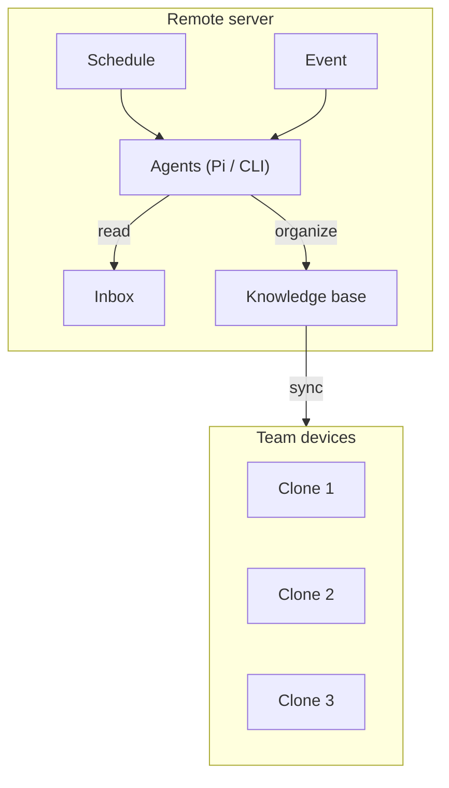
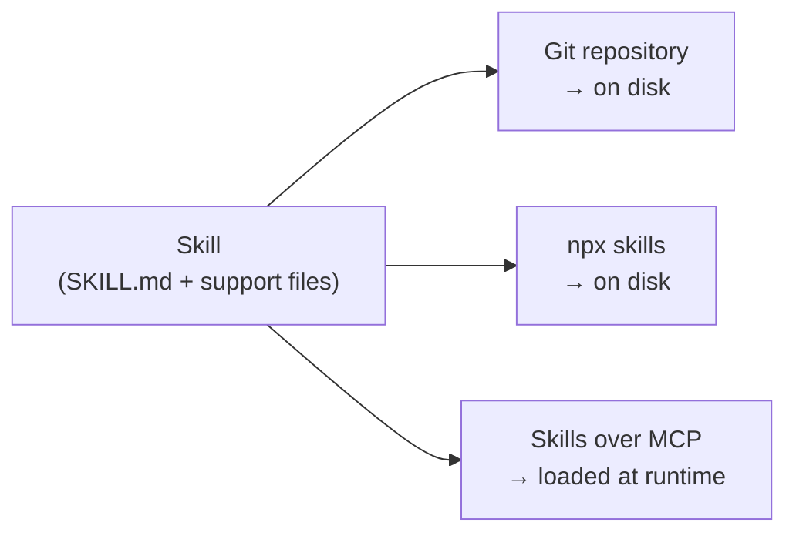

# 9. Teamwork — internal knowledge base and AI-friendly tool stack

> Shared skills are not enough. The team also needs an **internal knowledge base** agents can query, and a **tool stack** chosen for how well it works with AI — not just with humans.

Related: [03 Skill and folder orchestration](03_Skill_And_Folder_Orchestration.md) · [04 COMPUTERS.md](04_Computers_md_Fleet_Infrastructure.md) · [10 Automation](10_Automation_Repository_Agents.md) · [Lecture 3: 5 Knowledge as files](../Lecture_3_Simplify_Codebase_&_Knowledge_Base/05_Knowledge_As_Files_For_Agents.md) · [Lecture 3: 11 KB techniques](../Lecture_3_Simplify_Codebase_&_Knowledge_Base/11_Knowledge_Base_Problems_And_Known_Techniques.md) · [Lecture 3: 12 Update triggers](../Lecture_3_Simplify_Codebase_&_Knowledge_Base/12_Knowledge_Event_&_Triggers.md)

Source: S01E04 transcript (teamwork section), see [Fact-check](#fact-check).

## 1. The problem

Skills and rules (covered in [03](03_Skill_And_Folder_Orchestration.md)) are one part of teamwork. But agents also need access to **organizational knowledge** — product decisions, architecture context, customer patterns, incident history. And the tools the team uses determine how much agents can do — a tool with no API is a tool agents can't touch.

## 2. Internal knowledge base

The lecturer describes a knowledge base with its own API, available to agents through CLI or MCP:

Key points:
- Documents live on a **remote server**, managed by an agent
- The agent **organizes incoming information** and makes changes requested by team members
- **Scheduled workflows** keep documents organized and up to date
- Team devices get **synced clones** — everyone reads the same knowledge

This builds directly on [Lecture 3: 5 Knowledge as files](../Lecture_3_Simplify_Codebase_&_Knowledge_Base/05_Knowledge_As_Files_For_Agents.md) — the agent maintains the knowledge base, humans get a read-only bridge.

## 3. AI-friendly tool stack

The tools a team uses **directly define** how much it can do with AI. The lecturer shares the MEGA team's stack as an example:

| Category | Tools | Why they're AI-friendly |
|---|---|---|
| Observability | PostHog, Axiom | APIs for querying data, events, logs |
| Build / storage | Vercel, Minio, Depot, Cloudflare + Alchemy, Tailscale, UploadThing | CLI and API-first, agents can deploy and manage |
| Agent surfaces | Pi, Herdr, Moshi, OpenRouter | Built for agent workflows |
| Typed app substrate | XState, Effect, oxlint, mdsvex | Strong types = better agent comprehension |
| Auth / backend | Clerk, Convex | API-first, agents can manage users and data |
| Work the agent can write | Linear, Stripe, Resend, Attio | APIs agents can call directly (create issues, send emails, manage CRM) |
| Design | Paper, Figma | Emerging AI integration |

The principle: **choose tools the agent can use, not just tools humans like.** A tool with a good CLI or MCP server is more valuable than one with a better UI but no API.

## 4. Sharing skills across a team

Three distribution methods (from the transcript):

| Method | Pros | Cons |
|---|---|---|
| Git repo | Version-controlled, reviewable, familiar | Manual sync, disk footprint |
| [npx skills](https://github.com/vercel-labs/skills) | One command install, versioned | JS ecosystem dependency |
| [Skills over MCP](https://modelcontextprotocol.io/community/working-groups/skills-over-mcp) | No install, always current | Protocol still maturing |

Key requirement: skills must be **shared** and easy to keep **up to date**.

## 5. My take

The AI-friendly tool stack point is underrated. Every tool choice is now also an "can agents use this?" decision. A project management tool without an API means agents can't read or create tickets. A design tool without MCP means agents can't access specs. The cost of choosing AI-unfriendly tools compounds across the team.

For the internal knowledge base, the pattern from Lecture 3 applies: build it for agents first, give humans a read-only view. The remote server + sync model makes this a team-wide resource instead of one person's local files.

## Fact-check

| # | Claim | Verdict | Source | Checked |
|---|---|---|---|---|
| 1 | npx skills from Vercel Labs exist | **Agrees** | [vercel-labs/skills](https://github.com/vercel-labs/skills) repository exists | 2026-11-08 |
| 2 | Skills over MCP is an active working group | **Agrees** | [MCP community working group](https://modelcontextprotocol.io/community/working-groups/skills-over-mcp) page exists | 2026-11-08 |
| 3 | The MEGA team uses the listed tools | **Lecture-specific** | Lecturer's own stack. I haven't verified each tool's AI-friendliness independently. | 2026-11-08 |
| 4 | Tool choice directly defines AI capability | **Agrees** | General principle in AI engineering — tools without APIs are invisible to agents. Not controversial. | 2026-11-08 |
