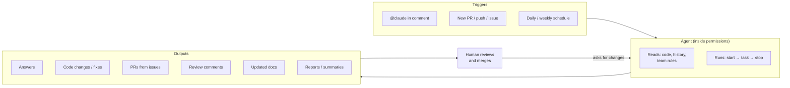

# 10. Automation — repository agents and background workflows

> Agents that run in GitHub comments, on PRs, on schedule — almost entirely in the background. They review code, enrich issues, fix small bugs, keep docs up to date. The human reviews and merges. That's the loop.

Related: [07 Multi-agent coordination](07_Multi_Agent_Coordination.md) · [06 Self-management](06_Self_Management_Pi_Herdr.md) · [04 COMPUTERS.md](04_Computers_md_Fleet_Infrastructure.md) · [Lecture 3: 12 Update triggers](../Lecture_3_Simplify_Codebase_&_Knowledge_Base/12_Knowledge_Event_&_Triggers.md)

Source: S01E04 transcript (automated workflows section), see [Fact-check](#fact-check).

## 1. The problem

There are tasks I do repeatedly that agents could handle: reviewing PRs, turning issues into implementations, keeping docs in sync, cleaning up dead code. These run in the background, triggered by events. How do I set them up, and what's the loop?

## 2. The trigger → agent → human loop

The agent always runs inside **permissions** — it can read code, history, and rules, but a human reviews the result. The human merges or asks for changes.

## 3. What repository agents can do

The lecturer's own list of uses is kept in the root [README](../README.md#the-lecturers-reference-setup). The table below adds a trigger and the agent's action for each.

| Task | Trigger | What the agent does |
|---|---|---|
| **PR review** | New PR | Reads the diff, applies [review rules](https://github.com/MEGA-DOT-DEV/examples/tree/main/examples/pr-review-rules), leaves comments |
| **Issue → PR** | New issue / `@agent` mention | Reads the issue, enriches it with context, creates a PR with implementation |
| **Doc updates** | Push to main / schedule | Detects changed modules, updates relevant docs |
| **Small bug fixes** | Issue labeled `auto-fix` | Reads the bug report, creates a fix PR |
| **Dependency checks** | Schedule | Scans for outdated/vulnerable dependencies, opens PRs |
| **Dead code cleanup** | Schedule | Finds unused code, creates cleanup PRs |
| **PR routing** | New PR | Assigns to the person responsible for the changed feature |
| **Data gathering** | Schedule / event | Collects data from external systems or team members |

## 4. Harnesses with GitHub integration

Several harnesses support this natively:

| Harness | Integration |
|---|---|
| [Claude Code](https://code.claude.com/docs/en/github-actions) | GitHub Actions, `@claude` in comments |
| [Cursor](https://cursor.com/docs/cli/github-actions) | GitHub Actions |
| [Devin](https://devin.ai/) | GitHub integration, autonomous agent |
| [CodeRabbit](https://www.coderabbit.ai/) | PR review bot |

## 5. Beyond GitHub — VPS deployment

The Pi + Herdr setup from [06 Self-management](06_Self_Management_Pi_Herdr.md) can be moved to a VPS and connected to GitHub. This gives:
- Agents that run permanently (not just on CI trigger)
- Full control over the environment
- Connection to external services beyond GitHub

The lecturer says this will be covered in later lessons.

## 6. My take

Repository agents are the lowest-risk automation to start with. They run in a sandboxed CI environment, they produce PRs that humans review, and the blast radius of a mistake is a bad PR that gets closed.

The key is setting good [review rules](https://github.com/MEGA-DOT-DEV/examples/tree/main/examples/pr-review-rules) — without them, the agent either reviews everything (noise) or misses the important things.

For my work, PR review and doc updates are the immediate wins. Issue-to-PR automation needs more thought — the quality depends heavily on how well the issue is written, which means the issue template matters as much as the agent.

## Fact-check

| # | Claim | Verdict | Source | Checked |
|---|---|---|---|---|
| 1 | Claude Code supports GitHub Actions integration | **Agrees** | [Claude Code docs](https://code.claude.com/docs/en/github-actions) | 2026-11-08 |
| 2 | CodeRabbit is an AI PR review tool | **Agrees** | [coderabbit.ai](https://www.coderabbit.ai/) — exists and is widely used | 2026-11-08 |
| 3 | PR review rules example exists in course repo | **Agrees** | [pr-review-rules example](https://github.com/MEGA-DOT-DEV/examples/tree/main/examples/pr-review-rules) exists | 2026-11-08 |
| 4 | Pi + Herdr can be deployed to a VPS for permanent agents | **Lecture-specific (opinion)** | Lecturer says this will be discussed in later lessons. Not demonstrated in this lecture. | 2026-11-08 |
