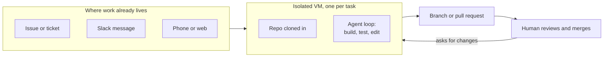

# 11. Cloud coding agents

> "Cloud agent" names two different things. **Cloud coding agents** (Cursor Cloud Agents, Claude Code in the cloud) are ready-made developer agents that run in a remote VM and return a branch or PR. **Agent hosting platforms** (Bedrock AgentCore, Azure AI Foundry) host an agent I build myself. The lecture means the first one. I want to come back to this note.

Related: [01 Harness lock-in](01_Harness_Lock-in_Keep_Doors_Open.md) · [06 Self-management](06_Self_Management_Pi_Herdr.md) · [07 Multi-agent coordination](07_Multi_Agent_Coordination.md) · [10 Automation](10_Automation_Repository_Agents.md) · [02 Agent runner portability](02_Agent_Runner_Portability.md) · [04 COMPUTERS.md](04_Computers_md_Fleet_Infrastructure.md) · [Lecture 2: 12 Subagents vs workers](../Lecture_2_Context_Agents_md_Skills_Tools/12_subagents_vs_workers.md)

Source: S01E04 transcript ("Critical Features": self-management and cloud agents), then my own web search on 2026-11-08. Vendor facts come from search results that summarize vendor docs; I did not open each doc page in full. See [Fact-check](#fact-check).

## 1. The problem

The lecture lists "cloud agents" next to self-management as a critical feature worth switching harnesses for, and gives no detail. I only knew the other meaning: Bedrock Agents, AgentCore, AI Foundry, where I deploy an agent and run it at scale. Are these the same thing, and why would one be "critical"?

## 2. Words refinement

Two terms share one name. I split them.

| Term | What it is |
|---|---|
| **Cloud coding agent** | A coding harness run by a vendor in a remote, isolated VM, with the repo already cloned. I hand it a task. It returns a branch or pull request. |
| **Agent hosting platform** | A managed runtime where I deploy **my own** agent code and call it through an API. |
| **Self-hosted cloud agent** | A cloud coding agent whose tool calls or sessions run on **my** hardware. The vendor still supplies the agent. |
| **Local agent** | The harness runs on my machine, in my terminal. |

## 3. Comparison

| | **Cloud coding agents** (the lecture's meaning) | **Agent hosting platforms** (what I knew) |
|---|---|---|
| Examples | Cursor Cloud Agents, Claude Code in the cloud, Codex cloud, Jules, Devin | Bedrock Agents, Bedrock AgentCore, Azure AI Foundry Agent Service |
| What I get | A ready-made developer agent with a full dev environment | A runtime where I deploy my own agent |
| Unit of work | A task that comes back as a branch or pull request | Whatever my agent app does |
| Environment | Isolated VM per agent with the repo cloned in. It builds, tests and can use a browser | Serverless runtime. AgentCore uses microVMs and works with any framework or model |
| Trigger | Phone, Slack, GitHub, Linear, web, or `claude --cloud` | API call from my own app |
| Who writes the agent loop | The vendor | Me |
| Main lock-in | The cloud environment config and the vendor's harness | The platform's runtime contract and identity model |

**The story:** the agent loop is the same one I run locally. What changes is where it runs and how it starts. That is why the unit of work becomes a ticket, not a conversation.

**What is important:** the unlock is operational, not technical.
- My laptop can be off.
- Many tasks run in parallel, each in its own sandbox.
- Tasks start from where work lives (an issue, a Slack message).
- The PR is the review gate.

**What is not important:** the VM technology itself. Firecracker, Ubuntu images and snapshots are implementation details that will change.

## 4. What the vendor docs say

All of this comes from search results that summarize vendor docs. I did not read the pages in full.

**Cursor Cloud Agents** ([docs](https://cursor.com/docs/cloud-agent)):
- Each agent runs in its own cloud VM with a full development environment.
- I can build the environment with an agent, from a saved snapshot, or from a Dockerfile in `.cursor/environment.json`.
- Admins can restrict outbound domains, add secrets, and connect private networks through Tailscale or Cloudflare Tunnel.
- I can take over the agent's desktop to test changes without checking out the branch.
- Self-Hosted Machines run tool calls on my hardware while the agent loop stays in Cursor's cloud.

**Claude Code in the cloud** ([docs](https://code.claude.com/docs/en/claude-code-on-the-web)):
- Each session gets an isolated, Anthropic-managed VM.
- Claude clones the selected GitHub repo, makes changes and pushes a branch.
- The session keeps running if I close my laptop.
- Sessions start from claude.ai/code, the mobile app, the Desktop app, or `claude --cloud`.
- Network access is limited by default. Organizations can route sessions to their own runners.

**Bedrock AgentCore Runtime** ([docs](https://docs.aws.amazon.com/bedrock-agentcore/latest/devguide/what-is-bedrock-agentcore.html)):
- A serverless runtime for deploying and scaling agents and tools.
- Works with open-source frameworks (Strands, LangGraph, CrewAI) and with models inside or outside Bedrock.
- A custom container must expose `/invocations` and `/ping`.
- This is a hosting contract, not a ready-made agent. It sits in the second column.

## 5. Local vs cloud

The trade-off from secondary sources (verify before presenting):

| | Local agent | Cloud agent |
|---|---|---|
| Steering | Tight, mid-task | Hands-off delegation |
| Parallelism | Separate git worktrees on my machine (see [07](07_Multi_Agent_Coordination.md)) | One sandbox per task |
| Best for | Uncertain, exploratory work | Known, well-scoped, parallel tickets |
| Isolation | My machine's permissions | Discarded VM per task |

I read this as complementary. Local for the work I need to steer. Cloud for tickets I can describe fully.

## 6. My take

My first reaction was "this is just a cloud platform where I run an agent". For the hosting platforms that is right. For cloud coding agents it misses the point. Nothing here is technically hard. The value is that **the harness, the environment and the trigger come as one product**, so I get parallel delegation without building any of it.

That is also the lock-in risk. In [01](01_Harness_Lock-in_Keep_Doors_Open.md) I mark "cloud agents / managed environments" as not portable. The environment definition (for example Cursor's `.cursor/environment.json`) is vendor-specific. If I use one, I keep the task description and rules in portable files and treat the environment config as the thin adapter.

For my platform work the self-hosted variants matter most. The agent loop stays with the vendor, and execution moves to my network. That is a different trust boundary from "my repo is cloned onto their VM".

## 7. Cautions

- **Restricted data:** cloud sessions clone the repo onto vendor-managed VMs and send code context to the vendor. For internal source code I check the [AI Solutions Catalog](http://aitools.aras.com/) first, as the organization instructions require. This note holds no business detail.
- **Privacy mode:** one secondary source says organizations that enforce Cursor's Privacy Mode cannot use background agents. Unverified.
- **Vendor numbers:** a vendor-reported "30% of Cursor's own merged PRs come from these agents" is marketing until independently checked.
- **Product names move:** Cursor renamed background agents to Cloud Agents. Re-check names and plans before presenting.

## 8. Open questions (to return to)

1. Which of these can I use under Aras rules, and in which configuration (vendor cloud, self-hosted machines, own runners)?
2. Can a cloud coding agent run against my own fleet (see [04](04_Computers_md_Fleet_Infrastructure.md)) instead of the vendor's VMs?
3. How much of a cloud environment definition can I keep in a portable form (Dockerfile, setup script) so switching vendors is cheap?
4. Would AgentCore (or similar) host a coding agent I wrote myself, and what would I lose compared with a vendor's cloud coding agent?
5. How do cost and speed compare with local workers and git worktrees for the same ticket set?
6. How would a coordinator hand tickets to cloud agents and collect PRs (a link to [07](07_Multi_Agent_Coordination.md) and [10](10_Automation_Repository_Agents.md))?

## Fact-check

Checked 2026-11-08. "Search summary of vendor docs" means I saw the vendor page named in a search result summary, not the full page.

| # | Claim | Verdict | Source | Checked |
|---|---|---|---|---|
| 1 | Cursor cloud agents run in isolated per-agent VMs with a full dev environment | **Agrees** (search summary of vendor docs) | [Cursor: Cloud Agents](https://cursor.com/docs/cloud-agent), [Setup](https://cursor.com/docs/cloud-agent/setup) | 2026-11-08 |
| 2 | Cursor environments can come from a snapshot or a Dockerfile in `.cursor/environment.json` | **Agrees** (search summary of vendor docs) | [Cursor: Cloud Environment Setup](https://cursor.com/docs/cloud-agent/setup) | 2026-11-08 |
| 3 | Cursor offers self-hosted machines where tool calls run on my hardware | **Agrees** (search summary of vendor docs) | [Cursor: self-hosted cloud agents](https://cursor.com/blog/self-hosted-cloud-agents) | 2026-11-08 |
| 4 | Cursor VM snapshot retention | **Unverified** | Two Cursor security pages in the results disagree (30 vs 90 days of inactivity). I did not resolve it. | 2026-11-08 |
| 5 | Claude Code cloud sessions run in an Anthropic-managed VM, clone the repo, push a branch, and keep running with the laptop closed | **Agrees** (search summary of vendor docs) | [Claude Code docs: cloud](https://code.claude.com/docs/en/claude-code-on-the-web), [Anthropic announcement](https://www.anthropic.com/news/claude-code-on-the-web) | 2026-11-08 |
| 6 | Claude Code cloud sessions can be routed to an organization's own runners | **Agrees** (search summary of vendor docs) | [Claude Code docs: cloud](https://code.claude.com/docs/en/claude-code-on-the-web) | 2026-11-08 |
| 7 | Bedrock AgentCore Runtime is a serverless runtime for my own agents, framework- and model-agnostic | **Agrees** (search summary of vendor docs) | [AWS: AgentCore overview](https://docs.aws.amazon.com/bedrock-agentcore/latest/devguide/what-is-bedrock-agentcore.html), [Runtime microVMs](https://docs.aws.amazon.com/bedrock-agentcore/latest/devguide/runtime-how-it-works.html) | 2026-11-08 |
| 8 | Codex cloud, Jules and Devin work asynchronously against repos | **Unverified — verify before presenting** | Secondary blogs only, e.g. [Background and cloud agents compared](https://developertoolkit.ai/en/workflows/automate/background-agents/) | 2026-11-08 |
| 9 | Local = steerable, cloud = parallel and hands-off | **Unverified — verify before presenting** | Secondary: [Three-tier agent orchestration](https://codex.danielvaughan.com/2026/04/09/three-tier-agent-orchestration/). Plausible, not primary. | 2026-11-08 |
| 10 | Organizations with Cursor Privacy Mode cannot use background agents | **Unverified — verify before presenting** | Secondary only. Check Cursor docs. | 2026-11-08 |
| 11 | 30% of Cursor's merged PRs are created by cloud agents | **Unverified** | Vendor-reported figure found in a secondary source. Not independently checked. | 2026-11-08 |
| 12 | Cloud agents are a "critical feature" worth switching harnesses for | **Lecture-specific (opinion)** | Lecturer's claim in the transcript. My view in section 6. | 2026-11-08 |
| 13 | Cloud agent environment config is vendor-specific and not portable | **My interpretation** | Based on Cursor's `.cursor/environment.json` being Cursor-specific. No cross-vendor standard found. | 2026-11-08 |
