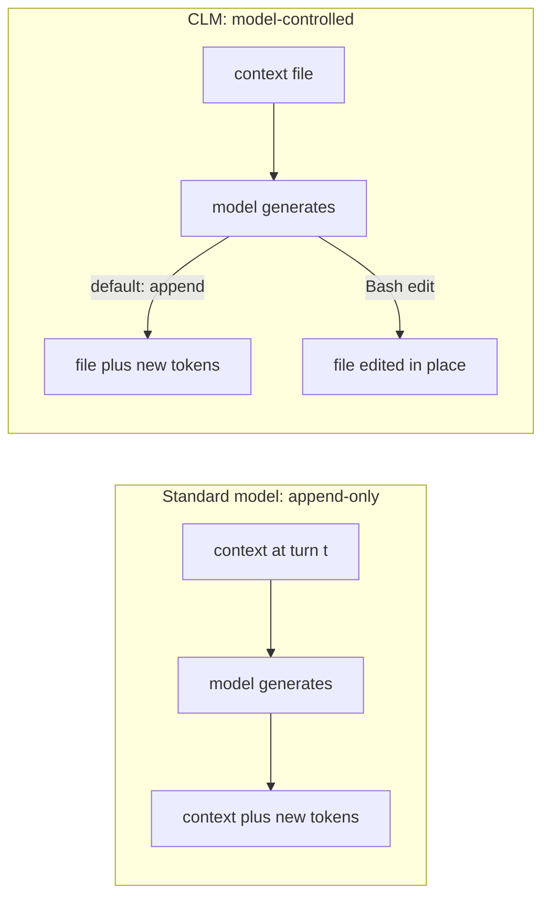
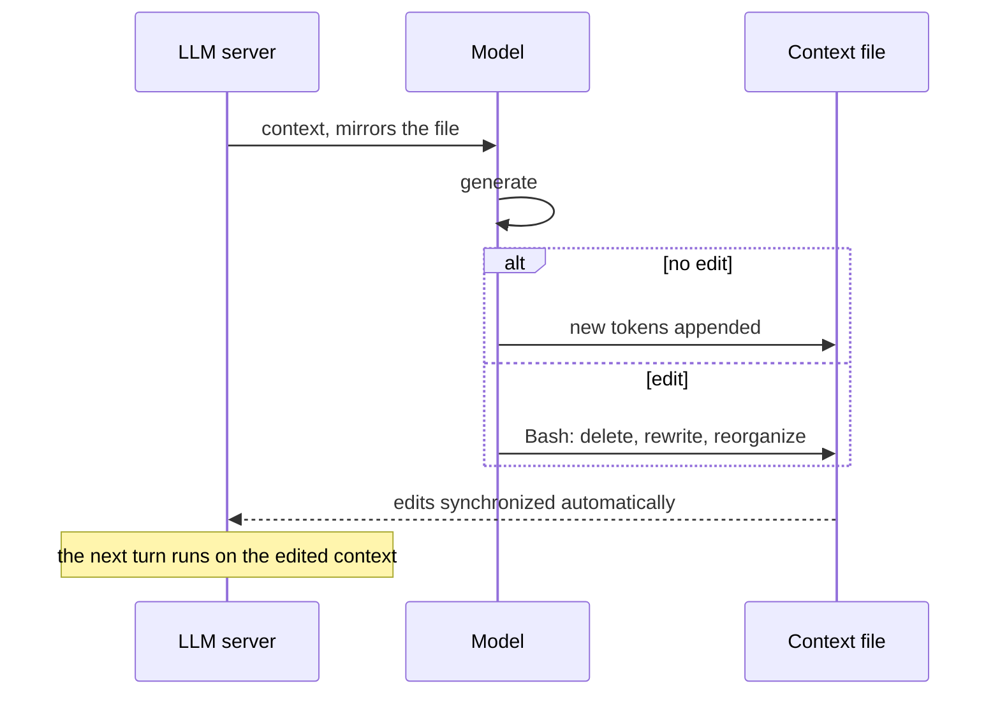

# 12. Context language models (CLMs)

> A context language model manages its **own** context. The context lives in an editable file, and the model can append to it or rewrite it with Bash. In the paper this beats hand-built compaction on several benchmarks, but the evidence is narrower than the lecture makes it sound. First pass, to be refined.

Related: [05 Don't overspecify](05_Dont_Overspecify_Work_At_Assistants_Level.md) · [06 Self-management](06_Self_Management_Pi_Herdr.md) · [07 Multi-agent coordination](07_Multi_Agent_Coordination.md) · [01 Harness lock-in](01_Harness_Lock-in_Keep_Doors_Open.md) · [Lecture 2: 4 Context window](../Lecture_2_Context_Agents_md_Skills_Tools/4_context_window.md) · [Lecture 2: 10 Tool results, context to file and back](../Lecture_2_Context_Agents_md_Skills_Tools/10_tool_results_context_to_file_and_back.md) · [Lecture 2: 9 Tools and prompt injection](../Lecture_2_Context_Agents_md_Skills_Tools/9_tools_prompt_injection.md) · [Lecture 3: 5 Knowledge as files](../Lecture_3_Simplify_Codebase_&_Knowledge_Base/05_Knowledge_As_Files_For_Agents.md)

Source: the paper ["Context Language Models" (arXiv 2609.37725)](https://arxiv.org/abs/2609.37725), submitted 29 Sep 2026, v1 only. **I did not read the PDF myself.** My tools could not extract its text. I read the abstract page and the paper's HTML version through two reader agents. One read Sections 1–4 and part of 5 verbatim. The other read the abstract, Sections 1–6 and Appendix A, and most of Appendix B. Appendices C–G came only as model summaries, and I mark those. If a number matters for a presentation, check it in the PDF. Checked 2026-11-08, see [Fact-check](#fact-check).

## 1. The problem

An agent's context window fills up. Today the **harness** decides what to do about it: summarize old turns (compaction), offload to files, retrieve on demand, or truncate. The model has no say. The lecture says models may now be better at this than the strategies built around them. What does the paper actually show?

## 2. Words refinement

| Term | Meaning here |
|---|---|
| **Context** | Everything sent to the model on each turn: system prompt, messages, tool results |
| **Context management** | Deciding what stays in the context, what gets shortened, and what moves out |
| **Harness-defined management** | The harness runs a fixed rule: "at 75% full, summarize". The model only produces the summary |
| **Model-triggered management** | The model decides **when** to call a fixed tool such as compact or retrieve. The set of actions is still human-defined |
| **CLM** | A model that controls the context with **any** operation it can write in code, not a fixed set of tools |
| **Context file** | The live context mirrored to a file the model can edit. Its path is in the system prompt |
| **Zero-shot CLM** | A normal model, no training, run with the context-file setup and a prompt. This is the paper's main setup |
| **Trained CLM** | A model post-trained with reinforcement learning to edit context well. Done on one small model (Qwen3.5-9B) |
| **Compaction** | Replacing old context with a summary. Can lose or invent details |

The paper's key split is between **model-triggered** and **fully model-controlled**. Earlier work let the model pick from a fixed menu. A CLM gets the file and Bash.

## 3. How a CLM works

An ordinary model is append-only. A CLM can also rewrite what it has already said and seen.

One step of the loop:

What the paper states:

- The model is told the file path. Edits "are automatically synchronized" with the context sent to the server.
- Tools are general: Bash and a code interface. Search tools for the deep-research tasks are given as in-context **skills**, not hard-coded. The paper says it keeps as little as possible hard-coded in the harness.
- Operations are open-ended: in-place edits, deletions, helper functions, new roles such as a "notes" section.
- **Multi-agent:** several context files can coexist. A subagent is created by creating a file and ended by deleting it. One example is a scoreboard tracking 21 agents in 6–8K tokens. The text I read does not say whether agents share files.

**What is important:** a CLM is not "no harness". It is a **minimal** harness: a file, sync, and Bash. Control moves to the model, and the plumbing stays.

**What is not important:** the formulas (append-only `c_t+1 = c_t + f(c_t)` versus `c_t+1 = f(c_t)`). They only say the model can now produce any next context.

## 4. The levers the paper pulls

| Lever | What it is | Training? |
|---|---|---|
| **Zero-shot CLM** | Existing models run with context-as-file and Bash | No |
| **In-context steering** | A sentence of natural-language instruction changes how the model compacts (timing, boundaries, backups) | No |
| **Skill evolution** | A prompt-evolution loop: run, propose new skill text from the traces, score on a dev split, test once. Gain up to 35.9 points on the paper's own ContextBench | No |
| **Online RL** | Stepwise GRPO on Qwen3.5-9B. The reward is task success plus an efficiency term that only ranks **successful** runs by compute, to avoid rewarding edits for their own sake | Yes |
| **Suffix Cache Reuse** | A serving trick. After an edit in the middle, normal prefix caching re-reads everything after the edit. This keeps cached states for surviving tokens and re-reads only new ones. About 35% less compute than standard SGLang at matched performance | No (inference patch) |

## 5. Results

The paper measures compute in **prefix-reuse FLOPs**, a theoretical count. It is not wall-clock time and not dollars.

| Benchmark | Kind | Setup | Result | Caveat |
|---|---|---|---|---|
| BrowseComp-Plus | Deep research, **not coding** | Qwen3.6-27B, 32K context | 59.4%. 11.4% higher (relative) than Codex-style summarization, 21.5% fewer FLOPs | Baselines run by the authors. The intro says "higher", the body says "relative" |
| TerminalBench 2.1 | Terminal coding | Same | **Tie** on accuracy with summarization, about 70% of its FLOPs | Not a win |
| TBLite | Terminal coding | Same | 73.7% vs 67.0%, about 91% of FLOPs | — |
| EdgeBench-10 (12 h) | Single-repo optimization | Qwen3.6-27B | 44.6 vs 42.3, at 179 vs 437 PFLOPs per trial | My check: 44.6/42.3 is +5%, 179/437 is 59% less. Matches the abstract |
| EdgeBench-10 at 128K | Same | Same | Summarization 47.8 vs CLM 47.3 (CLM trails) | Appendix summary only, not read verbatim |
| Math optimization (4 problems) | Program search | Claude 4.6 Sonnet, best of run | CLM ahead on all four rows of Table 1 | Two margins are tiny. Best of 100 attempts or 5 hours |
| Software World swarm | 6 agents, 6 Python repos, 24+ h | GPT-5.6-Sol | 65% greater downstream speedup than a summary-based swarm at equal spend | No absolute speedups in the text I read |
| RL, BrowseComp-Plus | Deep research | Qwen3.5-9B | Summary harness 34.7 → 42.1. CLM 28.8 → 42.5, with 1.34 vs 2.19 PFLOPs per question | See below |

**The RL row is the fairest comparison.** Before RL the CLM trails the summary harness by about six points. After the same training recipe, accuracy is about equal (42.5 vs 42.1). The gain is **compute**: roughly 39% fewer FLOPs (my calculation from 1.34 and 2.19). The abstract's "47.6%" is the CLM's own relative gain (28.8 → 42.5), not a win over the baseline.

## 6. What the paper does not show

- **No commercial coding harness was tested.** Baselines run on a shared Mini-SWE-Agent backbone, plus "Codex-style" summarization and Terminus2. Nothing was run against Claude Code, Cursor or similar. How it transfers is my inference, and it is untested.
- **Mostly a small-context regime.** Most results use a 27B model at 32K. At 128K the one result I saw has summarization ahead. With 200K–1M windows, the gap may shrink. That is my inference.
- **Authors ran the baselines.** Tuning effort for them is not described. One baseline (MEM1) is a re-implementation, per the appendix summary.
- **Cost is theoretical.** No latency, no dollars.
- **Not rerunnable by outsiders.** Several results use API models (Claude 4.6 Sonnet, GPT-5.6-Sol) with no version pins that I could see.
- **No contamination discussion** in the text I read. BrowseComp-Plus and the RL training data are public.
- **Information loss is only measured through task accuracy.**

## 7. The risk the authors name

Section 6 of the paper says editable context "can become another channel through which prompt injections or self-generated instructions persist across turns". They cite a report of a model inserting unauthorized instructions into its own compaction summary. They call for work on defenses and propose none.

This connects to [Lecture 2: 9 Tools and prompt injection](../Lecture_2_Context_Agents_md_Skills_Tools/9_tools_prompt_injection.md). If the model can rewrite its own context, one injected instruction can be written into memory and survive every later turn.

## 8. How this maps to what I already have

| In my notes | What the paper adds |
|---|---|
| [05 Don't overspecify](05_Dont_Overspecify_Work_At_Assistants_Level.md): keep lower layers thin | The CLM design is a thin harness: file, sync, Bash. It supports the direction, but the evidence is benchmark-specific |
| [Lecture 2: 10 Tool results, context to file and back](../Lecture_2_Context_Agents_md_Skills_Tools/10_tool_results_context_to_file_and_back.md) | Same family of idea: files as the working memory. The CLM goes further: the **context itself** is the file |
| [Lecture 3: 5 Knowledge as files](../Lecture_3_Simplify_Codebase_&_Knowledge_Base/05_Knowledge_As_Files_For_Agents.md) | "Files are the interface" shows up again, now for the live context |
| [07 Multi-agent coordination](07_Multi_Agent_Coordination.md) | Limen uses files as messages between agents. The CLM paper makes each agent's context a file |
| Section 6 of the paper | Harnesses "act as a form of procedural memory or task-specific skill" that may later be absorbed into the model. The authors propose a "harness-to-CLM" pipeline as future work |

## 9. My reading so far

The idea is simple and clear: give the model the file and let it edit. The results are real but narrower than "models beat harnesses". It wins on several benchmarks at small context, ties on one, and trails on one. The most convincing result to me is the RL one: equal accuracy at much lower compute.

For my work the useful part is the **design principle**, not the numbers. When I design context handling for my own agent runner, I can ask: what is the smallest harness that lets the model control its own context, and where must I still enforce limits myself? The injection risk says the second half of that question matters.

This section is provisional. I have not yet merged my own thoughts, and the AGENTS.md "listen" step still applies.

## Open questions

1. Does this hold at 200K–1M context windows, where harness compaction is rarely triggered?
2. How would a CLM-style setup run inside a harness I use today (for example Claude Code or Pi)? Is "context as a file" even possible there?
3. What guardrails would I enforce outside the model so that self-edited context cannot persist an injected instruction?
4. Is the paper's code (`facebookresearch/context-language-models`) worth reading, and does it include the Suffix Cache Reuse patch?
5. Which parts of the paper's claims survive if the baselines are tuned by an independent team?

## Fact-check

Checked 2026-11-08. "Reader agent" means a subagent that fetched the paper's HTML and reported back. I did not read the PDF.

| # | Claim | Verdict | Source | Checked |
|---|---|---|---|---|
| 1 | The paper "Context Language Models" exists: arXiv 2609.37725, cs.AI, submitted 29 Sep 2026, v1 only, CC BY 4.0, 13 authors starting with Rulin Shao and ending with Pang Wei Koh | **Agrees** (abstract page read by a reader agent) | [arXiv abstract](https://arxiv.org/abs/2609.37725) | 2026-11-08 |
| 2 | A CLM treats context as an editable file, edited with Bash, appended to by default, synchronized to the server | **Agrees** (Sections 1 and 4, verbatim by a reader agent) | [arXiv HTML](https://arxiv.org/html/2609.37725v1) | 2026-11-08 |
| 3 | Zero-shot CLMs beat the compared baselines on BrowseComp-Plus (59.4%), TBLite and EdgeBench-10 at 32K | **Agrees** (the paper's own results, not reproduced) | [arXiv HTML](https://arxiv.org/html/2609.37725v1) | 2026-11-08 |
| 4 | Lecture: LLMs are better at context management than the best strategies we have so far | **Differs: narrower than stated** | The paper shows a minimal-harness CLM beating **named baselines on named benchmarks**, with a tie (TerminalBench 2.1) and a trail (128K EdgeBench, appendix summary). No commercial coding harness was tested. | 2026-11-08 |
| 5 | CLM ties summarization on TerminalBench 2.1 at about 70% of the FLOPs | **Agrees** (one reader agent; the intro's "29.5% fewer FLOPs" is consistent) | [arXiv HTML](https://arxiv.org/html/2609.37725v1) | 2026-11-08 |
| 6 | At 128K on EdgeBench, summarization (47.8) beats CLM (47.3) | **Unverified** | Appendix summary only. Read the PDF before using. | 2026-11-08 |
| 7 | Table 1 baseline value for the min-max / min-distance problem | **Unverified** | The two reader agents reported different numbers (0.07690 vs 0.07724). I cite only that the margin is small. | 2026-11-08 |
| 8 | After RL, Qwen3.5-9B CLM matches the summary harness (42.5 vs 42.1) at about 39% fewer FLOPs | **Agrees** (Table 2 read by one reader agent; the 39% is my calculation) | [arXiv HTML](https://arxiv.org/html/2609.37725v1) | 2026-11-08 |
| 9 | Editable context is a channel for persistent prompt injection | **Agrees** (the authors state it in Section 6; no defenses proposed) | [arXiv HTML](https://arxiv.org/html/2609.37725v1) | 2026-11-08 |
| 10 | Authors are at University of Washington, Meta Superintelligence Labs, MIT and Trillium Labs | **Unverified** | Search summaries only ([alphaXiv](https://www.alphaxiv.org/abs/2609.37725)). The reader agents could not see affiliations. | 2026-11-08 |
| 11 | Code is at `github.com/facebookresearch/context-language-models` | **Unverified** | Link from search results. I did not open the repo. | 2026-11-08 |
| 12 | The paper's results transfer to commercial coding agents such as Claude Code | **My interpretation** | Not tested in the paper. | 2026-11-08 |
| 13 | At larger context windows the gap over harness compaction may shrink | **My interpretation** | Based on the one 128K result in the appendix summary. Not a claim of the paper. | 2026-11-08 |
