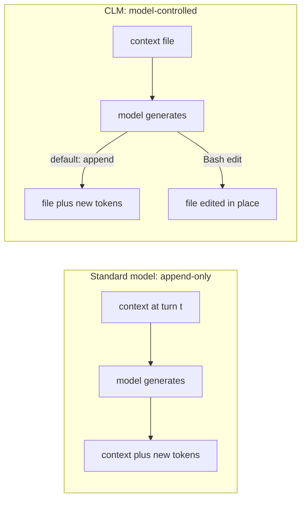
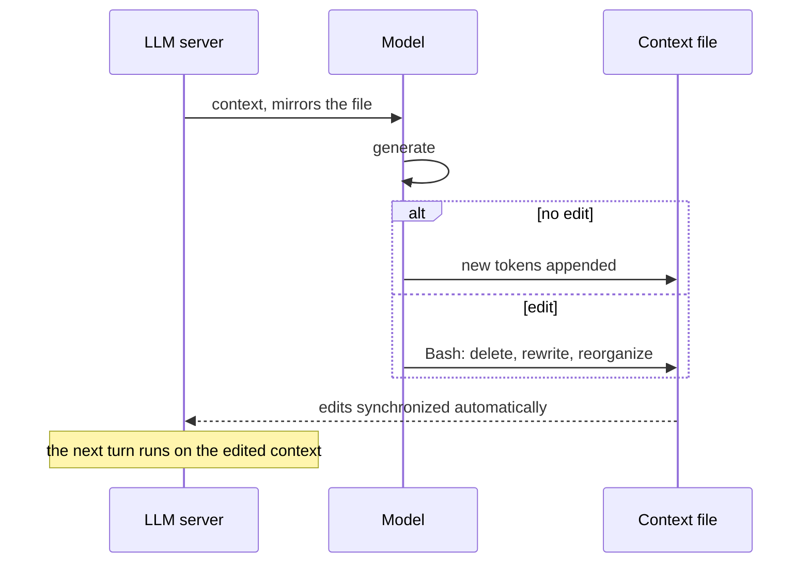
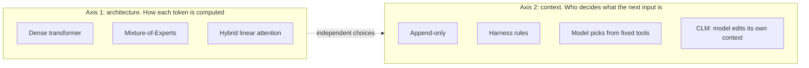

# 12. Context language models (CLMs)

> A context language model manages its **own** context. The context lives in an editable file, and the model can append to it or rewrite it with Bash. In the paper this beats hand-built compaction on several benchmarks, but the evidence is narrower than the lecture makes it sound. First pass, to be refined.

Related: [05 Don't overspecify](05_Dont_Overspecify_Work_At_Assistants_Level.md) · [06 Self-management](06_Self_Management_Pi_Herdr.md) · [07 Multi-agent coordination](07_Multi_Agent_Coordination.md) · [01 Harness lock-in](01_Harness_Lock-in_Keep_Doors_Open.md) · [Lecture 2: 4 Context window](../Lecture_2_Context_Agents_md_Skills_Tools/4_context_window.md) · [Lecture 2: 10 Tool results, context to file and back](../Lecture_2_Context_Agents_md_Skills_Tools/10_tool_results_context_to_file_and_back.md) · [Lecture 2: 9 Tools and prompt injection](../Lecture_2_Context_Agents_md_Skills_Tools/9_tools_prompt_injection.md) · [Lecture 3: 5 Knowledge as files](../Lecture_3_Simplify_Codebase_&_Knowledge_Base/05_Knowledge_As_Files_For_Agents.md)

Source: the paper ["Context Language Models" (arXiv 2609.37725)](https://arxiv.org/abs/2609.37725), submitted 29 Sep 2026, v1 only. Second pass: I read the **full PDF text** (27 pages, extracted locally with a PDF library). Chart and figure contents did not extract, so numbers that appear only inside figures come from captions and axis labels, and I mark those. The code repo was read through a reader agent, from its README pages. The first pass used the HTML version through reader agents, and where the PDF corrected it I say so in the [Fact-check](#fact-check). Checked 2026-11-08, see [Fact-check](#fact-check).

## 1. The problem

An agent's context window fills up. Today the **harness** decides what to do about it: summarize old turns (compaction), offload to files, retrieve on demand, or truncate. The model has no say. The lecture says models may now be better at this than the strategies built around them. What does the paper actually show?

## 2. Words refinement

| Term | Meaning here |
|---|---|
| **Context** | Everything sent to the model on each turn: system prompt, messages, tool results |
| **Context management** | Deciding what stays in the context, what gets shortened, and what moves out |
| **Harness-defined management** | The harness runs a fixed rule: "at 75% full, summarize". The model only produces the summary |
| **Model-triggered management** | The model decides **when** to call a fixed tool such as compact or retrieve. The set of actions is still human-defined |
| **CLM** | A model that controls the context with **any** operation it can write in code, not a fixed set of tools |
| **Context file** | The live context mirrored to a file the model can edit. Its path is in the system prompt |
| **Zero-shot CLM** | A normal model, no training, run with the context-file setup and a prompt. This is the paper's main setup |
| **Trained CLM** | A model post-trained with reinforcement learning to edit context well. Done on one small model (Qwen3.5-9B) |
| **Compaction** | Replacing old context with a summary. Can lose or invent details |

The paper's key split is between **model-triggered** and **fully model-controlled**. Earlier work let the model pick from a fixed menu. A CLM gets the file and Bash.

## 3. How a CLM works

An ordinary model is append-only. A CLM can also rewrite what it has already said and seen.

One step of the loop:

What the paper states:

- The model is told the file path. Edits "are automatically synchronized" with the context sent to the server.
- Tools are general: Bash and a code interface. Search tools for the deep-research tasks are given as in-context **skills**, not hard-coded. The paper says it keeps as little as possible hard-coded in the harness.
- Operations are open-ended: in-place edits, deletions, helper functions, new roles such as a "notes" section.
- **Multi-agent:** several context files can coexist. A subagent is created by creating a file and ended by deleting it. One example is a scoreboard tracking 21 agents in 6–8K tokens. The text I read does not say whether agents share files.

**What is important:** a CLM is not "no harness". It is a **minimal** harness: a file, sync, and Bash. Control moves to the model, and the plumbing stays.

The appendices show how much plumbing there is in the zero-shot setup:
- Tool results report the current context size, and the CLM gets an editing reminder 2,048 tokens before the budget (Appendix E).
- When a request would exceed the budget, the harness rolls back the last turn and retries, up to 6 times on BrowseComp-Plus and up to 50 on EdgeBench.
- Editing turns do not count against the turn limit.
- The authors found that models estimate their own context length poorly at long lengths, and that token-count hints help a lot (Appendix G). They call the reminders a "temporary augmentation".

So "the model manages its own context" holds for **what to keep and what to drop**. The harness still supplies the measurements and the safety net.

**What is not important:** the formulas (append-only `c_t+1 = c_t + f(c_t)` versus `c_t+1 = f(c_t)`). They only say the model can now produce any next context.

## 4. The levers the paper pulls

| Lever | What it is | Training? |
|---|---|---|
| **Zero-shot CLM** | Existing models run with context-as-file and Bash | No |
| **In-context steering** | A sentence of natural-language instruction changes how the model compacts (timing, boundaries, backups) | No |
| **Skill evolution** | A prompt-evolution loop: run, propose new skill text from the traces, score on a dev split, test once. Gain up to 35.9 points on the paper's own ContextBench | No |
| **Online RL** | Stepwise GRPO on Qwen3.5-9B. The reward is task success plus an efficiency term that only ranks **successful** runs by compute, to avoid rewarding edits for their own sake | Yes |
| **Suffix Cache Reuse** | A serving trick. After an edit in the middle, normal prefix caching re-reads everything after the edit. This keeps cached states for surviving tokens and re-reads only new ones. About 35% less compute than standard SGLang at matched performance | No (inference patch) |

## 5. Results

The paper measures compute in **prefix-reuse FLOPs**, a theoretical count. It is not wall-clock time and not dollars.

| Benchmark | Kind | Setup | Result | Caveat |
|---|---|---|---|---|
| BrowseComp-Plus | Deep research, **not coding** | Qwen3.6-27B, 32K context | 59.4%. 11.4% higher (relative) than Codex-style summarization, 21.5% fewer FLOPs | Baselines run by the authors. The intro says "higher", the body says "relative" |
| TerminalBench 2.1 | Terminal coding | Same | **Tie** on accuracy with summarization, about 70% of its FLOPs | Not a win |
| TBLite | Terminal coding | Same | 73.7% vs 67.0%, about 91% of FLOPs | — |
| EdgeBench-10 (12 h) | Single-repo optimization | Qwen3.6-27B | 44.6 vs 42.3, at 179 vs 437 PFLOPs per trial | My check: 44.6/42.3 is +5%, 179/437 is 59% less. Matches the abstract |
| EdgeBench-10 at 128K | Same | Same | Summarization 47.8 at 222 PFLOPs vs CLM 47.3 at 142 PFLOPs. CLM with subagents 50.2 at 219 PFLOPs | Appendix F, verified in the PDF. CLM trails by 0.5 points with about 36% less compute (my calculation). Subagents help here |
| Math optimization (4 problems) | Program search | Claude 4.6 Sonnet, best of run | CLM vs OpenEvolve: circle packing 2.618 vs 2.541, Heilbronn 0.03653 vs 0.03127, min-max 0.07758 vs 0.07690, Erdős 0.38094 vs 0.38123 (lower is better) | Two margins are tiny. One run per method, best of 100 attempts or 5 hours |
| Software World swarm | 6 agents, 6 Python repos, 24+ h, 272K context | GPT-5.6-Sol | 65% greater downstream speedup than a summary-based swarm at equal spend | Every agent runs in the **Pi** harness (Appendix E). The figure labels read 1.026 and 1.044 geometric-mean speedup. My inference is summary = 1.026 and CLM = 1.044, so the absolute gains are about 2.6% and 4.4% |
| RL, BrowseComp-Plus | Deep research | Qwen3.5-9B | Summary harness 34.7 → 42.1. CLM 28.8 → 42.5, with 1.34 vs 2.19 PFLOPs per question | See below |

**The RL row is the fairest comparison.** Before RL the CLM trails the summary harness by about six points. After the same training recipe, accuracy is about equal (42.5 vs 42.1). The gain is **compute**: 38.8% fewer FLOPs (the paper's figure, and my own calculation from 1.34 and 2.19 gives the same). The abstract's "47.6%" is the CLM's own relative gain (28.8 → 42.5), not a win over the baseline.

**One number I could not reconcile:** Appendix F reports zero-shot Qwen3.5-9B on BrowseComp-Plus at 39.9% for CLM versus 37.7% for the summary harness. Table 2 shows 28.8% versus 34.7% before RL. The RL setup uses different budgets and turn limits (28K budget and 80 turns for CLM, a 28,672-token compaction point and 100 turns for the summary harness), and the text does not explain the gap. I treat it as unresolved.

## 6. What kind of model is a CLM? (and how it differs from Mixture-of-Experts)

A CLM is **not a model architecture**. Two separate questions get mixed up:

- **Mixture-of-Experts (MoE)** is axis 1. In Mixtral, each layer holds eight feed-forward experts, and a learned router picks two of them for every token, so only about 13B parameters are active per token. MoE changes **which weights run** for each token.
- **A CLM** is axis 2. It changes **which tokens are in the input** on the next turn, and who decides that.
- The two are independent, so a CLM could run on an MoE model. The paper does not test one.

What the paper's models actually are: Qwen3.6-27B is a **hybrid** model with 64 layers, 16 of them full attention and 48 Gated DeltaNet (linear attention) layers. Its FLOPs formula uses one dense MLP width per layer (d = 5,120, d_ff = 17,408) and has no routing term. I found no mention of mixture-of-experts anywhere in the paper's text.

| Model or technique | What it changes | Relation to a CLM |
|---|---|---|
| Dense transformer | Nothing special: all weights are used for every token | The base case. Qwen3.6-27B is a dense-MLP hybrid |
| Mixture-of-Experts | Which weights run per token (sparse routing) | Orthogonal. Changes compute per token, not what is in the context |
| Hybrid linear attention | How attention cost grows with context | Matters for serving: Suffix Cache Reuse needs a special path for the linear layers |
| Reasoning ("thinking") model | Generates hidden reasoning before answering | The paper runs with thinking on. Chat templates strip old reasoning, which also breaks the cache |
| Long-context model | A larger window | A CLM manages a window of any size. The paper mostly uses 32K |
| Harness-managed compaction (Codex-style, MEM1) | The harness rewrites context on a rule | These are the paper's baselines |
| Model-triggered tools (Self-Compact, ACM) | The model picks when to call fixed tools | Stepping stones. A CLM removes the fixed action set |
| Recursive language models (RLM) | Long input becomes a read-only REPL variable | The paper calls it complementary |
| Memory-augmented (MemGPT) | External memory tiers, edit one fixed block | A CLM edits the whole live context. The paper calls them complementary |

**My reading of "native":** the abstract says CLMs "natively manage their own context". In the zero-shot case that means an **unmodified model used through a convention** (a context file, Bash, a prompt). Only the RL experiment changes weights, and that is one 9B model. So "native" is partly a direction the paper points at, and partly what it shows.

## 7. Weights, code and license

| Question | What I found |
|---|---|
| Does the paper release CLM weights? | None mentioned in the text. It releases the ContextBench skills and benchmark, and links the code repo on page 1 |
| Does the repo contain weights? | Not in the README pages the reader agent read. No model card, no Hugging Face model, no GitHub releases. The only Hugging Face link is the ContextBench dataset |
| Does the repo contain the RL training code? | **No.** Its RL README says "RL training for CLM is not part of this repository" and describes patches to ProRL-Agent-Server and Slime |
| What is in the repo? | The CLM harness for Harbor, in-context-learning code, ContextBench, and Suffix Cache Reuse implementations for SGLang and vLLM |
| License | The main README says CC BY-NC 4.0, which is **non-commercial**. I did not read the LICENSE file. A Creative Commons license is not designed for software, so I would read the actual terms |
| Which models produced the results? | Open-weight Qwen3.6-27B and Qwen3.5-9B, served locally with vLLM or SGLang, plus API models: Claude 4.6 Sonnet, Opus 5, Claude Fable 5.1, GPT-5.4, GPT-5.6-Sol |
| What would reproducing the RL take? | 70 steps on 3,040 prompts, 8 prompts with 32 rollouts each per step, 16 H200 GPUs for the policy and 48 for rollouts |
| Does it work with Pi? | The paper ran its 24-hour swarm in the Pi harness. The repo README lists "Day 1 Support" for Pi as an npm package, plus a community OpenCode port (reader agent, from the README; I did not open the package) |

Before I use the repo at work I check its license and the Qwen model licenses, and I follow the AI Solutions Catalog for anything near internal code.

## 8. Can I run it on standard inference?

**Zero-shot, yes. It is mostly a harness convention, not a new kind of model.**

- **What it needs:** any OpenAI-compatible server with tool calling enabled, and a context window large enough for the budget plus the maximum output. The repo's example is `vllm serve Qwen/Qwen3.6-27B` with a 65,536-token limit. API models work through litellm.
- **What it does not need:** new weights, a special architecture, or the Suffix Cache Reuse patch. The patch is an optional optimization.

What it costs on standard serving:

- Standard prefix caching reuses only the part of the prompt before the first change. An edit forces everything after it to be recomputed.
- The paper's own example (Qwen3.6-27B, 20K-token prompt, 500 generated tokens): an append-only turn costs 1.41×10^14 FLOPs, an edit in the middle 5.74×10^14, an edit at the start 10.81×10^14, which is 7.7 times more.
- The paper's FLOPs metric counts this recomputation, and CLM still wins on its benchmarks under standard serving. My inference is that edits near the end of the context are cheap and edits near the start are expensive.

Suffix Cache Reuse (SCR):
- It reuses cached states for the text that survives an edit and re-prefills only new text. On BrowseComp-Plus it cut compute from 10.98 to 7.14 PFLOPs per question (65%) at the same 60.2% accuracy.
- It is **approximate**, because the reused states were computed under the old context. The paper caps relocated spans at 6 per edit.
- Hybrid models need a special path: linear-attention layers keep a recurrent state, so it snapshots that state before the edit.
- Most of the benefit (5.3 of 7.8 points of reused tokens) comes from reasoning-token stripping, which happens even without CLM.
- The repo has patches for SGLang 0.5.16 and vLLM 0.19.1.

Other limits:
- **Model ability matters.** On TerminalBench 2.1, Qwen3.5-9B edits its context 1.4 times per task and makes no edit in half of the tasks. Qwen3.6-27B edits 2.6 times. The authors say gains grow with the model's ability to decide when to edit.
- **Closed APIs:** a stateless chat endpoint strips reasoning tokens and re-reads the history anyway. The paper's compute numbers are theoretical, so they do not show provider-side cost. Only the Opus 5 evolution runs report USD per task.
- **Safety:** the injection channel in section 10 applies to every setup.

I have not run any of this myself.

## 9. What the paper does not show

- **No commercial coding harness was tested.** Baselines run on a shared Mini-SWE-Agent backbone. The "Codex-style" summary harness uses Codex's summarization prompts and compacts at 75% of the budget (Appendix E). It is not the Codex CLI. Cursor and Terminus2 appear only in related work. Nothing was run against Claude Code, Cursor or similar. How it transfers is my inference, and it is untested.
- **Mostly a small-context regime.** Most results use a 27B model at 32K. At 128K plain CLM is 0.5 points behind summarization, and CLM with subagents is 2.4 ahead. With 200K–1M windows the picture may change. That is my inference.
- **Authors ran the baselines.** Tuning effort for them is not described. MEM1 is the authors' re-implementation (Appendix E).
- **Cost is theoretical.** No latency, no dollars.
- **Not rerunnable by outsiders.** Several results use API models (Claude 4.6 Sonnet, GPT-5.6-Sol) with no version pins that I could see.
- **No contamination discussion** in the text I read. BrowseComp-Plus and the RL training data are public.
- **Information loss is only measured through task accuracy.**

## 10. The risk the authors name

Section 6 of the paper says editable context "can become another channel through which prompt injections or self-generated instructions persist across turns". They cite a report of a model inserting unauthorized instructions into its own compaction summary. They call for work on defenses and propose none.

This connects to [Lecture 2: 9 Tools and prompt injection](../Lecture_2_Context_Agents_md_Skills_Tools/9_tools_prompt_injection.md). If the model can rewrite its own context, one injected instruction can be written into memory and survive every later turn.

## 11. How this maps to what I already have

| In my notes | What the paper adds |
|---|---|
| [05 Don't overspecify](05_Dont_Overspecify_Work_At_Assistants_Level.md): keep lower layers thin | The CLM design is a thin harness: file, sync, Bash. It supports the direction, but the evidence is benchmark-specific |
| [Lecture 2: 10 Tool results, context to file and back](../Lecture_2_Context_Agents_md_Skills_Tools/10_tool_results_context_to_file_and_back.md) | Same family of idea: files as the working memory. The CLM goes further: the **context itself** is the file |
| [Lecture 3: 5 Knowledge as files](../Lecture_3_Simplify_Codebase_&_Knowledge_Base/05_Knowledge_As_Files_For_Agents.md) | "Files are the interface" shows up again, now for the live context |
| [07 Multi-agent coordination](07_Multi_Agent_Coordination.md) | Limen uses files as messages between agents. The CLM paper makes each agent's context a file |
| Section 6 of the paper | Harnesses "act as a form of procedural memory or task-specific skill" that may later be absorbed into the model. The authors propose a "harness-to-CLM" pipeline as future work |

## 12. My reading so far

The idea is simple and clear: give the model the file and let it edit. The results are real but narrower than "models beat harnesses". It wins on several benchmarks at small context, ties on one, and trails on one. The most convincing result to me is the RL one: equal accuracy at much lower compute.

For my work the useful part is the **design principle**, not the numbers. When I design context handling for my own agent runner, I can ask: what is the smallest harness that lets the model control its own context, and where must I still enforce limits myself? The injection risk says the second half of that question matters.

This section is provisional. I have not yet merged my own thoughts, and the AGENTS.md "listen" step still applies.

## Open questions

1. Does this hold at 200K–1M context windows, where harness compaction is rarely triggered? At 128K the paper's own result is mixed.
2. Does the Pi package the repo lists exist, and does it run against a local vLLM server?
3. What guardrails would I enforce outside the model so that self-edited context cannot persist an injected instruction?
4. Can I use the code (CC BY-NC 4.0) and the Qwen models at work, and under which terms?
5. Does a CLM work as well on a Mixture-of-Experts model? The paper does not test one.
6. Which parts of the paper's claims survive if the baselines are tuned by an independent team?

## Fact-check

Checked 2026-11-08. "PDF" means the paper's full text, extracted locally and read by me. "Reader agent" means a subagent that fetched a web page and reported back; I used them for the code repo and for the first pass.

| # | Claim | Verdict | Source | Checked |
|---|---|---|---|---|
| 1 | The paper "Context Language Models" exists: arXiv 2609.37725, cs.AI, submitted 29 Sep 2026, v1 only, CC BY 4.0, 13 authors starting with Rulin Shao and ending with Pang Wei Koh | **Agrees** (abstract page read by a reader agent) | [arXiv abstract](https://arxiv.org/abs/2609.37725) | 2026-11-08 |
| 2 | A CLM treats context as an editable file, edited with Bash, appended to by default, synchronized to the server | **Agrees** (Sections 1 and 4, verbatim by a reader agent) | [arXiv HTML](https://arxiv.org/html/2609.37725v1) | 2026-11-08 |
| 3 | Zero-shot CLMs beat the compared baselines on BrowseComp-Plus (59.4%), TBLite and EdgeBench-10 at 32K | **Agrees** (the paper's own results, not reproduced) | [arXiv HTML](https://arxiv.org/html/2609.37725v1) | 2026-11-08 |
| 4 | Lecture: LLMs are better at context management than the best strategies we have so far | **Differs: narrower than stated** | The paper shows a minimal-harness CLM beating **named baselines on named benchmarks**, with a tie (TerminalBench 2.1) and a trail (128K EdgeBench, appendix summary). No commercial coding harness was tested. | 2026-11-08 |
| 5 | CLM ties summarization on TerminalBench 2.1 at about 70% of the FLOPs | **Agrees** (one reader agent; the intro's "29.5% fewer FLOPs" is consistent) | [arXiv HTML](https://arxiv.org/html/2609.37725v1) | 2026-11-08 |
| 6 | At 128K on EdgeBench-10, summarization (47.8, 222 PFLOPs) beats CLM (47.3, 142 PFLOPs). CLM with subagents reaches 50.2 (219 PFLOPs) | **Agrees** (verified in the PDF, Appendix F). Corrected 2026-11-08: was "unverified" | PDF pages 24–25 | 2026-11-08 |
| 7 | Table 1, min-max / min-distance: OpenEvolve 0.07690, OpenEvolve-Agent 0.07724, CLM 0.07758 | **Agrees** (verified in the PDF). Corrected 2026-11-08: the two reader agents had each quoted a different baseline row, and both were right | PDF page 7, Table 1 | 2026-11-08 |
| 8 | After RL, Qwen3.5-9B CLM matches the summary harness (42.5 vs 42.1) at 38.8% fewer FLOPs | **Agrees** (verified in the PDF; 38.8% is the paper's figure) | PDF page 3 and Table 2 on page 9 | 2026-11-08 |
| 9 | Editable context is a channel for persistent prompt injection | **Agrees** (the authors state it in Section 6; no defenses proposed) | [arXiv HTML](https://arxiv.org/html/2609.37725v1) | 2026-11-08 |
| 10 | Authors are at University of Washington, Meta Superintelligence Labs, MIT and Trillium Labs | **Agrees** (verified in the PDF, page 1). Corrected 2026-11-08: was "unverified" | PDF page 1 | 2026-11-08 |
| 11 | Code is at `github.com/facebookresearch/context-language-models` | **Agrees** (the PDF's first page links it; a reader agent read the repo's README pages) | [Repo](https://github.com/facebookresearch/context-language-models) | 2026-11-08 |
| 12 | The paper's results transfer to commercial coding agents such as Claude Code | **My interpretation** | Not tested in the paper. | 2026-11-08 |
| 13 | At larger context windows the picture over harness compaction may change | **My interpretation** | Based on the one 128K result (Appendix F, read in the PDF): plain CLM is 0.5 behind summarization and CLM with subagents is 2.4 ahead. Not a claim of the paper. | 2026-11-08 |
| 14 | Qwen3.6-27B is a hybrid model: 64 layers, 16 full attention and 48 Gated DeltaNet, with a dense MLP (d = 5,120, d_ff = 17,408) | **Agrees** (PDF, Appendices B and C) | PDF pages 15 and 17 | 2026-11-08 |
| 15 | The paper does not mention Mixture-of-Experts | **Agrees** (I read all the extracted text and found no mention. Text inside figures does not extract) | PDF | 2026-11-08 |
| 16 | In Mixtral, each layer has eight experts, a router picks two per token, and about 13B parameters are active | **Agrees** (search summary of the Mixtral paper) | [Mixtral of Experts](https://arxiv.org/abs/2401.04088) | 2026-11-08 |
| 17 | A CLM is an architecture-independent usage paradigm, so it could sit on an MoE model | **My interpretation** | Follows from the definition in Section 4.1. The paper tests no MoE model. | 2026-11-08 |
| 18 | The zero-shot harness runs against any OpenAI-compatible server with tool calling enabled | **Agrees** (repo README via a reader agent). I did not run it | [Repo](https://github.com/facebookresearch/context-language-models) | 2026-11-08 |
| 19 | The repo's license is CC BY-NC 4.0 | **Agrees** (README line via a reader agent). I did not read the LICENSE file | [Repo](https://github.com/facebookresearch/context-language-models) | 2026-11-08 |
| 20 | The RL training code is not in the repo | **Agrees** (the RL README says so, via a reader agent) | [Repo](https://github.com/facebookresearch/context-language-models) | 2026-11-08 |
| 21 | No CLM model weights are released | **Unverified** | I found none on the pages read and in the paper. Absence on those pages is not proof. | 2026-11-08 |
| 22 | An edit costs more the earlier it is: 1.41×10^14, 5.74×10^14 and 10.81×10^14 FLOPs for append-only, mid-context and start-of-context edits | **Agrees** (PDF, Appendix C, Figure 14; an illustrative example with Qwen3.6-27B) | PDF page 18 | 2026-11-08 |
| 23 | Suffix Cache Reuse cut compute from 10.98 to 7.14 PFLOPs per question at the same 60.2% accuracy, and it is approximate | **Agrees** (PDF, Section 5.3 and Appendix B) | PDF pages 9 and 15 | 2026-11-08 |
| 24 | The repo has Suffix Cache Reuse patches for SGLang 0.5.16 and vLLM 0.19.1 | **Agrees** (SCR README via a reader agent) | [Repo](https://github.com/facebookresearch/context-language-models) | 2026-11-08 |
| 25 | Software World absolute speedups are about 2.6% (summary) and 4.4% (CLM) | **Unverified** | I read 1.026 and 1.044 from the extracted figure labels. Which method owns which value is my inference. | 2026-11-08 |
| 26 | The repo lists CLM support for Pi as an npm package and a community OpenCode port | **Unverified** | Reader agent from the README. I did not open the package. | 2026-11-08 |
| 27 | The zero-shot harness still supplies token readouts, a budget reminder and rollback | **Agrees** (PDF, Appendices E and G) | PDF pages 19, 22 and 27 | 2026-11-08 |
| 28 | Table 2 (9B CLM 28.8% vs summary 34.7% before RL) and Appendix F (39.9% vs 37.7% zero-shot) | **Unverified (unreconciled)** | Both are in the PDF. The settings differ and the text does not explain the gap. | 2026-11-08 |
