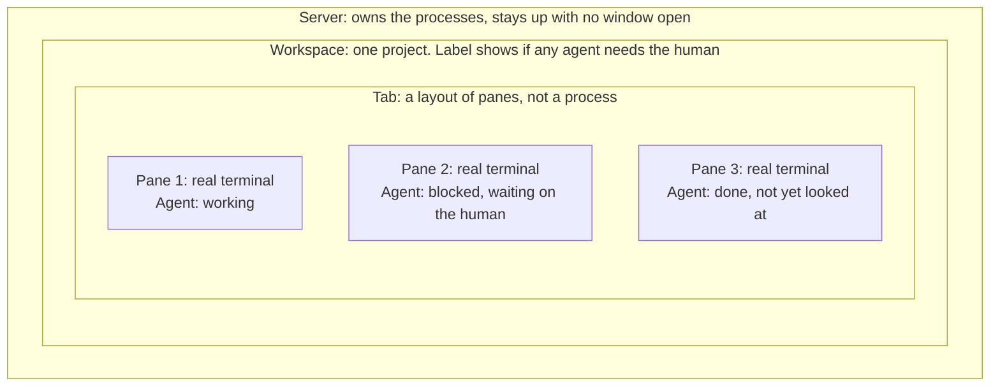
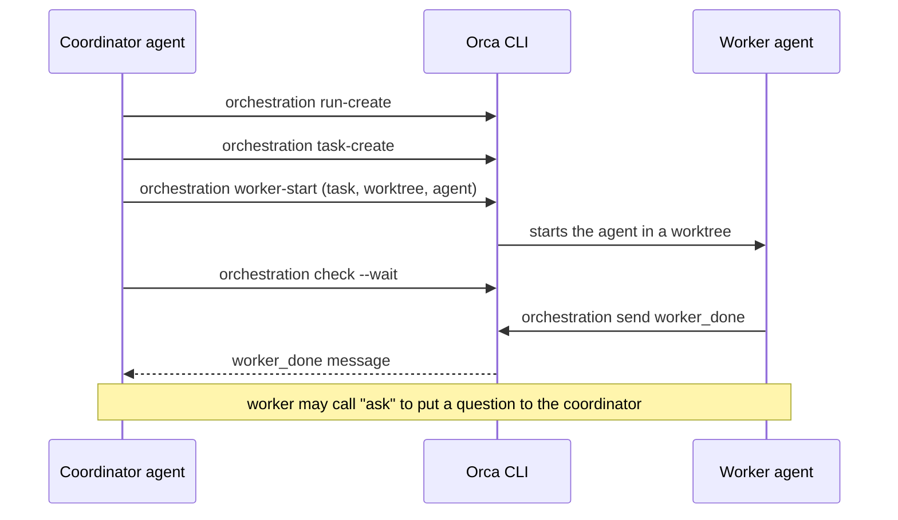
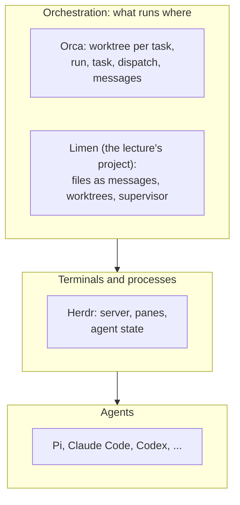

# 13. Herdr vs Orca — orchestrating agent harnesses

> Herdr keeps terminals and the agents inside them alive and shows their state. Orca gives every task its own git worktree and, in an experimental mode, runs coordinator and worker agents through tasks and messages. They sit at **different layers**, so I read them as complementary more than competing.

Related: [06 Self-management (Pi, Herdr)](06_Self_Management_Pi_Herdr.md) · [Lecture 5: 06 Running the fleet on a remote seat](../Lecture_5_Workflows_not_tool_sets/06_Run_The_Fleet_On_A_Remote_Seat.md) · [Lecture 5: 07 Herdr or Orca for my fleet](../Lecture_5_Workflows_not_tool_sets/07_Herdr_Or_Orca_For_My_Fleet.md) · [07 Multi-agent coordination](07_Multi_Agent_Coordination.md) · [01 Harness lock-in](01_Harness_Lock-in_Keep_Doors_Open.md) · [03 Skill and folder orchestration](03_Skill_And_Folder_Orchestration.md) · [04 COMPUTERS.md](04_Computers_md_Fleet_Infrastructure.md) · [11 Cloud coding agents](11_Cloud_Coding_Agents.md) · [Lecture 2: 12 Subagents vs workers](../Lecture_2_Context_Agents_md_Skills_Tools/12_subagents_vs_workers.md) · [Lecture 5: 09 A local fleet lab](../Lecture_5_Workflows_not_tool_sets/09_Local_Fleet_Lab_Sandboxes_And_Worktrees.md)

Source: S01E04 transcript (Herdr section, figures 6 and 7), the lecture's server figure (`img/herdr-server-workspace-tab-pane-agent.png`), and my own research on 2026-11-08. The vendor facts come from pages read by reader agents: herdr.dev and its TUI docs, the `herdrdev/herdr` repo, and the onorca.dev docs. I did not install or run either tool. See [Fact-check](#fact-check).

## 1. The problem

The lecture picks Herdr to keep Pi instances alive and to let one agent spawn others. I want to know what Herdr really is, and how it compares with Orca, which also runs fleets of agents. Which one solves which problem?

## 2. Words refinement

| Term | Meaning |
|---|---|
| **Agent multiplexer** | A tool that runs many terminals in one place and tracks the state of the agent inside each. Herdr's description is close to "tmux for agents" |
| **Orchestrator** | A tool that assigns tasks to agents and collects results. Orca's own tagline calls it "The AI Orchestrator" |
| **Server / core** | A background process that owns the terminals, so closing the window does not stop them |
| **Worktree** | A separate checkout of the same git repo on its own branch. It isolates parallel agents |
| **Worker** | An agent started by another agent. It runs as a separate process (see [Lecture 2: 12](../Lecture_2_Context_Agents_md_Skills_Tools/12_subagents_vs_workers.md)) |

**Two products are called Herdr.** I checked this on herdr.dev:

| Product | What it is |
|---|---|
| **Herdr TUI** | The original: a terminal app in Rust with its own background server (repo `herdrdev/herdr`). The lecture's commands belong to this one |
| **Herdr (desktop app)** | A newer, separate program built on `herdr-core`. The site says the two do not share agents |

**Two projects are called Orca.** I assume the lecture-adjacent one is **`stablyai/orca`**: a desktop app whose GitHub description is "run a fleet of coding agents". A different project, `orca-cli/orca` (a Go binary with SQLite state and MCP), showed up in a search summary. I did not see it on any primary page. This note covers `stablyai/orca`.

## 3. Herdr

### The model

The lecture's figure shows how Herdr nests things:

![Nested boxes. The outer box, Server, owns the processes and stays up with no window open. Inside it is a Workspace labeled "needs human": one project, and its label shows if any agent inside needs the human. The Workspace holds a Tab: a layout of panes, not a process. The Tab holds three Panes. Each Pane is a real terminal that survives the window closing and holds one agent. The first agent is working, the second is blocked and waiting on the human, the third is done and not yet looked at. Closing the window leaves these agents running; stopping the server ends them.](img/herdr-server-workspace-tab-pane-agent.png)

**The story:** processes belong to the **server**, not to a window. A tab is only a layout. A pane is a real terminal. The workspace label rolls up the state of its agents, so I see at a glance whether anything needs me.

**What is important:**
- Closing the window leaves the agents running. Stopping the server ends them.
- The agent is "noticed" in the pane. The figure says Herdr does not start it. In the CLI, `agent start` types the agent's command into an existing shell pane.
- Status is a first-class signal: `working`, `blocked`, `done` (finished, not yet looked at), `idle`, `unknown`.

**What is not important:** the exact box names. The ideas are server, layout, terminal, state.

### What the docs confirm about the lecture's commands

All four commands from the lecture's sequence figure exist in the Herdr TUI CLI reference, with one detail the lecture skips:

| Lecture step | Real command | Detail |
|---|---|---|
| Create tab | `herdr tab create [--workspace] [--cwd] [--label]` | Output includes the new pane id |
| Start agent | `herdr agent start <name> --kind pi --pane ID` | Needs an **existing shell pane** and a name. It does not create the tab |
| Prompt | `herdr agent prompt <target> <text> [--wait]` | Without `--wait`, success only means the text was written |
| Read | `herdr agent read <target> [--lines N]` | `herdr agent wait <target> --until done` also exists |

So the coordinator's real sequence is `tab create`, then `agent start` on the returned pane, then `prompt`, then `wait` or `read`.

### Pi

- Pi is a documented integration. `herdr integration install pi` writes an extension file under `~/.pi/agent/extensions/`.
- When the integration reports state, Herdr uses it instead of reading the screen.
- The docs do not say which Pi events map to which state.

### Keeping agents alive

Programs survive the app quitting, updating or crashing. They do not survive a reboot or stopping the core. After a restart, panes come back with a fresh shell in the same folder, and Herdr does not resume the agent. This is from the desktop app's docs. For the TUI, the lecture's figure says the same about the server.

### Herdr and Pi together: the Hello World exercise

The lecture suggests a first experiment. I start Herdr, run Pi inside it, and ask that Pi agent to create a new Hello World tab with a simple hello message for another agent. The agent then:

1. Explores the environment it is in
2. Opens a new tab in Herdr
3. Starts a new Pi instance
4. Sends a prompt to it
5. Waits for the worker to finish and reads its result

One Pi instance (the **coordinator**) orchestrates another (the **worker**) through Herdr:

![Sequence diagram with four actors: User, Coordinator, Herdr and Worker. The user gives the Coordinator a task. The Coordinator sends herdr tab create and herdr agent start to Herdr, and Herdr starts Pi in the Worker. The Coordinator sends herdr agent prompt, and Herdr types the task to the Worker. The Coordinator sends herdr agent read, marked red, and Herdr reads the Worker's screen and returns the screen text. The Coordinator passes the answer to the user. Orders go one way: the Coordinator gives them and Herdr carries them out. The Worker never replies. The Coordinator gets the answer by reading the Worker's screen.](img/herdr-coordinator-worker-sequence.png)

**The story:** the coordinator gives orders and Herdr carries them out. The worker never talks back. The coordinator gets the answer by **reading the worker's screen**.

**What is important:**
- The only channel from worker to coordinator is the terminal screen. That makes `agent read` the key step, and the figure marks it red.
- It is a **pull** model: the coordinator asks. Nothing tells the coordinator the worker is done unless it waits (`herdr agent wait <target> --until done`, or `agent prompt --wait`) or reads again.
- The lecture's figure skips the pane id between `tab create` and `agent start` (see the table above).

**What is not important:** the exact wording of the prompt. Hello World only proves the loop works.

**How this differs from other designs I have in my notes:**

| Design | How the coordinator learns the result |
|---|---|
| This figure (Herdr TUI) | Pull: reads the worker's screen |
| Herdr core docs (desktop app) | A background helper can report back into the parent agent's input with `hc send` |
| Orca orchestration | Push: the worker sends a typed `worker_done` message |
| Limen ([07](07_Multi_Agent_Coordination.md)) | Files plus a notification extension: the worker writes a report, the coordinator is told when the job ends |

**My reading:** screen text is a lossy result channel. It is the simplest thing that works, which is why it is a good first exercise, and the lecture then moves to files and a supervisor for the robust version. I treat the figure as the minimum loop, not the target design.

## 4. Orca

From the onorca.dev docs and the GitHub page (`stablyai/orca`):

- **What it is:** a desktop app with a companion mobile app and remote servers. It runs a fleet of coding agents "with your own subscription".
- **Unit of work:** a **worktree**. Each task gets its own `git worktree`, branch, agent terminals and browser tabs. The docs say this makes parallel agents safe.
- **Agents:** about 27 named agents (Claude Code, Codex, Gemini, Cursor, OpenCode, **Pi**, and more) and "any CLI agent".
- **Orchestration (experimental, off by default):** a **Run** has a coordinator inbox. **Tasks** have a status (`pending`, `ready`, `dispatched`, `completed`, `failed`, `blocked`). A **Dispatch** is one attempt on a terminal. **Messages** have types such as `worker_done`, `heartbeat`, `question`. **Decision gates** block a task until someone resolves them.
- **Limits and defaults:** nested worker depth 4, heartbeat every 5 minutes.

- **Remote:** SSH hosts, a "Remote Orca Server", and cloud VMs. `worker-start --on <machine>` can start a worker on another machine.
- **License:** MIT. Free and open source.

## 5. Comparison

| | **Herdr** | **Orca** (`stablyai/orca`) |
|---|---|---|
| Core idea | Keep terminals alive and show each agent's state | Give each task a worktree and fan agents out across them |
| Layer in my [seven-layer stack](01_Harness_Lock-in_Keep_Doors_Open.md#3-split-the-problem-into-layers) | Terminal and process location | Workspace and orchestration, above the terminal |
| Unit | Pane (a terminal) | Worktree (a task) |
| Isolation of parallel agents | None built in. I add worktrees myself (as in [07](07_Multi_Agent_Coordination.md)) | Built in: one worktree per task |
| Persistence | Server owns the processes. Survives closing the window, not a reboot | Remote servers and cloud VMs keep running. Local behavior after closing the app: not verified |
| State signal | `idle`, `working`, `blocked`, `done`, `unknown`. Open status protocol in the desktop app | Message types (`worker_done`, `heartbeat`, `question`) and task statuses |
| Agent spawns agent | `tab create`, `agent start`, `agent prompt`, `agent read`, `agent wait` | `orchestration run-create`, `task-create`, `worker-start`, `check --wait`, `send`, `ask` |
| Human in the loop | Workspace label shows who needs me | Decision gates, mobile notifications |
| Supported agents | Any terminal program. Pi has an official integration | About 27 named agents plus any CLI agent |
| Self-configuration | The agent edits plain config files from a guide the app exposes (desktop app) | CLI and a skills registry. Self-configuration not checked |
| Interfaces | Terminal app and a newer desktop app | Desktop, mobile, remote |
| License | Apache 2.0 | MIT |
| Maturity signal | Latest TUI release v0.9.5 (day and month shown, year not) | Orchestration still marked experimental |

## 6. Where each fits

- **Herdr** answers "where do my agents live and what are they doing?"
- **Orca** answers "how do I split work across agents and keep their changes apart?"
- The lecture's **limen** project builds the second answer by hand from git worktrees, files and a small CLI on top of Herdr. Orca ships a version of it as a product feature. That makes Orca a useful reference when I design my own coordinator: its task statuses, dispatch records and decision gates are a ready-made vocabulary.

I have not checked whether the two tools can work together. Orca lists Pi as a supported agent. Whether Orca can run on top of Herdr, or the reverse, is unverified.

## 7. Cautions

- **Third-party tools.** For anything near internal source code I check the [AI Solutions Catalog](http://aitools.aras.com/) first, as the organization instructions require. This note holds no business detail.
- **Trust model.** The Herdr desktop app's security doc says its mods "have your access": they are trusted JavaScript, not sandboxed, and there is no permission prompt per program or request. It also exposes a local control socket. I did not read the TUI's security model. Orca's docs I read do not describe a permission model, and its UI shows a "Full access" label.
- **Telemetry.** Both document anonymous telemetry and an opt-out. Herdr's desktop app has it on by default. Orca sends to PostHog and says it excludes prompts, paths and terminal output.
- **Install scripts.** Herdr's installers are `curl | sh` and `irm | iex`. The repo recommends reading them first.
- **Unstable facts.** Version numbers, star counts and "experimental" flags move within weeks.

## 8. My reading

The comparison made one thing clear for the lecture. The lecture shows a Herdr-based stack and calls it the way to run durable agents. The research shows it is one **layer** (terminals and state), and that the orchestration above it is something I either build, as limen does, or adopt, as Orca offers. For my platform work, the question is which layer I want to own. The state vocabulary in both tools (`blocked`, `done`, `worker_done`, `question`) looks like a contract worth keeping tool-independent, in line with [02](02_Agent_Runner_Portability.md).

## Open questions

1. Does `orca-cli/orca` (a Go binary with SQLite state and MCP) fill the same role as `stablyai/orca`?
2. Does Orca keep local agents running after I close the desktop app?
3. Can Orca run inside or alongside Herdr? (Its docs list Pi as a supported agent and name neither Herdr nor Limen.)
4. Why do some search summaries say Herdr is AGPL-3.0 while the LICENSE file says Apache 2.0?
5. Does the Herdr TUI have the same trust model as the desktop app (trusted mods, local control socket)?
6. Could I express my own coordinator's task states and messages in a form that maps to both tools?

## Fact-check

Checked 2026-11-08. "Reader agent" means a subagent that fetched the pages and reported back. I did not install or run either tool.

| # | Claim | Verdict | Source | Checked |
|---|---|---|---|---|
| 1 | There are two Herdr products: the Herdr TUI and a newer desktop app on `herdr-core`, and they do not share agents | **Agrees** (reader agents; the site's FAQ) | [herdr.dev](https://herdr.dev/), [Herdr TUI](https://herdr.dev/tui) | 2026-11-08 |
| 2 | The lecture's four commands (`tab create`, `agent start`, `agent prompt`, `agent read`) exist | **Agrees** (CLI reference read by a reader agent) | [Herdr TUI CLI reference](https://herdr.dev/tui/docs/cli-reference/) | 2026-11-08 |
| 3 | `agent start` creates a tab and starts Pi in it (as the lecture figure implies) | **Differs: slightly** | The CLI reference says `agent start` needs an existing shell pane and a name. `tab create` returns the pane id. | 2026-11-08 |
| 4 | Pi is a documented Herdr integration, installed with `herdr integration install pi`, and reports state | **Agrees** (TUI integration docs, reader agent) | [Herdr TUI docs](https://herdr.dev/tui/docs/agents/) | 2026-11-08 |
| 5 | Herdr's blocked-state detection for Pi is only "partial" | **Unverified** | One search summary says so. The TUI docs I read do not. I did not resolve it. | 2026-11-08 |
| 6 | Herdr is licensed Apache 2.0 | **Agrees** (the LICENSE file in `herdrdev/herdr` opens with "Apache License, Version 2.0") | [LICENSE](https://github.com/herdrdev/herdr/blob/master/LICENSE) | 2026-11-08 |
| 7 | Herdr is AGPL-3.0 | **Differs / unverified** | Appeared in a search summary. The primary LICENSE file says Apache 2.0. The summary may have described a fork or an older repo. Not resolved. | 2026-11-08 |
| 8 | Latest Herdr TUI release is v0.9.5 | **Agrees, date incomplete** | [Releases](https://github.com/herdrdev/herdr/releases/latest) shows "14 Oct" with no year. An older search summary said v0.7.1, which is out of date. | 2026-11-08 |
| 9 | Herdr agents survive closing the window and app crashes, but not a reboot or stopping the server | **Agrees** (desktop app docs and the lecture's figure) | [herdr.dev/core](https://herdr.dev/core/) | 2026-11-08 |
| 10 | Herdr desktop app mods are trusted JavaScript with no per-request permission prompt | **Agrees** (security doc, reader agent). Not checked for the TUI | [security.md](https://github.com/herdrdev/herdr-app/blob/master/docs/security.md) | 2026-11-08 |
| 11 | Orca (`stablyai/orca`) runs a fleet of coding agents, one git worktree per task, with desktop, mobile and remote runtimes | **Agrees** (docs read by a reader agent) | [onorca.dev docs](https://www.onorca.dev/docs), [GitHub](https://github.com/stablyai/orca) | 2026-11-08 |
| 12 | Orca supports about 27 named agents including Pi, and any CLI agent | **Agrees** (homepage and README) | [onorca.dev](https://onorca.dev/) | 2026-11-08 |
| 13 | Orca's orchestration has runs, tasks, dispatches, typed messages and decision gates, and is experimental | **Agrees** (docs read) | [Orca orchestration docs](https://www.onorca.dev/docs/cli/orchestration) | 2026-11-08 |
| 14 | Orca is MIT licensed | **Agrees** (homepage: free and open source) | [onorca.dev](https://onorca.dev/) | 2026-11-08 |
| 15 | Orca keeps local agents running after the desktop app closes | **Unverified** | Its text says agents keep running when the laptop sleeps, but that refers to remote servers and cloud VMs. | 2026-11-08 |
| 16 | Orca's GitHub star count | **Unverified, volatile** | One page read shows 119.3k. A search summary showed other figures. I do not rely on it. | 2026-11-08 |
| 17 | `orca-cli/orca` (Go, SQLite, MCP) is a separate orchestration project | **Unverified** | Search summary only. Not seen on any primary page. | 2026-11-08 |
| 18 | Herdr and Orca work at different layers and are complementary | **My interpretation** | My reading of the two feature sets. Not stated by either project. | 2026-11-08 |
| 19 | Limen is a hand-built version of what Orca ships as a feature | **My interpretation** | Based on the lecture's limen description and Orca's task and message vocabulary. | 2026-11-08 |
| 20 | In the lecture's figure the worker never replies and the coordinator gets the answer by reading the worker's screen | **Lecture-specific, partly differs** | The figure is the lecture's. The Herdr core docs (desktop app, read by a reader agent) show a background helper reporting back into the parent agent's input with `hc send`. I did not check whether the TUI has an equivalent reply path. | 2026-11-08 |
| 21 | `herdr agent wait <target> --until done` and `agent prompt --wait` exist | **Agrees** (CLI reference, reader agent) | [Herdr TUI CLI reference](https://herdr.dev/tui/docs/cli-reference/) | 2026-11-08 |
| 22 | Screen text is a lossy result channel and files or typed messages are more robust | **My interpretation** | My reading of the figure compared with limen's job reports and Orca's typed messages. Not stated by the lecture or the vendors. | 2026-11-08 |
