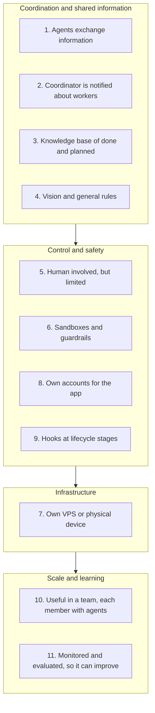

# 14. What an agent fleet needs beyond spawning workers

> Spawning a worker is the easy part. The lecture lists **11 more things** a fleet of agents needs. I turn the list into a checklist: where my notes already cover each point, where they do not, and one test question per point for my own platform.

Related: [07 Multi-agent coordination](07_Multi_Agent_Coordination.md) · [06 Self-management](06_Self_Management_Pi_Herdr.md) · [13 Herdr vs Orca](13_Herdr_vs_Orca_Agent_Orchestration.md) · [03 Skill and folder orchestration](03_Skill_And_Folder_Orchestration.md) · [04 COMPUTERS.md](04_Computers_md_Fleet_Infrastructure.md) · [08 Settings](08_Settings_Model_Routing_Cost.md) · [09 Teamwork](09_Teamwork_Knowledge_Base_Tool_Stack.md) · [10 Automation](10_Automation_Repository_Agents.md) · [02 Agent runner portability](02_Agent_Runner_Portability.md) · [Lecture 2: 3 Lifecycle hooks](../Lecture_2_Context_Agents_md_Skills_Tools/3_lifecycle_hooks.md) · [Lecture 2: 9 Tools and prompt injection](../Lecture_2_Context_Agents_md_Skills_Tools/9_tools_prompt_injection.md) · [Lecture 3: 14 Task board](../Lecture_3_Simplify_Codebase_&_Knowledge_Base/14_Broader_Context_Task_Board.md) · [Lecture 1: 17 Ambient, durable agents](../Lecture_1_Mechanics_Behind_Generative_AI/17_ambient_durable_agents.md) · [Lecture 5: 09 A local fleet lab](../Lecture_5_Workflows_not_tool_sets/09_Local_Fleet_Lab_Sandboxes_And_Worktrees.md)

Source: the S01E04 transcript (the list after the Herdr worker-spawning exercise). The lecturer says the next lessons will cover "nearly every aspect of it". Industry pointers come from my web search on 2026-11-08, read as search summaries of vendor and project docs. See [Fact-check](#fact-check).

## 1. The problem

I can already make one agent start another (see [06](06_Self_Management_Pi_Herdr.md) and [13](13_Herdr_vs_Orca_Agent_Orchestration.md)). What else must exist before I can trust a fleet of them with real work?

## 2. Words refinement

The lecture says "agents" and "workers", and I called them "sub-agents". They are not the same, and the list is about the **worker** case:

| Term | Meaning here |
|---|---|
| **Subagent** | A helper inside one harness session with its own context. Its answer is injected into the caller's context |
| **Worker** | A subagent that runs as a **separate process**, stays interactive, and can be triggered by an event |
| **Coordinator** | The agent that hands work to workers and gets notified when they finish |
| **Fleet** | Several coordinators and workers running over time, possibly on several machines |

See [Lecture 2: 12 Subagents vs workers](../Lecture_2_Context_Agents_md_Skills_Tools/12_subagents_vs_workers.md) for the full split. The 11 points assume workers and a fleet.

## 3. The 11 requirements

The lecture gives a flat list. I group it into four themes so I can reason about it. The grouping is mine.

### Coverage in my notes

"Covered" means I wrote about it.

| # | Requirement (lecture wording, shortened) | Where my notes touch it | Status |
|---|---|---|---|
| 1 | Agents exchange information | Files as messages in [07](07_Multi_Agent_Coordination.md). Typed messages in Orca, see [13](13_Herdr_vs_Orca_Agent_Orchestration.md). A2A in [Lecture 2: 12](../Lecture_2_Context_Agents_md_Skills_Tools/12_subagents_vs_workers.md) and [04](04_Computers_md_Fleet_Infrastructure.md) | Covered (design), nothing tested |
| 2 | Coordinator is notified about workers | Job-end notifications in [07](07_Multi_Agent_Coordination.md). Pull vs push result channels in [13](13_Herdr_vs_Orca_Agent_Orchestration.md) | Covered |
| 3 | Knowledge base of what is done and planned | Board in [07](07_Multi_Agent_Coordination.md), [Lecture 3: 14 Task board](../Lecture_3_Simplify_Codebase_&_Knowledge_Base/14_Broader_Context_Task_Board.md), the whole Lecture 3 | Covered |
| 4 | Agents know the vision and follow rules | `vision.md` and `styleguide.md` in [07](07_Multi_Agent_Coordination.md). AGENTS.md and skill metadata in [03](03_Skill_And_Folder_Orchestration.md) | Covered |
| 5 | Human involvement considered, but limited | Human reviews and merges in [10](10_Automation_Repository_Agents.md). Herdr's "needs human" label and Orca's decision gates in [13](13_Herdr_vs_Orca_Agent_Orchestration.md) | **Partly.** No note on approval policy or escalation |
| 6 | Sandboxes and mechanisms that block unwanted actions | VM isolation in [11](11_Cloud_Coding_Agents.md). Prompt injection in [Lecture 2: 9](../Lecture_2_Context_Agents_md_Skills_Tools/9_tools_prompt_injection.md). Privacy boundary in [08](08_Settings_Model_Routing_Cost.md) | **Partly.** No dedicated note |
| 7 | Own VPS or physical device | Machine registry in [04](04_Computers_md_Fleet_Infrastructure.md). VPS mention in [10](10_Automation_Repository_Agents.md) | **Partly.** The lecturer defers it to a later lesson |
| 8 | Own accounts and what the app needs | Nothing | **Gap** |
| 9 | Hooks at various stages | [Lecture 2: 3 Lifecycle hooks](../Lecture_2_Context_Agents_md_Skills_Tools/3_lifecycle_hooks.md). Hooks are not portable, see [01](01_Harness_Lock-in_Keep_Doors_Open.md) | Covered |
| 10 | Useful in a team, each member with agents | Shared skills and knowledge base in [09](09_Teamwork_Knowledge_Base_Tool_Stack.md) and [03](03_Skill_And_Folder_Orchestration.md) | **Partly.** Per-person agents inside one team not analyzed |
| 11 | Monitored and evaluated, so it can improve | How to measure cost per task is in [17](17_Cost_Per_Task.md). Monitoring and evaluating a running fleet is not covered | **Gap** |

## 4. Industry pointers for the weak spots

These are what I found for the points my notes do not yet cover well. They come from search summaries of the vendor docs. I did not read the pages in full.

**Point 6, sandboxes** ([Claude Code sandboxing docs](https://code.claude.com/docs/en/sandboxing)): the sandbox is OS-level isolation for Bash commands and their child processes. It limits filesystem and network access. It does **not** cover built-in tools such as Read, Edit and WebFetch. Permission rules govern those. The docs recommend using both.

**Point 9, hooks** ([Claude Code hooks reference](https://code.claude.com/docs/en/hooks)): a `PreToolUse` hook can allow, deny, ask or defer. Deny and ask rules still apply whatever the hook returns. When several hooks match, the strictest decision wins. Command hooks run **outside** the sandbox. The docs I saw list different events and output fields on different pages, so I check the current reference before I rely on a field name.

**Point 8, accounts** ([Microsoft Entra Agent ID](https://learn.microsoft.com/en-us/entra/agent-id/what-is-microsoft-entra-agent-id)): Microsoft's model gives each agent its **own identity** instead of a shared or reused user account, with blueprints (templates) for many instances and Conditional Access for policy. Agents built outside Microsoft platforms are not registered automatically. One Microsoft page says the product is in preview and a third-party glossary says it is generally available, so its status is unresolved.

**Point 11, monitoring** ([OpenTelemetry GenAI](https://opentelemetry.io/blog/2026/genai-observability/)): a trace has a top-level `invoke_agent` span, child `chat` spans for LLM calls, and `execute_tool` spans for tools. Prompt and tool content is **off** by default because it may be sensitive. The agent conventions are still in progress. They give a shared vocabulary, but researchers argue they do not capture reasoning provenance or let one runtime replay another's trace.

**Point 1–2, coordination** ([Anthropic: multi-agent research system](https://www.anthropic.com/engineering/multi-agent-research-system)): a lead agent plans, delegates to parallel subagents and collects results. The same orchestrator-worker shape as the lecture's coordinator and workers. I did not read the post's memory and failure lessons.

## 5. Test questions for my own platform

I want to run these against the agent platform I work on. One question per point:

1. Can two agents exchange information without sharing a context window, and where does the message live?
2. When a worker ends or crashes, who tells the coordinator, and how long does that take?
3. Where is "done, planned, in progress" written, and can a fresh agent read it cold?
4. Which file holds the vision and rules, and how often is it put in front of the model?
5. Which decisions always need a human, and what happens when no human is available?
6. What can an agent **not** do even if it tries, and is that enforced outside the model?
7. Where does each agent run, and can I rebuild that machine from a runbook?
8. Which identity does each agent use, and can I revoke one without touching the others?
9. Which lifecycle points can I intercept, and would those hooks survive a harness switch?
10. Can two people's agents share skills, rules and knowledge without stepping on each other?
11. After the fact, can I see what an agent did and judge whether it was good?

## 6. Pattern across the list

Reading the 11 points together, they split in two:

| Text can do it | Only code or infrastructure can enforce it |
|---|---|
| 1 Exchange information (files) | 2 Notification when a job ends |
| 3 Done and planned (a board file) | 6 Sandboxes |
| 4 Vision and rules | 7 Own machine |
| 10 Shared skills and rules in a team | 8 Own accounts |
| | 9 Hooks |
| | 11 Monitoring |

This matches the lecture's own line in [07](07_Multi_Agent_Coordination.md): code does only what text cannot do reliably. It also matches the privacy-boundary point in [08](08_Settings_Model_Routing_Cost.md): where a rule must hold even if the model tries to get around it, the rule belongs in infrastructure, not in a prompt. Points 5, 6 and 8 are the ones where I would not trust text alone.

## Open questions

1. Which of the weak points matter most for my platform: accounts, monitoring, or the human-in-the-loop policy?
2. Does the platform I work on give each agent its own identity today, or do agents share one?
3. What would a minimal monitoring contract look like that is not tied to one vendor (spans, task states, outcomes)?
4. Where does approval policy live: in hooks, in the coordinator, or in infrastructure?
5. Which of the 11 points does the lecturer cover in later lessons, and do they match my grouping?

## Fact-check

Checked 2026-11-08. "Search summary" means I saw the vendor or project page named in a search result summary, not the full page.

| # | Claim | Verdict | Source | Checked |
|---|---|---|---|---|
| 1 | A fleet of agents needs these 11 things beyond spawning workers | **Lecture-specific (opinion)** | The lecturer's list in the transcript. It is a requirements list, not a factual claim. The lecturer says later lessons cover most of it. | 2026-11-08 |
| 2 | Claude Code sandboxing is OS-level isolation for Bash and does not cover built-in tools such as Read, Edit and WebFetch | **Agrees** (search summary of vendor docs) | [Sandboxing docs](https://code.claude.com/docs/en/sandboxing) | 2026-11-08 |
| 3 | `PreToolUse` hooks can allow, deny, ask or defer, deny and ask rules still apply, the strictest hook wins, and command hooks run outside the sandbox | **Agrees** (search summary of vendor docs). Field names vary across doc pages | [Hooks reference](https://code.claude.com/docs/en/hooks), [Hooks guide](https://code.claude.com/docs/en/hooks-guide) | 2026-11-08 |
| 4 | Microsoft Entra Agent ID gives each agent its own identity | **Agrees** (search summary of vendor docs) | [What is Microsoft Entra Agent ID](https://learn.microsoft.com/en-us/entra/agent-id/what-is-microsoft-entra-agent-id) | 2026-11-08 |
| 5 | Entra Agent ID is in preview or generally available | **Unverified** | One Microsoft page says preview, a third-party glossary says generally available. Check Microsoft's current docs. | 2026-11-08 |
| 6 | OpenTelemetry GenAI uses `invoke_agent`, `chat` and `execute_tool` spans, with content capture off by default | **Agrees** (search summary of an OpenTelemetry blog post) | [GenAI observability](https://opentelemetry.io/blog/2026/genai-observability/) | 2026-11-08 |
| 7 | OpenTelemetry's agent conventions are still in progress | **Agrees, verify before presenting** | Search summary of OpenTelemetry blog posts. The GenAI conventions moved to a separate repository and attribute names have changed, so check the current spec. | 2026-11-08 |
| 8 | Anthropic's research system uses a lead agent that delegates to parallel subagents | **Agrees** (search summary of the post, not read in full) | [Anthropic engineering](https://www.anthropic.com/engineering/multi-agent-research-system) | 2026-11-08 |
| 9 | My coverage column: which points my notes cover | **My interpretation** | My own assessment from reading my notes and a keyword search of the repo on 2026-11-08. | 2026-11-08 |
| 10 | The grouping into four themes and the text-vs-infrastructure split | **My interpretation** | Mine. Not in the lecture or the sources. | 2026-11-08 |
