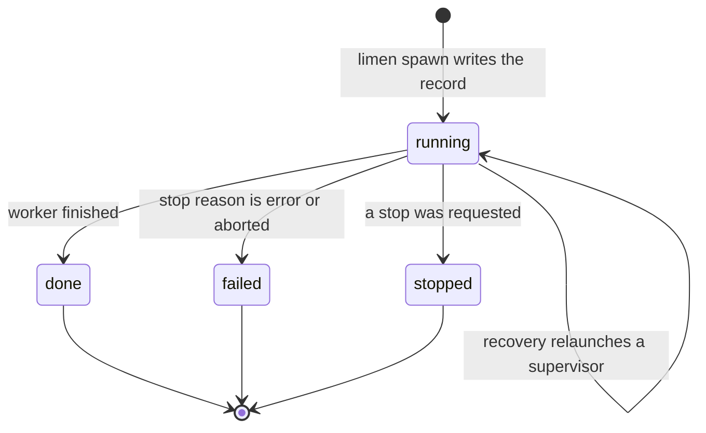
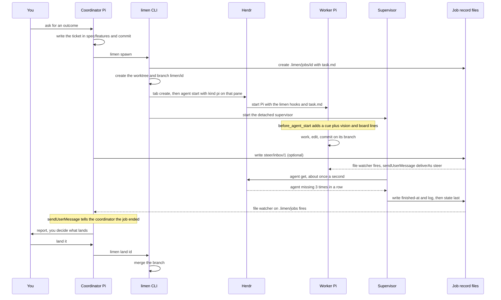

# 15. Behind the scenes: Pi hooks, files and Herdr in limen

> The figure's three records are plain files and git. Pi's hooks run **inside** each agent process, and nothing in Pi connects two processes. So limen links the coordinator, the workers and the supervisor with files, file watchers, Herdr and a detached supervisor.

Related: [07 Multi-agent coordination](07_Multi_Agent_Coordination.md) · [06 Self-management](06_Self_Management_Pi_Herdr.md) · [13 Herdr vs Orca](13_Herdr_vs_Orca_Agent_Orchestration.md) · [14 What an agent fleet needs](14_What_Agent_Fleets_Need_Beyond_Spawning.md) · [Lecture 2: 3 Lifecycle hooks](../Lecture_2_Context_Agents_md_Skills_Tools/3_lifecycle_hooks.md) · [Lecture 2: 9 Tools and prompt injection](../Lecture_2_Context_Agents_md_Skills_Tools/9_tools_prompt_injection.md) · [Lecture 2: 12 Subagents vs workers](../Lecture_2_Context_Agents_md_Skills_Tools/12_subagents_vs_workers.md)

Source: the lecture's job-record figure (`img/pi-orchestration-spec-job-record-branch.png`), Pi's [extensions docs](https://pi.dev/docs/latest/extensions), the [limen repo at the pinned commit](https://github.com/overment/limen/tree/01fc400e916e05f4f92ff881b48cd1b40eee99e6), and the course examples. I read all of them through reader agents, and I did not run anything. Reader coverage: the Pi page was verbatim for about 90% of its text and a summary for the middle part. For limen the agent read the README and about 15 source files, listed in the [Fact-check](#fact-check), and it could not read a few others. Checked 2026-11-08.

## 1. The problem

Between "the coordinator writes a ticket" and "the coordinator is told the job ended", what actually happens? Which part is Pi, which is Herdr, and which is limen's own code?

## 2. Words refinement

| Term | Meaning here |
|---|---|
| **Pi extension** | A TypeScript or JavaScript file loaded into a Pi process. It subscribes to events and can add messages, tools and prompt text |
| **Pi event** | A named moment in one Pi session, for example `before_agent_start`, `tool_result`, `agent_settled` |
| **limen hook** | One of limen's extension files, loaded into the coordinator's and workers' Pi: `communication.ts`, `steering.ts`, `wake.ts` |
| **Job record** | The folder `.limen/jobs/<id>/` that holds everything about one worker run |
| **Supervisor** | A separate detached process that watches one worker and finalizes the job record |
| **Hosted job** | A job whose worker runs in a Herdr pane. A **detached** job runs under a wrapper instead |
| **Engine** | The agent program that runs the worker: `pi` or `omp` |

## 3. The figure

**The story:** three records sit in the middle, and the three roles only ever touch them. The coordinator writes the **spec** and later merges the **branch**. The worker reads the spec, writes progress to the **job record**, and commits to the branch. The supervisor writes the outcome to the job record. The red arrow, *job ended*, runs from the job record to the coordinator.

**What is important:**
- **The spec and the branch are in Git.** They are shared and versioned.
- **The job record is on this machine.** It is runtime state, not history.
- **No arrow joins the coordinator and the worker.** Everything goes through a record.

**What is not important:** the box shapes and the exact arrow routing.

## 4. What Pi provides, and what it does not

From Pi's extensions docs:

| What I need | What Pi offers |
|---|---|
| Add text to every run | `before_agent_start` can return a chained `systemPrompt` and a message |
| React to a tool result | `tool_result` can patch the result. Other events observe or block |
| Know when an agent is idle | `agent_settled` is the final idle signal. `agent_end` is not |
| Put a message into a running or idle agent | `pi.sendUserMessage(content, { deliverAs })`. When idle it starts a turn |
| Choose when it arrives | `deliverAs`: `steer`, `followUp` or `nextTurn` (below) |
| Start and stop my own watchers | `session_start` and `session_shutdown` |
| Load extensions | Auto-discovered from `~/.pi/agent/extensions` and project `.pi/extensions`. Project ones load only after the project is trusted |

**What it does not offer:** all hooks run in the **same process** as one Pi session. The page documents no messaging between two Pi instances. Anything that crosses processes needs a channel I build: files, a watcher, RPC, or a tool like Herdr. That is exactly the gap limen fills.

Delivery modes for a running agent:

| `deliverAs` | When the message arrives |
|---|---|
| `steer` | After the current turn finishes its tool calls, before the next model call |
| `followUp` | Only when the agent has no more tool calls |
| `nextTurn` | Queued for the next user prompt, no interruption |

The course's worker-steering example makes a related point. It tests three ways to deliver a correction and says the instruction must arrive as a user or developer message, because "without it, the Worker reads the correction in a tool result and often treats it as data". That example is a simulation on a custom harness, not a Pi extension.

## 5. How each arrow in the figure is done

All of this is from limen's README and source at the pinned commit.

| In the figure | What actually happens |
|---|---|
| Coordinator writes the ticket | A file `spec/features/<state>/F001-slug/ticket.md`, committed to Git. `limen spawn` refuses unless each `Ticket: spec/...` path exists in the base commit |
| Spec: Planned, Active, Done | The **folder is the state**: `planned/`, `active/`, `done/`, `dropped/`. I found no status field in code |
| Worker reads the spec | The worker starts with `@<job>/task.md` as its first message. `task.md` points at the ticket |
| Worker gets its own space | A git worktree at `<parent>/.<repo>-limen-worktrees/<id>` on branch `limen/<id>` |
| Worker writes progress and report | Files in `.limen/jobs/<id>/`: `activity`, `tool-calls`, `last-tool`, `commits`, `tip`, and `result` (the last assistant text). The session log is in `session/` |
| Worker commits | On its branch, in its worktree. `recordCommits` writes `commits` and `tip` |
| Supervisor starts with the worker | `limen spawn` launches a detached supervisor process |
| Supervisor watches | In hosted mode it runs `herdr agent get` about once a second. Three "missing" in a row ends the job as "hosted agent ended". Five "unknown" triggers a search for the agent. Liveness is a pid plus a process start identity, and there is no heartbeat file |
| Supervisor records the outcome | `finalizeJob` writes `finished-at` and a log line, and writes `state` **last** as the commit point. It also removes `pid` and `born` |
| Job ended, red arrow | Two paths. In-process: `wake.ts` in the coordinator's Pi watches `.limen/jobs` and sends a message. Out-of-process: `finalizeJob` calls `promptCoordinator`, which the README says runs `herdr agent prompt` on the coordinator's pane |
| Coordinator merges | `limen land <id>` requires state `done`, a clean target equal to the current branch, at least one commit, and a confirmation (or `--yes`) |

### The extensions

| Extension | Pi events and APIs it uses | What it does |
|---|---|---|
| `communication.ts` | `before_agent_start`, `message_end`, `tool_result` | Appends the manual, register, vision, styleguide and a NOW/NEXT board digest to the system prompt. Workers get only a cue plus read-only vision and board lines. After `write` or `edit` it adds a spec or styleguide reminder. After a `limen spawn` or `git merge` command it adds a vision reminder |
| `steering.ts` | `session_start`, `session_shutdown`, `pi.sendUserMessage` with `deliverAs: "steer"` | Watches `steer/inbox/` with a file watcher plus a 500 ms poll, and delivers each numbered file as a steering message |
| `wake.ts` | `session_start`, `agent_settled`, `message_start`, `message_end`, `session_shutdown`, `sendUserMessage` | Watches `.limen/jobs` recursively. Sends a plain message when the coordinator is idle and a `followUp` when it is busy. The text starts with "Limen job" |

The `tool_result` reminders explain the lecture's claim that the styleguide is "injected more often" than AGENTS.md: it is added at every run and again after edits.

### The job `state` file

The four values are from the code. "Failed on error or aborted" is stated there. Which condition leads to `stopped`, and what the "hosted agent ended" case becomes, is my inference.

## 6. The whole flow

This is a composite from the files I read. The hosted-mode supervisor steps come from `supervisor.ts`. The wake and steering steps come from the hooks. The `herdr agent prompt` path to the coordinator is left out because I did not read that file.

## 7. Where the code differs from the lecture

| The lecture or course material says | What the sources show |
|---|---|
| A Pi extension gives the worker a tool for its final report | I found no such tool. The worker's last message is captured from the session log into `result`. A file I did not read may differ |
| The course links its worker-steering and job-end examples where it describes the Pi extensions | They are simulations on a custom harness, not Pi extensions. The real implementation is limen's `steering.ts` and `wake.ts` |
| The coordinator and workers are Pi instances | The README says the default engine is OMP. Pi is selected with `--engine pi` |
| Agent recovery works only on macOS | The README says macOS or Linux. Recovery has no macOS gate. One Darwin-specific helper reads process identity on non-Linux systems |

## 8. Using limen: the lecturer's steps

The lecturer asks to study the repository, play with it, chat about it with an agent, and extract ideas or modify it. His steps to apply it to a project, with what limen creates:

1. `limen init` creates `spec/vision.md`, `spec/build.md`, `spec/features/{planned,active,done,dropped}/`, `.agents/limen/styleguide.md`, and extension stubs under `.pi/extensions/` and `.omp/extensions/`.
2. Shape the vision and the styleguide together with an agent. The vision holds the product description and direction, and may point to separate files for the main modules. The styleguide holds the coding rules the agent follows. It is injected into prompts more often than AGENTS.md, so both files stay short.
3. Install Pi and Herdr.
4. Open Pi and ask it to implement something.

The README says limen runs on macOS and Linux, and that Windows is unsupported.

## 9. Ideas worth taking from limen

| Idea | Where it is in limen | What I can take |
|---|---|---|
| State is a folder, not a field | A ticket's state is its folder: `planned`, `active`, `done`, `dropped`. Git history is the audit trail | Task states that a person and any agent can read, with no service to run |
| Publish atomically | The job directory is built as `.publishing-<id>` and renamed into place. The `state` file is written last | A reader never sees a half-written job |
| Detect a dead worker without a heartbeat | A pid plus a process start identity, and in hosted mode a poll of Herdr | Avoids mistaking a reused pid for the worker (my inference) |
| Keep the supervisor outside the agent | A detached process finalizes the record, and recovery relaunches a supervisor after a crash | Crash handling that does not depend on the crashed agent |
| More than one wake-up path | A file watcher in the coordinator's Pi, `herdr agent prompt` from the supervisor, and an optional webhook | A missed message does not hide a finished job (my inference) |
| Steer a running worker through files | Numbered files in `steer/inbox/` with claim and delivered records, delivered as a steering message | Steering that works for any agent that can watch a folder, with a record of what arrived |
| Give each worker only the hooks it needs | The worker's Pi starts with `--no-extensions` and one `--extension` per hook. Jobs get a lighter project context than the coordinator | A smaller attack surface and a smaller context per worker |
| Guard the merge | `limen land` needs state `done`, a clean target equal to the current branch, at least one commit, and a confirmation | A human-confirmed merge whose preconditions the CLI checks |
| Reviews as jobs | A reviewer job reports a verdict and does not rewrite the candidate | Review without the risk that the reviewer changes the work |
| Swap the engine, keep the record | The same job record for the `pi` and `omp` engines | A job record that stays the same when the harness changes, as in [02](02_Agent_Runner_Portability.md) |

## 10. Cautions

- **Extensions run with full permissions.** Pi's docs say extensions run in the Pi process with the same operating-system permissions and can inspect prompts, tool calls, files, credentials and session history. I would review any extension I did not write.
- **Messages become input.** A steering file or a worker's result ends up as a message in an agent's context. In the course examples nothing authenticates the sender, and one example notes that the worker's report goes straight into the coordinator's input. I did not check whether limen filters either. This is the injection surface in [Lecture 2: 9](../Lecture_2_Context_Agents_md_Skills_Tools/9_tools_prompt_injection.md).
- **Failure behavior differs from Claude Code.** In Pi, an error in a `tool_call` handler blocks the tool, and an error in a `user_bash` handler blocks the command. In Claude Code, a failing hook does not block by default ([Lecture 2: 3](../Lecture_2_Context_Agents_md_Skills_Tools/3_lifecycle_hooks.md)).
- **Project extensions need trust.** Pi loads project-local extensions only after the project is trusted.
- **The `state` file is a commit point.** It is written last, so a half-written record never looks finished.

## Open questions

1. Is there a final-report tool in a file I did not read (`hook/hosted.ts`, the wrapper)?
2. Is `.limen/` excluded from Git? I did not read `.gitignore`, and the figure says the job record is on this machine.
3. When both the file watcher and `herdr agent prompt` wake the coordinator, does it get the message twice?
4. What does a detached job use instead of Herdr to detect that a worker ended?

## Fact-check

Checked 2026-11-08. "Reader agent" means a subagent that fetched the pages and reported back. I did not run limen, Pi or Herdr.

| # | Claim | Verdict | Source | Checked |
|---|---|---|---|---|
| 1 | Pi has the events `before_agent_start`, `tool_result`, `message_end`, `session_start`, `session_shutdown`, `agent_settled` and others | **Agrees** (reader agent; the page was read verbatim for most of its length) | [Pi extensions](https://pi.dev/docs/latest/extensions) | 2026-11-08 |
| 2 | `pi.sendUserMessage` with `deliverAs`: `steer` arrives after the current turn's tool calls and before the next model call, `followUp` when no tool calls remain, `nextTurn` for the next prompt | **Agrees** (reader agent) | [Pi extensions](https://pi.dev/docs/latest/extensions) | 2026-11-08 |
| 3 | Pi documents no messaging between two Pi instances | **Agrees** (absence on the page the reader read; not proof of absence elsewhere) | [Pi extensions](https://pi.dev/docs/latest/extensions) | 2026-11-08 |
| 4 | Extensions run in-process with the same OS permissions, can read credentials and history, and project extensions load only after trust | **Agrees** (reader agent) | [Pi extensions](https://pi.dev/docs/latest/extensions) | 2026-11-08 |
| 5 | An error in a Pi `tool_call` handler blocks the tool | **Agrees** (reader agent) | [Pi extensions](https://pi.dev/docs/latest/extensions) | 2026-11-08 |
| 6 | limen layout: `spec/vision.md`, `spec/build.md`, `.agents/limen/styleguide.md`, `spec/features/{planned,active,done,dropped}/`, `.limen/jobs/<id>/` | **Agrees** (README at the pinned commit, reader agent) | [limen](https://github.com/overment/limen/tree/01fc400e916e05f4f92ff881b48cd1b40eee99e6) | 2026-11-08 |
| 7 | Ticket state is the folder. Month subfolders in `done` and `dropped` | **Agrees** for the folders (README). **Inferred** for the month subfolders | limen README and `herdr.ts` | 2026-11-08 |
| 8 | The job record files, with `state` written last, and liveness by pid plus start identity | **Agrees** (`src/job/record.ts`, `supervisor.ts`) | limen source | 2026-11-08 |
| 9 | The hosted supervisor polls `herdr agent get` about once a second, ends the job after 3 "missing", and searches after 5 "unknown" | **Agrees** (`src/runtime/supervisor.ts`) | limen source | 2026-11-08 |
| 10 | The three hooks use the Pi events and APIs listed in section 5 | **Agrees** for `communication.ts` and `steering.ts`. **Partly** for `wake.ts`: the reader saw the first ~39.9K of 52K characters, and the fetch tool refused to summarize the rest as "internal" code although the repo is public | limen `hook/` | 2026-11-08 |
| 11 | A final-report tool exists for workers | **Differs / unverified** | The lecture says so. I found none in the files read. | 2026-11-08 |
| 12 | `promptCoordinator` runs `herdr agent prompt` on the coordinator's pane | **Unverified** | Stated in the README. `coordinator-wake.ts` was not read | 2026-11-08 |
| 13 | `limen land` requires state `done`, a clean target equal to the current branch, one commit, and confirmation | **Agrees** (`src/commands/land.ts`). The git merge arguments were not read | limen source | 2026-11-08 |
| 14 | The default engine is OMP, and Pi needs `--engine pi` | **Agrees** (README, reader agent) | limen README | 2026-11-08 |
| 15 | The worker-steering and job-end-notification examples are simulations on a custom harness, not Pi extensions | **Agrees** (source read by a reader agent) | [examples](https://github.com/MEGA-DOT-DEV/examples/tree/main/examples) | 2026-11-08 |
| 16 | Recovery works only on macOS (lecture) | **Differs** | README: macOS or Linux, Windows unsupported. The Darwin-specific part is a helper for process identity on non-Linux systems | 2026-11-08 |
| 17 | Files not read: `coordinator-wake.ts`, `wrapper.ts`, `hook/hosted.ts`, `git.ts`, `finish-webhook.ts`, the templates and docs | **Unverified** | Not fetched | 2026-11-08 |
| 18 | The sequence diagram in section 6 | **My interpretation** | A composite of the files read, with the unread paths left out | 2026-11-08 |
| 19 | Which condition produces the `stopped` state, and what "hosted agent ended" becomes | **My interpretation** | Not shown in the files read | 2026-11-08 |
| 20 | `limen init` creates `spec/vision.md`, `spec/build.md`, `spec/features/{planned,active,done,dropped}/`, `.agents/limen/styleguide.md` and the extension stubs, and limen runs on macOS and Linux with Windows unsupported | **Agrees** (README at the pinned commit, reader agent) | [limen](https://github.com/overment/limen/tree/01fc400e916e05f4f92ff881b48cd1b40eee99e6) | 2026-11-08 |
| 21 | `spawn` builds the job directory as `.publishing-<id>` and renames it into place, and the worker's Pi starts with `--no-extensions` and one `--extension` per limen hook | **Agrees** (`src/commands/spawn.ts`, reader agent) | limen source | 2026-11-08 |
| 22 | The steering and notification folders carry claim, delivered and ready records | **Agrees** (job record layout, reader agent) | limen source | 2026-11-08 |
| 23 | A reviewer job reports a verdict and does not rewrite the candidate | **Agrees** (README and source, reader agent) | limen README | 2026-11-08 |
| 24 | The lecturer's four steps and his advice to play with the repository and extract ideas | **Agrees** (the lecture's text) | The S01E04 transcript | 2026-11-08 |
| 25 | The "What I can take" column in section 9 | **My interpretation** | My reading of what each design choice offers. Not stated by the repository or the lecture | 2026-11-08 |
