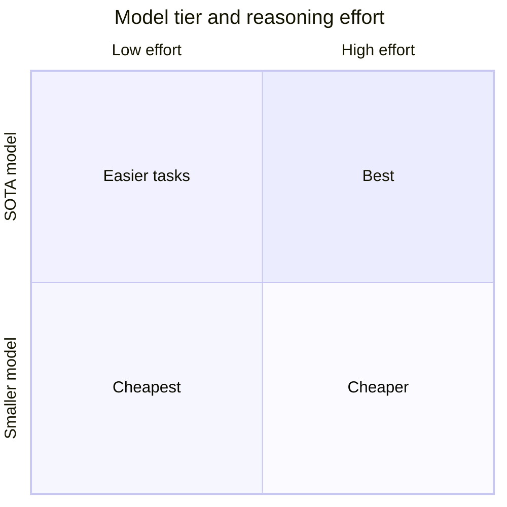
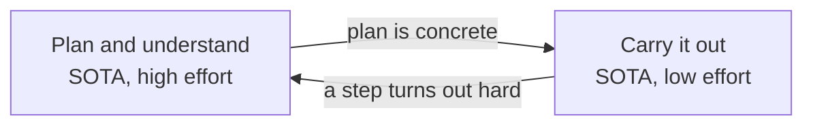

# 16. SOTA and reasoning effort — two separate dials

> SOTA says **which model** I use: the capability ceiling of its weights. Reasoning effort says **how much that model thinks** on this one call. They are independent, so a top model at low effort is a real option. The lecture's 2×2 grid says: start with a SOTA model, then lower the effort or switch to a smaller model for easier tasks.

Related: [17 Cost per task](17_Cost_Per_Task.md) · [08 Settings: routing, cost and privacy](08_Settings_Model_Routing_Cost.md) · [02 Agent runner portability](02_Agent_Runner_Portability.md) · [05 Don't overspecify](05_Dont_Overspecify_Work_At_Assistants_Level.md) · [07 Multi-agent coordination](07_Multi_Agent_Coordination.md) · [14 What an agent fleet needs](14_What_Agent_Fleets_Need_Beyond_Spawning.md) · [Lecture 1: 06 Reasoning, visible and silent](../Lecture_1_Mechanics_Behind_Generative_AI/06_reasoning_visible_and_silent.md) · [Lecture 1: 05 Harnesses, providers, steering](../Lecture_1_Mechanics_Behind_Generative_AI/05_lesson_harnesses_providers_steering.md)

Source: S01E04 transcript (Settings section) and the lecture's grid figure (`img/sota-model-vs-reasoning-effort-grid.png`). Vendor facts come from search results that summarize Anthropic and OpenAI docs, and I did not open each page in full. The course's effort-routing example was read through a reader agent. See [Fact-check](#fact-check).

## 1. The problem

I had treated "SOTA" and "high reasoning effort" as the same thing: the best model, thinking hard. The lecture separates them. What is each one, and what does the separation buy me?

## 2. Words refinement

| Term | Meaning here |
|---|---|
| **SOTA model** | The best model available at a given moment. The lecturer gives no formal test, and neither do I |
| **Smaller model** | A cheaper, less capable model, from the same vendor or another |
| **Reasoning effort** | A setting that tells the model how much to think before it answers. It changes how many thinking tokens it spends on this call |
| **Thinking tokens** | Tokens the model generates before the answer. They cost output tokens and time. [Lecture 1: 06](../Lecture_1_Mechanics_Behind_Generative_AI/06_reasoning_visible_and_silent.md) separates them from silent reasoning inside one forward pass |
| **Cost per task** | Total spend to finish one task, not the price per token. See [17](17_Cost_Per_Task.md) |

## 3. The figure

**The story:** two cost levers, and the grid shows what each one buys. The best result sits at SOTA with high effort, and it also costs the most. Moving left (less effort) or down (a smaller model) lowers cost. The caption says to **start at the top** and move only when the task is easy enough.

**What is important:**
- The two axes are separate. "Top model" does not mean "high effort".
- The top row is **SOTA at low effort**. That is the cell I had missed.
- The grid is a menu, not a ranking. A cheaper cell is right when the task allows it.

**What is not important:** the shading and the exact box sizes. A 2×2 like the Eisenhower matrix, but here both axes are cost levers.

## 4. Two dials

| | Model tier (SOTA or smaller) | Reasoning effort |
|---|---|---|
| What it changes | The weights: knowledge, skill, judgment | How many thinking tokens the model spends before it answers |
| How I set it | The model name | An API parameter or a harness setting |
| Main cost effect | Price per token | Number of output tokens, and time |
| Who sets it | Me, once per project or per agent | Me, or a coordinator, per call |

My reading, not a vendor claim: more effort can lengthen the reasoning, but it cannot add knowledge the weights lack. That is why a smaller model at high effort is not the same as a top model at low effort.

## 5. What the vendors say

**Anthropic** (search summaries of the platform docs):
- Opus 5.5 supports five levels: low, medium, high, xhigh, max. The default is medium. Supported levels differ by model.
- Manual thinking budgets are gone on newer Opus models. `budget_tokens` returns an error from Opus 4.7 onward, and effort controls thinking depth instead.
- Effort is **soft guidance**. `max_tokens` is the hard cap.
- The Opus 4.8 guide warns that on moderately complex tasks, low effort risks under-thinking. It suggests starting at xhigh for coding and agentic work, and at high at minimum for intelligence-sensitive work.
- A docs table for Opus 5.5 on a SWE-bench Pro subset lists: low 87.4% at $0.11 per task, medium 92.8% at $0.21, high 95.3% at $0.29, xhigh 96.7% at $0.74. These are the vendor's numbers.
- The Opus 4.5 announcement said medium effort matched Sonnet 4.5's best SWE-bench Verified score with 76% fewer output tokens, and the highest effort beat Sonnet 4.5 by 4.3 points with 48% fewer tokens. Opus 4.5 is now a legacy model.

**OpenAI** (search summaries of the reasoning guide and a help article):
- `reasoning.effort` sets how many reasoning tokens the model generates. Accepted values depend on the model: `none`, `minimal`, `low`, `medium`, `high`, `xhigh`, `max`.
- GPT-5.2 added `none` and `xhigh`. With `none` the model behaves like a non-reasoning model.
- gpt-5.5 defaults to medium.

**What this means:** the level names and defaults differ between vendors and between models of one vendor. "Low" on one is not "low" on another.

## 6. What the numbers say about the grid

Using the Anthropic table above, my calculation: going from xhigh to low on Opus 5.5 costs 9.3 points (96.7% to 87.4%) and cuts cost per task about 6.7 times ($0.74 to $0.11). On that benchmark subset, a top model at low effort is cheap and still strong. The Opus 4.5 announcement points the same way against a smaller model: the top model at medium effort matched the smaller model's best score with far fewer tokens.

Three limits on that reading:
- **They are vendor-reported numbers** on one benchmark each, and I did not open the pages.
- **Low effort has a floor.** Anthropic's own guide warns about under-thinking on moderately complex tasks.
- **Nothing here shows that a top model at low effort beats a smaller model at high effort on my tasks.** That has to be measured.

So the grid is a hypothesis to test per task type, which is what the lecture says: no clear rule, benchmarks give a baseline, and I check on my own tasks.

## 7. The course example: effort routing

The course's [effort-routing example](https://github.com/MEGA-DOT-DEV/examples/tree/main/examples/effort-routing), read through a reader agent:

| Aspect | What it does |
|---|---|
| Idea | A coordinator picks low or high effort for each of ten tasks. Code compares cost per solved task against fixed high and fixed low |
| Tasks | Ten fixed arithmetic questions, five easy and five multi-step |
| Scoring | Exact numeric match on an `ANSWER:` line. No partial credit |
| How effort is set | `reasoning: { effort }` with `low` or `high`, plus a lower output cap and timeout for low |
| Routing rule given to the coordinator | "Route by the work, not by the length of the question" |
| Safety | The coordinator's map must name every task once with `low` or `high`, or the run fails instead of defaulting |
| Results in the README | None. It says one run in October 2026 cost under a cent with the default model, and ends with a question: do the extra tokens solve more of the multi-step tasks on my model? |

The example's tests assert "high 10/10, low 5/10, routed 10/10", but those come from a mock model the authors programmed. They are not measurements. The example is a **harness for running my own comparison**, not evidence.

## 8. My practice: check the dropdown, then step down

The course example is a way to experiment, and none of this is new to me. It is how I already work:

- Before a task I check the reasoning setting (the dropdown) instead of leaving whatever it was last time.
- The model does its **initial reasoning at a high setting**: understanding the task and planning.
- After that I **step the effort down** for the rest of the work. Thinking tokens are billed as output and take time (see [17](17_Cost_Per_Task.md)), so fewer of them cut price and raise speed.

In the grid from section 3 this is a path on one model: start top-right (SOTA, high effort), then move left to top-left (SOTA, low effort). It uses the cell I had missed, as a step instead of a fixed choice.

The step back up is my suggestion, not part of the practice as I described it.

**The course example tests something different:**

| | The course example | My step-down |
|---|---|---|
| When effort is chosen | Once per task, before the work, by a coordinator | Mid-task, after the initial reasoning |
| Unit | A whole task | A phase of one task |
| Rule | "Route by the work, not by the length of the question" | Spend thinking where the plan is made, not where it is carried out |

So the example measures per-task routing, not step-down. To test step-down I would add a third mode to it, "high, then low", and compare it with fixed high and fixed low on the same tasks.

**Two costs to know before stepping down:**

1. **Changing effort can break the cache.** Anthropic's docs say the effort value is part of what the cache sees, so changing it between requests invalidates the message-level cache breakpoints. The next request then pays full input price for the whole history instead of the cache-read price. A per-message effort setting (beta, on supported models) keeps the cache, and setting effort explicitly to the model's default does not break it. These are search summaries, and the details vary by model. My reasoning: the one-time cost grows with the size of the history, and the saving grows with the number of turns left. So I step down early, while the history is short, or use per-message effort where it exists.
2. **Low effort can under-think.** The Opus 4.8 guide warns about it on moderately complex tasks. A step-down is safest when the plan is concrete and the remaining steps are mechanical.

**How the harnesses expose it:**
- **Claude Code:** `/effort` opens a slider, and `/effort <level>` sets a level. The new level applies to the next message at the latest. It applies to the session only or is saved as the default, depending on how I confirm. A `maxEffortLevel` setting caps it. Subagents follow the session level only on the same model, and otherwise take an `effort` field from their own definition, which is how a coordinator can give each worker its own level.
- **Pi:** the extensions docs list a `thinking_level_select` event (observe only). I did not check how the level is set.

## 9. What this means for a portable runner

My interpretation, from the vendor differences above:

- **Use a neutral effort scale in the runner and map it per provider in the adapter.** The vendors' levels and defaults differ, so hard-coding `"low"` in the orchestrator leaks one vendor's meaning into the rest of the system. This is the adapter rule from [02](02_Agent_Runner_Portability.md).
- **Set effort per task type, and per phase, in configuration.** A coordinator can then follow the example's rule and route by the work, and the runner can step the effort down after the planning phase, with the cache cost in mind.
- **Record effort, tokens and cost for each task.** Without that, I cannot compare cost per solved task, and monitoring is the gap listed as point 11 in [14](14_What_Agent_Fleets_Need_Beyond_Spawning.md).

## Open questions

1. For my own task types, which cell of the grid is the cheapest one that still passes?
2. Does a top model at low effort beat a smaller model at high effort on my tasks, or only on the vendors' benchmarks?
3. What is the smallest neutral effort scale that maps cleanly onto both vendors' levels?
4. Does "high, then low" beat fixed high and fixed low on my tasks once the cache cost of the change is counted?

## Fact-check

Checked 2026-11-08. "Search summary" means I saw the vendor page named in a search result summary, not the full page.

| # | Claim | Verdict | Source | Checked |
|---|---|---|---|---|
| 1 | SOTA means the best model available at a given moment | **Lecture-specific (definition)** | The lecturer's wording. I found no formal definition. | 2026-11-08 |
| 2 | Model tier and reasoning effort are independent settings | **Agrees** (search summaries of vendor docs: effort is a parameter of a chosen model) | [Anthropic effort docs](https://platform.claude.com/docs/en/build-with-claude/effort), [OpenAI reasoning guide](https://developers.openai.com/api/docs/guides/reasoning) | 2026-11-08 |
| 3 | Opus 5.5 has five effort levels (low, medium, high, xhigh, max), default medium, and supported levels differ by model | **Agrees** (search summary of vendor docs) | [Opus 5.5 overview](https://platform.claude.com/docs/en/models/opus-5-5/overview) | 2026-11-08 |
| 4 | Manual thinking budgets (`budget_tokens`) return an error on Opus 4.7 and later, and effort replaces them | **Agrees** (search summary of vendor docs) | [Steering thinking](https://platform.claude.com/docs/en/build-with-claude/thinking-steering-and-cost) | 2026-11-08 |
| 5 | Effort is soft guidance and `max_tokens` is the hard cap | **Agrees** (search summary of vendor docs) | [Steering thinking](https://platform.claude.com/docs/en/build-with-claude/thinking-steering-and-cost) | 2026-11-08 |
| 6 | Low effort risks under-thinking on moderately complex tasks, and the suggested starting levels are xhigh for coding and agentic work and high at minimum for intelligence-sensitive work | **Agrees for Opus 4.8** (search summary). **Verify before presenting**: newer models may give different advice | [Prompting Claude Opus 4.8](https://platform.claude.com/docs/en/build-with-claude/prompt-engineering/prompting-claude-opus-4-8) | 2026-11-08 |
| 7 | Opus 5.5 SWE-bench Pro subset: low 87.4% at $0.11, medium 92.8% at $0.21, high 95.3% at $0.29, xhigh 96.7% at $0.74 per task | **Unverified (vendor-reported)** | A search summary of an Anthropic docs table. I did not open the page, so the page and the benchmark subset are unconfirmed. | 2026-11-08 |
| 8 | Opus 4.5 at medium effort matched Sonnet 4.5's best SWE-bench Verified score with 76% fewer output tokens, and at the highest effort beat it by 4.3 points with 48% fewer tokens | **Agrees** (search summary of the announcement). Vendor-reported. Opus 4.5 is now legacy | [Introducing Claude Opus 4.5](https://www.anthropic.com/news/claude-opus-4-5) | 2026-11-08 |
| 9 | The default effort for Opus 4.7 | **Unverified** | One Claude Code page says xhigh and the Opus 5.5 migration guide says high. Not resolved. | 2026-11-08 |
| 10 | OpenAI `reasoning.effort` accepts `none`, `minimal`, `low`, `medium`, `high`, `xhigh`, `max` depending on the model, `none` makes the model behave like a non-reasoning model, and gpt-5.5 defaults to medium | **Agrees** (search summaries). A GPT-6 and GPT-5.6 page appeared in the results only once, so I left it out | [Reasoning guide](https://developers.openai.com/api/docs/guides/reasoning), [help article](https://help.openai.com/en/articles/5072518-controlling-the-length-of-openai-model-responses) | 2026-11-08 |
| 11 | The effort-routing example has ten arithmetic tasks, low vs high effort, and no measured results in its README | **Agrees** (reader agent read the README and code) | [effort-routing](https://github.com/MEGA-DOT-DEV/examples/tree/main/examples/effort-routing) | 2026-11-08 |
| 12 | The example's test numbers (high 10/10, low 5/10, routed 10/10) are from a mock model | **Agrees** (reader agent read `routing.test.ts`) | [effort-routing](https://github.com/MEGA-DOT-DEV/examples/tree/main/examples/effort-routing) | 2026-11-08 |
| 13 | Going from xhigh to low costs 9.3 points and cuts cost per task about 6.7 times | **My calculation** from the vendor-reported numbers in row 7 | — | 2026-11-08 |
| 14 | A top model at low effort can beat a smaller model at high effort | **Unverified** | Not shown by any source I read. Only the Opus 4.5 vendor claim points that way, against a smaller model at its best score. | 2026-11-08 |
| 15 | More effort cannot add knowledge the weights lack | **My interpretation** | My reasoning. Not stated by the vendors or the lecture. | 2026-11-08 |
| 16 | A runner should use a neutral effort scale mapped per provider in the adapter | **My interpretation** | Follows from the differing level names and defaults in rows 3 and 10. | 2026-11-08 |
| 17 | Claude Code `/effort` changes the level mid-session, applies it to the next message at the latest, saves it per session or as a default, supports a `maxEffortLevel` cap, and subagents follow the session level only on the same model | **Agrees** (search summary of Claude Code docs) | [Model configuration](https://code.claude.com/docs/en/model-config) | 2026-11-08 |
| 18 | Changing effort between requests invalidates message-level cache breakpoints, per-message effort (beta) keeps the cache on supported models, and setting the model's default explicitly does not break it | **Agrees** (search summary of Anthropic docs). **Verify before presenting**: older and newer pages differ on whether the tool and system caches also miss, and support varies by model | [Steering thinking](https://platform.claude.com/docs/en/build-with-claude/thinking-steering-and-cost), [Effort](https://platform.claude.com/docs/en/build-with-claude/effort) | 2026-11-08 |
| 19 | Pi has a `thinking_level_select` event | **Agrees** (reader agent on the Pi extensions page). It is observe-only, and how the level is set was not checked | [Pi extensions](https://pi.dev/docs/latest/extensions) | 2026-11-08 |
| 20 | Stepping effort down after the initial reasoning saves price and time | **My practice, not measured here** | Follows from reasoning tokens being billed as output ([17](17_Cost_Per_Task.md)). No measurement in this repo. | 2026-11-08 |
| 21 | The cache cost of a step-down grows with history size, and the saving grows with the turns left | **My interpretation** | My reasoning from the billing and caching docs. | 2026-11-08 |
| 22 | The course example routes effort once per task, before the work, and does not test step-down | **Agrees** (reader agent read the code) | [effort-routing](https://github.com/MEGA-DOT-DEV/examples/tree/main/examples/effort-routing) | 2026-11-08 |
