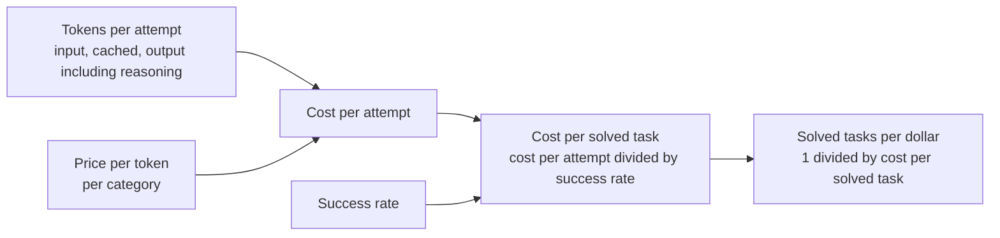

# 17. Cost per task — price per token is the wrong number

> Token price tells me what one token costs. It does not tell me what one finished task costs, because models spend very different numbers of tokens on the same task. The number I want is **cost per task**, and its inverse, **tasks per dollar**. Better still is cost per **solved** task, which also counts the failures.

Related: [08 Settings: routing, cost and privacy](08_Settings_Model_Routing_Cost.md) · [16 SOTA and reasoning effort](16_SOTA_And_Reasoning_Effort.md) · [12 Context language models](12_Context_Language_Models.md) · [14 What an agent fleet needs](14_What_Agent_Fleets_Need_Beyond_Spawning.md) · [02 Agent runner portability](02_Agent_Runner_Portability.md)

Source: S01E04 transcript (Settings section) and the lecture's cost figure (`img/token-price-vs-cost-per-task.png`). Billing facts come from search summaries of OpenAI and Anthropic docs, and cost-per-task practice from a search summary of Artificial Analysis's methodology. **I could not read slopalytics.com**, the site the lecture names. See [Fact-check](#fact-check).

## 1. The problem

Comparing models by price per million tokens looks simple. Why does it mislead, and what should I compare instead?

## 2. Words refinement

| Term | Meaning here |
|---|---|
| **Token price** | The price per million tokens. Real bills use several prices: uncached input, cached input, cache writes, and output |
| **Tokens per task** | Every token the model reads and writes to finish one task, across all turns of the agent loop |
| **Cost per task** | Tokens per task multiplied by their prices, summed over the categories |
| **Tasks per dollar** | One divided by cost per task |
| **Cost per solved task** | Cost per attempt divided by the success rate. A failed attempt still costs money. The research literature calls the idea "cost-of-pass" |
| **Reasoning tokens** | Thinking tokens before the answer. Both OpenAI and Anthropic bill them as output tokens, even when the text is hidden or summarized |

## 3. The figure

**The story:** Model A is four times cheaper per token and still loses, because it needs 5.5 times as many tokens. The last column, in red, is the one that decides.

**What is important:** cost per task is price multiplied by tokens. The two numbers move independently, so neither one alone ranks the models.

**What is not important:** the bar lengths. They only show the direction.

My arithmetic from the figure:

| | Model A | Model B |
|---|---|---|
| Token price | $0.50 / Mtok | $2.00 / Mtok |
| Tokens per task | 220k | 40k |
| **Cost per task** | 220k × $0.50 / 1M = **$0.11** | 40k × $2.00 / 1M = **$0.08** |
| **Tasks per dollar** | 9.1 | 12.5 |

Model B is 4 times more expensive per token and 27% cheaper per task. The rule behind it: **cost ratio = price ratio × token ratio**. B wins as long as it uses less than a quarter of A's tokens. At 55k tokens per task, B would cost the same $0.11 as A.

The figure uses one price per token. Real bills do not, which is the next section.

## 4. Why tokens per task differ

- **Reasoning tokens are billed as output.** OpenAI's docs say reasoning tokens are not visible through the API but still take context space and are billed as output tokens. Anthropic says the same about thinking, and notes the billed output count can differ from the visible text. A model that thinks more costs more at the same price. This is the link to [16 SOTA and reasoning effort](16_SOTA_And_Reasoning_Effort.md).
- **Agent loops resend the context.** Each turn sends the whole history again as input, so input tokens usually dominate over a long task. That is why a task can reach hundreds of thousands of tokens.
- **Caching changes the input price.** Anthropic prices cache reads at about 0.1 times base input and 5-minute cache writes at 1.25 times. OpenAI's page for one current model lists cached input at 5% of the uncached rate. A high cache hit rate lowers cost per task a lot. Anthropic recommends pricing each usage category at its own rate.
- **Edits that break the cache raise the cost.** [12 Context language models](12_Context_Language_Models.md) shows this: an edit near the start of the context forces a recompute of everything after it. My reading is that cache hit rate is part of cost per task, not a separate topic.
- **Changing the effort setting can break the cache too.** Anthropic's docs say a change between requests invalidates the message-level cache, so a mid-session step-down has a one-time cost. See [16](16_SOTA_And_Reasoning_Effort.md#8-my-practice-check-the-dropdown-then-step-down).
- **Retries and failures cost tokens too.** A model that needs three attempts pays for three.

## 5. Cost per solved task

Cost per task assumes the task got done. If a cheap model fails more often, the failures belong in the number. Cost per solved task divides the cost per attempt by the success rate.

An illustration, with numbers I made up to show the effect, not data:

| | Cost per attempt | Success rate | Cost per solved task | Solved tasks per dollar |
|---|---|---|---|---|
| Model A | $0.11 | 90% | $0.122 | 8.2 |
| Model B | $0.08 | 60% | $0.133 | 7.5 |

Here B is cheaper per attempt and still more expensive per solved task. In the lecture's own figure B wins on cost per task. Whether it still wins depends on how often each one succeeds, and the figure does not say.

Two pointers to the same idea:
- A paper on this framing, "Cost-of-Pass", reports that lightweight models were the most cost-effective for basic quantitative tasks, large models for knowledge-intensive ones, and reasoning models for complex quantitative problems, despite higher per-token costs. I saw this only as a search summary of its conclusions.
- The course's effort-routing example compares cost per **solved** task, and says it is "unknown" if no task is solved. See [16](16_SOTA_And_Reasoning_Effort.md).

## 6. Who publishes cost per task

- **Artificial Analysis** computes cost per task from the tokens a model actually uses on its Intelligence Index, multiplied by input, cache and output prices, weighted by each benchmark's share. A model that writes longer answers or more reasoning tokens costs more per task even at the same token price (search summary of its methodology page).
- **Slopalytics** is the site the lecture names for a Cost Per Task metric. The page returned only its title when fetched, because it appears to render in the browser, and no search result described it. **I cannot say what it measures or how.** Verify before presenting.
- **The numbers move.** A 2026 DoiT write-up that cites Artificial Analysis reports per-task costs from a few cents to under two dollars for different models, and says a ranking reversed within weeks as prices and runs were refreshed. It is a third-party source, so I treat the figures as an illustration of spread, not as data.
- **A benchmark's "task" is not my task.** One comparison I saw makes this point directly. A published cost per task is a starting point, and my own tasks decide.

## 7. What I would measure in my own runner

For each task my runner finishes, I would record:
- input, cached input, output and reasoning tokens, separately
- the price table in force at the time, per category
- whether the task succeeded, by a check that is not the model's own opinion
- the model and the effort level used

From those I get cost per task, cost per solved task and tasks per dollar for each cell of the [model and effort grid](16_SOTA_And_Reasoning_Effort.md#3-the-figure). That is also the monitoring data that point 11 in [14](14_What_Agent_Fleets_Need_Beyond_Spawning.md) says is missing. The adapter layer from [02](02_Agent_Runner_Portability.md) is the natural place to count tokens per provider, because each provider reports usage with different field names and prices.

## Open questions

1. What does Slopalytics actually define as cost per task, and is it per attempted or per solved task?
2. For my own task types, what is the cost per solved task in each cell of the grid?
3. How large is the cache hit rate in my agent loops, and how much of the bill is input rather than output?

## Fact-check

Checked 2026-11-08. "Search summary" means I saw the page named in a search result summary, not the full page.

| # | Claim | Verdict | Source | Checked |
|---|---|---|---|---|
| 1 | Model A costs $0.11 per task and Model B $0.08, from 220k × $0.50/M and 40k × $2.00/M | **Agrees** (my arithmetic matches the figure) | The lecture's figure | 2026-11-08 |
| 2 | Tasks per dollar are 9.1 and 12.5, B is about 27% cheaper per task, and B's break-even is 55k tokens | **My calculation** from the figure's numbers | — | 2026-11-08 |
| 3 | Reasoning and thinking tokens are billed as output tokens even when hidden, and the billed count can differ from the visible text | **Agrees** (search summaries of vendor docs) | [OpenAI reasoning guide](https://developers.openai.com/api/docs/guides/reasoning), [Anthropic pricing](https://platform.claude.com/docs/en/about-claude/pricing), [Anthropic thinking](https://platform.claude.com/docs/en/build-with-claude/thinking) | 2026-11-08 |
| 4 | Anthropic prices cache reads at about 0.1 times base input and 5-minute cache writes at 1.25 times | **Agrees** (search summary of vendor docs). Exceptions exist per model | [Anthropic prompt caching](https://platform.claude.com/docs/en/build-with-claude/prompt-caching) | 2026-11-08 |
| 5 | OpenAI cached input is 5% of the uncached rate | **Unverified for models in general** | The figure appeared on one model's page in the results. Check the model you use. | 2026-11-08 |
| 6 | Artificial Analysis computes cost per task from actual token use, multiplied by input, cache and output prices and weighted over its index | **Agrees** (search summary of its methodology page) | [Artificial Analysis methodology](https://artificialanalysis.ai/methodology) | 2026-11-08 |
| 7 | Slopalytics provides a Cost Per Task metric that is more accurate than token price | **Unverified** | The lecture's claim. I could not read the site (it returned only its title) and found no description of it. | 2026-11-08 |
| 8 | Per-task costs across models range from a few cents to under two dollars, and a ranking reversed within weeks | **Unverified (third-party)** | A DoiT write-up citing Artificial Analysis, seen as a search summary. [DoiT](https://www.doit.com/blog/cost-per-task-vs-cost-per-token) | 2026-11-08 |
| 9 | "Cost-of-Pass" finds lightweight models most cost-effective on basic quantitative tasks, large models on knowledge-intensive ones, and reasoning models on complex quantitative problems | **Agrees, verify before presenting** (search summary of the paper's conclusions; I did not read its definition) | [arXiv 2504.13359](https://arxiv.org/html/2504.13359v2) | 2026-11-08 |
| 10 | Cost per solved task is cost per attempt divided by the success rate | **My definition**, in the spirit of cost-of-pass | — | 2026-11-08 |
| 11 | The effort-routing example reports cost per solved task as unknown when no task is solved | **Agrees** (reader agent read the README) | [effort-routing](https://github.com/MEGA-DOT-DEV/examples/tree/main/examples/effort-routing) | 2026-11-08 |
| 12 | Cache hit rate belongs in cost per task, and edits that break the prefix cache raise it | **My interpretation**, linking the billing docs to the recompute costs shown in note 12 | — | 2026-11-08 |
| 13 | The 90% and 60% success rates in section 5 | **Invented for illustration** | Not data. | 2026-11-08 |
