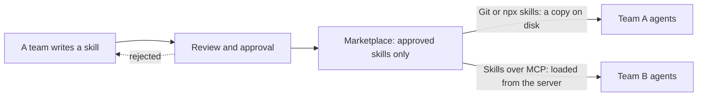

# 18. Sharing approved skills across teams — an AI marketplace

> A skill is a folder: `SKILL.md` plus files. There are three ways to share the same files across teams: a Git repository the team shares and `npx skills` both put a copy on disk, and Skills over MCP serves the skill from a server with nothing installed. An **AI marketplace** adds approval on top of any of them: one place where only reviewed skills are published, and teams take them from there.

Related: [09 Teamwork](09_Teamwork_Knowledge_Base_Tool_Stack.md) · [03 Skill and folder orchestration](03_Skill_And_Folder_Orchestration.md) · [01 Harness lock-in](01_Harness_Lock-in_Keep_Doors_Open.md) · [14 What an agent fleet needs](14_What_Agent_Fleets_Need_Beyond_Spawning.md) · [Lecture 2: 5 Skills](../Lecture_2_Context_Agents_md_Skills_Tools/5_skills.md) · [Lecture 2: 9 Tools and prompt injection](../Lecture_2_Context_Agents_md_Skills_Tools/9_tools_prompt_injection.md)

Source: S01E04 transcript (shared resources) and the lecture's figure (`img/sharing-skills-git-npx-skills-over-mcp.png`). The `npx skills` facts come from its README and docs, the Skills over MCP facts from the working group charter and SEP-2640, both read through a reader agent (SEP-2640 was read verbatim for about 40K of 65K characters, and the rest came as a summary). The skill format and Claude Code marketplace facts come from search summaries of the official docs. The marketplace idea is mine. See [Fact-check](#fact-check).

## 1. The problem

One person writes a good skill. How do other teams get it, keep it current, and trust it? Copying files by hand does not scale, and a skill is an instruction the agent follows, so trust matters.

## 2. Words refinement

| Term | Meaning here |
|---|---|
| **Skill** | A folder with `SKILL.md` and optional support files, in the [Agent Skills format](https://agentskills.io/specification) |
| **On disk** | The skill is copied into the agent's skills folder and read from there |
| **Skills over MCP** | An MCP server serves the skill and the agent loads it at runtime. Nothing is installed |
| **Approval** | A review before a skill is published for other teams |
| **AI marketplace** | A catalog where approved skills are published, plus a controlled way for teams to take them. This is my term |

Claude Code also has a feature called a plugin **marketplace**. It is one vendor's implementation, covered in section 5.

## 3. The figure

![A flow diagram. A skill, shown as SKILL.md plus files, goes three ways: to a Git repository shared by the team, to npx skills which installs skills, and to Skills over MCP, an MCP server. The Git repository and npx skills reach the agent that uses the skill, both labeled "on disk". Skills over MCP reaches the agent through a red arrow labeled "no install". The caption says all three ways share the same SKILL.md files, Git and npx skills put a copy on disk, and with Skills over MCP the agent loads the skill from the server.](img/sharing-skills-git-npx-skills-over-mcp.png)

**The story:** one skill, three routes. The skill files are the same in all three. What differs is where the skill lives when the agent uses it: as a copy on disk, or loaded from a server.

**What is important:**
- **No new format.** All three routes carry the same `SKILL.md` files, so a skill is not locked to one route.
- **The red arrow is the difference.** With Skills over MCP there is no install step and no local copy.
- **Copies can drift.** A copy on disk stays as it was until someone updates it.

**What is not important:** the box layout.

## 4. The three routes

### Git repository shared by the team

The team keeps skills in a repository. The history, review and tags are Git's own. The agent reads the skills from a folder that holds a checkout of that repository, and how the folder is wired depends on the harness.

### `npx skills`

A CLI from [vercel-labs/skills](https://github.com/vercel-labs/skills) (MIT, needs Node.js 22.20 or later).
- **Commands:** `npx skills add <source>`, `update`, `remove`, and `check`, which exits with an error when an update exists, so it can gate CI.
- **Where skills land:** project scope by default, in `./<agent>/skills/`, or `-g` for the user's home. Claude Code uses `.claude/skills/`, Cursor `.agents/skills/`, and Pi, Zed, Codex and others share `.agents/skills/`. It supports "OpenCode, Claude Code, Codex, Cursor, and 75 more".
- **Copy or link:** the default is a symlink to one canonical copy. `--copy` makes independent copies.
- **Versions:** `owner/repo@v1.2.3` pins a release tag or a full commit. A `skills-lock.json` file records sources and content hashes. I found no semver ranges.
- **Private sources:** private repositories work through existing Git credentials, SSH or the GitHub CLI. Any Git URL works, and so does a download URL for a `SKILL.md` or an archive. No internal registry protocol is documented.
- **Telemetry:** on by default. `DISABLE_TELEMETRY=1` or `DO_NOT_TRACK=1` turns it off, and the README says that also turns off its security-audit requests.

### Skills over MCP

A working group of the Model Context Protocol, converted from an interest group on 2026-04-16.
- **Status:** the charter says SEP-2640, the Skills extension (`io.modelcontextprotocol/skills`), was "Final, merged on September 13, 2026". The spec file sits under a `beta` path, which suggests it may not be fully stable. That is my inference.
- **How a server exposes skills:** it uses the existing **Resources** primitive, with no new primitive. Each file is a resource at `skill://<skill-path>/<file-path>`. There are two required methods, `skills/list` and `skills/get`, and an optional directory read. Each listing entry carries the skill's frontmatter and a list of files with their SHA-256 digest and size.
- **How an agent loads one:** the host builds its skill registry from the listing without fetching every `SKILL.md`. It fetches `SKILL.md` when the skill is activated and the other files when they are read, and it checks each against its digest. Reading a skill does not activate it. Activation goes through the host's own skill-loading path.
- **Security rules in the SEP:** approval binds to the set of files, so a change revokes it. The digests are unsigned, so a matching digest is not a trust boundary. A skill from MCP must not silently shadow a same-named skill from another origin.

## 5. The marketplace idea

An AI marketplace puts an approval step in front of whichever route teams use:

How each route can give control (my interpretation, from the facts above):

| Need | Git repository | `npx skills` | Skills over MCP |
|---|---|---|---|
| Only approved skills | Review and protection on the repository's main branch | Install only from the approved repository, pinned to a tag or commit | The server lists only approved skills |
| Know what version runs | The commit | The lock file with content hashes | The digest of each file |
| Updates reach teams | Teams pull | `check` and `update` | The server changes the skill, and an agent must approve again when its files change |
| Remove a bad skill | Delete it from the repository. Existing checkouts keep it until updated | `remove` on each machine. Copies elsewhere stay | Unpublish it. No copy sits on disk |

**Approval needs a record.** The Agent Skills spec has a free-form `metadata` map of strings and recommends distinctive key names. [03](03_Skill_And_Folder_Orchestration.md) already uses it for `harness`, `model`, `origin`, `upstream` and `local_changes`. A marketplace entry could add `approved_by`, `approved_at` and a review reference in the same way. That is my suggestion, not part of any spec.

**Claude Code's own marketplace.** Claude Code has plugin marketplaces. A team adds one with `claude plugin marketplace add <org>/<marketplace> --scope project` and commits the resulting `.claude/settings.json`, so each teammate who trusts the folder gets it. On Team and Enterprise plans an organization can distribute one from its settings. Administrators can register a marketplace and enable its plugins through managed settings (`extraKnownMarketplaces`, `enabledPlugins`), and the `strictKnownMarketplaces` setting is an allowlist for policy enforcement. This is a vendor feature, so in the [portability terms of 01](01_Harness_Lock-in_Keep_Doors_Open.md) it is a thin adapter around skills that stay portable. I did not check which parts a plugin can carry.

## 6. Cautions

- **A skill is an instruction the agent obeys,** and sometimes code it runs. Review it before publishing, as in [Lecture 2: 5 Skills](../Lecture_2_Context_Agents_md_Skills_Tools/5_skills.md). Skill text served over MCP is untrusted input until approved.
- **Approval is only as good as the review.** A digest proves a file did not change, not that it is safe.
- **No restricted data in a shared skill.** An internal marketplace is shared by definition. Skills carry no customer data, credentials or Aras business secrets, and internal source code goes through the [AI Solutions Catalog](http://aitools.aras.com/) rules.
- **Telemetry:** `npx skills` reports usage by default. Check it before using the tool on internal sources.
- **A skill tied to one harness or model** needs its `harness` and `model` metadata filled in, or other teams find out by failure.

## Open questions

1. Which route fits an internal marketplace: a private Git host, an MCP server I run, or both?
2. What approval record does a skill need: reviewer, date, and a hash of the reviewed files?
3. How do skills that depend on a harness or model show up in a shared catalog?
4. How do I revoke a skill that has already been copied to disk?

## Fact-check

Checked 2026-11-08. "Reader agent" means a subagent that fetched the pages and reported back. "Search summary" means I saw the page named in a search result summary, not the full page.

| # | Claim | Verdict | Source | Checked |
|---|---|---|---|---|
| 1 | `npx skills` has `add`, `update`, `remove` and `check`, installs per project by default or globally with `-g`, links to one canonical copy by default, and `--copy` makes independent copies | **Agrees** (README and docs, reader agent) | [vercel-labs/skills](https://github.com/vercel-labs/skills) | 2026-11-08 |
| 2 | Install paths: Claude Code `.claude/skills/`, Cursor `.agents/skills/`, Pi, Zed and Codex share `.agents/skills/` | **Agrees** (docs, reader agent) | [agents.md](https://github.com/vercel-labs/skills/blob/main/docs/agents.md) | 2026-11-08 |
| 3 | `owner/repo@v1.2.3` pins a tag or commit, `skills-lock.json` records sources and content hashes, and no semver ranges exist | **Agrees** for pinning and the lock file. The absence of ranges is **unverified** (absence on the pages read) | [commands.md](https://github.com/vercel-labs/skills/blob/main/docs/commands.md) | 2026-11-08 |
| 4 | Private repositories work through existing Git credentials, and any Git URL or download URL works | **Agrees** (README, reader agent) | [vercel-labs/skills](https://github.com/vercel-labs/skills) | 2026-11-08 |
| 5 | Telemetry is on by default and the opt-out also disables security-audit requests | **Agrees** (README, reader agent) | [vercel-labs/skills](https://github.com/vercel-labs/skills) | 2026-11-08 |
| 6 | No internal registry protocol is documented for `npx skills` | **Agrees** (absence on the pages read) | [vercel-labs/skills](https://github.com/vercel-labs/skills) | 2026-11-08 |
| 7 | The Skills over MCP group was converted to a working group on 2026-04-16, and SEP-2640 is "Final, merged on September 13, 2026" | **Agrees** (charter, reader agent) | [Skills over MCP](https://modelcontextprotocol.io/community/working-groups/skills-over-mcp) | 2026-11-08 |
| 8 | Skills are served as resources at `skill://` URIs with `skills/list`, `skills/get` and an optional directory read, and each file has a SHA-256 digest | **Agrees** (SEP-2640, verbatim for most of the page) | [SEP-2640](https://modelcontextprotocol.io/seps/2640-skills-extension.md) | 2026-11-08 |
| 9 | Digests are unsigned, approval is revoked when the file set changes, and a skill must not silently shadow a same-named one from another origin | **Agrees** (charter and SEP text, reader agent) | [SEP-2640](https://modelcontextprotocol.io/seps/2640-skills-extension.md) | 2026-11-08 |
| 10 | Allowed-tools from an MCP-served skill are ignored unless the user approves them | **Unverified** | From the reader agent's summary of the part of the SEP it could not read verbatim | 2026-11-08 |
| 11 | The `beta` path of the spec file suggests the spec is not fully stable | **My inference** | The charter lists the path. I did not open the repository. | 2026-11-08 |
| 12 | The Agent Skills spec requires `name` and `description`, and allows `license`, `compatibility`, `metadata` (a string map, with distinctive key names recommended) and `allowed-tools` (experimental) | **Agrees** (search summary of the spec) | [Agent Skills specification](https://agentskills.io/specification) | 2026-11-08 |
| 13 | Claude Code plugin marketplaces can be shared by a committed project setting, distributed from organization settings, and controlled with `extraKnownMarketplaces`, `enabledPlugins` and the `strictKnownMarketplaces` allowlist | **Agrees** (search summary of Claude Code docs) | [Host and maintain a marketplace](https://code.claude.com/docs/en/plugins/host-marketplace) | 2026-11-08 |
| 14 | Approval fields (`approved_by`, `approved_at`, a review reference) in skill metadata | **My suggestion** | Not part of any spec | 2026-11-08 |
| 15 | The control table in section 5 | **My interpretation** | Built from the facts in rows 1 to 9. Not stated by the sources | 2026-11-08 |
| 16 | An "AI marketplace" as a controlled way to share approved skills | **My interpretation** | The lecture lists the three routes under shared resources and does not use this term | 2026-11-08 |
