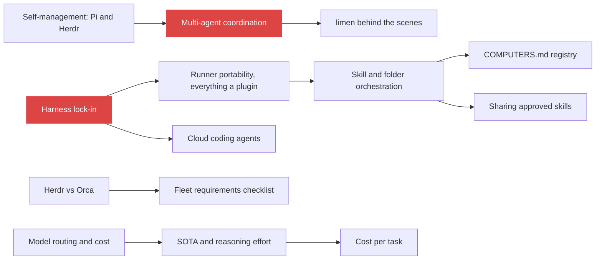

# Lecture 4: Working with AI harnesses

> The harness is a replaceable middle layer: I keep the substance in my repo, build my own agent systems around open contracts, run fleets of agents with files and supervisors, and pick models by cost per task.

Source: S01E04 transcript, the lecture video and web research. Pictures are in `img/`. Related: [Lecture 3: Simplify the codebase](../Lecture_3_Simplify_Codebase_&_Knowledge_Base/README.md) · [Lecture 5: Workflows, not tool sets](../Lecture_5_Workflows_not_tool_sets/README.md) · [root README](../README.md)

## What this lecture covered

## Notes

### Lock-in and portability

| File | Name | What it covers | Keywords |
|---|---|---|---|
| [01_Harness_Lock-in_Keep_Doors_Open.md](01_Harness_Lock-in_Keep_Doors_Open.md) | Harness lock-in, keep doors open | Treat the harness as a replaceable middle layer between UI and tools, keeping substance in the repo rather than vendor features | harness, lock-in, replaceable layer, vendor incentive |
| [02_Agent_Runner_Portability.md](02_Agent_Runner_Portability.md) | Agent runner portability | In my own agent system lock-in is my own code, and plugin architecture, open contracts and adapters remove it | plugin architecture, open contracts, adapter boundaries, llm abstraction |
| [11_Cloud_Coding_Agents.md](11_Cloud_Coding_Agents.md) | Cloud coding agents | Ready-made coding agents in a remote VM differ from platforms that host an agent I build | cloud coding agents, agent hosting platforms, remote vm |

### Fleet organization and infrastructure

| File | Name | What it covers | Keywords |
|---|---|---|---|
| [03_Skill_And_Folder_Orchestration.md](03_Skill_And_Folder_Orchestration.md) | Skill and folder orchestration | Separate skills by harness, scope and origin, and track upstream sources like dependencies | skills, harness, scope, origin, fleet pattern |
| [04_Computers_md_Fleet_Infrastructure.md](04_Computers_md_Fleet_Infrastructure.md) | COMPUTERS.md, fleet registry | Every machine running agents gets an entry in one registry file, and a runbook provisions new boxes | computers.md, registry, runbook, fleet |
| [14_What_Agent_Fleets_Need_Beyond_Spawning.md](14_What_Agent_Fleets_Need_Beyond_Spawning.md) | What fleets need beyond spawning | The lecture's 11 requirements for a fleet, turned into a checklist with one test question each | agent fleet, 11 requirements, checklist |
| [18_Sharing_Approved_Skills_AI_Marketplace.md](18_Sharing_Approved_Skills_AI_Marketplace.md) | Sharing approved skills | Three ways to share skills across teams (Git repo, npx skills, Skills over MCP), with approval on top | skill.md, git repository, npx skills, skills over mcp, marketplace |

### Layers, models and cost

| File | Name | What it covers | Keywords |
|---|---|---|---|
| [05_Dont_Overspecify_Work_At_Assistants_Level.md](05_Dont_Overspecify_Work_At_Assistants_Level.md) | Don't overspecify, work at the assistants level | The stack is code, LLMs, harnesses, assistants, and overspecifying the harness is a trap | four layers, assistants, overspecifying |
| [08_Settings_Model_Routing_Cost.md](08_Settings_Model_Routing_Cost.md) | Settings, model routing, cost | Measure models by cost per task, not token price, with a deterministic privacy boundary | model routing, reasoning effort, cost per task, privacy |
| [16_SOTA_And_Reasoning_Effort.md](16_SOTA_And_Reasoning_Effort.md) | SOTA and reasoning effort | SOTA picks the model and effort picks how much it thinks, so a top model at low effort is an option | sota, reasoning effort, two dials |
| [17_Cost_Per_Task.md](17_Cost_Per_Task.md) | Cost per task | Token price hides different token counts, so I use cost per task, tasks per dollar, cost per solved task | cost per task, tasks per dollar, token price |

### Self-managing agents and coordination

| File | Name | What it covers | Keywords |
|---|---|---|---|
| [06_Self_Management_Pi_Herdr.md](06_Self_Management_Pi_Herdr.md) | Self-management with Pi and Herdr | An agent reads its own docs, changes its settings, spawns workers and survives a closed terminal | self-management, pi, herdr, workers |
| [07_Multi_Agent_Coordination.md](07_Multi_Agent_Coordination.md) | Multi-agent coordination | Agents talk through files, a supervisor watches each worker, and the coordinator is notified when jobs end | coordinator, workers, files as messages, supervisor |
| [13_Herdr_vs_Orca_Agent_Orchestration.md](13_Herdr_vs_Orca_Agent_Orchestration.md) | Herdr vs Orca | Herdr keeps terminals and agents alive, Orca gives each task a git worktree, and they sit at different layers | herdr, orca, git worktree, orchestration |
| [15_Pi_Limen_Behind_The_Scenes.md](15_Pi_Limen_Behind_The_Scenes.md) | Pi and limen behind the scenes | Records are plain files and git, Pi hooks run inside each process, and limen links coordinator, workers and supervisor | limen, pi hooks, files, file watchers, supervisor |

### Team and automation

| File | Name | What it covers | Keywords |
|---|---|---|---|
| [09_Teamwork_Knowledge_Base_Tool_Stack.md](09_Teamwork_Knowledge_Base_Tool_Stack.md) | Teamwork, knowledge base, tool stack | Shared skills are not enough, the team needs an internal knowledge base agents can query | teamwork, knowledge base, tool stack |
| [10_Automation_Repository_Agents.md](10_Automation_Repository_Agents.md) | Automation and repository agents | Agents run in GitHub comments, on PRs and on schedule while the human reviews and merges | repository agents, github, background workflows, pr |
| [12_Context_Language_Models.md](12_Context_Language_Models.md) | Context language models | A model manages its own context in an editable file, with narrower evidence than claimed | context language model, editable context file, compaction |
