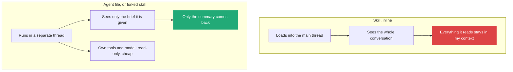
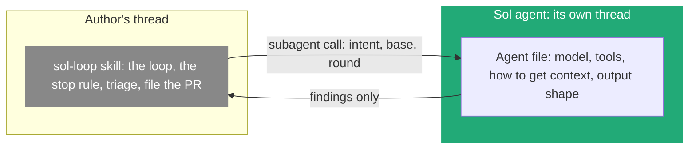
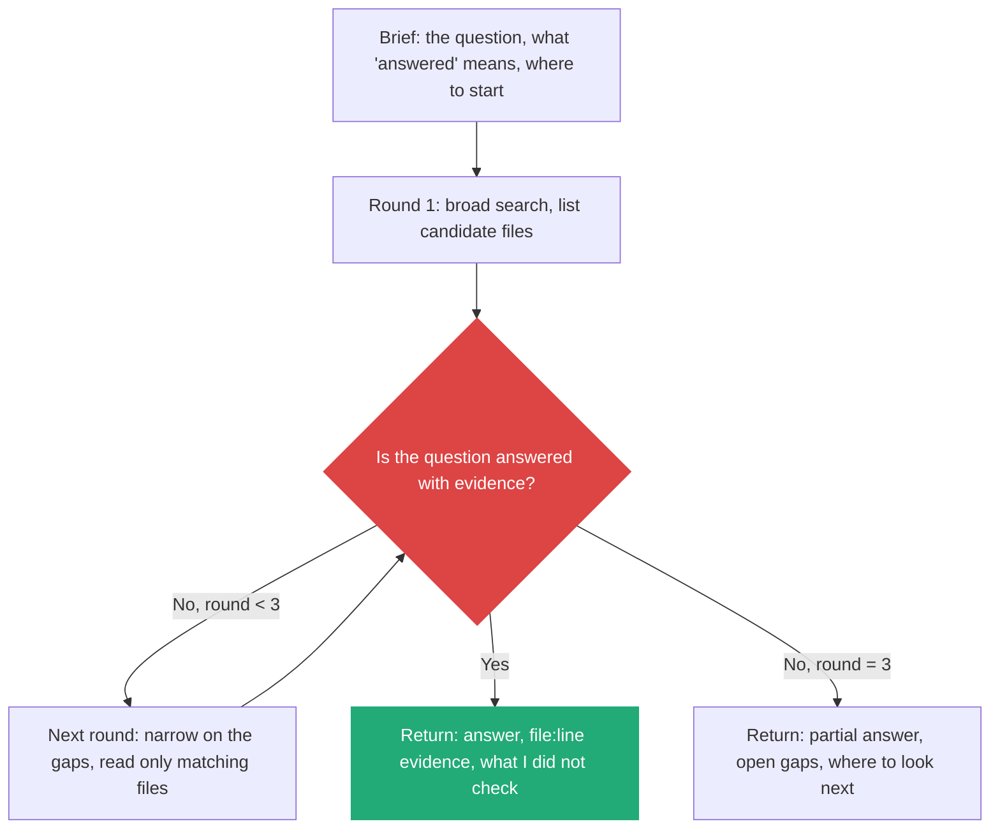
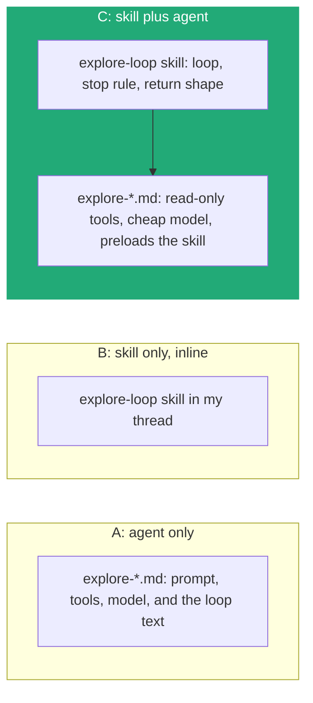

# 1. Skill or agent for exploring: put the loop in a skill, keep the agent for isolation

> The industry does not choose skill over agent. It splits the job: the procedure (the loop, the stop rule, the shape of the answer) goes in a skill, and the agent file keeps what a skill cannot enforce (separate context, tool limits, model). My explore agents stay, and the sol-loop idea makes them better.

Related: [08 Skills as building blocks](08_Skills_As_Building_Blocks.md) · [Lecture 2: 12 Subagents vs workers](../Lecture_2_Context_Agents_md_Skills_Tools/12_subagents_vs_workers.md) · [Lecture 2: 5 Skills](../Lecture_2_Context_Agents_md_Skills_Tools/5_skills.md) · [Lecture 4: 08 Model routing and cost](../Lecture_4_Harness/08_Settings_Model_Routing_Cost.md) · [Lecture 4: 05 Don't overspecify](../Lecture_4_Harness/05_Dont_Overspecify_Work_At_Assistants_Level.md) · [02 Before the merge: a second pair of eyes](02_Merge_Review_Second_Pair_Of_Eyes.md)

Source: S01E05 transcript (the sol-loop skill and the subagent bloat it hit), my existing note [Lecture 2: 12](../Lecture_2_Context_Agents_md_Skills_Tools/12_subagents_vs_workers.md), Claude Code subagent and skill docs and Anthropic engineering posts, all read as search summaries on 2026-11-09. See [Fact-check](#fact-check).

## 1. The problem

The lecturer's sol-loop is a skill: review, fix, repeat, stop after three loops. My explore agents (`explore-*`) are separate agent files that search and read code and return findings. They work well, but they run once and answer. Two questions follow:

1. Would a loop, written the way the sol-loop is written, improve exploring?
2. Does the industry now prefer a skill over a separate agent for this kind of job?

## 2. Words

| Term | Means here | Not to be confused with |
|---|---|---|
| **Skill** | Markdown loaded into the **current thread** when its description fits. Describes behavior | An agent. It has no thread of its own by default |
| **Agent file (subagent)** | Markdown plus settings (tools, model, permissions). Runs in a **separate thread** and returns a result | A skill with a longer prompt |
| **Forked skill** | A skill marked to run in a separate thread, as a subagent (`context: fork` in Claude Code) | A subagent defined in `.claude/agents/` |
| **Explore agent** | A read-only helper that searches and reads, then returns compressed findings | A planner or an editor |
| **Loop** | Repeat a step until a stop rule fires (three rounds, coverage reached) | An open-ended retry |

## 3. What really differs: thread and settings, not format

Both are Markdown with a name and a description. The difference is where they run and what they can touch ([Lecture 2: 12](../Lecture_2_Context_Agents_md_Skills_Tools/12_subagents_vs_workers.md)).

| | Skill, inline | Agent file or forked skill |
|---|---|---|
| Context | Shared with the conversation | Isolated, sees only the brief |
| Cost to my context | Everything it reads | The summary only |
| Tool limits | Hints only | Enforced (no write tool) |
| Model | The main one | Can be cheaper |
| Portable across harnesses | Yes, same format | Harness-specific fields (`tools:` in Claude Code, TOML in Codex) |

**Why exploring is the textbook case for isolation:** it reads a lot to produce a little. Run inline, every file it opens stays in my context. Run isolated, I get one page of findings. That is the reason a built-in read-only Explore agent exists in Claude Code, and the reason the lecturer was unhappy when a subagent read a whole CLI history and bloated his context ([02](02_Merge_Review_Second_Pair_Of_Eyes.md#how-the-sol-loop-got-here-seven-edits)).

## 4. What the vendors and the industry say

| Source | What it says | What I take from it |
|---|---|---|
| Anthropic, [Equipping agents with Agent Skills](https://www.anthropic.com/engineering/equipping-agents-for-the-real-world-with-agent-skills) | Skills are folders of instructions loaded on demand (progressive disclosure) | Skills carry knowledge and procedure |
| Anthropic talk, "Don't Build Agents, Build Skills Instead" (Barry Zhang, Mahesh Murag) | Put expertise in skills rather than in more agents. Multiple agents are reasoned about separately: parallel work, separation of concerns, protecting the main context | The trend is "agent plus skills", not "skills instead of agents" |
| Claude Code docs, [subagents](https://code.claude.com/docs/en/subagents) | Subagents have own context, tools, model. Built-in Explore is read-only. From v2.1.198 it inherits the main model instead of always using Haiku | Isolation and read-only settings are still the point of Explore |
| Claude Code, skills with `context: fork` | A skill can run as an isolated subagent and return a summary. Sources say it is for when isolation is the point, and that the forked skill cannot spawn further forks | The two formats converge. A skill can borrow an agent's isolation |
| Anthropic, [Building effective agents](https://www.anthropic.com/research/building-effective-agents) | Patterns: evaluator-optimizer (a loop with clear criteria), orchestrator-workers, parallelization. Start with the simplest that works | A loop needs a clear criterion. Add agents only when they help |

**Where I land on the question:** I found no source that says "prefer a skill over an agent". I found a consistent direction: **knowledge and procedure in skills (portable, cheap to change, reused by many agents), isolation and limits in agent files (or forked skills)**. This matches [08](08_Skills_As_Building_Blocks.md) and the four-layer stack in [Lecture 4: 05](../Lecture_4_Harness/05_Dont_Overspecify_Work_At_Assistants_Level.md): the durable text goes up, the thin harness-specific settings stay below.

### The worked case: the lecturer's sol agent

The lecturer ran into this split himself ([02](02_Merge_Review_Second_Pair_Of_Eyes.md#how-the-sol-loop-got-here-seven-edits), edit 6). The skill told Claude to use Sol, but Claude could start only the models on its internal list. In his words: "I ended up making a custom sub-agent that was hardcoded in Claude Code that allowed it", and then he "changed the rule here to say, 'You can call Sol using the custom Sol agent with your sub-agent tool.'"

| What the agent carries | Why a skill cannot |
|---|---|
| **The model**, even one outside the harness's own list | A skill has no authority to start a thread on another model |
| **Tools and limits** (read-only, which commands) | A skill's text is a request, not a limit |
| **Its own thread**, so only the findings return | A skill's text and everything it reads land in my thread |
| **Context it fetches itself** (git history, the PR and its comments) and a fixed output shape | These travel with the reviewer, so every caller gets the same behavior |

**Where the loop stays:** in the parent. The loop must edit code, and the reviewer is read-only. A subagent also cannot start another subagent (search summary, verify). So the agent is the reviewer, and whatever drives the rounds (a skill, or a rule in `AGENTS.md`) sits in the author's thread. My `review-loop` example follows this split: [`.claude/review-loop/`](../.claude/review-loop/README.md).

## 5. Would a loop improve exploring?

Yes, if the loop has the three things the sol-loop learned the hard way ([02](02_Merge_Review_Second_Pair_Of_Eyes.md#how-the-sol-loop-got-here-seven-edits)): a finish line, a stop rule with a number, and a rule about what not to read.

| sol-loop lesson | The same line in an explore loop |
|---|---|
| The agent stopped at "we agree", not at the real finish line | Say what "answered" means in the brief. Evidence with file and line, not a feeling |
| Loops ran too long, scope crept | "Stop after three rounds." Return gaps instead of wandering |
| The subagent read the whole history and bloated context | Return a compressed answer. List files read, not their content |
| Different model families catch different things | Optional: a second explorer on another model checks only the gaps |

**Where the loop lives:** inside the explorer's own thread. A subagent in Claude Code cannot start another subagent (search summary, verify), so the loop is rounds of search and read inside one explorer. The sol-loop is different: its loop runs in the parent, which calls the reviewer each round.

## 6. Three ways to build it

| Option | Good | Bad | Use when |
|---|---|---|---|
| A: agent only (today) | One file, isolated, read-only | The loop text is copied into each `explore-*` agent and stays in one harness | One explorer, one harness |
| B: skill only, inline | Portable, sees my context | All reads land in my context | Small question that needs my conversation |
| **C: skill plus agent** | One loop text shared by every explorer. Isolation and limits kept. Portable procedure | Two files to keep in step | Several `explore-*` agents, or more than one harness |

My choice is C for my own set. The skill holds the loop. Each `explore-*` agent stays short: tools, model, and a line that loads the skill (Claude Code agents can preload skills with a `skills:` field, search summary, verify).

## 7. A skill audit I can run

The sol-loop's edit history ([02](02_Merge_Review_Second_Pair_Of_Eyes.md#how-the-sol-loop-got-here-seven-edits)) turns into questions I can ask of any skill.

| Question | If the answer is "no" |
|---|---|
| Did I edit this skill in the last two months? | Read it. The lecturer: "If you have a skill that you use regularly that you have not edited in months, I have concerns" |
| Does it end at the finish line I want today? | Move the end condition |
| Does it have a number or stop rule for loops? | Add one |
| Does it name the tool or agent to call, not a general category? | Name it |
| Does its output waste context or money? | Tell the agent what not to read |
| Do I still use it? | Delete it ([08](08_Skills_As_Building_Blocks.md)) |

An agent can run this audit on a schedule instead of me: see [note 05](05_Agents_Maintain_The_Tools_I_Review.md).

A skill with a change history can be reviewed like code: what failed, what line fixed it. I would keep that history next to the skill (the "structure log" idea from [Lecture 3: 13](../Lecture_3_Simplify_Codebase_&_Knowledge_Base/13_Knowledge_Skill_Anatomy.md)) and the fleet metadata from [Lecture 4: 03](../Lecture_4_Harness/03_Skill_And_Folder_Orchestration.md).

## My take

The decision is not "skill or agent". It is two questions in a row: **does the task need my conversation?** (yes: inline skill) and **does it read much to say little?** (yes: isolation, so an agent or a forked skill). The loop then belongs to the text, which can be a skill either way.

For the agentic platform this suggests a layering: skills as the shared procedure library, agent definitions as thin profiles (tools, model, budget) that reference skills. That keeps the portability argued in [Lecture 4: 01](../Lecture_4_Harness/01_Harness_Lock-in_Keep_Doors_Open.md) and fits the model-routing point in [Lecture 4: 08](../Lecture_4_Harness/08_Settings_Model_Routing_Cost.md): the profile picks a cheap model, the skill stays model-agnostic.

## Cautions

- Whether a loop improves my explorers is a guess until I run both versions on the same questions and compare answers, files read and tokens. The sol-loop's results are the lecturer's observation, not a measurement.
- A loop can make an explorer slower and costlier for questions that one pass answers. The three-round cap limits the damage.
- Exact fields (`context: fork`, `skills:`, `agent:`) differ by harness and version. Re-check the docs before building.
- Exploring sends code content to the model. For Aras code, check the [AI Solutions Catalog](http://aitools.aras.com/) first.

## Summary

Keep the explore agents for isolation, read-only tools and a cheaper model. Move the loop into a skill with a clear finish line, a three-round cap and a compressed return shape, and let the agents load it. The industry direction is skills for procedure and agents for isolation, not skills instead of agents.

## Open questions

- Which of my `explore-*` agents share the same instructions today, and so would share one skill?
- What is a fair test: the same ten code questions, scored on correct answer, files read and tokens?
- Does my harness preload skills into a subagent, or does the agent have to load the skill itself?

## Fact-check

| # | Claim | Verdict | Source | Checked |
|---|---|---|---|---|
| 1 | The industry prefers a skill over a separate agent | **Differs** | No source says this. Anthropic material pairs skills with agents: [Agent Skills post](https://www.anthropic.com/engineering/equipping-agents-for-the-real-world-with-agent-skills) and the "Don't Build Agents, Build Skills Instead" talk (via a [summary](https://videohighlight.com/v/CEvIs9y1uog), not watched) | 2026-11-09 |
| 2 | A skill can run in an isolated subagent | **Agrees (secondary sources)** | `context: fork` described in third-party guides such as [crystl.dev](https://crystl.dev/blog/skills-vs-subagents-claude-code/). Official page not read. Verify before presenting | 2026-11-09 |
| 3 | A forked skill cannot spawn further subagents | **Unverified** | One third-party source only. Verify before presenting | 2026-11-09 |
| 4 | Built-in Explore is read-only, and inherits the main model from v2.1.198 | **Agrees (search summary of official docs)** | [Claude Code subagents](https://code.claude.com/docs/en/subagents). Older pages say Haiku. Check the version | 2026-11-09 |
| 5 | Agent files can preload skills with a `skills:` field | **Agrees (secondary sources)** | Third-party descriptions, for example [zenn.dev](https://zenn.dev/trust_delta/articles/claude-code-skills-subagents-approaches?locale=en). Official page not read. Verify before presenting | 2026-11-09 |
| 6 | Evaluator-optimizer loops need clear success criteria | **Agrees (secondary sources)** | Summaries of [Building effective agents](https://www.anthropic.com/research/building-effective-agents). The original post was not retrieved | 2026-11-09 |
| 7 | Multiple agents cost several times more tokens than one | **Unverified** | A summary attributes "3 to 10 times" to Anthropic. Not confirmed against Anthropic's own text | 2026-11-09 |
| 8 | Skill and agent files differ in thread and settings, not format | **Agrees** | My own note [Lecture 2: 12](../Lecture_2_Context_Agents_md_Skills_Tools/12_subagents_vs_workers.md), built from the lecture | 2026-11-09 |
| 9 | A cross-model reviewer finds more | **Lecture-specific** | The lecturer's observation, see [02](02_Merge_Review_Second_Pair_Of_Eyes.md#how-the-sol-loop-got-here-seven-edits) | 2026-11-09 |
| 10 | The lecturer built a custom subagent so Claude could call Sol, and the skill then called it | **Lecture-specific** | S01E05 transcript, the part after the subagent bloat story. Not checked against Claude Code docs beyond the `model` field in [subagents](https://code.claude.com/docs/en/subagents) | 2026-11-09 |
| 11 | A subagent cannot start another subagent | **Unverified** | Third-party sources only. Verify before presenting | 2026-11-09 |

## Sources

- S01E05 transcript (the sol-loop and its subagent bloat)
- [Claude Code subagents](https://code.claude.com/docs/en/subagents), [Anthropic: Agent Skills](https://www.anthropic.com/engineering/equipping-agents-for-the-real-world-with-agent-skills), [Anthropic: Building effective agents](https://www.anthropic.com/research/building-effective-agents)
- [Lecture 2: 12 Subagents vs workers](../Lecture_2_Context_Agents_md_Skills_Tools/12_subagents_vs_workers.md) for the skill-vs-agent table
- Sections 5, 6 and "My take" are my own reasoning
