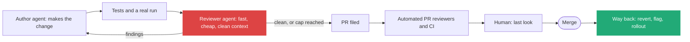
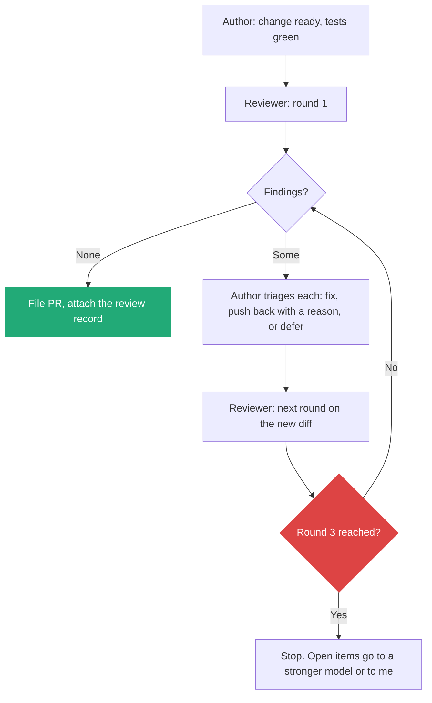
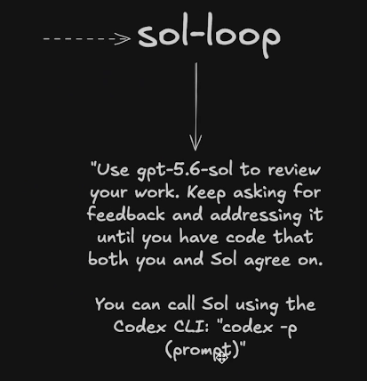
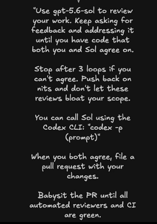
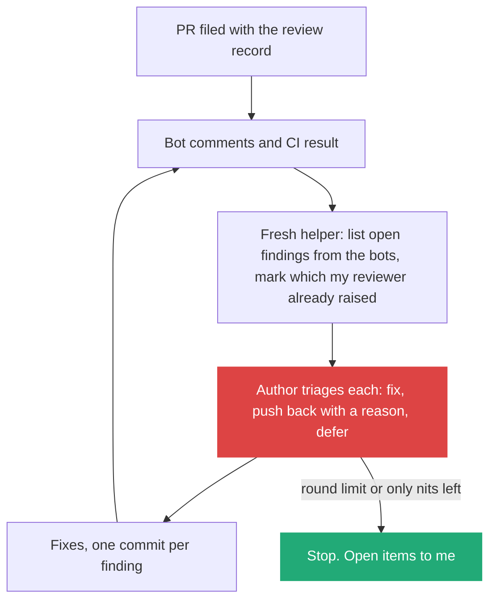
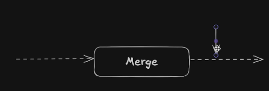

# 2. Before the merge: a second pair of eyes from a fast, cheap reviewer

> A PR bot such as CodeRabbit helps but guarantees nothing. A separate reviewer agent, on a fast and cheap model, with a clean context and a narrow brief, adds an independent check before the PR is filed and a bounded revise-and-recheck loop after it. It is a filter that makes my review easier, not a replacement for tests, bots, a human or a way back.

Related: [01 Skill or agent for exploring](01_Skill_Or_Agent_For_Explore_Loops.md) · [03 The gap](03_The_Gap_Build_Speed_Vs_Keeping_Up.md) · [draft_08 Compose skills](draft_08_Compose_Skills_Building_Blocks_To_Workflows.md) · [draft_06 Teach with bad and good examples](draft_06_Teach_With_Bad_And_Good_Examples.md) · [Lecture 4: 08 Model routing and cost](../Lecture_4_Harness/08_Settings_Model_Routing_Cost.md) · [Lecture 4: 17 Cost per task](../Lecture_4_Harness/17_Cost_Per_Task.md) · [Lecture 2: 12 Subagents vs workers](../Lecture_2_Context_Agents_md_Skills_Tools/12_subagents_vs_workers.md)

Source: S01E05 transcript (the sol-loop and the merge button with its sketch `img/merge-step-before-and-after-sketch.png`, with the PR reviewers named in the story). Papers, DORA and vendor docs checked on 2026-11-09 as search summaries, see [Fact-check](#fact-check).

## 1. The problem

The lecturer reviews with a second model family before he files the PR, then babysits the PR until the automated reviewers and CI are green. His first version stopped too early, and the PR bots still found things his agents missed. So no single check is enough.

Where does a sol-loop-style reviewer fit in the path to the merge button, what should the agent built on it look like, and can a fast, cheap model do the job?

## 2. Words

| Term | Means here | Not to be confused with |
|---|---|---|
| **Second pair of eyes** | A reviewer that did not write the change and does not share the author's context | A second run of the author's own session |
| **Reviewer agent** | A read-only helper that gets a diff and a brief and returns findings | A bot installed on the repository |
| **Automated PR reviewer** | A product that reviews a PR after it is filed (CodeRabbit, Greptile and similar, as named in the lecture) | The reviewer agent. It runs before the PR, under my control |
| **Revision loop** | Review, fix, review again, until a stop rule fires | Open-ended polishing |
| **Independence** | The reviewer's mistakes are not the author's mistakes | A different prompt on the same model and context |

## 3. Where the reviewer sits

Each layer catches a different kind of problem. The reviewer agent is the one layer that runs before anyone else's time is spent.



| Layer | Strong at | Weak at | Cost of a miss |
|---|---|---|---|
| Tests, CI | Exact, repeatable checks | Anything nobody wrote a test for | Caught late, or in production |
| **Reviewer agent (before the PR)** | Logic slips, missed cases, mismatches between intent and diff, fast and many times | Subtle bugs if the model is weak. Noise if the brief is loose | Cheap: one more loop |
| Automated PR reviewers | Wide context, repo conventions, a standing second opinion on every PR | Run after the PR exists. No guarantee. Comments can be noise | A PR round trip and my team's time |
| Human | Intent, risk, judgment | Volume | Expensive |
| Way back | Limiting the damage of what got through | Prevention | Small, if built ([section 7](#7-the-other-side-of-the-button-the-way-back)) |

**Why run a reviewer agent when a PR bot exists:**
- **Order.** The agent runs before the PR. Findings are fixed before the team sees the change, which is the point of the sol-loop: "wasted my other code review agents and my team's time" if skipped.
- **Control.** I write its brief and its stop rule. A bot has its own settings and its own rate limits.
- **Different eyes.** Two different checkers disagree in useful ways, see section 4.
- **No guarantee from any single layer.** The lecturer's own history shows it: agreement between his agents did not stop the bots from finding more.

## 4. What the evidence says about a second reviewer

The idea is plausible. The size of the gain is not settled.

| Question | What I found |
|---|---|
| Do reviewers favor their own output? | Yes, to a degree. The paper [LLM Evaluators Recognize and Favor Their Own Generations](https://arxiv.org/abs/2404.13076) links the bias to how well a model recognizes its own text. A later paper, [Are LLM Evaluators Really Narcissists?](https://arxiv.org/pdf/2601.22548), argues that evaluator uncertainty inflates the measured bias |
| Does a second model find different defects? | Partly. One small preprint on a single team's reviews found [56.5% of confirmed defects were found by exactly one model](https://zenodo.org/records/20519585), and calls it directional |
| Does it improve the result? | Mixed. One paper finds cross-model reviewers differ partly (41.2% overlap in errors) but [not significantly better in F1 than same-model review](https://www.opentrain.ai/papers/when-does-a-second-model-help-cross-model-review-in-llm-verification--arxiv-2610.01471/). Another found that [unioning two models' findings hurt F1](https://arxiv.org/pdf/2606.15689) because the models mostly find the same bugs |

**What I take from it:**
- **Independence is the useful property**, more than raw model strength. A reviewer that sees only the diff and the intent cannot copy the author's wrong assumption.
- **Do not treat a second model as a guarantee.** The gain is real in some studies and absent in others.
- **Use the reviewer to narrow my attention, not to approve.** It points at lines worth a human look.

## 5. Designing the reviewer agent

Same split as in [note 01](01_Skill_Or_Agent_For_Explore_Loops.md): the **procedure** is a skill, the **isolation and limits** are the agent file.

```markdown
---
name: review-second-eyes
description: Review a diff for correctness against the stated intent. Read-only. Use before filing a PR.
tools: Read, Grep, Glob
model: <fast, cheap model>
---
You get: the diff, the intent in two sentences, and the acceptance checks.
You do not get the author's reasoning. Do not ask for it.
Check, in this order:
1. Does the diff do what the intent says, and nothing else?
2. Cases the change misses: empty input, failure paths, concurrency, old data.
3. Anything the change breaks outside the diff (callers, config, migrations).
4. Tests: do they test the behavior or only the code path?
Return at most 8 findings. Each: severity, file:line, evidence, a fix hint.
List what you did not check. If clean, say "no findings" and why.
Skip style nits.
```

| Design choice | Reason |
|---|---|
| **Read-only tools** | A reviewer that edits becomes a second author. Isolation is lost |
| **Clean context: diff, intent, acceptance checks** | Independence from the author's assumptions. Smaller and cheaper too |
| **Fixed checklist, ordered** | A cheap model follows a short list better than "review this" |
| **Capped findings and "skip nits"** | The sol-loop learned to "push back on nits" so reviews do not bloat the scope |
| **"What you did not check"** | The human sees the holes in the review, not only its findings |
| **Evidence with file and line** | I can verify a finding in seconds, so noise is cheap to discard |

A runnable version of this design is in [`.claude/review-loop/`](../.claude/review-loop/README.md): the procedure as a skill, the reviewer as an agent with its model in the header, git history and PR comments read through `git` and `gh`. It is not enabled and has not been run.

### The revision loop



- **Stop after three rounds.** The lecturer's number, added after loops "way longer than they should" caused scope creep.
- **The author may push back.** A finding is a claim to check, not an order. Each pushback is one line with a reason.
- **The loop lives in the parent.** The author agent calls the reviewer each round, as the sol-loop does. Only the reviewer runs isolated.

### How the sol-loop got here: seven edits

Why a second family at all: the lecturer found that one model family "might not be my favorite for writing code, but they were incredibly thorough for reviewing it". So he writes with his preferred model and brings the other in before the PR. The skill began as three sentences and changed seven times, each time because he watched the agent do something he did not want.



The first slide holds the whole skill: "Use gpt-5.6-sol to review your work. Keep asking for feedback and addressing it until you have code that both you and Sol agree on. You can call Sol using the Codex CLI: `codex -p (prompt)`". One instruction, one stop condition ("both agree"), one example call.



The later slide has five paragraphs: review until "both you and Sol agree on" the code, "Stop after 3 loops if you can't agree. Push back on nits and don't let these reviews bloat your scope.", how to call Sol, "When you both agree, file a pull request with your changes.", "Babysit the PR until all automated reviewers and CI are green."

| Edit | What he saw | The line he changed or added | Type of fix |
|---|---|---|---|
| v1 | Nothing yet | The three sentences above | Starting idea |
| v2 | The agent stops once both agree | "When you both agree, file a pull request with your changes" | **Goal moved to the real finish line** |
| v3 | PR reviewers catch what the agents missed | "Babysit the PR until all automated reviewers and CI are green" | **Finish line moved again** |
| v4 | Loops run long, scope creeps | "Stop after three loops if you can't agree. Push back on nits" | **A limit and a stance** |
| v5 | A subagent calling the CLI reads the whole CLI history and bloats context and bill | The model made available as a subagent inside the harness (see [Lecture 4: 06](../Lecture_4_Harness/06_Self_Management_Pi_Herdr.md)) | **Capability change** |
| v6 | Claude cannot start a subagent on a model outside its list | A custom, hard-coded subagent, the "sol agent". The skill says: call Sol with the custom agent through the subagent tool | **A capability moved from text into an agent** ([01](01_Skill_Or_Agent_For_Explore_Loops.md)) |
| v7 | A better tool appeared in the harness | "Use the delegate tool", with the tool descriptions fixed in the open source project | **New tool, and fixing the tool** |

**Important:**
- **Every edit answers something he observed.** He audits what agents do and writes the fix as a sentence.
- **The finish line moved three times** (agree, then PR, then green PR). A skill's end condition is the first thing to check.
- **Limits go in the text as numbers.** "Three loops" is something the agent can follow.
- **Cost showed up as a side effect** (a subagent reading a long history). Look at the bill, not only the result.
- **Open source helped:** "if you rely on open source tools, you can fix these things when they break."

**Not important:** which two model families, which GUI, the cursor mark on the slides. The pattern fits any pair.

### After the PR: reconciling the reviewer with the bots

The lecturer's later version keeps going after the PR is filed: "Babysit the PR until all automated reviewers and CI are green" ([the seven edits](#how-the-sol-loop-got-here-seven-edits)). Two reviewers now judge one change, and the author has to reach one decision.



| Case | Decision |
|---|---|
| My reviewer and a bot raise the same finding | Fix it. Two independent hits are the strongest signal I get |
| Only a bot raises it | Check the evidence. Fix if it ties to the intent or a failing check, otherwise push back or defer |
| Only my reviewer raised it, the bot is silent | Keep it. The bot sees the PR from another angle and is not a veto |
| A bot asks for a change that undoes another finding | The intent decides. Record the reason in the PR |
| A nit | Push back in one line. This is how the loop stays small |

**Two guards, because this loop has no natural end:** a round limit (the slide caps the sol-loop at three, and the same cap fits here) and a fresh helper for each round, so the bot comments do not fill the author's thread ([the seven edits](#how-the-sol-loop-got-here-seven-edits): the lecturer's reports of scope creep and context bloat).

## 6. Fast and cheap: where it fits and where it does not

A cheap model makes the extra pass affordable, so I can run it on every change instead of only the risky ones. Prices change often, so I record cost per task instead of copying a price table ([Lecture 4: 17](../Lecture_4_Harness/17_Cost_Per_Task.md)).

| Tier | Job | Escalate when |
|---|---|---|
| Fast and cheap | Every change: the checklist pass, broad and shallow | A finding is high severity, or the diff touches a risky area (auth, data, money, migrations) |
| Strong, other family | High severity findings and risky areas: verify the finding, look for what the cheap pass missed | Still unresolved after round three |
| Human | Anything the strong model cannot settle, and every change that has no way back | |

This is the same shape as the lecturer's nightly triage: cheap models filter, strong models confirm ([draft_02](draft_02_Markdown_Is_Executable.md), [Lecture 4: 08](../Lecture_4_Harness/08_Settings_Model_Routing_Cost.md)).

**Where a cheap reviewer fails:**
- It misses subtle logic and cross-file effects, so a clean result from it proves little.
- It over-reports when the brief is loose. The finding cap and evidence rule limit this.
- If it is the same family as the author, it can share the author's blind spots. Prefer a different family when the area is risky.

## 7. The other side of the button: the way back

"Merge button itself is just a button, but there's a lot that goes into the before and after of that button." Sections 3 to 6 are the before. The lecturer's sketch adds the after.



**The story.** One solid box labelled **Merge**. A dashed arrow runs into it from the left and a dashed arrow runs out of it to the right. The box is the only fixed thing. The two dashed lines are everything that leads to it and follows it, and they are where the work of a workflow goes.

**Important:**
- **The merge is a point on a line, not an end.** The change still has to live in production.
- **The right-hand arrow is as long as the left one.** Whatever I build before the merge, I owe an equal amount after it.
- **Both lines are dashed:** each team fills them with its own steps (tests, review, flags, rollout, revert).
- **Mistakes break through** "even if you have the best engineers in the world obsessively reviewing things". The lecturer's frustration after the click: "What if the changes were broken? ... How do I undo the damage?"

**Not important:** the drawing tool's selection marks at the top right of the picture.

**Speed raises the price of having no way back.** Agents push more changes to the button each day. If the chance of a bad change per merge stays the same, bad changes grow with volume. The reviewer and the tests lower the chance. The way back limits the cost of each change that still gets through. DORA, the research programme behind the most used delivery metrics, splits them into **throughput** (change lead time, deployment frequency, failed deployment recovery time) and **instability** (change fail rate, deployment rework rate). Failed deployment recovery time is the way back measured in minutes. The 2025 DORA report calls AI an **amplifier** of what a team already does well or badly and links AI adoption to higher throughput.

**Ways back, by what I can undo.** These are common practice, and I have not checked them against a source here.

| Way back | What it undoes | What it needs from me |
|---|---|---|
| Revert one commit | Code of one change | Small, single-purpose changes. A squash merge makes one change one commit |
| Switch a flag off | Behavior in production, without a deploy | The change shipped behind a flag |
| Stop a staged rollout | Reach of the change, while few users see it | A rollout in steps with a health check at each step |
| Roll back a release | Everything in one release | A previous release that still runs |
| Undo a data change | Data, only if planned | A migration that can go back, a backup, or expand-then-contract steps. Often the hardest |
| Undo what an agent did outside the repo | Messages sent, tickets changed, files moved | A log of agent actions, and tools that can reverse them. Not covered by git |

**Rule for AI-heavy work:** before an agent may merge on its own, I can name the way back for that kind of change. If I cannot, the change stops at the human gate.

**When this does not fit.** The lecturer says it himself: "You don't have to think the way I think ... if I was writing code for a pacemaker, I would probably be fired."

| Domain | Can I revert cheaply? | Where to put the effort |
|---|---|---|
| Web app with staged rollout | Yes | After side is strong. Agents can go far on their own |
| Internal tools | Yes | Light before, light after |
| On-premise product with customer-run upgrades | Hard | Heavy before, careful release gates |
| Safety-critical or regulated software | No | Human sign-off before. Agents prepare evidence, they do not merge |

His closing rule: "You should adjust your workflows based on how you work and what is and isn't working for you ... and be willing to adjust them as things change" ([the seven edits](#how-the-sol-loop-got-here-seven-edits)).

## My take

I would add the reviewer agent as a building block, not as a gate. Its output is a short list with evidence, plus a line saying what it did not check. That list goes into the PR text, next to the way back for the change ([section 7](#7-the-other-side-of-the-button-the-way-back)). The human reading the PR then sees: what changed, what was tested, what a second reviewer found, what it did not look at, and how to undo it.

Two honest limits. The evidence for gains from a second model is mixed, so I should measure it on my own work before I rely on it: take a set of past PRs with known problems, run the reviewer, and count what it finds and what it invents. And a reviewer agent does not replace the bots: they see the repository at a different time and from a different angle, and running both costs little.

For an agentic platform, the reviewer is a worker with a very small contract: input is a diff and an intent, output is findings with evidence, tools are read-only. That is easy to describe, to cap and to log.

The pacemaker remark is the useful part of the merge sketch. The degree of autonomy comes from how revertable a change is, not from how good the model is. Where AI is heavily involved, I treat "what is the way back for this change?" as a required field of the change, next to "what does it do?" and "how was it tested?". The same question applies to my agentic platform: before an agent acts, what evidence does it produce, and after it acts, what is the undo? High-risk uses need approval under the AI governance rules.

## Cautions

- The diff and the intent go to a model. For Aras code, check the [AI Solutions Catalog](http://aitools.aras.com/) before using any model or bot, and do not send Restricted Data.
- A reviewer can create false confidence: "the second model found nothing" is not "there is nothing". Keep the "did not check" line and the human gate.
- Findings from AI review need a human decision before use.
- Claims about CodeRabbit are limited to what its documentation summary says. I found no vendor statement on false positives.

## Summary

Put a read-only reviewer agent between the tests and the PR: clean context, a fixed checklist, a fast and cheap model, findings with evidence, at most three rounds. Escalate risky or high-severity findings to a stronger model from another family. It makes human review easier by narrowing it. It does not replace PR bots, tests, a human, or a way back, and the way back matters more as agents speed up: before an agent merges on its own, I can name how its change is undone.

## Open questions

- Which set of my past PRs, with known problems, can serve as a test for the reviewer?
- Which areas of my code count as risky and always go to the strong reviewer?
- Where does the review record live: the PR text, a file, or both?
- For my platform, which agent actions are revertable and which are not, and who owns the way back for each (code, data, messages, tickets)?
- Do I record the way back in the PR text, so a person on call finds it fast?

## Fact-check

| # | Claim | Verdict | Source | Checked |
|---|---|---|---|---|
| 1 | A PR bot does not guarantee that no problems remain | **Agrees (my reasoning, supported by the lecture)** | The lecturer's agents agreed, and the bots still found more. I found no vendor statement either way | 2026-11-09 |
| 2 | CodeRabbit reviews with several models and repository context, on every new PR by default | **Agrees (search summary)** | [CodeRabbit FAQ](https://docs.coderabbit.ai/faq/) and [pull request review](https://docs.coderabbit.ai/overview/pull-request-review.md). Pages not read in full | 2026-11-09 |
| 3 | Models favor their own output when judging | **Agrees, with a limit** | [Panickssery et al.](https://arxiv.org/abs/2404.13076). A later paper, [arXiv 2601.22548](https://arxiv.org/pdf/2601.22548), says evaluator uncertainty accounts for much of the measured effect. Search summaries | 2026-11-09 |
| 4 | A second model finds different defects | **Agrees, weakly** | [Single-team preprint](https://zenodo.org/records/20519585), not peer reviewed | 2026-11-09 |
| 5 | A second model improves review quality | **Differs: mixed** | [arXiv 2610.01471](https://www.opentrain.ai/papers/when-does-a-second-model-help-cross-model-review-in-llm-verification--arxiv-2610.01471/) found no significant F1 gain, and [arXiv 2606.15689](https://arxiv.org/pdf/2606.15689) found that unioning two models hurt F1. Search summaries, papers not read | 2026-11-09 |
| 6 | A cheap, fast model is good enough as a first-pass reviewer | **Unverified** | My design assumption. Test on my own PRs before relying on it | 2026-11-09 |
| 7 | Multi-model review catches 3 to 5 times more bugs | **Unverified** | Blog claims only. Not used in this note | 2026-11-09 |
| 8 | Running the reviewer before the PR saves the team's time | **Lecture-specific** | The lecturer's stated reason for the sol-loop | 2026-11-09 |
| 9 | Stop after three rounds | **Lecture-specific** | The lecturer's rule, added after scope creep. See [the seven edits](#how-the-sol-loop-got-here-seven-edits) | 2026-11-09 |
| 11 | A later round with the bots needs its own round limit and a fresh helper | **My interpretation** | The lecturer's slide caps only the agreement loop and has no limit on the babysit step ([the seven edits](#how-the-sol-loop-got-here-seven-edits)). The guard is my design reasoning | 2026-11-09 |
| 10 | The reviewer should be read-only with a clean context | **My interpretation** | Design reasoning from independence and from [Lecture 2: 12](../Lecture_2_Context_Agents_md_Skills_Tools/12_subagents_vs_workers.md) (a fresh subagent sees only what I give it) | 2026-11-09 |
| 12 | The reviewer model is `gpt-5.6-sol` | **Agrees (search summary)** | Listed as the flagship of OpenAI's GPT-5.6 family (with Terra and Luna), released July 2026: [OpenRouter](https://openrouter.ai/models/openai/gpt-5.6-sol), [Box model card](https://developer.box.com/guides/box-ai/ai-models/openai-gpt-5-6-sol-model-card). OpenAI's own page not read. The transcript's "Soul" is "Sol" | 2026-11-09 |
| 13 | `codex -p (prompt)` calls the model with a prompt | **Unverified** | Third-party Codex CLI references describe `-p` as `--profile`, and OpenAI's docs describe `codex exec` for non-interactive runs ([docs](https://developers.openai.com/codex/noninteractive), via search). Check `codex --help` before presenting | 2026-11-09 |
| 14 | T3 Code has a delegate tool and a new-thread tool | **Unverified** | Not found in a search. [T3 Code README](https://github.com/pingdotgg/t3code) not read for tools. Verify before presenting | 2026-11-09 |
| 15 | The later slide caps only the agreement loop. The babysit step has no limit on it | **My reading of the slide** | `img/sol-loop-second-version-slide.png`. The text may continue below the cut | 2026-11-09 |
| 16 | The writing model "Fable Five" and the PR reviewers "Macroscope", "Code Rabbit", "Greptile" | **Unverified** | Names as spoken in the transcript. Code Rabbit and Greptile are PR review products. Not checked individually | 2026-11-09 |
| 17 | A harness can run a custom subagent on a chosen model | **Agrees (search summary)** | [Claude Code subagents](https://code.claude.com/docs/en/subagents): `.claude/agents/` files with a `model` field | 2026-11-09 |
| 18 | Staged rollouts, nightlies and QA make a bad merge cheaper | **Lecture-specific** | The lecturer's experience at his employers. Standard release-engineering practice, but no source was read for this note. Verify before presenting | 2026-11-09 |
| 19 | DORA splits delivery metrics into throughput and instability, and instability holds change fail rate and deployment rework rate | **Agrees** | [DORA metrics history](https://dora.dev/guides/dora-metrics/history/), via a search summary. Page not read in full | 2026-11-09 |
| 20 | "Failed deployment recovery time" replaced "mean time to recover" | **Agrees** | Same DORA page, via a search summary | 2026-11-09 |
| 21 | The 2025 DORA report calls AI an amplifier and links AI adoption to higher throughput | **Agrees** | [DORA 2025 report page](https://research.google/pubs/dora-2025-state-of-ai-assisted-software-development-report/) and [Google's summary](https://blog.google/technology/developers/dora-report-2025/), via search. Report not read | 2026-11-09 |
| 22 | AI adoption raises instability (more failed changes) | **Unverified** | No change-fail-rate figure found for AI. Read the DORA report before presenting this as fact | 2026-11-09 |
| 23 | More changes per day means more bad changes reach production if the per-change rate stays the same | **My interpretation** | Arithmetic from volume. Not a measured result | 2026-11-09 |
| 24 | Autonomy should match how revertable a change is | **My interpretation** | Reasoning from the pacemaker remark. Not from a source | 2026-11-09 |
| 25 | The table of ways back (revert, flag, staged rollout, release rollback, data undo, agent actions) | **My interpretation** | Common practice, no source read. Verify before presenting | 2026-11-09 |

## Sources

- S01E05 transcript (the sol-loop, the PR bots, the merge button)
- [LLM Evaluators Recognize and Favor Their Own Generations](https://arxiv.org/abs/2404.13076), [Are LLM Evaluators Really Narcissists?](https://arxiv.org/pdf/2601.22548)
- [Cross-model review in LLM verification](https://www.opentrain.ai/papers/when-does-a-second-model-help-cross-model-review-in-llm-verification--arxiv-2610.01471/), [A comparative evaluation of LLMs for automated code review](https://arxiv.org/pdf/2606.15689), [single-team defect preprint](https://zenodo.org/records/20519585)
- [DORA metrics history](https://dora.dev/guides/dora-metrics/history/) and [DORA 2025 report](https://research.google/pubs/dora-2025-state-of-ai-assisted-software-development-report/)
- [CodeRabbit documentation](https://docs.coderabbit.ai/faq/)
- [GitHub CLI manual: gh pr view](https://cli.github.com/manual/gh_pr_view) for the commands in the example skill
- The merge sketch is the lecturer's slide, copied to `img/`
- Sections 3, 5, 6, the ways-back and domain tables in section 7, and "My take" are my own reasoning
