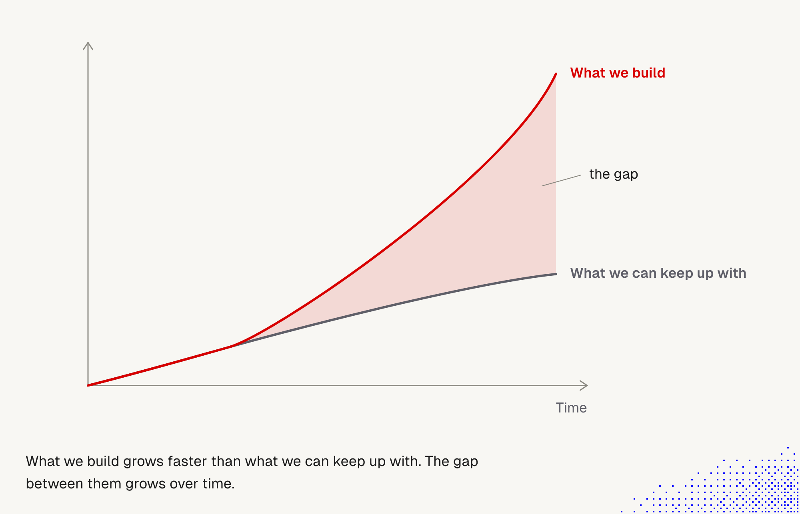
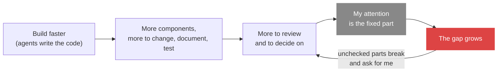

# 3. The gap: what I can build vs what I can keep up with

> Building gets faster every month, but my ability to understand, review, test and decide does not. The gap between the two grows with time, and it is the reason shipping is still slow. The answer is not to build less. It is to move the keeping-up work from my attention to checks, workflows and ways back that run without me.

Related: [02 Before the merge](02_Merge_Review_Second_Pair_Of_Eyes.md) · [draft_02 Markdown is executable](draft_02_Markdown_Is_Executable.md) · [draft_05 Seek tedium](draft_05_Seek_Tedium_Delegate_The_Boring.md) · [draft_06 Teach with bad and good examples](draft_06_Teach_With_Bad_And_Good_Examples.md) · [draft_07 Prompting wider](draft_07_Prompting_Wider.md) · [01 Skill or agent](01_Skill_Or_Agent_For_Explore_Loops.md) · [Lecture 2: 4 Context window](../Lecture_2_Context_Agents_md_Skills_Tools/4_context_window.md) · [Lecture 2: 5 Skills](../Lecture_2_Context_Agents_md_Skills_Tools/5_skills.md) · [Lecture 3: 4 Ask why](../Lecture_3_Simplify_Codebase_&_Knowledge_Base/04_Ask_Why.md) · [Lecture 4: 10 Automation](../Lecture_4_Harness/10_Automation_Repository_Agents.md) · [Lecture 4: 17 Cost per task](../Lecture_4_Harness/17_Cost_Per_Task.md)

Source: S01E05 article, section "Speed of complexity growth" and its two figures; my own reading of the first figure (`img/build-vs-keep-up-gap.png`). Lehman's laws and the DORA 2025 report checked on 2026-11-09 as search summaries. See [Fact-check](#fact-check).

## 1. The problem

Features take a fraction of the time they took a few months ago. Yet a change still takes as long to reach production as it did. A small personal tool is fast to build and soon hard to manage, with or without AI. Something does not add up. The question: **why does faster building not give faster shipping?**

## 2. Words

| Term | Means here | Not to be confused with |
|---|---|---|
| **What we build** | The amount of code, features, agents, scripts and integrations that exist | Value delivered. More things built is not more value |
| **What we can keep up with** | What a person can understand, review, test, document and decide on in the same time | Raw compute or tokens. The limit is attention and judgment |
| **The gap** | Things that exist but nobody has understood or checked | Technical debt only. Debt is code that is worse than it should be. The gap also holds code that is fine but unread |

## 3. The figure

**The story.** In the first stretch both curves are the same: I build a little and I understand all of it. Then building speeds up, because an agent does the typing. What I can follow keeps its old slope and starts to flatten. The shaded area is everything that exists and that I cannot vouch for.

**Important:**
- The curves **split early**. The gap does not start when the system is big, it starts when building speeds up.
- The red curve **accelerates**, the grey one **flattens**. The gap grows faster than either curve alone.
- The grey curve is not zero. I keep up with more than before, but not at the rate of the red one.
- The y axis has no scale. The figure shows the shape of the problem, not measured data.

**Not important:** the exact point where the curves split, the exact slope, the colors.

The loop at the right is the part that hurts: the gap does not sit still. Parts I did not check break, and the breakage comes back to my attention as one more thing to read.

## 4. What does not scale with building speed

| Work | Why it stays slow | Where I see it |
|---|---|---|
| **Review** | Someone has to understand the change to vouch for it | The merge decision, [note 02](02_Merge_Review_Second_Pair_Of_Eyes.md) |
| **Testing** | More components mean more cases. The article says testing alone can take longer than the agents' work | [02, the way back](02_Merge_Review_Second_Pair_Of_Eyes.md#7-the-other-side-of-the-button-the-way-back) |
| **Documentation** | Every new component adds text that has to stay true | Docs sync in the article's workflow list |
| **People and process** | Teams and businesses change at human speed. They cannot see what a release did to users before the next one lands | Rollout, support, training |
| **Agents asking for me** | Agents get stuck, wait for approval or fail silently, and each case needs my attention | The article's second figure: most of my time goes to the system, little to my work |

## 5. The article's second figure

The article adds a picture of what the gap does to one person. I am on the left, with a small box "my work" and a large frame "my system" holding scripts, integrations and three agents. A thin arrow goes to my work ("less time") and a thick red one to the system ("most of your time"). One agent is stuck, one waits for me, and one has a dashed outline and "fails silently", with no arrow back at all.

The silent one is the dangerous case. A stuck agent asks. A silent one hides inside the gap until someone notices the result is missing.

## 6. Two practices that move work off my attention

The lecturer's workflows hold two habits that shrink the gap by letting the agent do the part I used to do. The full notes are [draft_07](draft_07_Prompting_Wider.md) and [draft_06](draft_06_Teach_With_Bad_And_Good_Examples.md).

**Prompt wider: my gate moves to after the evidence.** A narrow prompt returns a diff that I read line by line. A wide one starts from the raw report and ends at a PR with proof. His case: a screenshot of a bug complaint, and by the time he looks again there is "a pull request up, ready to go, with a video showing exactly what was wrong and a video confirming the fix actually works."

| | Narrow | Wide |
|---|---|---|
| I give the agent | A file and a change | The symptom, a screenshot, a ticket |
| Who finds the cause | Me | The agent |
| What I read | The diff | Proof: tests, a video of the bug and of the fix |
| Where my gate is | Before the work | After the evidence |

This lifts the grey curve only if the proof is real and the way back exists. The article warns that agents "can easily game" unit and e2e tests, so the proof must include using the app as a person would ([02, the way back](02_Merge_Review_Second_Pair_Of_Eyes.md#7-the-other-side-of-the-button-the-way-back)). Related: context rot in a long wide run ([Lecture 2: 4](../Lecture_2_Context_Agents_md_Skills_Tools/4_context_window.md)), and the agent asking when the raw input is vague ([Lecture 3: 3](../Lecture_3_Simplify_Codebase_&_Knowledge_Base/03_Agent_Asks_Dumb_Questions.md)). Automation that runs wide without me: [Lecture 4: 10](../Lecture_4_Harness/10_Automation_Repository_Agents.md).

**Teach with a bad and a good example: write my taste once.** When an agent writes a PR title I cannot read, a two-minute skill with the bad output and the good one fixes it for every later session: "It will see the bad example, which is what it would have done, and it'll see the good example, which is what you want, and it will work."

| | Text | Why |
|---|---|---|
| **Bad** | `Perf server: Negotiate per-message deflate on the WebSocket` | Names the mechanism. The lecturer cannot tell what it means |
| **Good** | `Perf server: Cut WebSocket frame size by 70%+ with gzipping` | States the effect, with a number |

Every output I stop correcting by hand is review time I get back. The skill is a check for taste that runs without me. How skills are built and improved: [Lecture 2: 5](../Lecture_2_Context_Agents_md_Skills_Tools/5_skills.md) and [7](../Lecture_2_Context_Agents_md_Skills_Tools/7_skill_shaper_how_to_improve_skills.md). If the agent still misses, I ask it why ([Lecture 3: 4](../Lecture_3_Simplify_Codebase_&_Knowledge_Base/04_Ask_Why.md)).

## My take

I read the figure as a capacity problem, and the capacity is mine. A bigger context window or a faster model moves the red curve, not the grey one. So there are only three honest moves:

1. **Build less.** Remove, simplify, refuse. The article puts removal above adding. It is also the cheapest way to shrink the gap.
2. **Check without me.** Tests, evals, a second reviewer, an agent that uses the app. Every check that runs without me lifts the grey curve for one class of defect. [Note 02](02_Merge_Review_Second_Pair_Of_Eyes.md) is one such check.
3. **Make wrong cheap.** Rollback, flags, staged rollout. What I cannot check before I ship I can still undo after ([02, the way back](02_Merge_Review_Second_Pair_Of_Eyes.md#7-the-other-side-of-the-button-the-way-back)).

The article's one-line version, "we need to use AI to keep up with AI", fits moves 2 and 3. It does not cover move 1, and I would put move 1 first.

For an agentic platform this is a design rule: a feature that adds an agent must also add a way to see what the agent did, a stop, and a way back.

## Cautions

- The figure is a concept. Do not quote it as evidence that the gap is some number or that it is exponential.
- "Use AI to keep up" can add more output to review. A review agent that produces ten findings per change has moved work into my queue, not out of it.

## Summary

Building speed grows faster than my capacity to follow, and the unchecked difference is the gap. Review, testing, documentation, people and agents that need me do not speed up with the agents. I shrink the gap by building less, by checks that run without me and by cheap ways back.

## Open questions

- How do I measure the gap in a real team? Candidates: changes merged without a human reading the diff, components nobody owns, agents without a trace of their last run.
- Does the grey curve rise at all with better tooling, or only shift to a different kind of attention?

## Fact-check

| # | Claim | Verdict | Source | Checked |
|---|---|---|---|---|
| 1 | The chart shows building speed outrunning what people can keep up with | **Lecture-specific (opinion)** | The article's own conceptual figure. No scale, no data | 2026-11-09 |
| 2 | A program's complexity grows as it is evolved unless work is done to maintain or reduce it | **Agrees** | Lehman's law of increasing complexity, restated in [Lehman 1996](https://www.cs.kent.edu/~jmaletic/cs63902/Papers/Lehman96.pdf) and summarised on [Wikipedia](https://en.wikipedia.org/wiki/Lehman%27s_laws_of_software_evolution), via a search summary. Paper not read in full | 2026-11-09 |
| 3 | Effort spent against complexity leaves less for growth | **Agrees** | Same Lehman 1996 text, via a search summary | 2026-11-09 |
| 4 | AI adoption is linked to higher delivery throughput | **Agrees** | [DORA 2025 report page](https://research.google/pubs/dora-2025-state-of-ai-assisted-software-development-report/) and [Google's summary](https://blog.google/technology/developers/dora-report-2025/), via a search summary. Report not read | 2026-11-09 |
| 5 | AI adoption raises instability | **Unverified** | One secondary summary says so. No figure found. Read the [DORA report](https://dora.dev/research/2025/dora-report/) before presenting it | 2026-11-09 |
| 6 | Testing alone can take longer than the agents' work | **Lecture-specific (opinion)** | Article text, no source given | 2026-11-09 |
| 7 | "Use AI to keep up with AI" | **Lecture-specific (opinion)** | Article text. The article says "at least to some degree" for the fixes | 2026-11-09 |
| 9 | Agents "can easily game" unit and e2e tests | **Lecture-specific (opinion)** | Article, section "Quality". No source given | 2026-11-09 |
| 10 | A bug report can become a PR with before and after video evidence | **Lecture-specific** | The lecturer's demonstration ([draft_07](draft_07_Prompting_Wider.md)). No outside check | 2026-11-09 |
| 11 | A bad and a good example in a skill steer the model well | **Lecture-specific** | The lecturer's experience ([draft_06](draft_06_Teach_With_Bad_And_Good_Examples.md)). Consistent with common few-shot practice, not verified here | 2026-11-09 |
| 8 | Each unchecked agent adds attention cost (stuck, waiting, silent failure) | **Lecture-specific (opinion)** | Article's second figure. Matches my own experience, not measured | 2026-11-09 |

## Sources

- S01E05 article, "Speed of complexity growth" (figures 1 and 2, local copy `img/build-vs-keep-up-gap.png`)
- [Lehman 1996, Laws of software evolution revisited](https://www.cs.kent.edu/~jmaletic/cs63902/Papers/Lehman96.pdf) and [Wikipedia: Lehman's laws](https://en.wikipedia.org/wiki/Lehman%27s_laws_of_software_evolution)
- [DORA 2025 report](https://research.google/pubs/dora-2025-state-of-ai-assisted-software-development-report/) and [Google's write-up](https://blog.google/technology/developers/dora-report-2025/)
- My own reasoning: sections 4 to 6 and "My take", including the three moves
