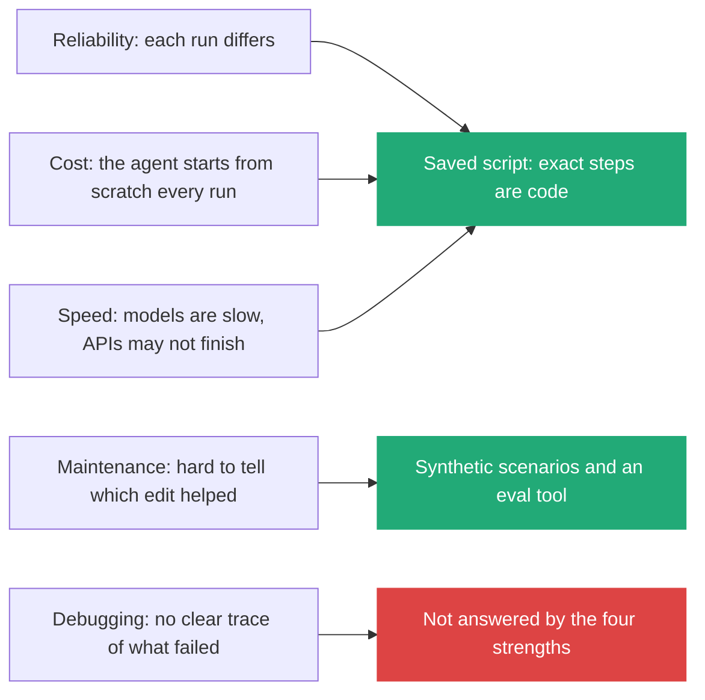
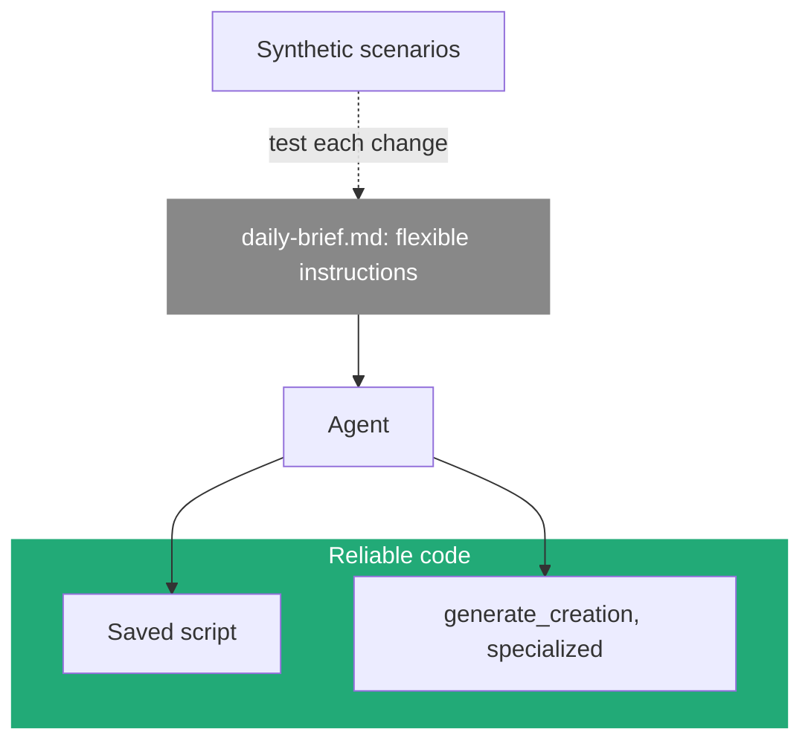
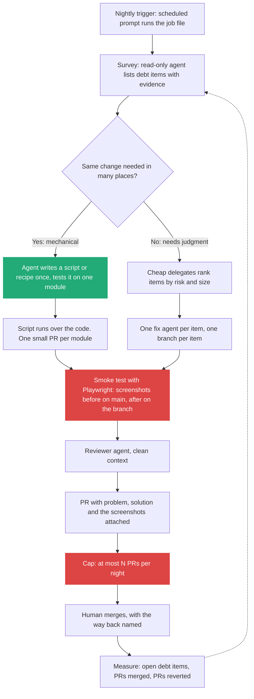
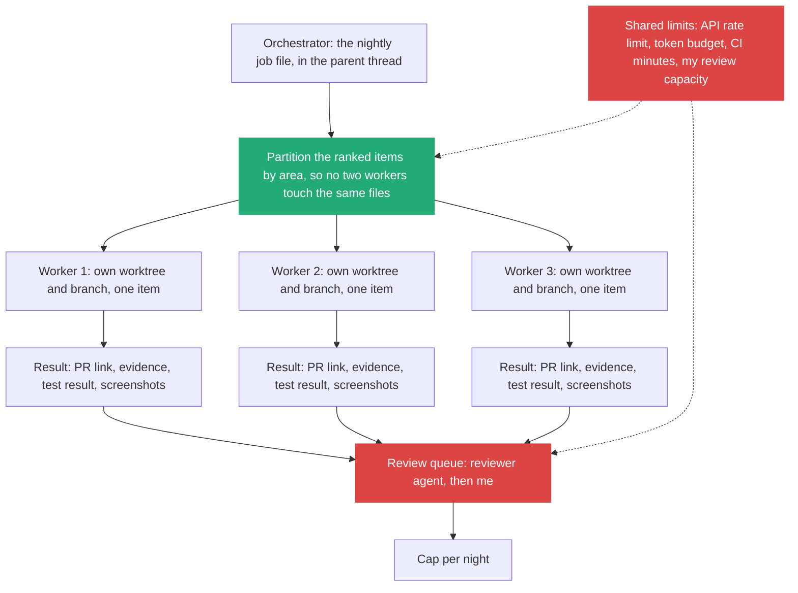

# 4. Executable Markdown: a skill as a program, and how far to push it

> A Markdown file given to an agent runs almost like a program. It is not deterministic, but it is cheap to change and good enough for many jobs. I keep the Markdown for judgment, move exact and repeated steps into saved scripts and generalized tools, and test changes with synthetic scenarios.

Related: [03 The gap](03_The_Gap_Build_Speed_Vs_Keeping_Up.md) · [05 Agents maintain the tools](05_Agents_Maintain_The_Tools_I_Review.md) · [02 Before the merge](02_Merge_Review_Second_Pair_Of_Eyes.md) · [01 Skill or agent](01_Skill_Or_Agent_For_Explore_Loops.md) · [draft_01 Workflows live in prompts and skills](draft_01_Workflows_Live_In_Prompts_And_Skills.md) · [draft_05 Seek tedium](draft_05_Seek_Tedium_Delegate_The_Boring.md) · [draft_08 Compose skills](draft_08_Compose_Skills_Building_Blocks_To_Workflows.md) · [Lecture 2: 5 Skills](../Lecture_2_Context_Agents_md_Skills_Tools/5_skills.md) · [Lecture 3: 12 Update triggers](../Lecture_3_Simplify_Codebase_&_Knowledge_Base/12_Knowledge_Event_&_Triggers.md) · [Lecture 4: 10 Automation](../Lecture_4_Harness/10_Automation_Repository_Agents.md) · [Lecture 4: 08 Model routing and cost](../Lecture_4_Harness/08_Settings_Model_Routing_Cost.md) · [Lecture 4: 17 Cost per task](../Lecture_4_Harness/17_Cost_Per_Task.md)

Source: S01E05 article, section "Executable Markdown vs Code" (figure `img/executable-markdown-for-agent.png`, and figures 4 and 5 as the article describes them), and the transcript's nightly PR triage story. Claude Code scheduling and subagent docs, Promptfoo and Moderne checked on 2026-11-09 as search summaries. See [Fact-check](#fact-check).

## 1. The problem

Many tools I build are a fixed procedure with a few judgment calls. Written as code, they need parsing, retries and special cases. Written as a skill, they are a page of text. Can the text be the program, what do I give up, and how do I get the exact parts back without writing the whole thing as code?

## 2. Words

| Term | Means here | Not to be confused with |
|---|---|---|
| **Executable Markdown** | A `.md` prompt or skill the agent follows step by step, with tools (CLI, MCP) | A script. The same input can take a different path |
| **Single responsibility skill** | A skill that does one job, so it combines with others | A long skill that does everything |
| **Saved script** | Code the agent wrote once and now reuses, as a skill dependency or a deployed endpoint | A one-off script the agent writes and throws away |
| **Generalized tool** | One broad tool the agent specializes at run time (`generate_creation`, not "create Facebook ads") | A bespoke tool per task |
| **Synthetic scenario** | A test case an AI generates to check how a skill behaves after a change | A real user case |
| **Delegate** | A helper agent started by the main agent for one job, with its own model | A long-lived worker ([Lecture 2: 12](../Lecture_2_Context_Agents_md_Skills_Tools/12_subagents_vs_workers.md)) |
| **Scheduled prompt** | A saved prompt the harness reruns on a timer | A cron job that runs code |

## 3. The picture


**The story.** A small file of plain lines, `skill.md`, is the only thing I write. It reaches the agent as instructions. The agent has hands: a browser, files, email, code. What comes out is a whole job, and that frame is about three times the size of the file. The article's reading: "many products may be a single .md file".

**Important:**
- **The file is red, the instructions arrow is red.** The text is the program.
- **The tools are two-way.** The agent reads from them and writes to them, so it can check its own step.
- **The output box is much bigger than the input.** That is the leverage, and also why mistakes hide in it.
- The article's examples fit the picture: a personal daily newsletter, a spoken brief through a text-to-speech API, a researched PDF report, drafts for email triage. All need only an agent with CLI or MCP tools.

**Not important:** the exact tool set and the report example. They stand for any job.

The lecturer on why this is less strange than it sounds: "Back in my day, the idea that you could have something.js and pipe this into Node.js ... was just mind-blowing ... But now, you can take something.markdown and pipe that into Claude, and it will execute it, almost like it's code. Is it deterministic? No. But JavaScript barely feels deterministic nowadays."

| | Script | Markdown workflow |
|---|---|---|
| Same input, same steps | Yes | No, the path can differ |
| Handles an odd case | Only if I coded it | The model adapts |
| Cost to change | Edit, test, deploy | Edit a sentence |
| Where it breaks | A clear error | A quiet wrong turn |
| Portability | Tied to the runtime | Any harness that reads Markdown |

## 4. Five problems, and what the article answers

The article names five problems a programmer sees at once, then four strengths to build on. I read the strengths against the problems:



| Problem | Why it hurts | Cover |
|---|---|---|
| **Reliability** | A run can give misleading claims or take an action it should not | Put exact steps in a saved script. Fix the output format in the prompt. Keep a human on anything that acts |
| **Cost** | The agent redoes everything each run. Run many times a day for many users, the cost can pass the value | Saved scripts so the model is not rebuilding the same code. Cheap model filters, strong model confirms (section 6) |
| **Speed** | LLMs are slower than scripts. A run may never finish | Move the hot path into a script. Name rate limits and stay under them |
| **Debugging** | Hard to tell what failed and why | **The article gives no answer.** My cover: the prompt asks the agent to log each step and its evidence, and the run ends with a short report I read |
| **Maintenance** | Hard to test a change, and to know which edit improved or hurt the result | Synthetic scenarios, run with an eval tool, to see trends across edits |

The four strengths the article lists:

| Strength | What it means | Example |
|---|---|---|
| **Flexibility** | Skills combine with other skills, tools and one-off scripts. For that, a skill needs a single responsibility | Skills as building blocks ([draft_08](draft_08_Compose_Skills_Building_Blocks_To_Workflows.md)) |
| **Code mode** | Models write small scoped apps well. Save and reuse them, as a skill dependency or deployed (the article names Cloudflare) so events, schedules or other agents trigger them | A saved script for a daily brief |
| **Capabilities** | Generalize tools so the agent handles what it was not prepared for, and specializes them for the case | `generate_creation`, specialized for Facebook ads, instead of a "create Facebook ads" tool |
| **Evaluation** | AI generates synthetic scenarios, and a tool such as [Promptfoo](https://www.promptfoo.dev/) shows trends in behavior | Run the same scenarios before and after editing a skill |



The split I take from the article: **text where the job needs judgment, code where it needs exactness, and a test set around the text.**

## 5. Worked case: the nightly PR triage

The lecturer's open source project gets "800 to 1,000" pull requests a day at times. He cannot read them all, so a scheduled prompt runs every day at 9:00 p.m.

```mermaid
sequenceDiagram
    participant T as Timer 9 p.m.
    participant M as Main agent
    participant H as Cheap delegates (Haiku)
    participant O as Strong delegates (Opus + second model family)
    participant Me as Me
    T->>M: Run the saved prompt
    M->>H: One delegate per PR active in the last 24 h
    H-->>M: Brief audit: mergeability, value, novelty, insights
    M->>O: Only PRs that look mergeable
    O-->>M: Verify each one
    M-->>Me: Short list, 8 PRs or fewer, worth merging or taking over
    style H fill:#2a7,stroke:#2a7,color:#fff
    style O fill:#d44,stroke:#d44,color:#fff
```

**The whole program, as the lecturer wrote it** (his words, shortened):

```text
Every day at 9:00 p.m. do the following.
Spin up a set of Haiku delegates to look at pull requests with activity
in the last 24 hours. Do a brief audit for mergeability, value, novelty,
and other insights I might want to know.
If any look mergeable, have Opus and a second-family delegate verify.
Come back with a short list of eight or fewer PRs worth merging
or taking over to get landed.
Any confusion about what I'm looking for? Ask. Otherwise do a test run
before we set up the scheduled task.
```

**What happened:** the agent asked no questions, ran a test with the Haiku delegates, had Opus and the second model review 12 PRs, and showed the list. He approved, and the agent wrote the saved prompt it reruns each night. That prompt grew code-like parts: specific commands, and steps to stay under GitHub rate limits. This is the problem table at work: the rate limit (speed) and the exact commands (reliability) moved into the text as code-like lines.

**Important:**
- **No code was written by hand.** The prompt, then the agent's rewrite of it, is the workflow.
- **Cost is a design input.** A strong model on every PR "would put us out of business". Cheap model filters, strong model confirms ([Lecture 4: 08](../Lecture_4_Harness/08_Settings_Model_Routing_Cost.md), [17](../Lecture_4_Harness/17_Cost_Per_Task.md)).
- **Test run before the schedule.** The agent proves the flow once, then saves it.
- **The output is a short list a person reads.** A wrong turn costs me one review, not a merge.

**Not important:** the model names and the 9 p.m. time. They are his choices.

## 6. Applying it: a nightly agent that prepares the tech-debt fix, with screenshots as proof (my design)

This part is my own reasoning, not the lecture's. The question: debt grows faster than anyone on the project can pay it down. That is the gap from [note 03](03_The_Gap_Build_Speed_Vs_Keeping_Up.md) on one codebase. The executable Markdown idea gives me the shape: a prompt file is the job definition, a scheduled prompt triggers it every night (the triage in section 5), and the agent comes back with a fix prepared and the proof attached. A single prompt "fix the tech debt" fails every row of the problem table at once, so I split the work by how exact it must be.



| Role | Model tier | Tools | Limit | Output |
|---|---|---|---|---|
| **Trigger** | None, a schedule | The harness's scheduled prompt | Runs the job file once a night | The start of the run |
| **Survey agent** | Cheap | Read-only: code, git history, issue tracker | Writes nothing | A ranked list: item, evidence (file, line), mechanical or judgment |
| **Script author** (mechanical items) | Strong, once | Edit, run tests | One module first, then widen | A saved script, and its test on one module |
| **Fix agent** (judgment items) | Mid | Edit, run tests | One item, one PR, diff size cap | A branch with the fix |
| **Smoke test** | None, a saved Playwright script | Browser | Fixed list of pages and flows | Screenshots before and after, and pass or fail |
| **Reviewer** | Cheap, other family for risky areas | Read-only | Three rounds ([note 02](02_Merge_Review_Second_Pair_Of_Eyes.md)) | Findings with evidence |
| **Gatekeeper rule** | None, a rule in the prompt | | Cap per night, no merge by agents | A short queue for me |

Why each choice:
- **The prompt file prepares the agent.** The nightly job is the Markdown: what to survey, how to split, which limits hold, what the PR must contain. I change it by editing a sentence, and I review each change to it like code.
- **Mechanical items go to a script, not to agents.** The same edit across fifty files is what the article's code mode is for: the agent writes it once, and it then runs exactly, fast and for almost no tokens. Industry practice matches: OpenRewrite and Moderne run deterministic recipes across many repositories and pair them with agents, though the evidence I found is vendor-reported (see fact-check).
- **The smoke test is a saved script, not prose.** It is the exact part of the job, so it is code: Playwright opens the pages the change can touch and takes a screenshot of each, on main and on the branch. The article warns that agents "can easily game" unit and e2e tests and says to verify by using the app as a person would ([note 03, section 6](03_The_Gap_Build_Speed_Vs_Keeping_Up.md#6-two-practices-that-move-work-off-my-attention)). Before and after screenshots are that proof, in a form I read in seconds. They show that pages render and look the same. They do not show that behavior is right, so the script also asserts on what matters, and the reviewer reads the diff.
- **The screenshots travel with the PR.** `gh pr create --attach` uploads a local image and writes its link into the PR text, from `gh` 2.99.0 on (fact-check). I do not need a browser trick or a hosting service.
- **The cap protects me.** Fifty debt PRs a night is a new gap, in my review queue. The lecturer's "eight or fewer" is the shape: a short list I can read. The cap rises only when merged PRs stay clean.
- **Tests come first.** An agent refactoring code with no tests has nothing to check against. Areas without tests start with a test-writing item, and a human reads those tests.
- **A way back for every PR.** Small, single-purpose PRs revert alone ([note 02, section 7](02_Merge_Review_Second_Pair_Of_Eyes.md#7-the-other-side-of-the-button-the-way-back)).
- **A trend I can see.** Open debt items, PRs merged and PRs reverted tell me whether the fleet shrinks the debt or only moves it. A night that fails must say so, or it is the silent agent from note 03. Keeping the job file itself fit as models change is [note 05](05_Agents_Maintain_The_Tools_I_Review.md).

### Scaling to several sub-agents

The same job runs wider when the orchestrator hands items to several fix agents at once. The orchestrator stays in the parent thread and each worker is a sub-agent with its own thread, so only a short result comes back ([note 01](01_Skill_Or_Agent_For_Explore_Loops.md)).



| What scales | What does not | Guard |
|---|---|---|
| Workers on separate items, in parallel | **Two workers editing the same files**: merge conflicts and duplicate fixes | Partition by area before the fan-out. One worktree and branch per worker ([git worktree](https://git-scm.com/docs/git-worktree)) |
| Cheap survey and ranking | **My review capacity.** Ten workers make ten PRs and one reader | The nightly cap, and a cap on workers in flight (start with three) |
| Token-cheap scripts for mechanical items | **Tokens for judgment items.** Every worker pays for its own context | A budget per worker and per night, tracked per task ([Lecture 4: 17](../Lecture_4_Harness/17_Cost_Per_Task.md)) |
| Parallel runs | **Rate limits and CI minutes**, shared by all workers | Stagger starts, and name the limit in the job file as in the triage prompt |
| The same prompt for every worker | **Drift between workers**: one skips the smoke test | The smoke test and the PR format are fixed in the job file, and the gatekeeper rejects a PR without screenshots |

**Important:**
- **The limit is the review queue, not the number of agents.** Adding workers lifts the red curve in [note 03](03_The_Gap_Build_Speed_Vs_Keeping_Up.md) and leaves the grey one flat.
- **Workers do not coordinate with each other.** The orchestrator partitions, and a worker that needs a file outside its area stops and reports.
- **A worker returns a result, not its history.** The orchestrator keeps its context for decisions.

**Not important:** the number three. It is a starting point I would raise only while merged PRs stay clean.

## My take

This is the center of the lecture for an agentic platform: a saved prompt is a small, readable job definition, and a skill file is the contract of a worker. The open point is **who reviews the saved prompt**. The model rewrote it, so a change history and a human read of each rewrite are the audit trail ([Lecture 3: 13](../Lecture_3_Simplify_Codebase_&_Knowledge_Base/13_Knowledge_Skill_Anatomy.md) on keeping the history next to the skill). Output that goes to a human list is a safe first use. Output that acts, such as merging, needs limits and a way back first.

The article's missing answer on debugging is the one I would fill first. A job that runs at night and fails quietly is the "fails silently" agent from note 03.

## Cautions

- Non-determinism is real. Do not use this where one wrong step cannot be undone.
- A scheduled prompt can drift as the model changes. Re-read it ([01, the audit](01_Skill_Or_Agent_For_Explore_Loops.md#7-a-skill-audit-i-can-run)).
- Vendor numbers for agent plus recipe migrations are claims, not measurements. Test on my own code.
- Data: triage and debt prompts read repository content. For Aras code, check the [AI Solutions Catalog](http://aitools.aras.com/) before pointing any agent at it, and keep customer data and credentials out of prompts and notes.
- Screenshots show whatever the page shows. Run the smoke test against test data only, and look at each image before it is uploaded, since a PR and its attachments are visible to everyone who can read the repository.

## Summary

A Markdown prompt can be the whole workflow: written once, tested once, scheduled. Its five problems (reliability, cost, speed, debugging, maintenance) are answered by moving exact steps into saved scripts, generalizing tools, and testing edits with synthetic scenarios. Use cheap models to filter and strong models to confirm. For growing tech debt, a nightly scheduled job file prepares the fixes: mechanical items go to a script, judgment items to one agent and one PR each, a Playwright smoke test attaches before and after screenshots as proof, the nightly output is capped, and I measure the trend.

## Open questions

- What share of my project's debt is mechanical (one change in many places), and what share needs judgment?
- Which of my small scripts would be shorter and clearer as a saved prompt, and which saved prompts should become scripts?
- Where do I keep the saved prompt so its rewrites are reviewed?
- What is the right nightly cap on debt PRs for my team's review capacity?
- How many workers can run before my review queue, rate limits or merge conflicts make the night worse than a single agent?
- Which pages and flows must the smoke test cover so that its screenshots mean something, and which need an assertion as well as an image?

## Fact-check

| # | Claim | Verdict | Source | Checked |
|---|---|---|---|---|
| 1 | Skills are executable Markdown and many products may be a single `.md` file | **Lecture-specific (opinion)** | Article text | 2026-11-09 |
| 2 | A harness can rerun a saved prompt on a schedule | **Agrees** | [Claude Code scheduled tasks](https://code.claude.com/docs/en/scheduled-tasks): `/loop` (session only), desktop tasks, and cloud routines created with `/schedule`. Search summary, page not read in full | 2026-11-09 |
| 3 | A harness can start delegates on chosen models | **Agrees** | [Claude Code subagents](https://code.claude.com/docs/en/subagents): `model` field takes `sonnet`, `opus`, `haiku` or `inherit`. Search summary. Sources disagree on precedence with the `CLAUDE_CODE_SUBAGENT_MODEL` variable, so check the page | 2026-11-09 |
| 4 | The lecturer's harness (T3 Code) runs this flow | **Unverified** | The lecturer's setup. [T3 Code](https://github.com/pingdotgg/t3code) exists, MIT, supports Codex, Claude and OpenCode per its README summary. Whether it has scheduling is not checked | 2026-11-09 |
| 5 | The delegate models "Haiku 5.5" and "Opus 5.5", and the second-family reviewer "6.1 Soul" | **Unverified** | Names as spoken in the transcript. The reviewer is most likely `gpt-5.6-sol` (see [02](02_Merge_Review_Second_Pair_Of_Eyes.md#how-the-sol-loop-got-here-seven-edits)), but the "6.1" is not confirmed. Verify before presenting | 2026-11-09 |
| 6 | "800 to 1,000 PRs a day" at his project | **Unverified** | Spoken once in the transcript. Verify before presenting | 2026-11-09 |
| 7 | The result is not deterministic but useful | **Lecture-specific** | The lecturer's experience | 2026-11-09 |
| 8 | The five problems (reliability, cost, speed, debugging, maintenance) | **Lecture-specific (opinion)** | Article text. They match common concerns with agent workflows, but no source is given | 2026-11-09 |
| 9 | Models write small scoped apps well, and saved scripts can be reused or deployed (for example to Cloudflare) | **Lecture-specific** | Article text and its [example repository](https://github.com/MEGA-DOT-DEV/examples/tree/main/examples/skill-vs-saved-script), not read | 2026-11-09 |
| 10 | Generalized tools let an agent handle problems it was not prepared for | **Lecture-specific** | Article text and its [example repository](https://github.com/MEGA-DOT-DEV/examples/tree/main/examples/primitives-vs-bespoke-tools), not read | 2026-11-09 |
| 11 | Promptfoo is an open-source tool for running test cases against prompts and models and asserting on outputs | **Agrees (search summary)** | [Promptfoo](https://www.promptfoo.dev/). Official docs not read. Skill evaluation with it appears in community write-ups only | 2026-11-09 |
| 12 | An agent can generate synthetic scenarios that reveal how a skill change shifts behavior | **Lecture-specific** | Article text and its [example repository](https://github.com/MEGA-DOT-DEV/examples/tree/main/examples/synthetic-skill-eval), not read. No official Promptfoo page found for this feature | 2026-11-09 |
| 13 | The four strengths answer reliability, cost, speed and maintenance, and leave debugging open | **My interpretation** | My reading of the article's two lists | 2026-11-09 |
| 14 | OpenRewrite and Moderne run deterministic recipes across many repositories and pair them with agents | **Agrees (vendor-reported)** | [TechCrunch on Moderne](https://techcrunch.com/2025/02/11/moderne-raises-30m-to-solve-technical-debt-across-complex-codebases/) and the [OpenRewrite README](https://cdn.jsdelivr.net/gh/openrewrite/rewrite@main/README.md), via search summaries | 2026-11-09 |
| 15 | A migration benchmark finished 100% in 3 minutes against 25% for an agent alone, and token use fell from 61M to 30,000 | **Unverified** | Vendor listings only. Not used as evidence in this note | 2026-11-09 |
| 16 | The tech-debt fleet design (nightly trigger, survey, mechanical vs judgment split, smoke test with screenshots, nightly cap, tests first, measure the trend) | **My interpretation** | Design reasoning from this note, [note 02](02_Merge_Review_Second_Pair_Of_Eyes.md) and [note 03](03_The_Gap_Build_Speed_Vs_Keeping_Up.md). Not run | 2026-11-09 |
| 17 | Playwright can take screenshots in a script and as an automatic option on failure, and a full-page capture needs an explicit option | **Agrees (search summary)** | Third-party tutorials ([BrowserStack](https://www.browserstack.com/guide/playwright-screenshot), [Checkly](https://www.checklyhq.com/docs/learn/playwright/taking-screenshots/)). The official docs at playwright.dev were not read. Verify option names before building | 2026-11-09 |
| 18 | `gh` can attach a local image or video to a PR or comment with `--attach` (since gh 2.99.0) | **Agrees (search summary)** | [GitHub changelog, 2026-09-01](https://github.blog/changelog/2026-09-01-github-cli-media-in-issues-pull-requests-and-comments) and [GitHub docs: attaching files with GitHub CLI](https://docs.github.com/en/github-cli/github-cli/attaching-files-with-github-cli), via search. Pages not read. The installed `gh` is 2.103.3. Verify the flags with `gh pr create --help` | 2026-11-09 |
| 19 | Before and after screenshots from a smoke test are useful proof on a PR | **My interpretation** | Reasoning from the lecturer's video proof ([note 03](03_The_Gap_Build_Speed_Vs_Keeping_Up.md#6-two-practices-that-move-work-off-my-attention)). A screenshot shows how a page looks, not that behavior is correct | 2026-11-09 |
| 20 | Several sub-agents can each work in an isolated git worktree and branch | **Agrees** | [git worktree docs](https://git-scm.com/docs/git-worktree). That the harness starts a sub-agent in its own worktree comes from the harness's own tool descriptions in this session, and I did not read the vendor docs page. Verify before building | 2026-11-09 |
| 21 | Parallel workers cost more tokens than one, and conflicts and shared limits cap the speedup | **My interpretation** | Reasoning from shared files, shared rate limits and per-worker context. No measurement. A "3 to 10 times" figure for multi-agent token use is unverified ([note 01](01_Skill_Or_Agent_For_Explore_Loops.md)) | 2026-11-09 |
| 22 | The review queue, not the number of agents, is the limit | **My interpretation** | Reasoning from [note 03](03_The_Gap_Build_Speed_Vs_Keeping_Up.md). Not measured | 2026-11-09 |

## Sources

- S01E05 article, "Executable Markdown vs Code" (figure copied to `img/executable-markdown-for-agent.png`), and the S01E05 transcript (the nightly triage prompt, quoted and shortened). The nightly debt agent with Playwright screenshots is my own idea
- [Claude Code scheduled tasks](https://code.claude.com/docs/en/scheduled-tasks) and [subagents](https://code.claude.com/docs/en/subagents)
- [Promptfoo](https://www.promptfoo.dev/)
- [GitHub changelog: media in issues, pull requests and comments from the CLI](https://github.blog/changelog/2026-09-01-github-cli-media-in-issues-pull-requests-and-comments), [Playwright screenshots, as described by Checkly](https://www.checklyhq.com/docs/learn/playwright/taking-screenshots/)
- [OpenRewrite](https://cdn.jsdelivr.net/gh/openrewrite/rewrite@main/README.md) and [Moderne coverage](https://techcrunch.com/2025/02/11/moderne-raises-30m-to-solve-technical-debt-across-complex-codebases/)
- [git worktree](https://git-scm.com/docs/git-worktree)
- My own reasoning: the problem-to-strength reading in section 4, section 6 (including the scaling diagram) and "My take"
