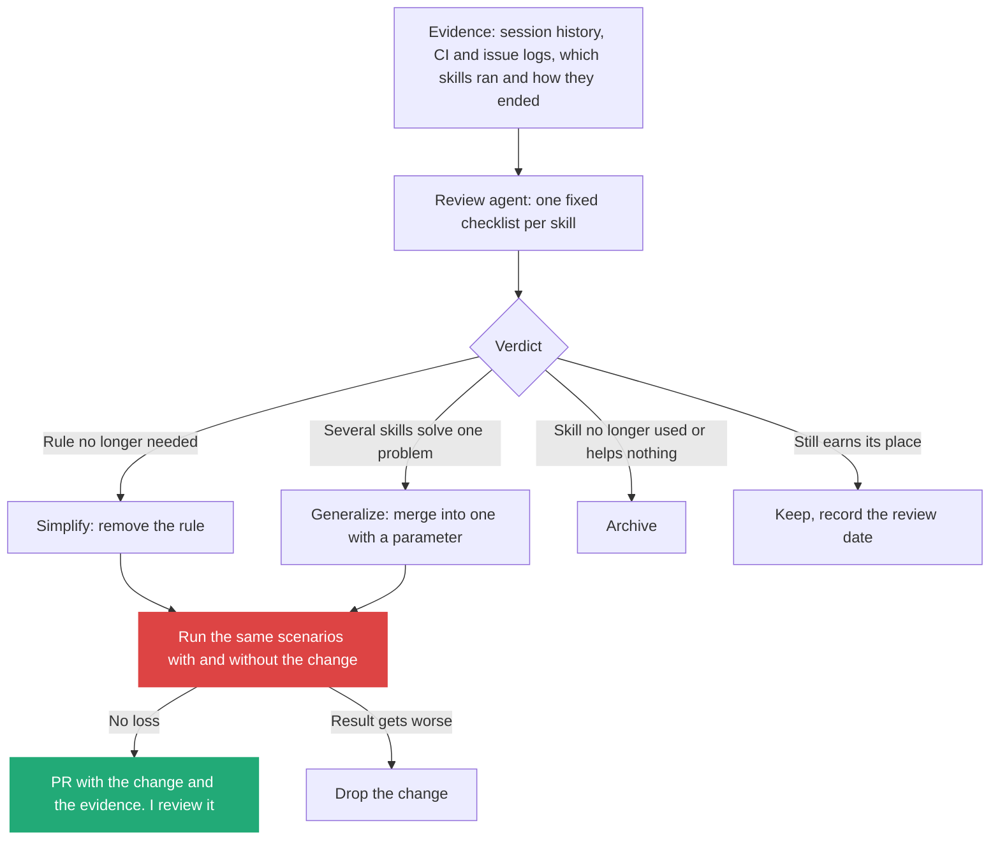

# 5. Agents build and maintain my tools: I review them, I do not hand-edit them

> I build the system once: knowledge base, global context, primitives and a work framework. Agents then create and maintain my tools and skills, and I review a standing report on each one: does it still solve a problem, does the model still need its rules, can several be merged into one. Models change faster than I can re-read my skills, so a rule that worked a year ago needs evidence to stay.

Related: [04 Executable Markdown](04_Executable_Markdown_Skills_As_Programs.md) · [03 The gap](03_The_Gap_Build_Speed_Vs_Keeping_Up.md) · [01 Skill or agent, with the skill audit](01_Skill_Or_Agent_For_Explore_Loops.md#7-a-skill-audit-i-can-run) · [02 Before the merge](02_Merge_Review_Second_Pair_Of_Eyes.md) · [draft_08 Compose skills](draft_08_Compose_Skills_Building_Blocks_To_Workflows.md) · [draft_09 Where skills live](draft_09_Where_Skills_Live_Global_Harness_Repo.md) · [Lecture 2: 7 Skill shaper](../Lecture_2_Context_Agents_md_Skills_Tools/7_skill_shaper_how_to_improve_skills.md) · [Lecture 3: 12 Update triggers](../Lecture_3_Simplify_Codebase_&_Knowledge_Base/12_Knowledge_Event_&_Triggers.md) · [Lecture 4: 03 Skill and folder orchestration](../Lecture_4_Harness/03_Skill_And_Folder_Orchestration.md)

Source: S01E05 article, the section on building the system and its figure (`img/system-built-once-agents-maintain-tools.png`), and the article's list of components (skills and generators kept up by routines that scan history). My own observation of working with skills. Vendor prompting guidance and skill evaluation tooling checked on 2026-11-09 as search summaries. See [Fact-check](#fact-check).

## 1. The problem

Every tool and skill I write by hand is something I must also keep up. The number grows with my agents, so maintenance joins the gap from [note 03](03_The_Gap_Build_Speed_Vs_Keeping_Up.md). And the ground moves: models get smarter, and instructions written for a weaker model can become noise or do harm. Who keeps my tools and skills fit, and how do I know which edits are worth making?

## 2. Words

| Term | Means here | Not to be confused with |
|---|---|---|
| **The system** | What I build once and refine: knowledge base, global context, primitives, work framework | A tool. The system makes tools |
| **Tool** | A thing I use: daily briefing, inbox triage, deploy monitor. The agents create and maintain it | A primitive |
| **Primitive** | A reusable building block that agents combine without changing it (search, read, transform, write) | A bespoke tool for one task |
| **Work framework** | What keeps agents on track: the process and limits they follow | A single prompt |
| **Review** | A standing check of a skill against evidence: does it still help | Hand-editing it on a hunch |
| **Stale rule** | An instruction written for a weaker model or an old problem, that now does nothing or hurts | A rule that is still doing work |

## 3. The picture

![On the left, "You". In the middle, "Agents". On the right, a frame "Your tools" with Daily briefing, Inbox triage and Deploy monitor. At the bottom, a frame "Your system" with four boxes: Knowledge base (your notes and facts), Global context (goals, rules, preferences), Primitives (reusable building blocks) and Work framework (keeps agents on track). A red arrow, "build and refine", goes from You to the system. Lines from each system box go up to the Agents. An arrow "create and maintain" and two more go from the Agents to the tools. An arrow "use" goes from You over the top to the tools. The caption: You build the system once. Agents use it to create and maintain your personal tools.](img/system-built-once-agents-maintain-tools.png)

**The story.** I do two different things. I **build and refine the system** (the red line, bottom) and I **use the tools** (the line over the top). I do not touch the tools in between. The agents read the four parts of the system and, from them, create and maintain the tools. The system is small and stable. The tools are many and change.

**Important:**
- **The red arrow goes to the system, not to the tools.** My hand-work goes where it is reused by everything.
- **"Create and maintain" belongs to the agents.** The arrows do not return to me.
- **All four system parts feed the agents.** A tool built without them (no facts, no rules, no building blocks, no framework) starts from nothing each time, which is the cost problem of [note 04](04_Executable_Markdown_Skills_As_Programs.md).
- **The caption says "once".** In practice the system is refined as I work, and the article says so: the habit of maintaining it matters as much as the first build.

**Not important:** the three example tools. They stand for any tool I use daily.

## 4. What I see: I rarely need to edit by hand, I need to review

My own observation, and it matches the article's line that routines scan history and other sources, such as issue trackers and CI/CD logs, to suggest new skills and optimize existing ones, including archiving the ones nobody needs. Hand-editing skills fails for two reasons:

- **I cannot see what a skill costs or earns.** An edit on a hunch has no evidence behind it.
- **The reference point moves.** A model one step smarter may follow a short instruction that an older one needed spelled out. The rules that helped last year are now extra text in every run, and some push the model too hard.

So my job changes from editing to reviewing, and the review is done by an agent with a fixed checklist. It reads the skill, its usage and a test result, and proposes a change.

## 5. The review checklist

| Question | How the agent checks | Action if the answer is no |
|---|---|---|
| **Does it still address a problem I have?** | Look at the last uses and the logs. Is the situation it was written for still happening? | Archive |
| **Does the model still need it?** | Run the task without the skill, or without one rule, on the same scenarios. Compare ([note 04](04_Executable_Markdown_Skills_As_Programs.md), synthetic scenarios) | Remove the rule |
| **Is any rule only there to push the model?** | Look for shouting words (CRITICAL, MUST, NEVER), repeated reminders and long rule lists | Rewrite as one plain sentence with the reason |
| **Does another skill do the same job?** | Compare descriptions and bodies | Merge into one |
| **Could one skill with a parameter replace several?** | Look for near-copies that differ in a noun | Generalize it, as the article does with `generate_creation` |
| **Is the description still right?** | Run realistic requests that should and should not trigger it | Rewrite the description ([Lecture 2: 7](../Lecture_2_Context_Agents_md_Skills_Tools/7_skill_shaper_how_to_improve_skills.md)) |
| **What does it cost?** | Tokens loaded per session, tokens spent per run | Shorten, or move detail into a file loaded on demand |

**The evidence I lean on.** Anthropic's prompting guidance, as summarized in several sources, says that prompts written to fix undertriggering on older models can overtrigger newer ones, and advises dialing back aggressive language. A recent paper on why skills help and hurt agents ("The Regression Tax") treats a skill as something that can lower results, which is the reason to test removal and not only addition. Anthropic's skill-creator reportedly runs each eval with and without the skill and reports the difference, which is the check in the second row.

## 6. Guards: an agent that edits agent instructions

Letting agents change their own instructions is a loop with a risk in it.

| Risk | Guard |
|---|---|
| The agent loosens a safety rule because it "looks stale" | Protected files and rules the review agent may not change. A human reviews every change to them |
| A change looks fine and degrades results | No change merges without the with-and-without scenario run. The result is in the PR |
| The review runs on a hunch, not on use | The agent cites the evidence (log lines, scenario results) for each verdict, as the reviewer agent does in [note 02](02_Merge_Review_Second_Pair_Of_Eyes.md) |
| A bad change is hard to undo | Skills live in git. Each change is one small PR, so one revert undoes it ([note 02, section 7](02_Merge_Review_Second_Pair_Of_Eyes.md#7-the-other-side-of-the-button-the-way-back)) |
| Session history holds secrets or customer data | Redact before the review reads it, and keep the history inside approved tools |
| The review itself grows into more work for me | A cap on proposals per run, and a short digest. I read a list, not every skill |

## My take

This is the answer to the maintenance row of [note 04's problem table](04_Executable_Markdown_Skills_As_Programs.md): the article names the problem and gives synthetic scenarios as a test, and I add the loop around it. A skill registry for my platform would carry, per skill: owner, last used, last reviewed, last scenario result and a link to its history. The nightly review is itself executable Markdown run by a schedule, and it needs the same limits as the debt fleet: a cap, evidence, a human at the merge.

My own rule for age: a skill that has not been reviewed since the last model change is suspect, even if it has not been edited for months. The audit in [note 01](01_Skill_Or_Agent_For_Explore_Loops.md#7-a-skill-audit-i-can-run) asks whether I edited a skill. The question here is whether anyone checked it against today's model.

## Cautions

- "A smarter model needs fewer rules" is a trend, not a law. Some rules protect against real failures at any model level. The with-and-without run decides, not my feeling.
- Scenarios generated by an AI can miss the case that matters. Seed them with real failures from the logs.
- Session history can hold Restricted Data (customer data, credentials, personal data). For Aras work, check the [AI Solutions Catalog](http://aitools.aras.com/) before any agent reads history, and redact first.
- The review agent changes text that steers other agents. Keep a human at the merge until its proposals have a record I trust.

## Summary

I build the system once and refine it as I work. Agents create and maintain the tools, and I review them with a standing checklist: still needed, still earns its place, simplifiable, mergeable. Each change must pass a with-and-without run, arrive as a small PR with evidence, and be easy to revert. Rules that worked on an older model are the first suspects.

## Open questions

- Which of my skills were written for a weaker model, and what happens to their results when I remove half the rules?
- Where do I keep per-skill history (last used, last reviewed, last scenario result) so the review has something to read?
- Which rules must stay protected from the review agent?
- How often does the review run: nightly, weekly, or after each model change?

## Fact-check

| # | Claim | Verdict | Source | Checked |
|---|---|---|---|---|
| 1 | I build the system once, and agents create and maintain my tools | **Lecture-specific (opinion)** | Article, figure and text | 2026-11-09 |
| 2 | Routines can scan history and sources such as issue trackers and CI/CD logs to suggest new skills, optimize existing ones and archive the unneeded | **Lecture-specific** | Article text and its [session-mining example](https://github.com/MEGA-DOT-DEV/examples/tree/main/examples/session-mining), not read | 2026-11-09 |
| 3 | Prompts written for older models can overtrigger newer ones, and emphatic language should be dialed back | **Agrees (search summary)** | [Anthropic prompting best practices](https://platform.claude.com/en/docs/build-with-claude/prompt-engineering/claude-prompting-best-practices), via a snippet and third-party quotes ([mirror of the docs](https://wphillipmoore.github.io/the-infrastructure-mindset/research/R0020/2026-03-25/Q003-imperative-constraints/sources/SRC01-anthropic-docs/evidence/E02), [DEV Community](https://dev.to/gabrielanhaia/the-lets-think-step-by-step-trick-is-now-hurting-your-prompts-heres-what-replaced-it-41d)). Official page not read in full. The guidance for the newest models is unconfirmed | 2026-11-09 |
| 4 | Skills can lower agent results as well as raise them | **Agrees (search summary)** | [The Regression Tax](https://arxiv.org/pdf/2607.22520). Paper not read | 2026-11-09 |
| 5 | Anthropic's skill-creator runs evals with and without the skill and reports pass rate, tokens and time | **Agrees (secondary sources)** | [Tessl write-up](https://tessl.io/blog/anthropic-brings-evals-to-skill-creator-heres-why-thats-a-big-deal) and other third-party posts. No Anthropic page found. Verify before relying on the modes | 2026-11-09 |
| 6 | Rules that worked a year ago can stop working as models improve | **Agrees (partly)** | Follows from row 3. How much it affects a given skill is not measured here | 2026-11-09 |
| 7 | I rarely need to hand-edit skills, I need to review them | **My interpretation** | My own experience. Not measured | 2026-11-09 |
| 8 | The review checklist, the verdict flow and the guards | **My interpretation** | Design reasoning from [note 01](01_Skill_Or_Agent_For_Explore_Loops.md), [note 02](02_Merge_Review_Second_Pair_Of_Eyes.md) and [note 04](04_Executable_Markdown_Skills_As_Programs.md). Not run | 2026-11-09 |

## Sources

- S01E05 article (figure copied to `img/system-built-once-agents-maintain-tools.png`)
- [Anthropic prompting best practices](https://platform.claude.com/en/docs/build-with-claude/prompt-engineering/claude-prompting-best-practices)
- [The Regression Tax: why skills help and hurt LLM agents](https://arxiv.org/pdf/2607.22520)
- [Tessl: Anthropic brings evals to skill-creator](https://tessl.io/blog/anthropic-brings-evals-to-skill-creator-heres-why-thats-a-big-deal)
- My own reasoning: sections 4 to 6, "My take" and the registry idea
