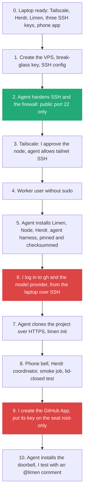
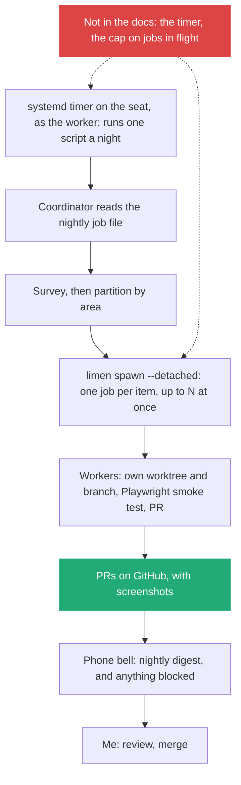

# 6. Running the fleet: a remote seat with Pi, Herdr and Limen, and where Orca fits

> The lecturer's setup is a Linux VPS (the "seat") on a private Tailscale network, running Pi agents under Limen and Herdr, started from my desktop, a GitHub `@limen` comment or a phone, and reaching GitHub only through PRs. I would follow it for the first fleet run, because its guide is complete and hardened. Orca is a separate desktop control plane that supports Pi, so I would try it second and not mix the two ([note 07](07_Herdr_Or_Orca_For_My_Fleet.md)). None of the documents I read schedules a nightly run, so the nightly tech-debt job needs a timer that I add and test myself.

Related: [04 Executable Markdown](04_Executable_Markdown_Skills_As_Programs.md) · [03 The gap](03_The_Gap_Build_Speed_Vs_Keeping_Up.md) · [02 Before the merge](02_Merge_Review_Second_Pair_Of_Eyes.md) · [05 Agents maintain the tools](05_Agents_Maintain_The_Tools_I_Review.md) · [Lecture 4: 04 COMPUTERS.md and fleet infrastructure](../Lecture_4_Harness/04_Computers_md_Fleet_Infrastructure.md) · [Lecture 4: 06 Self-management with Pi and Herdr](../Lecture_4_Harness/06_Self_Management_Pi_Herdr.md) · [07 Herdr or Orca](07_Herdr_Or_Orca_For_My_Fleet.md) · [Lecture 4: 13 Herdr vs Orca](../Lecture_4_Harness/13_Herdr_vs_Orca_Agent_Orchestration.md) · [Lecture 4: 07 Multi-agent coordination](../Lecture_4_Harness/07_Multi_Agent_Coordination.md) · [Lecture 4: 10 Automation](../Lecture_4_Harness/10_Automation_Repository_Agents.md)

Source: S01E05 article, section "Getting remote" (its bullet list of what I do and what the AI does, and figures 10 to 12), and the Limen seat guide `docs/seat/agent-setup.md` with the Limen README. Pi, Herdr and Orca documentation pages, read on 2026-11-09 through a fetch agent that returns extracted page text. Pages it did not read are named in [Fact-check](#fact-check). The Herdr and Orca comparison is in [Lecture 4: 13](../Lecture_4_Harness/13_Herdr_vs_Orca_Agent_Orchestration.md), and this note does not repeat it.

## 1. The problem

Note 04 gives me the design of a nightly fleet that prepares tech-debt fixes. A fleet needs somewhere to run: a machine that stays on, a way for agents to start jobs from my desktop, GitHub or a schedule, a way for them to reach me, and limits on what they can touch. Which parts do I need, which tool does each job, and what do the documents leave out?

## 2. Words

| Term | Means here | Not to be confused with |
|---|---|---|
| **Seat** | The Linux VPS that runs the agents while my laptop is closed (Limen's word) | My desktop |
| **Harness** | The agent program that talks to a model and uses tools. Pi, OMP (oh-my-pi) and Devin are the ones Limen names | Limen, which starts and tracks jobs for a harness |
| **Limen** | A small CLI, files and git: plans work, starts workers (`limen spawn`), tracks jobs, and answers GitHub comments | An agent. It carries no model of its own |
| **Coordinator** | The agent session on the seat that receives wakes and starts jobs | A worker |
| **Worker / job** | One agent run on one task, in its own git worktree and branch | A person |
| **Doorbell** | The opt-in GitHub link: a PR or issue comment with `@limen` or `/limen` from someone with write access wakes the coordinator | The phone notification ("bell") |
| **Multiplexer** | A terminal workspace that keeps many agent sessions alive and shows which one needs me (Herdr) | A scheduler |
| **Herdr TUI and Herdr desktop app** | Two separate products. The TUI is the original terminal app with its own server. The desktop app is newer, built on `herdr-core`, and does not share agents with the TUI ([Lecture 4: 13](../Lecture_4_Harness/13_Herdr_vs_Orca_Agent_Orchestration.md)) | One tool. The Limen guide's commands belong to the TUI |
| **Tailnet** | My private Tailscale network. Only my desktop, phone and seat are in it | The public internet |

## 3. The two pictures

**The story.** The remote agents are the red box in the middle. Four things feed them: my desktop agents (starts jobs), a schedule, GitHub issues and PRs, and external events (all triggers). They read one shared knowledge base, which syncs back to my desktop. The seat never needs me at the keyboard.

**Important:**
- **Four ways in:** desktop, schedule, GitHub and events. The Limen guide documents the desktop and the GitHub doorbell. It does not describe a schedule or other events (section 7).
- **The knowledge base is shared**, so every worker starts from the same facts ([note 05](05_Agents_Maintain_The_Tools_I_Review.md)).

**The story.** Everything that controls the agents sits inside the red frame. Desktop and phone reach the seat only over Tailscale. Exactly one arrow crosses the frame: the agents' work, as PRs, into GitHub.

**Important:**
- **One exit, and it is the PR.** The agents do not push to main. A person merges ([note 02, section 7](02_Merge_Review_Second_Pair_Of_Eyes.md#7-the-other-side-of-the-button-the-way-back)).
- **The phone arrow goes both ways:** I reach in, and the seat asks for me. That answers the "agent that fails silently" from [note 03](03_The_Gap_Build_Speed_Vs_Keeping_Up.md#5-what-the-gap-does-to-one-person-the-agent-fleet).

**Not important:** the frame colors and the example repo names.

## 4. The parts and what each one does

| Part | Job | What the docs say | What they leave out |
|---|---|---|---|
| **Pi** | Harness: reads, edits, runs commands, talks to the model | MIT. Install `curl -fsSL https://pi.dev/install.sh \| sh` or `npm install -g --ignore-scripts @earendil-works/pi-coding-agent`. `pi -p "query"` for scripts, `--mode json`, `--mode rpc`. `--tools` allowlist. Keys in env vars such as `ANTHROPIC_API_KEY`. **No permission popups and no sandbox**: it runs with the account's permissions | Any scheduler. Built-in sub-agents ("spawn Pi instances via tmux"). A remote mode |
| **OMP (oh-my-pi)** | The harness the Limen seat guide pins and installs for the worker (`omp` 18.6.1) | Named in the guide and README. Pi is Limen's default engine | Why the guide pins OMP while the article says Pi |
| **Herdr** (the TUI, as the Limen guide uses it) | Keeps agent sessions alive, shows working, blocked, done or idle, reaches the seat with `herdr --remote`, installs the agent integration with `herdr integration install` | Apache-2.0. Agents keep running when the window closes, and do not survive a reboot or a stopped server. The desktop app adds `herdr-core`, `hc` commands and iPhone and Android apps, which I read about but which are a different product | A scheduler. Model login (that is the agent's). A resume of an agent after a reboot |
| **Limen** | Job layer: `limen init`, `limen spawn`, `limen jobs`, `limen prune`, `limen github connect`. Each job gets its own worktree, branch, log and state | MIT. **Experimental**: commands and files "can change". macOS or Linux, Node 24 or later | How many jobs run at once. Scheduled jobs. Claude Code and Codex as engines |
| **Tailscale** | The private network. Seat SSH only over the tailnet | The guide forbids `tailscale up --ssh` and `tailscale funnel` | |
| **Moshi or ntfy** | The phone bell: tells me when an agent needs me | Moshi hooks pair on the seat. ntfy is the alternative | Push from Herdr itself. Only an example mod uses ntfy |
| **GitHub App + `gh`** | The doorbell and the way the agents open PRs | One App and one key per seat. Permissions: Metadata read, Issues read and write, Pull requests read | Whether the doorbell works for an organization-owned repo beyond "the account that owns the repo" |
| **Orca** | A desktop IDE for running many agents, each in its own git worktree, with a browser tab per task | MIT. macOS, Windows, Linux. Supports Pi, OMP, Claude Code, Codex and many more. SSH worktrees, a mobile app (beta), an `orca` CLI, `orca automations` for scheduled tasks | Whether automations run when the app is closed. Any relation to Limen or Herdr (none stated). A hardening guide |

## 5. Pi with Herdr and Limen, or Pi with Orca

They are two different control planes: a seat that takes jobs from GitHub and a coordinator (Limen with Herdr), or a desktop app that creates a worktree per task and runs agents in it, locally or over SSH (Orca). They do not mention each other. I would run the lecturer's setup first, because it is the only complete, hardened one, and try Orca second on a separate machine. The comparison, the decision and a fair trial of Orca are in [note 07](07_Herdr_Or_Orca_For_My_Fleet.md), and the layer comparison is in [Lecture 4: 13](../Lecture_4_Harness/13_Herdr_vs_Orca_Agent_Orchestration.md).

## 6. Setup: what I do and what the agent does

The guide is written to be pasted into an agent. Each step has a check, and the agent stops on a mismatch. The agent never touches a secret: I type provider logins, the GitHub App key and the phone token myself.

| Phase | Me | The agent | Check |
|---|---|---|---|
| **Laptop** | Install Tailscale, Herdr, Limen. Create three ed25519 keys: admin (root, tailnet only), break-glass (root, public IP), worker (no sudo, tailnet only). Install Moshi or ntfy on the phone | Verifies the tools | Keys exist, separate |
| **Seat** | Create an Ubuntu LTS VPS (8 GB RAM, 150 GB disk, 2 vCPU, public IPv4). Put the break-glass key on it. Add an SSH config block | Sets `PasswordAuthentication no`, root key-only, `ufw` default deny with only 22/tcp, installs `git gh acl mosh python3` | `ufw` shows only port 22 |
| **Tailscale** | Approve the node from the link | Installs Tailscale, allows `tailscale0`, restricts admin and worker logins to tailnet ranges | Admin SSH works over the tailnet only |
| **Worker** | | Creates the user with no sudo, `loginctl enable-linger`, tailnet-only `AllowUsers` | No sudo or admin group |
| **Tools** | | Clones Limen to `/opt/limen` at a pinned commit, installs Node 24.21.0, Herdr 0.9.3 and OMP 18.6.1 with SHA-256 checks, OMP as the worker (never root) | Checksums print OK |
| **Logins** | `gh auth login` and the model login, **from the laptop over SSH** (never from another server) | Does not ask for or read tokens | `gh auth status` |
| **Project** | Decide what to commit after `limen init` | Clones over HTTPS, runs `limen init` only inside the project | `git status` is read, nothing is pushed |
| **Phone bell** | Paste the Moshi hook token, or set an ntfy topic | Installs `moshi-hook`, enables the service | A test notification arrives |
| **Coordinator and smoke job** | Open Herdr to the seat, start the coordinator with `LIMEN_COORDINATOR=1` | Starts a small `limen spawn --detached` job | Close the laptop lid for five minutes: the job finished and the tab is still there |
| **Prune** | | Enables `limen-prune.timer` (daily `limen prune`) so finished worktrees do not fill the disk | Timer is active |
| **GitHub App** | Create it, webhook off, only the permissions above, install on one repository, copy the key to `/root/limen-app.pem` and delete my copy | Runs the doorbell installer, `limen github connect`, enables `limen-github.timer` when `limen github doctor` is clean | A comment `@limen please review this PR` wakes the coordinator, about two minutes later |

A green `limen github doctor` does not prove the App is installed on the repository, so the live comment test is the real check.

## 7. The nightly tech-debt job on this seat (my design)

The seat gives me the triggers from the desktop and from GitHub. [Note 04](04_Executable_Markdown_Skills_As_Programs.md) needs a third one, the clock. Neither Limen's guide, Pi's docs nor Herdr's docs describe a scheduler, and the Limen guide's only timers are prune, the GitHub poller and the ntfy bell.

- **The timer is mine to add.** A systemd timer (the guide already uses them) that starts the coordinator's job file once a night. I would test it with one job before trusting it. The guide shows `limen spawn --detached` but not a timer-started spawn, so this is unverified.
- **The cap on jobs in flight is mine to enforce.** Limen's docs do not state a limit, so the nightly job file holds it (start with three), and `limen jobs --running` is how the coordinator counts.
- **Pi runs headless** with `pi -p`, `--mode json` or `--mode rpc`, and a `--tools` allowlist. For the read-only survey agent I would pass `--tools read,grep,find,ls`. A headless run cannot show Pi's project-trust prompt, so I would pass `--approve` or `--no-approve` explicitly.
- **Worktree cleanup** follows Limen's daily prune. What "finished" means for a failed job is not stated, so I would check the disk after the first week.
- **A night that fails must say so**: the phone bell carries the digest and any blocked job.

## 8. Security and governance

What the docs say about risk, in short:
- **Pi has no sandbox and no approval prompts.** Its own security page says to treat model output as untrusted and to run it inside a container or VM when the repository or automation is not trusted.
- **Limen workers approve tools automatically and have the same access as my account.** A git worktree "is not a security sandbox."
- **Orca pre-fills permission-bypass flags** for each agent CLI by default.
- **Prompt injection** from repo files, comments and command output can steer an agent. Debt work reads a lot of code, so this is not theoretical.

My additions (design reasoning, not in the guide):
- **Give the seat its own GitHub identity.** The guide has me run `gh auth login` for my account, so workers get my GitHub access. A separate bot account, or a token scoped to the one repository, limits it.
- **Fine-grained, short-lived credentials** for the model provider, with a spending limit.
- **Network egress:** the seat should reach only what it needs (GitHub, the model provider, package mirrors).
- **No secrets in the debt job's prompts, screenshots or PR text**, and test data only in the smoke test.
- **The App key stays root-only**, and the worker cannot read it.

**Before I start, as Aras work:** I would stop at these gates and not at the first command.
- If the repository is Aras source code, check the [AI Solutions Catalog](http://aitools.aras.com/) for the approved tool configuration first. A VPS with a third-party provider and a model API is a new data path.
- Running autonomous agents that change code is an agentic action. For Aras systems that is a High-Risk Use under the AI governance rules and needs the AI Governance Committee's approval before I proceed.
- My own isolated remote desktop is not the same as an approved place for source code. I would confirm where the code may live.

## My take

The article's picture is a tool for one person and a few repositories. The useful part for my platform is the pattern: a private control network, a seat per fleet, one exit (PRs), a phone path for "ask me", and a person at the merge. I would build the first run small: one repository, one worker, one smoke job, then the doorbell. Only after that would I add the nightly timer and a second worker, and watch the review queue ([note 03](03_The_Gap_Build_Speed_Vs_Keeping_Up.md)).

The documents disagree in two places that matter for a first run. The article says Pi runs on the seat while the guide installs OMP. And herdr.dev now leads with the desktop app while the guide pins Herdr 0.9.3 and uses the TUI's commands. I would follow the guide's versions exactly and not the sites.

## Cautions

- Limen says it is experimental software. Commands can change, so pin the commit as the guide does.
- A completed job does not prove a feature is finished or ready to merge (Limen's README).
- Never copy `.limen/` between machines. A job is visible only on the machine that started it.
- The seat holds code and a model key. Treat it like production, with backups of nothing I cannot lose.
- Everything here is a design from documents. Nothing has been run.

## Summary

Run the first fleet the way the lecturer does: an Ubuntu VPS on a private tailnet, Pi (or the OMP the guide pins) under Limen with Herdr, a phone bell, and a GitHub App doorbell, with agents as PR authors only. I do the logins, keys and the App key myself, and the agent does the hardening and installs against checks. The nightly tech-debt run adds a timer and a cap that the documents do not provide. Orca is a second option on a separate machine. Aras code needs the catalog check and, for autonomous agents, governance approval first.

## Open questions

- Is the seat a VPS, or a Linux VM inside my isolated remote desktop environment, and where may the code be stored?
- Does Limen run on Windows through WSL2? The README names macOS and Linux only.
- How many workers can the seat run at once with 8 GB of RAM?
- Does `orca automations` run when the Orca app is closed, and does Orca on an SSH host run a nightly job unattended?
- Should the seat use a separate GitHub bot account, and how does the doorbell work for an organization-owned repository?

## Fact-check

| # | Claim | Verdict | Source | Checked |
|---|---|---|---|---|
| 1 | The seat is an Ubuntu LTS VPS (x86_64 or arm64, at least 8 GB RAM, 150 GB disk, 2 vCPU, public IPv4) on Tailscale, with Pi, Limen and Herdr | **Agrees** | [Limen seat guide](https://github.com/overment/limen/blob/main/docs/seat/agent-setup.md) and the article's list, read through a fetch agent | 2026-11-09 |
| 2 | Three SSH keys (admin, break-glass, worker), firewall with only public port 22, worker without sudo, App key root-only | **Agrees** | Same guide | 2026-11-09 |
| 3 | The guide installs OMP 18.6.1 for the worker and Pi is Limen's default engine | **Differs from the article's "Pi"** | Same guide and the [Limen README](https://github.com/overment/limen) | 2026-11-09 |
| 4 | Limen is experimental, MIT, macOS or Linux with Node 24 or later | **Agrees** | Limen README, via a fetch agent | 2026-11-09 |
| 5 | Limen describes no scheduled jobs and states no concurrency limit | **Agrees (absence in the pages read)** | The guide and README. Linked pages `docs/jobs.md`, `docs/commands.md`, `docs/remote.md`, `docs/groups.md` and `SECURITY.md` were not read | 2026-11-09 |
| 6 | The GitHub poller reaches the coordinator in about two minutes | **Agrees (guide)** | The guide's own observation. The poll interval is not stated | 2026-11-09 |
| 7 | Pi: MIT, runs with the account's permissions, no permission popups, no built-in sandbox, no scheduler, no built-in sub-agents | **Agrees** | [Pi docs: security](https://pi.dev/docs/latest/security.md), [containerization](https://pi.dev/docs/latest/containerization.md), [CLI](https://pi.dev/docs/latest/cli.md), via a fetch agent | 2026-11-09 |
| 8 | Pi runs headless with `-p`, `--mode json` and `--mode rpc`, restricts tools with `--tools`, and needs `--approve` or `--no-approve` for explicit trust in automated runs | **Agrees** | Pi CLI and security docs | 2026-11-09 |
| 9 | Pi requires Node.js 22.19 or newer | **Differs: Limen pins Node 24.21.0** | Pi README against the Limen guide. Use the guide's version on the seat | 2026-11-09 |
| 10 | Herdr: Apache-2.0, agents keep running when the window closes, remote machines over SSH, no scheduler. The desktop app also has `herdr-core` and phone apps | **Agrees** | [herdr.dev](https://herdr.dev/) and the [herdr-app repository](https://github.com/herdrdev/herdr-app), via a fetch agent | 2026-11-09 |
| 11 | The Herdr the Limen guide pins (0.9.3, `herdr --remote`, `herdr integration install`) is the Herdr TUI, not the desktop app | **Agrees (inference)** | The commands match the TUI CLI reference as read in [Lecture 4: 13](../Lecture_4_Harness/13_Herdr_vs_Orca_Agent_Orchestration.md) (`herdr integration install pi`, 0.9.x releases). The guide does not name the product | 2026-11-09 |
| 12 | Orca: MIT desktop IDE, one git worktree and one agent terminal per task, supports Pi and OMP, SSH worktrees, mobile app (beta), `orca` CLI, `orca automations` | **Agrees** | [Orca docs](https://onorca.dev/docs), [supported agents](https://www.onorca.dev/docs/agents/supported), [SSH](https://www.onorca.dev/docs/ssh), [CLI](https://www.onorca.dev/docs/cli/overview), via a fetch agent. The LICENSE file, automations, orchestration and remote-server pages were not read | 2026-11-09 |
| 13 | Orca pre-fills each agent CLI's permission-bypass flag by default | **Agrees** | Orca docs (Settings, Agents, Agent Permissions), via a fetch agent | 2026-11-09 |
| 14 | Orca has any relation to Limen or Herdr | **Agrees: none stated** | Neither name appears in the Orca pages read | 2026-11-09 |
| 15 | Claude Code and Codex are supported engines in Limen | **Unverified** | Not mentioned in the Limen pages read. Orca lists both | 2026-11-09 |
| 16 | A systemd timer can start a nightly Limen job | **My interpretation** | Reasoning from the guide's own timers and `limen spawn --detached`. Not tested | 2026-11-09 |
| 17 | A separate GitHub identity or a repository-scoped token limits what workers can do | **My interpretation** | The guide has me log in `gh` as my own account. Not tested with Limen | 2026-11-09 |
| 18 | Aras rules: source code needs the AI Solutions Catalog, and autonomous agent actions in Aras systems are High-Risk Use needing governance approval | **Agrees (organization policy)** | The organization's AI usage rules as given to me. Not a vendor source | 2026-11-09 |

## Sources

- S01E05 article, "Getting remote", and its figures (copied to `img/remote-fleet-local-vps-github.png` and `img/remote-fleet-private-tailnet.png`)
- [Limen](https://github.com/overment/limen) and its [seat setup guide](https://github.com/overment/limen/blob/main/docs/seat/agent-setup.md)
- [Pi docs](https://pi.dev/docs/latest): [security](https://pi.dev/docs/latest/security.md), [containerization](https://pi.dev/docs/latest/containerization.md), [CLI](https://pi.dev/docs/latest/cli.md)
- [Herdr](https://herdr.dev/) and [herdr-app](https://github.com/herdrdev/herdr-app)
- [Orca docs](https://onorca.dev/docs) and [stablyai/orca](https://github.com/stablyai/orca)
- My own reasoning: sections 5, 7 and 8 (the choice, the nightly timer, the security additions) and "My take"
