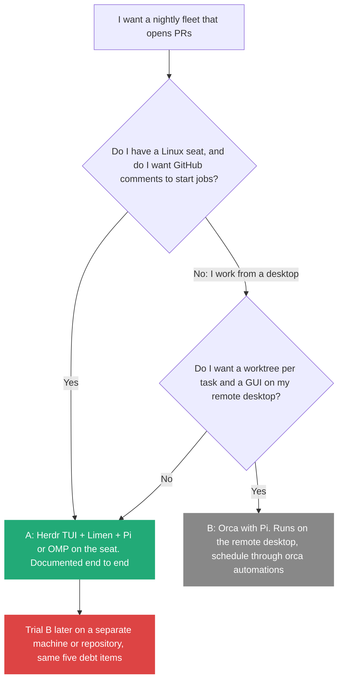

# 7. Herdr or Orca for my fleet: which control plane first

> Herdr keeps agent terminals alive on the seat and shows which one needs me. Orca gives every task its own git worktree and runs from a desktop app. They sit at different layers ([Lecture 4: 13](../Lecture_4_Harness/13_Herdr_vs_Orca_Agent_Orchestration.md) has the full comparison), but for running my tech-debt fleet they are two alternative control planes. I would run the lecturer's Herdr with Limen first, and try Orca second on a separate machine, with the same five debt items on both.

Related: [06 Run the fleet on a remote seat](06_Run_The_Fleet_On_A_Remote_Seat.md) · [04 Executable Markdown](04_Executable_Markdown_Skills_As_Programs.md) · [03 The gap](03_The_Gap_Build_Speed_Vs_Keeping_Up.md) · [Lecture 4: 13 Herdr vs Orca](../Lecture_4_Harness/13_Herdr_vs_Orca_Agent_Orchestration.md) · [Lecture 4: 06 Self-management with Pi and Herdr](../Lecture_4_Harness/06_Self_Management_Pi_Herdr.md) · [Lecture 4: 07 Multi-agent coordination](../Lecture_4_Harness/07_Multi_Agent_Coordination.md) · [09 A local fleet lab](09_Local_Fleet_Lab_Sandboxes_And_Worktrees.md)

Source: [Lecture 4: 13](../Lecture_4_Harness/13_Herdr_vs_Orca_Agent_Orchestration.md) (layers, commands, orchestration vocabulary, checked 2026-11-08), and the Orca, Herdr and Pi pages read for [note 06](06_Run_The_Fleet_On_A_Remote_Seat.md) on 2026-11-09 through a fetch agent. I did not install or run either tool. See [Fact-check](#fact-check).

## 1. The problem

The lecturer runs Pi with Herdr and Limen on a seat. I would prefer Pi with Orca if it works. Which one do I start with for the nightly tech-debt fleet of [note 04](04_Executable_Markdown_Skills_As_Programs.md), and how do I decide whether the other is worth a trial?

## 2. Words

| Term | Means here | Not to be confused with |
|---|---|---|
| **Control plane** | The thing I use to start agents, see their state and reach them from afar | The harness (Pi), which talks to the model |
| **Herdr TUI / Herdr desktop app** | Two separate Herdr products. The Limen guide's commands belong to the TUI | One tool |
| **`stablyai/orca`** | The Orca covered here: a desktop IDE for running agents in worktrees. A different project, `orca-cli/orca`, appeared in a search and I did not verify it | Any other "orca" |
| **Permission bypass** | A launch flag that lets an agent run tools without asking each time | A sandbox |

## 3. What I read about Orca since note 13

[Lecture 4: 13](../Lecture_4_Harness/13_Herdr_vs_Orca_Agent_Orchestration.md) says what Orca is and how its orchestration works. Reading its docs for a remote fleet added these facts:

| Question for a remote fleet | What the Orca docs say | What they leave out |
|---|---|---|
| Where does it run? | Desktop app on macOS (13.4 or later), Windows and Linux. Mobile companion on iOS and Android (beta) | A version floor for Windows and Linux |
| Can it run agents on another machine? | **SSH worktrees**: Orca creates the worktree on the remote host and runs the agent there. Closing the app does not kill remote sessions. On first connect it installs its own managed server on the host, and there is no setting to turn that off | Which OS a remote host needs beyond "64-bit ARM Linux servers" are mentioned. Remote desktop (RDP or VNC) |
| Can I script it? | An `orca` CLI ships with the app: `orca worktree create`, `orca terminal create`, `orca terminal send`, `orca terminal wait`, `orca status`. Linux names it `orca-ide` | Whether the CLI works with no GUI, except through "Remote Orca Server", a page not read |
| Can it run on a schedule? | `orca automations` creates scheduled tasks. The README's example is "nightly dependency bumps" | Whether a scheduled run happens while the app is closed |
| Does it support Pi? | **Yes.** Pi is on the supported list with auto-setup, hooks and status. OMP is listed separately | |
| What about permissions? | It pre-fills each CLI's bypass flag for new launches (Claude's `--dangerously-skip-permissions`, Codex's `--dangerously-bypass-approvals-and-sandbox`, `--yolo` for others). Settings, Agents, Agent Permissions switches to Manual. The stated reason: a worktree is disposable, and I can drop the diff before merging | Any OS-level sandbox |
| Relation to Limen or Herdr? | None stated | |

## 4. How I decide

| | **A: Pi or OMP, Herdr, Limen on a seat** | **B: Pi with Orca** |
|---|---|---|
| Documented end to end for a fleet | **Yes**, a 14-phase guide with a check per step | No. Product docs only |
| Hardening | Keys, firewall, tailnet only, worker without sudo, App key root-only | SSH host-key checks. Agents launch with **bypass flags pre-filled** (switch to Manual) |
| Triggers | Desktop and the GitHub `@limen` doorbell | Desktop, the `orca` CLI, `orca automations` |
| Schedule | Not described | `orca automations` exists. Whether it runs without the app open is not stated |
| Worktree per task | Limen does it (`limen spawn`) | Built in |
| Phone | Moshi or ntfy | Orca mobile app (beta) |
| Runs on my remote desktop | Needs a Linux seat | **Yes**, Windows included |
| Weak point | Experimental. Concurrency not documented | The desktop app is the control plane, and it installs its own server on an SSH host |

**My choice: A first, as the lecturer advises.** The Limen guide is the only complete, checked setup I found, and its hardening is what I would otherwise design. The phone bell and the doorbell give the "ask me" path that [note 03](03_The_Gap_Build_Speed_Vs_Keeping_Up.md#5-what-the-gap-does-to-one-person-the-agent-fleet) says a fleet needs. Orca is a fair second run, because it works with Pi and has worktrees, SSH and a schedule. Running both on one seat means two control planes over the same worktrees, so I would keep the trial on a separate machine or repository.

## 5. A fair trial of B

Same five debt items from the survey of [note 04](04_Executable_Markdown_Skills_As_Programs.md), same Pi model, same job file, one run on each control plane.

| What I measure | Why |
|---|---|
| PRs that were clean without edits | Quality of the loop, not the tool |
| My review time per PR | The real cost, from [note 03](03_The_Gap_Build_Speed_Vs_Keeping_Up.md) |
| Runs that failed without telling me | The silent-agent test |
| Tokens per merged PR | Cost per task ([Lecture 4: 17](../Lecture_4_Harness/17_Cost_Per_Task.md)) |
| Permission prompts I had to answer, or bypass flags that fired | The safety difference |
| Did a scheduled run happen with the app closed | The open question for B |

## 6. Security difference

| Control plane | Default posture | My guard |
|---|---|---|
| Pi | Runs with the account's permissions. No approval prompts, no sandbox | Run it on the seat (a VM boundary) or in a container. Allowlist tools with `--tools` for read-only agents |
| Herdr (desktop app) | Mods are trusted JavaScript with no per-request prompt ([Lecture 4: 13](../Lecture_4_Harness/13_Herdr_vs_Orca_Agent_Orchestration.md)). Not checked for the TUI | Do not install unknown mods. Read the installer before running it |
| Limen | Workers approve tools automatically and have my account's access. A worktree is not a sandbox | A separate GitHub identity or repository-scoped token, short-lived provider keys ([note 06](06_Run_The_Fleet_On_A_Remote_Seat.md)) |
| Orca | Bypass flags pre-filled for each agent | Set Agent Permissions to Manual for the trial, or run the trial only on a throwaway repository |

## My take

The two tools are easy to confuse because both say "many agents". Herdr answers "where do my agents live and what are they doing". Orca answers "how do I split work and keep changes apart". For a fleet whose limit is my review queue ([note 03](03_The_Gap_Build_Speed_Vs_Keeping_Up.md)), the orchestration vocabulary matters more than the terminal: Orca's task states and decision gates are a ready list of what my own coordinator should record. I would use them as a reference even if I never run Orca.

## Cautions

- Orca's facts here come from product pages, not from running it. Its default bypass flags are the first thing I would check on the machine.
- Orca's SSH mode installs its own server on the host. That is another thing running on the seat, and I would want to know what it can reach.
- Vendors move fast. Versions, star counts and "experimental" flags change within weeks.
- For Aras code, check the [AI Solutions Catalog](http://aitools.aras.com/) before using either tool, as in [note 06](06_Run_The_Fleet_On_A_Remote_Seat.md).

## Summary

Start with the lecturer's setup (Herdr, Limen and Pi or OMP on a seat), because it is documented and hardened end to end. Try Orca second, on a separate machine, with the same five debt items, and judge both by clean PRs, my review time, silent failures, tokens per PR and permission posture. Keep Orca's task-state vocabulary as a reference for my own coordinator.

## Open questions

- Does `orca automations` run a scheduled task while the Orca app is closed?
- Can Orca run inside or alongside Herdr? Neither project names the other.
- What does Orca's managed server on an SSH host have access to, and can I run it without it?
- Does the Herdr TUI have the same trust model as the desktop app?

## Fact-check

The layer comparison, the Herdr commands and the licenses are checked in [Lecture 4: 13](../Lecture_4_Harness/13_Herdr_vs_Orca_Agent_Orchestration.md) and not repeated here. New claims:

| # | Claim | Verdict | Source | Checked |
|---|---|---|---|---|
| 1 | Orca runs on macOS (13.4 or later), Windows and Linux, with a mobile companion in beta | **Agrees** | [Orca install](https://onorca.dev/docs/install) and [mobile](https://www.onorca.dev/docs/mobile), via a fetch agent | 2026-11-09 |
| 2 | Orca can create worktrees and run agents on a remote host over SSH, and installs a managed server there | **Agrees** | [Orca SSH docs](https://www.onorca.dev/docs/ssh), via a fetch agent | 2026-11-09 |
| 3 | Orca lists Pi as a supported agent | **Agrees** | [Orca supported agents](https://www.onorca.dev/docs/agents/supported), via a fetch agent | 2026-11-09 |
| 4 | Orca has an `orca` CLI and `orca automations` for scheduled tasks | **Agrees** | [Orca CLI overview](https://www.onorca.dev/docs/cli/overview) and the README, via a fetch agent. The automations and remote-server pages were not read | 2026-11-09 |
| 5 | Orca pre-fills permission-bypass flags for new agent launches | **Agrees** | Orca docs (Settings, Agents, Agent Permissions), via a fetch agent | 2026-11-09 |
| 6 | Scheduled Orca runs happen with the app closed | **Unverified** | Not stated in the pages read | 2026-11-09 |
| 7 | Orca is related to Limen or Herdr | **Agrees: none stated** | Neither name appears in the Orca pages read | 2026-11-09 |
| 8 | Herdr first, Orca second is the right order for my fleet | **My interpretation** | Reasoning from how complete each setup guide is. Not measured, see section 5 | 2026-11-09 |

## Sources

- [Lecture 4: 13 Herdr vs Orca](../Lecture_4_Harness/13_Herdr_vs_Orca_Agent_Orchestration.md) for the layer comparison and its sources
- [Orca docs](https://onorca.dev/docs), [SSH](https://www.onorca.dev/docs/ssh), [supported agents](https://www.onorca.dev/docs/agents/supported), [CLI](https://www.onorca.dev/docs/cli/overview) and [stablyai/orca](https://github.com/stablyai/orca)
- [Limen seat guide](https://github.com/overment/limen/blob/main/docs/seat/agent-setup.md) and [Pi security docs](https://pi.dev/docs/latest/security.md)
- My own reasoning: sections 4 to 6 and "My take"
