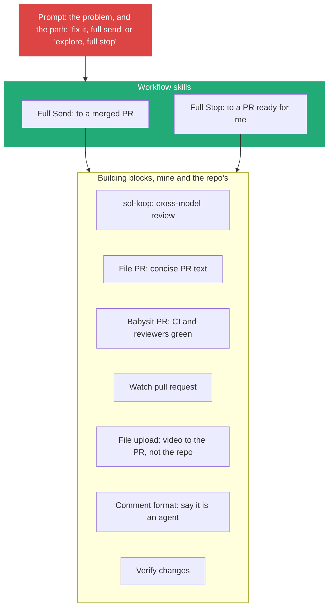
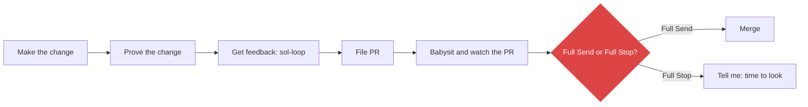
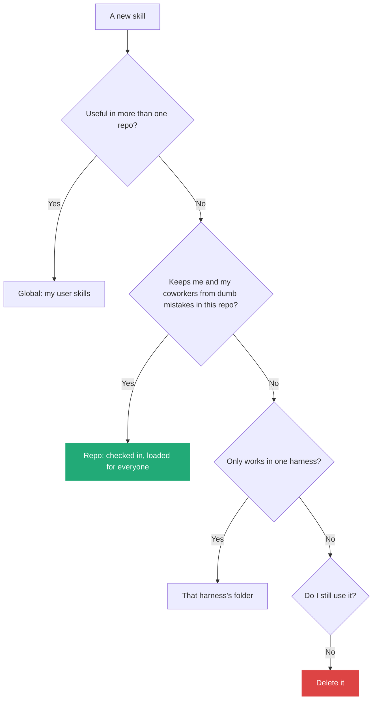
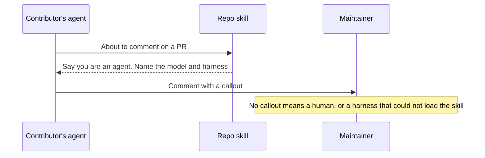

# 8. Skills as building blocks: write them small, compose them, place them, keep few

> The way I want work done lives in skills and prompts, not in wrapper code. Small skills do one job each, workflow skills such as Full Send and Full Stop call them like a program calls a library, and my prompt only picks the path. A skill goes global if it helps in several repositories, into the repository if it keeps contributors from mistakes, and away if I do not use it.

Related: [04 Executable Markdown](04_Executable_Markdown_Skills_As_Programs.md) · [05 Agents maintain the tools](05_Agents_Maintain_The_Tools_I_Review.md) · [03 The gap](03_The_Gap_Build_Speed_Vs_Keeping_Up.md) · [02 Before the merge](02_Merge_Review_Second_Pair_Of_Eyes.md) · [01 Skill or agent](01_Skill_Or_Agent_For_Explore_Loops.md) · [Lecture 2: 5 Skills](../Lecture_2_Context_Agents_md_Skills_Tools/5_skills.md) · [Lecture 2: 6 Router skills](../Lecture_2_Context_Agents_md_Skills_Tools/6_router_skills.md) · [Lecture 2: 7 Skill shaper](../Lecture_2_Context_Agents_md_Skills_Tools/7_skill_shaper_how_to_improve_skills.md) · [Lecture 3: 13 Knowledge skill anatomy](../Lecture_3_Simplify_Codebase_&_Knowledge_Base/13_Knowledge_Skill_Anatomy.md) · [Lecture 3: 4 Ask why](../Lecture_3_Simplify_Codebase_&_Knowledge_Base/04_Ask_Why.md) · [Lecture 4: 01 Harness lock-in](../Lecture_4_Harness/01_Harness_Lock-in_Keep_Doors_Open.md) · [Lecture 4: 03 Skill and folder orchestration](../Lecture_4_Harness/03_Skill_And_Folder_Orchestration.md) · [Lecture 4: 05 Don't overspecify](../Lecture_4_Harness/05_Dont_Overspecify_Work_At_Assistants_Level.md) · [Lecture 4: 18 Sharing approved skills](../Lecture_4_Harness/18_Sharing_Approved_Skills_AI_Marketplace.md) · [09 A local fleet lab](09_Local_Fleet_Lab_Sandboxes_And_Worktrees.md)

Source: S01E05 transcript (the opening and closing sections, the Full Send, Full Stop and building-block passages, the file-PR skill, the "global, harness or repo" and PR comment skill passages). Claude Code skill locations, Matt Pocock's skills repository and the `gh --attach` change checked on 2026-11-09 as search summaries. See [Fact-check](#fact-check).

## 1. The problem

I can encode how my team works in scripts, CI rules, wrappers around the GitHub CLI, or in plain skills and prompts. One big skill that does everything is hard to change and reuse. Where should the workflow live, how do I build skills so I can combine them, and where does each one go?

## 2. Words

| Term | Means here | Not to be confused with |
|---|---|---|
| **Workflow** | The steps and judgment rules for getting a kind of work done | A pipeline engine such as GitHub Actions |
| **Wrapper** | Code around a tool that limits what the model can do (a restricted `gh`) | A tool the model calls on purpose |
| **Building block** | A small skill with one job (file a PR, babysit CI, upload a file) | A script |
| **Workflow skill** | A skill that calls blocks in order to finish a kind of work | A pipeline engine |
| **Full Send** | The agent does everything up to a merged PR, with no human watching | Full Stop |
| **Full Stop** | The same flow, but it stops before the merge and calls me | Cancel |
| **Global, repo, harness skill** | Lives in my user folder, or is checked into one repository, or works with one harness only | A skill that merely sits in a harness folder |

## 3. Skills or code

The lecturer: "When models were dumber, that made a lot of sense, but they've gotten pretty smart now." And: "Putting your time into building custom wrapper functions around your tools to prevent them from doing the wrong thing, probably not the best use of your time." His proof is portability: "All of the skills I just showed work great in every harness I use. They work great with every modern model that I touch."

This is [Lecture 4: 05](../Lecture_4_Harness/05_Dont_Overspecify_Work_At_Assistants_Level.md) applied to team work: skills sit at the Assistants layer, and wrapper code sits at the Code layer that models outgrew first. He does not argue that code disappears. Workflows "can be very dynamic and involve a lot of code", and a skill calls it.

| Need | Place | Why |
|---|---|---|
| Steer how the agent works: order of steps, taste, style | Skill or prompt | Judgment, and it changes often |
| An exact, cheap, repeatable check (links, formats, lint) | Code, called from the skill | Code never forgets ([Lecture 3: 13](../Lecture_3_Simplify_Codebase_&_Knowledge_Base/13_Knowledge_Skill_Anatomy.md): judgment in notes, mechanics in scripts) |
| A hard limit that must hold even if the model is wrong (secrets, production, deploy) | Permissions, sandbox, CI | A prompt is a request, not a barrier ([Lecture 4: 14](../Lecture_4_Harness/14_What_Agent_Fleets_Need_Beyond_Spawning.md)) |
| A missing capability (upload a video without committing it) | A small tool, announced by a skill | The lecturer built a file-upload tool for exactly this |

A wrapper that blocks a mistake is also a bet that the model keeps making it. A skill that shows the mistake and the fix loses little when the model improves ([note 05](05_Agents_Maintain_The_Tools_I_Review.md)).

## 4. Three layers: blocks, workflows, prompt

"I've created this hierarchy here, effectively, where I have the skills the repo provides, the skills that I provide, like the building block skills. Then I have a workflow set on top ... Then above that, I have the prompt I send."



**Important:**
- **"Markdown is kind of just a program at this point, you can have your program call another program the same way we would back in the Unix terminal days."** Skills form a graph, and the agent is good at calling one thing from another.
- **Blocks are small and stable. Workflows change more often** ([note 02, the seven edits](02_Merge_Review_Second_Pair_Of_Eyes.md#how-the-sol-loop-got-here-seven-edits)).
- **The block set grows from pain.** The file-upload block exists because agents committed a giant video to the repository to show it in a PR. The lecturer built a tool and a skill so the video shows in the PR and stays out of the repo (the CLI can now attach files itself, see the fact-check).

**Not important:** the exact list of blocks. Mine will differ.

## 5. Full Send and Full Stop

The Full Send description: "Only trigger if the user requests full send. If the user triggered this, it's 'cause they are not watching the thread, and they want you to complete the work end-to-end autonomously. Your updates and your final message will go unread long after you stop. You own the work from its current state to a merged PR."



| | Full Send | Full Stop |
|---|---|---|
| Ends at | A merged PR | A PR ready to merge |
| Who merges | The agent | Me |
| Used for | Small, clear changes: a screenshot of misaligned CSS, "fix it, full send" | Hairy ones: data flow from UI to harness, a database that does not persist, a memory leak |
| The thread after | Archived on merge: "I'm mentally prepared to never see the thread again unless it asks me a question" | I read it |

For a design discussion he uses a different block, Matt Pocock's grilling skill, to go back and forth until he knows what he wants. The two endings are the merge-button question from [note 02, section 7](02_Merge_Review_Second_Pair_Of_Eyes.md#7-the-other-side-of-the-button-the-way-back) turned into a switch I set per task: Full Send needs a revertable change and strong verification.

## 6. Writing a block from a real annoyance

When an agent writes something I dislike, I write a short skill with the bad version it would have produced and the good version I want. The lecturer wrote his file-PR skill in about two minutes after an agent produced a commit message he could not read. His pair, from his own repository:

| | PR title | Why |
|---|---|---|
| **Bad** | `Perf server: Negotiate per-message deflate on the WebSocket` | Names the mechanism. "I have no idea what this means when I read it" |
| **Good** | `Perf server: Cut WebSocket frame size by 70%+ with gzipping` | States the effect, with a number |

```markdown
---
name: file-pr
description: Use whenever the user asks to file, open or create a pull request.
---
1. Check that no PR exists for this branch.
2. Follow the repo's title convention (see recent merged PRs).
3. Title: short, human-readable, says why the change matters.
   Bad:  <the agent's usual title>
   Good: <the title I want>
4. Description: the problem first, then the solution.
   Bad:  <the agent's usual description>
   Good: <the description I want>
```

| Step | What I do |
|---|---|
| 1 | Notice what the agent keeps doing that I dislike |
| 2 | Copy the real bad output |
| 3 | Write the version I want, for the same case |
| 4 | Write a description that says when to load the skill and when not to |
| 5 | Add a guard for each past mistake (the first line above) |
| 6 | Test on a new task. If it still misses, ask the agent why ([Lecture 3: 4](../Lecture_3_Simplify_Codebase_&_Knowledge_Base/04_Ask_Why.md)) and edit |

He wants agent-invoked skills only: "I want my skills to be clear when the agent should or shouldn't use them, and I let the agent choose when." Where a skill has side effects (deploy, send a message), the docs offer a way to block automatic use, and I would use it there.

## 7. Where a skill lives



| Scope | Rule from the lecture | Example |
|---|---|---|
| Global | "If the skill is useful in more than one repo, it should probably be in your globals" | File PR, babysit PR, sol-loop |
| Repo | "If the point of the skill is to keep you and your coworkers from making dumb mistakes, then it goes in the repo" | The PR comment skill |
| Harness | Not stated as a rule. Harness limits come up as workarounds | The custom subagent for one harness |
| Workflow skills | Keep them "slightly higher level to be useful outside of one specific repo" | Full Send, Full Stop |

**Case: the PR comment skill.** It began as a personal block: when an agent comments on a PR for him, it must say an agent wrote it, and which model. He moved it into the repository after other contributors' comments did not say human or bot. Every contributor's agent now loads it, so he "knows what model they used, what harness they used, and if it was them or not".



A repo skill prevents bad behavior that other contributors could hit: "a thing the model's confused by that you can't fix with code", or "a specific thing that people are doing that is making your life as a maintainer harder".

## 8. Keep the set small and measured

| Practice | How |
|---|---|
| Delete what I do not use | "You should also not be that scared to delete skills when you're not using them that much or if they're doing things you don't want" |
| Measure | Ask the agent which skills were invoked where, how often, and how often the change was merged afterwards |
| Do not collect | He has "two times more skills than I probably should" from trying many shared sets |
| Review on a schedule | The standing review of [note 05](05_Agents_Maintain_The_Tools_I_Review.md) and the audit in [note 01](01_Skill_Or_Agent_For_Explore_Loops.md#7-a-skill-audit-i-can-run) |

## My take

This is dependency design for text: small units, one job, a stable interface (the skill's description), a clear owner. Two risks follow from the code analogy: a block change can break many workflows, and a call graph the agent chooses at run time is harder to trace than a pipeline. For my platform I would record, per job, which skills were loaded, so I can see the graph that actually ran. That log also feeds the review of [note 05](05_Agents_Maintain_The_Tools_I_Review.md) and the fleet metadata from [Lecture 4: 03](../Lecture_4_Harness/03_Skill_And_Folder_Orchestration.md) and [18](../Lecture_4_Harness/18_Sharing_Approved_Skills_AI_Marketplace.md).

For an organization the repo skill puts team norms where the agent reads them: contribution rules, disclosure, style. It resembles a pull request template, but the agent acts on it. It is also an instruction that other people's agents will follow, so whoever merges a change to it controls those agents, and it needs the review that code gets.

## Cautions

- Full Send needs a revertable change and strong verification. It is not for every repository.
- Chained skills multiply context and cost. A skill that loads five others needs a budget.
- A repo skill changes the behavior of every contributor's agent, including their prompt-injection exposure ([Lecture 2: 9](../Lecture_2_Context_Agents_md_Skills_Tools/9_tools_prompt_injection.md)). A harness that cannot find the skill will not follow it, so a missing disclosure line is a signal and not proof of a human.
- Examples taken from my own repository can hold business detail. Abstract them, and keep secrets and customer data out of any repo skill.

## Summary

Put the way of working into small skills, compose them into workflow skills, and let the prompt choose the path, with Send and Stop as two endings of one flow. Keep code for exact checks and hard limits. Write a block from a real bad output next to the good one. Put a skill in my globals if it helps in several repositories, in the repository if it protects it from contributor mistakes, and delete what I do not use.

## Open questions

- Which wrappers or hooks of mine exist only because an older model made a mistake?
- Which five building blocks would cover most of my own work?
- Which of my skills would protect a shared repository if every contributor's agent loaded it?
- How do I log which skills ran on each job?

## Fact-check

| # | Claim | Verdict | Source | Checked |
|---|---|---|---|---|
| 1 | Wrapping tools to restrict a model is a weak use of time now | **Lecture-specific** | The lecturer's opinion. Consistent with Anthropic's advice to prefer simple prompts, which I did not re-read for this note | 2026-11-09 |
| 2 | Skills work across harnesses and models | **Differs: partly** | Skills follow the open Agent Skills format, but harness-specific frontmatter is not portable. A report says [OpenCode ignores `disable-model-invocation`](https://github.com/anomalyco/opencode/issues/11972) and another that [a Claude Desktop upload failed on it](https://github.com/anthropics/claude-code/issues/24826). Search summary of open issues, not retested | 2026-11-09 |
| 3 | Personal skills load in all projects and project skills only in that project | **Agrees** | [Claude Code skills docs](https://code.claude.com/docs/en/skills): `~/.claude/skills/` and `.claude/skills/`. Search summary | 2026-11-09 |
| 4 | Name clashes resolve in a fixed order | **Agrees** | Enterprise over personal over project, per the docs as summarized by search. One blog says the opposite and looks unreliable. Verify on the page | 2026-11-09 |
| 5 | A repo skill reaches every contributor's agent | **Differs: partly** | Only harnesses that read that folder load it. Other harnesses vary ([Lecture 4: 03](../Lecture_4_Harness/03_Skill_And_Folder_Orchestration.md)) | 2026-11-09 |
| 6 | A skill can tell the agent to call another skill | **Lecture-specific** | The lecturer's practice. I found no documented skill-to-skill call mechanism. The agent loads skills by description. Verify before presenting | 2026-11-09 |
| 7 | A skill is loaded by the agent when its description fits, and can be limited to human use only | **Agrees** | [Claude Code skills](https://code.claude.com/docs/en/skills): `disable-model-invocation: true` blocks automatic use. Open issues report [a refusal of the slash command](https://github.com/anthropics/claude-code/issues/26251) and [a field only controlling menu visibility](https://github.com/anthropics/claude-code/issues/56494). Search summary, not retested | 2026-11-09 |
| 8 | Bad and good examples in a skill steer the model well, and agents write verbose PR text without guidance | **Lecture-specific** | The lecturer's experience. Consistent with common few-shot practice, not verified here | 2026-11-09 |
| 9 | Matt Pocock publishes a grilling skill | **Agrees** | [github.com/mattpocock/skills](https://github.com/mattpocock/skills), MIT, `grill-me`. Search summary, repo not read | 2026-11-09 |
| 10 | The GitHub CLI could not upload files until recently | **Agrees** | `gh` can now attach a local image or video with `--attach`, from 2.99.0 ([GitHub changelog, 2026-09-01](https://github.blog/changelog/2026-09-01-github-cli-media-in-issues-pull-requests-and-comments)). Search summary, page not read | 2026-11-09 |
| 11 | T3 Code archives a thread on merge | **Unverified** | The lecturer's statement. [T3 Code](https://github.com/pingdotgg/t3code) README not read for this | 2026-11-09 |
| 12 | "P-Stack" skills | **Unverified** | Named in the transcript. Not identified. Verify before presenting | 2026-11-09 |
| 13 | Agents can report which skills ran and how often | **Unverified** | The lecturer's statement. Not tested | 2026-11-09 |
| 14 | Global for multi-repo, repo for mistake prevention | **Lecture-specific** | The lecturer's rule of thumb | 2026-11-09 |

## Sources

- S01E05 transcript (the quotes, the skill, the example pair and the PR comment story)
- [Claude Code skills docs](https://code.claude.com/docs/en/skills), [Matt Pocock's skills repository](https://github.com/mattpocock/skills), [GitHub changelog: media from the CLI](https://github.blog/changelog/2026-09-01-github-cli-media-in-issues-pull-requests-and-comments)
- My own reasoning: the table of where code still wins, the skill skeleton layout, the six-step pattern, the decision flow and "My take"
