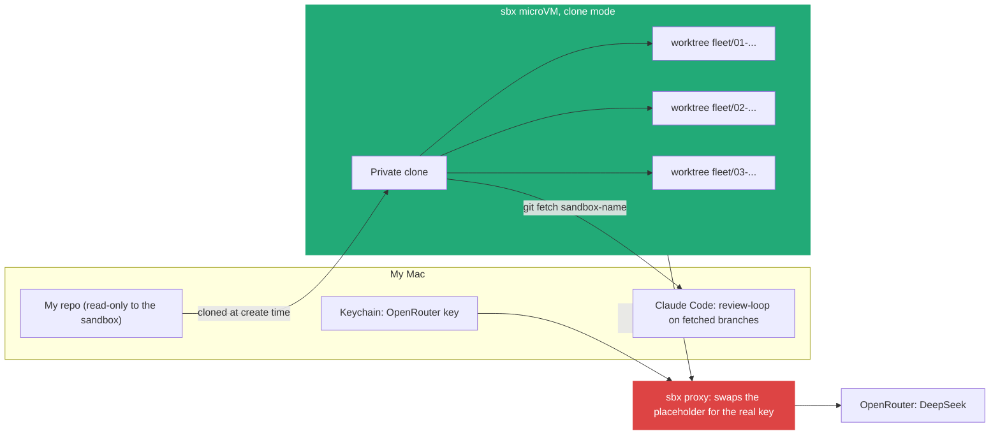
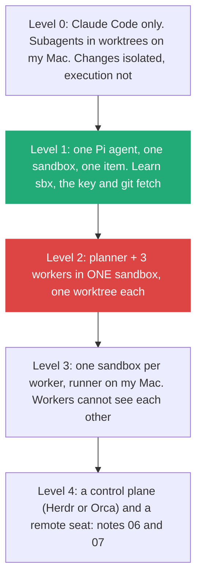
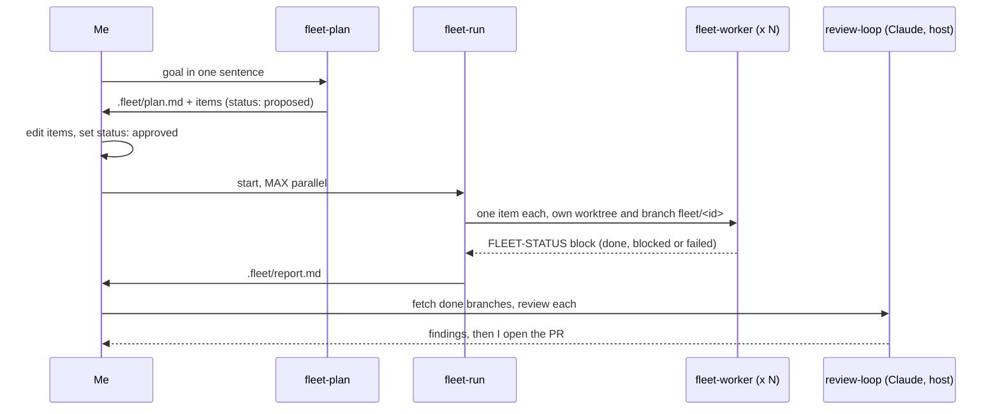

# 9. A local fleet lab: sandboxes for execution, worktrees for changes

> I run my first fleet on my own Mac with nothing installed globally except the `sbx` CLI. Each Pi agent runs inside a Docker Sandbox microVM in **clone mode**, so it cannot touch my files. Each work item gets its own **git worktree and branch** inside that clone, so parallel changes cannot collide. Three small skills (`fleet-plan`, `fleet-run`, `fleet-worker`) work unchanged in Pi and in Claude Code, and I climb from one agent to a full fleet in four levels.

Related: [06 Run the fleet on a remote seat](06_Run_The_Fleet_On_A_Remote_Seat.md) · [07 Herdr or Orca for my fleet](07_Herdr_Or_Orca_For_My_Fleet.md) · [04 Executable Markdown](04_Executable_Markdown_Skills_As_Programs.md) · [08 Skills as building blocks](08_Skills_As_Building_Blocks.md) · [02 Before the merge](02_Merge_Review_Second_Pair_Of_Eyes.md) · [03 The gap](03_The_Gap_Build_Speed_Vs_Keeping_Up.md) · [Lecture 4: 07 Multi-agent coordination](../Lecture_4_Harness/07_Multi_Agent_Coordination.md) · [Lecture 4: 13 Herdr vs Orca](../Lecture_4_Harness/13_Herdr_vs_Orca_Agent_Orchestration.md) · [Lecture 4: 14 What agent fleets need](../Lecture_4_Harness/14_What_Agent_Fleets_Need_Beyond_Spawning.md) · [Lecture 2: 12 Subagents vs workers](../Lecture_2_Context_Agents_md_Skills_Tools/12_subagents_vs_workers.md) · [Lecture 2: 5 Skills](../Lecture_2_Context_Agents_md_Skills_Tools/5_skills.md)

Source: Pi docs (skills, CLI, providers, security, containerization), Claude Code docs (skills, subagents), Docker Sandboxes docs (get started, credentials, Git workflow) and a search summary of the `sbx run --clone` reference and release notes, all checked on 2026-11-11. The pilot facts come from a shallow clone of my own repository on the same day. The kit is in [`.agents/fleet-lab/`](../.agents/fleet-lab/README.md). See [Fact-check](#fact-check).

## 1. The problem

Notes 06 and 07 put the fleet on a remote seat. Before I rent a seat, I want to learn the loop on my own Mac: plan, run several agents in parallel, review, open PRs. I don't want to fill the machine with new global tools. Which isolation do I need, what is the smallest setup that gives it, and how do I write the skills once for both Pi and Claude Code?

## 2. Words

| Term | Means here | Not to be confused with |
|---|---|---|
| **Change isolation** | Parallel agents edit separate copies of the code: one worktree and one branch each | Execution isolation. A worktree does not stop a command from deleting my home folder |
| **Execution isolation** | The agent's process cannot reach my files, keys or network beyond what I allow | A worktree. Pi's docs: "project trust and the working folder are not sandboxes" |
| **Docker Sandbox (`sbx`)** | Docker's CLI that runs an agent in a microVM, with a credential proxy and a network policy | A plain `docker run`, which shares my env vars and mounts my folder read-write |
| **Clone mode** | `sbx run --clone`: my repo is mounted read-only, the agent edits a private clone, and I `git fetch sandbox-<name>` to get its branches | Mount mode (the default), where the agent edits my working tree directly |
| **Fleet roles** | Planner, runner (orchestrator), worker, reviewer. Roles, not programs | Herdr or Orca, which are control planes ([07](07_Herdr_Or_Orca_For_My_Fleet.md)) |
| **`.fleet/`** | Local state of one run: plan, items, logs, report. Excluded from git, written only by the runner and the planner | The job record of Limen (`.limen/jobs/`), which it imitates ([Lecture 4: 15](../Lecture_4_Harness/15_Pi_Limen_Behind_The_Scenes.md)) |

## 3. Two isolations, one tool

I need both kinds. Docker Sandboxes gives both in one command: the microVM isolates execution, and clone mode with one worktree per item isolates changes.

**What matters:**
- **The key never enters the VM.** `sbx secret set openrouter` keeps it in the macOS Keychain, the sandbox sees a sentinel, and the proxy puts the real key into request headers ([Docker credentials](https://docs.docker.com/ai/sandboxes/configuration/credentials/)).
- **The only way back is git.** Edits reach my repo only when I fetch a branch. Removing the sandbox deletes unfetched work.
- **Clone mode guards against changes, not reading.** The sandbox can still read my repo, including git-ignored files. So the repo must hold no secrets ([Docker isolation](https://docs.docker.com/ai/sandboxes/security/isolation/)).

| Option | Execution isolated | Changes isolated | Installs on my Mac |
|---|---|---|---|
| Claude Code subagents with `isolation: worktree` | No | Yes | Nothing |
| Pi with `npm install -g` and worktrees | No | Yes | Node package |
| Plain Docker (Pi's `Dockerfile.pi`) | Process only. Env vars and the mounted folder are exposed | No, unless I add worktrees | Image |
| **`sbx` clone mode + worktree per item** | **Yes, microVM + proxy** | **Yes** | **`sbx` CLI only** |

## 4. From simple to complex: four levels

I climb one level at a time and move up only when the level below works.

| Level | Commands I type (exact syntax in the [kit README](../.agents/fleet-lab/README.md)) | I move up when |
|---|---|---|
| 0 | `/fleet-plan` then `/fleet-run` in Claude Code | Plans are good and items do not overlap |
| 1 | `sbx run --clone --kit docker.io/sbx/pi-kit:latest pi`, one item by hand | I fetched one clean branch from the sandbox |
| 2 | `sbx exec <name> -- .agents/skills/fleet-run/scripts/run-pi-workers.sh 3` | Three branches come back, each with a status block |
| 3 | One `sbx run --clone` per item, started from my Mac | A worker needs its own tools or services, or I don't trust one item's code near the others |

Level 2 is the target of this note. Level 3 costs one VM per item, and Docker's Git guide says to use it only when tasks need independent environments ([Docker Git workflow](https://docs.docker.com/ai/sandboxes/workflows/git/)).

## 5. Three skills, one file each, both harnesses

The fleet is three skills plus the reviewer I already have. Each skill is short and does one job. All fleet state passes through files and git.

| Skill | Writes | Never does | Stop point |
|---|---|---|---|
| `fleet-plan` | `.fleet/plan.md`, `.fleet/items/NN-slug.md` | Edits the code | Full Stop: I approve each item ([08](08_Skills_As_Building_Blocks.md)) |
| `fleet-run` | Worktrees, `.fleet/logs/`, `.fleet/report.md` | Edits code itself, merges | When all workers have returned |
| `fleet-worker` | Commits on its own branch `fleet/<id>` | Pushes, merges, touches files outside its scope | Done-check passes, or 2 failed attempts |

**Two rules carry the design:**
- **Items do not share files.** The planner gives each item a scope (paths it may touch). Two items on one file are merged into one or chained with `after:`. This is what makes parallel runs safe, not the worktree.
- **One writer for `.fleet/`.** Workers never write state. They end with a fixed `FLEET-STATUS` block, and the runner records it. Claude Code blocks a worktree subagent from writing to the main checkout anyway, so this rule makes Pi and Claude behave alike ([Claude Code subagents](https://code.claude.com/docs/en/sub-agents)).

**Portability.** Pi implements the Agent Skills spec and finds skills in `.agents/skills/` ([Pi skills](https://pi.dev/docs/latest/skills.md)). Claude Code finds them in `.claude/skills/` ([Claude Code skills](https://code.claude.com/docs/en/skills)). So the skills live once in `.agents/skills/`, `.claude/skills/<name>` is a symlink to them, and the frontmatter uses only portable fields (`name`, `description`, `license`, `compatibility`, `metadata`, `allowed-tools`). What differs is how a worker starts:

| | Claude Code | Pi |
|---|---|---|
| Worker | Subagent file `.claude/agents/fleet-worker.md` with `isolation: worktree` and `skills: [fleet-worker]` | `pi -p --no-session --model <id> --skill <path>` in a worktree the script creates |
| Parallel cap | The runner skill starts at most `MAX` subagents at once | `xargs -P MAX` in `run-pi-workers.sh` |
| Model | `model:` in the agent file | `--model openrouter/deepseek/deepseek-v4.1-flash` (verify the id) |
| Built-in subagents | Yes | No. Workers are separate `pi` processes, which is what Pi's own subagent example does too |

## 6. Models: DeepSeek through OpenRouter

Workers run on a cheap fast model. The reviewer is from another family, as [note 02](02_Merge_Review_Second_Pair_Of_Eyes.md) argues.

| Role | Model | Route |
|---|---|---|
| Planner | DeepSeek V4.1 Flash first. If the plans are weak, a stronger DeepSeek or Claude Sonnet | OpenRouter, `sbx secret set openrouter` |
| Workers | DeepSeek V4.1 Flash (`deepseek/deepseek-v4.1-flash` on OpenRouter, verify before presenting) | Same key |
| Reviewer | Claude via `review-loop` on my Mac | My Claude Code login |
| Direct DeepSeek (comparison run) | Same model from the DeepSeek platform | `sbx secret set-custom --host api.deepseek.com --env DEEPSEEK_API_KEY`, because `deepseek` is not a built-in `sbx` service |

Prices on OpenRouter differ between its own page and aggregators, so I check the live page and measure tokens per merged branch instead ([Lecture 4: 17](../Lecture_4_Harness/17_Cost_Per_Task.md)).

## 7. The pilot: my architecture repository

The first target is [Azure-Solution-and-Enterprise-Architecture-in-Depth](https://github.com/Glareone/Azure-Solution-and-Enterprise-Architecture-in-Depth). It is mostly Markdown, so a bad branch is cheap to drop. What a quick survey of the clone shows (2026-11-11):

| Signal | Count | Fleet item it suggests | Done-check |
|---|---|---|---|
| Links to the repo's three old names (`AZ-304-SA-And-Architecture-Design-In-Depth` 82, `AZ-304-305-SA-...` 51, `AZ-304-SA-Azure-Architect-Design` 9). All three return 301 to the current name | 142 | Rewrite to the current name | `grep` for the old names returns 0 |
| Tracked build output under `bin/`, `obj/`, `.vs/`, and no `.gitignore` | 61 files | Remove them, add a .NET and Node `.gitignore` | `git ls-files` shows none |
| `README.md` | 1,958 lines, 137 headings | Split into one index per area (Azure, TOGAF, system design, patterns) | Every old anchor still resolves |
| File names with spaces, commas or a colon (`Entitlement: Azure AD B2B ...md`) | 6 at the root | Rename to kebab-case and fix the links | A Windows checkout works, link check passes |
| Markdown files with a Mermaid diagram | 1 of 68 | One diagram per area index | Renders on GitHub |

The redirect matters: GitHub keeps redirects for a renamed repository only until someone creates a new repository with the old name ([GitHub docs](https://docs.github.com/en/repositories/creating-and-managing-repositories/renaming-a-repository)). The first two items have no overlapping files, so they make a good two-worker smoke test at Level 2. The README split touches every link, so it runs after the link rewrite (`after: 01-...`).

## My take

The lecturer's question is which control plane runs the fleet. The local lab shows the order is the other way round. First I need two boundaries I can trust (a VM for execution, a branch for changes) and a plan whose items don't share files. Herdr or Orca add visibility on top, and that only pays off once several items run for hours. Until then, `.fleet/report.md` and `sbx ls` are my control plane.

## Cautions

- **Not run yet.** The kit is written from the docs. The `--clone` and `--kit` combination, Pi inside `pi-kit`, and the placeholder key with Pi's OpenRouter client are the three things Level 1 must prove first.
- **Network policy.** Balanced is the documented first choice. A direct DeepSeek host may need an allow rule. Check with `sbx policy` before blaming the model.
- **Clone mode reads everything in the repo**, including git-ignored files. No `.env` in a repo I hand to a sandbox.
- **Cheap models fail quietly.** A worker can claim "done" with a weak check. The done-check must be a command, and the reviewer runs on another family.

## Summary

Execution isolation comes from an `sbx` microVM, and change isolation from clone mode plus one worktree and branch per item. Three portable skills (plan, run, worker) and my existing reviewer make the fleet, coordinated through `.fleet/` files with one writer. I climb from Claude-only (Level 0) to one sandbox with three DeepSeek workers (Level 2) on my architecture repo, and leave control planes and the remote seat for later.

## Open questions

- Does `sbx run --clone` accept `--kit` for Pi, and does Pi's OpenRouter client work with the proxy placeholder key?
- Does `pi -p` load a skill passed with `--skill` reliably on a Flash model, or must the prompt say `/skill:fleet-worker`?
- Do I keep the fleet skills committed in the target repository after the pilot, or install them per run?
- At which number of parallel items does my review time, not the model, become the limit ([03](03_The_Gap_Build_Speed_Vs_Keeping_Up.md))?

## Fact-check

| # | Claim | Verdict | Source | Checked |
|---|---|---|---|---|
| 1 | Pi implements the Agent Skills spec and discovers `.agents/skills/` in the project (up to the repo root) and `~/.agents/skills/` | **Agrees** | [Pi skills](https://pi.dev/docs/latest/skills.md), read via fetch | 2026-11-11 |
| 2 | Claude Code loads skills from `.claude/skills/` (personal, project, nested, plugin) and does not document `.agents/skills/` | **Agrees** | [Claude Code skills](https://code.claude.com/docs/en/skills), first 100k of 119k characters read; [open feature request](https://claudeissues.com/issue/16345-feature-request-support-the-standard-agents-skills-directory-for-agent-skills) | 2026-11-11 |
| 3 | Portable frontmatter is `name`, `description`, `license`, `compatibility`, `metadata`, `allowed-tools` | **Agrees** | Both skills pages above | 2026-11-11 |
| 4 | Claude Code subagents take `isolation: worktree` and `skills:`. A worktree subagent cannot run commands in the main checkout | **Agrees** | [Claude Code subagents](https://code.claude.com/docs/en/sub-agents), first 100k characters read | 2026-11-11 |
| 5 | Pi has no built-in subagents. An official example extension runs subagents as separate `pi` processes | **Agrees** | [Pi subagent example](https://app.unpkg.com/@earendil-works/pi-coding-agent@0.80.9/files/examples/extensions/subagent/README.md), search summary | 2026-11-11 |
| 6 | Pi CLI has `-p`, `--model provider/id`, `--tools`, `--no-session`, `--skill`, `--thinking` | **Agrees** | [Pi CLI](https://pi.dev/docs/latest/cli.md) | 2026-11-11 |
| 7 | Pi uses `OPENROUTER_API_KEY` for OpenRouter and `DEEPSEEK_API_KEY` for DeepSeek | **Agrees** | [Pi providers](https://pi.dev/docs/latest/providers.md). Pi's DeepSeek provider id is not stated there | 2026-11-11 |
| 8 | Pi documents Docker Sandboxes with `sbx run --kit docker.io/sbx/pi-kit:latest pi` | **Agrees** | [Pi containerization](https://pi.dev/docs/latest/containerization.md) | 2026-11-11 |
| 9 | `sbx secret set openrouter` is built in, `deepseek` is not, and the real key never enters the sandbox | **Agrees** | [Docker credentials](https://docs.docker.com/ai/sandboxes/configuration/credentials/) | 2026-11-11 |
| 10 | Clone mode mounts the repo read-only, the agent edits a private clone, I fetch from `sandbox-<name>`. Docker recommends a worktree per parallel task | **Agrees** | [Docker Git workflow](https://docs.docker.com/ai/sandboxes/workflows/git/); `--clone` details from a search summary of the [run reference](https://docs.docker.com/reference/cli/sbx/run/) and [v0.31.0 release](https://github.com/docker/sbx-releases/releases/tag/v0.31.0) | 2026-11-11 |
| 11 | `sbx` installs with Homebrew (`docker/tap/sbx`) on Apple Silicon, macOS 14 or later | **Unverified** | Search summary of Docker's get-started page. The install page returned 404. Verify before presenting | 2026-11-11 |
| 12 | `--clone` and `--kit` can be combined | **Unverified** | No page shows both. Level 1 tests it | 2026-11-11 |
| 13 | OpenRouter id `deepseek/deepseek-v4.1-flash` exists (released 2026-09-10) | **Unverified** | Search summary of OpenRouter model pages. Verify before presenting | 2026-11-11 |
| 14 | GitHub rename redirects stop when a repository with the old name is created | **Agrees** | [GitHub docs: renaming a repository](https://docs.github.com/en/repositories/creating-and-managing-repositories/renaming-a-repository), known behaviour, page not re-read | 2026-11-11 |
| 15 | The pilot counts (142 old-name links, 61 build files, 1,958-line README) | **Agrees** | My survey of a shallow clone, and `curl -I` showing 301 for all three old names | 2026-11-11 |

## Sources

- [Pi docs](https://pi.dev/docs/latest/): skills, CLI, providers, security, containerization
- [Claude Code docs](https://code.claude.com/docs/en/): skills, subagents
- [Docker Sandboxes](https://docs.docker.com/ai/sandboxes/): get started, credentials, Git workflow, isolation; [sbx releases](https://github.com/docker/sbx-releases/releases)
- [OpenRouter DeepSeek models](https://openrouter.ai/models/deepseek/deepseek-v4.1-flash)
- [Agent Skills specification](https://agentskills.io)
- My own reasoning: the four levels, the three skills and their rules, the one-writer rule, the model split, the pilot items and "My take"
