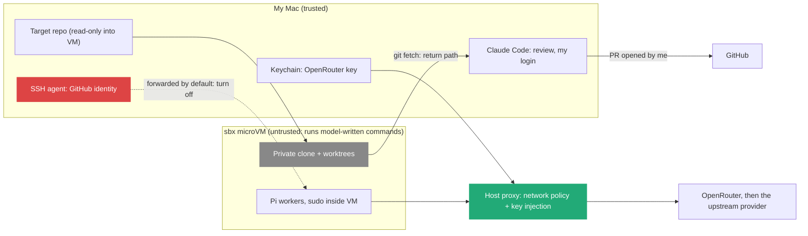

# 10. Fleet lab threat model: what an agent may do alone, with me, and never

> I split every action of the [fleet lab](09_Local_Fleet_Lab_Sandboxes_And_Worktrees.md) into three zones: **alone** (inside the sandbox, on its own branch), **with me** (an approval I give per action), and **never** (the agent has no credential, mount or network path to do it). An action belongs in "never" only when a mechanism blocks it. A rule written in a skill is guidance, not a control. Two defaults are wrong for this lab and change before the first run: SSH agent forwarding (on) and the Balanced network preset.

Related: [09 A local fleet lab](09_Local_Fleet_Lab_Sandboxes_And_Worktrees.md) · [06 Run the fleet on a remote seat](06_Run_The_Fleet_On_A_Remote_Seat.md) · [07 Herdr or Orca](07_Herdr_Or_Orca_For_My_Fleet.md) · [02 Before the merge](02_Merge_Review_Second_Pair_Of_Eyes.md) · [05 Agents maintain the tools](05_Agents_Maintain_The_Tools_I_Review.md) · [Lecture 4: 14 What agent fleets need](../Lecture_4_Harness/14_What_Agent_Fleets_Need_Beyond_Spawning.md) · [Lecture 2: 9 Tools and prompt injection](../Lecture_2_Context_Agents_md_Skills_Tools/9_tools_prompt_injection.md) · [Lecture 2: 3 Lifecycle hooks](../Lecture_2_Context_Agents_md_Skills_Tools/3_lifecycle_hooks.md)

Source: Docker Sandboxes docs (isolation, local policy, credentials, settings, install), OpenRouter docs (provider selection, data policies, key limits), Claude Code docs (hooks, permissions), the OWASP Top 10 for Agentic Applications, and search summaries for DeepSeek's privacy terms and two `sbx` issues, all checked on 2026-11-11. Nothing was run. See [Fact-check](#fact-check).

## 1. The problem

Note 09 gives me a working design. Before anything runs, I want to know what an agent in this setup can reach, what it can do without me, and what it must be unable to do. I am investigating the area, so the output is a threat model I can reuse for any agent fleet, not only a list of settings.

## 2. Words

| Term | Means here | Not to be confused with |
|---|---|---|
| **Zone A: alone** | The agent acts without asking. Damage stays inside the VM, its clone and its branch | Unrestricted |
| **Zone B: with me** | One explicit approval per action, and I see what I approve | A permission prompt I click through by habit |
| **Zone C: never** | No credential, mount, socket or network path exists. The agent cannot do it even if it tries | A "never" line in a skill. That is Zone A guidance |
| **Mechanism** | A control outside the model: VM boundary, read-only mount, missing key, network rule, spend cap, branch protection | An instruction the model may ignore under prompt injection |
| **Return path** | Everything that leaves the sandbox: git branches I fetch, logs I read, the clipboard | The model call, which is an outbound data path (R1) |

## 3. Assets, boundaries, data flows

| Asset | Worst outcome | Boundary that protects it |
|---|---|---|
| My host files and other repos | Read or changed by an agent | VM, no mount outside the target repo |
| Target repo on the host | Changed behind my back | Clone mode: read-only mount |
| OpenRouter key | Stolen or overspent | Proxy keeps it out of the VM. Spend cap on the key |
| GitHub identity (SSH key, `gh` token) | Push, PR or comment as me | **No GitHub secret in `sbx`, SSH forwarding off** |
| Repo content | Sent to a provider that keeps or trains on it | Provider choice and account privacy settings (R1) |
| My Mac after review | Runs code an agent wrote | Path guard before checkout (R6) |

**What matters:** the VM runs model-written commands with `sudo` inside, so I treat everything in it as hostile. Docker says the hypervisor boundary is the control, not privilege separation inside the VM ([Docker isolation](https://docs.docker.com/ai/sandboxes/security/isolation/)).

## 4. The three zones for R1 to R4

These four risks decide whether the lab is safe to start. Each cell says what the mechanism is, or says plainly that only I am the control.

### R1. Code and text leave for a model provider

| Zone | Actions | Enforced by |
|---|---|---|
| A: alone | Send public-repo content to the model chosen for the run | OpenRouter account privacy settings: deny providers that may train, ZDR where offered, allowed-provider list as a ceiling |
| B: with me | Choose the target repo and its data class. Choose model and provider. Run direct DeepSeek | **Only me.** Nothing technical stops content in the VM from going to the model. That is the model's job |
| C: never | Confidential or Aras code reaches any fleet model | **Not enforceable by a mechanism in this lab.** The only real control is keeping that code out of the VM: no mount, no clone. Policy: public repos only |

DeepSeek's own [privacy policy](https://cdn.deepseek.com/policies/en-US/deepseek-privacy-policy.html) (updated 2026-02-10) says it collects, processes and stores personal data in the People's Republic of China, uses inputs to train its models with an opt-out by email to privacy@deepseek.com, and keeps inputs while the account is active. So the direct DeepSeek route is for public content only, and I send the opt-out before the comparison run. Through OpenRouter, the request-level fields `data_collection: "deny"` and `zdr: true` exist, and the account-wide settings apply whatever client sends the request, so I set them in the account and do not rely on Pi to send them ([OpenRouter provider selection](https://openrouter.ai/docs/guides/routing/provider-selection)). If no ZDR endpoint serves the model, requests fail, which is the safe failure.

### R2. Prompt injection steers the agent (OWASP ASI01 Agent Goal Hijack)

| Zone | Actions | Enforced by |
|---|---|---|
| A: alone | Read any file in the clone, run commands in the VM, reach allowlisted hosts | VM boundary, allowlist |
| B: with me | Any request to a host no rule covers | `sbx` holds unmatched requests for approval under both presets. I answer with `sbx policy approval respond` |
| C: never | Reach any other host. Write to GitHub. Touch my host | **Locked Down** preset plus one allow rule (`openrouter.ai`), deny rules win over allow rules. No GitHub credential in the VM |

Balanced allows whole categories (code hosts, package managers, cloud services) ([Docker local policy](https://docs.docker.com/ai/sandboxes/governance/local/)). Each one is a possible exfiltration channel for an injected agent. Locked Down gives no baseline, so I add only what a run needs and read `sbx policy log` after it.

### R3. Cost abuse with my key (OWASP LLM10:2025 Unbounded Consumption)

| Zone | Actions | Enforced by |
|---|---|---|
| A: alone | Spend up to the cap of a lab-only key | OpenRouter per-key limit with a daily reset. Requests over it get rejected ([key limits](https://openrouter.ai/docs/guides/best-practices/capping-shared-agent-keys)) |
| B: with me | Raise the cap, add a key, raise `MAX` workers | Only me, in the OpenRouter dashboard |
| C: never | Spend beyond the cap. Use my main key | Separate key, cap on it. BYOK spend is outside the cap by default, so no BYOK in the lab |

### R4. Secrets in the repo reach the agent (OWASP ASI03 Identity and Privilege Abuse)

| Zone | Actions | Enforced by |
|---|---|---|
| A: alone | Read everything in the mounted repo, **git-ignored files included** | Nothing. Clone mode guards against change, not inspection |
| B: with me | Start a sandbox on a repo | A pre-run check that lists ignored and untracked files: `git ls-files --others --ignored --exclude-standard` must show nothing secret |
| C: never | Read host files outside the repo, host env vars, the real API key, my SSH agent | VM and no other mount. Proxy injects the key on the host side. `sbx settings set ssh.agentForwardingEnabled false` and `sbx daemon restart` |

SSH forwarding is the default ([Docker settings](https://docs.docker.com/ai/sandboxes/configuration/settings/)). An open issue reports forwarding while `SSH_AUTH_SOCK` was unset ([sbx #115](https://github.com/docker/sbx-releases/issues/115)), so after turning it off I check inside the sandbox that `ssh-add -l` finds no agent.

## 5. R5 to R9 in one table

| # | Risk | OWASP | A: alone | B: with me | C: never (mechanism) |
|---|---|---|---|---|---|
| R5 | Supply chain: `pi-kit:latest`, the `docker/tap` Homebrew tap, Pi packages, skills | ASI04 | Use pinned images and read skills | Every install and version bump | An unpinned image: pin `pi-kit` by digest |
| R6 | **Poisoned return path:** an agent branch adds `.claude/settings.json` hooks, `.vscode/tasks.json`, git hooks or npm scripts that run on my Mac | ASI05 | Write such files in its own branch | Checkout on the host, only after a path guard passes | Running them unseen: a path guard that fails the branch if it touches `.claude/`, `.agents/`, `.github/`, `.vscode/`, `.git*`, `*.sh`, `package.json` |
| R7 | Level 0 and host-side Pi have no execution isolation | ASI02 | Nothing on the host | Level 0 as plan-only, with Claude Code asking per tool | Host Pi runs: not used in this lab |
| R8 | A cheap model reports "done" with a weak check, or hides a change in a large diff | ASI09 (title unverified) | Commit on its branch | Review with another model family, human merge | Push or merge: no GitHub credential, branch protection on `main` |
| R9 | No audit trail | — | Logs in `.fleet/logs/` | Read `sbx policy log` after each run | Losing them: keep logs before `sbx rm` |

R6 deserves its own line. Claude Code's trust dialog gates project hooks in interactive sessions, but in `-p` and SDK runs the folder counts as trusted, and committed project hooks run ([Claude Code hooks](https://code.claude.com/docs/en/hooks)). My target repo is a folder I already trust. So an agent branch that adds a hook runs on my Mac the moment I check it out and start a headless review. The guard must run on the fetched ref, before checkout.

## 6. Rules in my skills are not controls

| Skill rule | Mechanism that backs it | Zone it really is |
|---|---|---|
| Worker: "never `git push`" | No GitHub credential in the VM, SSH forwarding off | C, once both are in place |
| Worker: "change only paths in scope" | None yet. The path guard (R6) would back it | A, until the guard exists |
| Worker: "never read secrets" | None. Clone mode exposes ignored files | A. The pre-run check makes it B |
| Runner: "never merge" | Branch protection on GitHub, no credential | C |
| Planner: "do not edit code" | None | A. Its output is only a plan I approve, so low impact |

## 7. Run gate for Level 1

Each step needs my yes. Nothing on this list has run yet.

| # | Step | Changes | Undo | Risk |
|---|---|---|---|---|
| 1 | `brew trust docker/tap`, `brew install docker/tap/sbx` | Trusts Docker's tap, installs `sbx` | `brew uninstall sbx`, untrust the tap | R5 |
| 2 | `sbx login` | Docker account session on this Mac | `sbx logout` (verify) | Low |
| 3 | `sbx settings set ssh.agentForwardingEnabled false`, `sbx daemon restart` | Global: no SSH agent in any sandbox | Set back to `true` | Closes R4 |
| 4 | Locked Down preset (exact `sbx policy init` argument: check `--help`), then `sbx policy allow network openrouter.ai` | Global network policy | `sbx policy` reset | Closes R2 |
| 5 | OpenRouter: new lab key with a daily limit. Account privacy: deny training, ZDR where offered | Account settings | Delete key, revert settings | Closes R3, narrows R1 |
| 6 | `sbx secret set openrouter` | Key in the macOS Keychain | `sbx secret rm openrouter` | Low |
| 7 | In the target repo: `git ls-files --others --ignored --exclude-standard` | Nothing. Read-only | — | Checks R4 |
| 8 | `sbx run --clone --name fleet-azure --kit docker.io/sbx/pi-kit@sha256:<digest> pi` | Creates the VM and clone | `sbx rm fleet-azure` (deletes unfetched work) | R5 if not pinned |
| 9 | Inside: `ssh-add -l` must fail, `sbx policy check network github.com` must deny | Nothing | — | Verifies 3 and 4 |
| 10 | After: `sbx policy log`, path guard on each branch, then `git fetch` | Refs under `sandbox-fleet-azure/` | `git remote remove` | R6, R9 |

## My take

The useful question for any agent setup is not "is it sandboxed" but "which column is each action in, and what puts it there". Most agent docs answer with instructions. The answers that hold are a missing credential, a read-only mount, a deny rule and a spend cap. R1 is the one risk this lab cannot close with a mechanism, so data classification stays my decision, and Aras code stays out of the lab entirely.

## Cautions

- **Search summaries carry part of this note:** the two `sbx` issues, the OpenRouter key limits, the ASI09 title. I read the Docker, OpenRouter and Claude Code pages through a fetch tool, not in full.
- **The path guard (R6) does not exist yet.** Until it does, no agent branch gets checked out on my Mac or reviewed headless.
- **On a Windows work laptop** enabling Windows Hypervisor Platform needs an elevated prompt, which is IT's decision, and work data rules apply before anything else.
- **`sbx` changes fast.** The SSH setting arrived in a recent CLI version (search summary). I check `sbx version` and the settings page before the run.

## Summary

Three zones: alone inside the VM, with my approval per action, and never because no path exists. R2, R3 and most of R4 close with mechanisms (Locked Down network, a capped lab key, SSH forwarding off). R1 cannot close by mechanism, so public repos only. R6, code that runs on my Mac after review, needs a path guard before the first fetch.

## Open questions

- Does OpenRouter offer a ZDR endpoint for DeepSeek V4.1 Flash, or does `zdr` make the model unusable?
- Mountless mode keeps even ignored files away from the agent. Can I get branches back from a mountless sandbox without giving it a GitHub credential?
- Should the path guard live in `fleet-run` (inside the VM) or on the host before fetch? Only the host side is outside the agent's reach.

## Fact-check

| # | Claim | Verdict | Source | Checked |
|---|---|---|---|---|
| 1 | Clone mode protects the host repo from change, not inspection. Ignored files are readable | **Agrees** | [Docker isolation](https://docs.docker.com/ai/sandboxes/security/isolation/) | 2026-11-11 |
| 2 | SSH agent forwarding is on by default and any process in the sandbox can ask it to sign | **Agrees** | Same page; [Docker settings](https://docs.docker.com/ai/sandboxes/configuration/settings/) | 2026-11-11 |
| 3 | `sbx settings set ssh.agentForwardingEnabled false` then `sbx daemon restart` turns it off, globally | **Agrees** | Search summary of the settings page and [sbx #305](https://github.com/docker/sbx-releases/issues/305) | 2026-11-11 |
| 4 | Forwarding was reported with `SSH_AUTH_SOCK` unset | **Unverified** | [sbx #115](https://github.com/docker/sbx-releases/issues/115), search summary, fix status unknown | 2026-11-11 |
| 5 | Credential values never enter the VM. The proxy injects them for AI services | **Agrees** | [Docker isolation](https://docs.docker.com/ai/sandboxes/security/isolation/), [credentials](https://docs.docker.com/ai/sandboxes/configuration/credentials/) | 2026-11-11 |
| 6 | The host Docker socket is not exposed. Local stdio MCP servers run on the host | **Agrees** | [Docker isolation](https://docs.docker.com/ai/sandboxes/security/isolation/) | 2026-11-11 |
| 7 | Balanced allows categories (AI APIs, package managers, code hosts, cloud). Locked Down has no baseline. Unmatched requests wait for approval. Deny wins over allow. `sbx policy log` shows traffic | **Agrees** | [Docker local policy](https://docs.docker.com/ai/sandboxes/governance/local/) and a search summary of the network-rules and approvals pages | 2026-11-11 |
| 8 | OpenRouter supports `data_collection`, `zdr`, `only`, `ignore` per request, and account-wide privacy settings | **Agrees** | [OpenRouter provider selection](https://openrouter.ai/docs/guides/routing/provider-selection) | 2026-11-11 |
| 9 | OpenRouter keys take a credit limit with daily, weekly or monthly reset. BYOK is excluded by default | **Agrees** | Search summary of [OpenRouter key docs](https://openrouter.ai/docs/guides/best-practices/capping-shared-agent-keys) | 2026-11-11 |
| 10 | DeepSeek stores data in the PRC, trains on inputs with an opt-out by email, keeps inputs while the account is active | **Agrees** | [DeepSeek privacy policy](https://cdn.deepseek.com/policies/en-US/deepseek-privacy-policy.html), last update 2026-02-10, read via fetch | 2026-11-11 |
| 11 | Claude Code `-p` and SDK runs treat the folder as trusted, so committed project hooks run | **Agrees** | Search summary of [Claude Code hooks](https://code.claude.com/docs/en/hooks) and [permissions](https://code.claude.com/docs/en/permissions) | 2026-11-11 |
| 12 | OWASP Top 10 for Agentic Applications: ASI01 Goal Hijack, ASI02 Tool Misuse, ASI03 Identity and Privilege Abuse, ASI04 Supply Chain, ASI05 Unexpected Code Execution | **Agrees** | [OWASP release, 2025-12-09](https://genai.owasp.org/2025/12/09/owasp-top-10-for-agentic-applications-the-benchmark-for-agentic-security-in-the-age-of-autonomous-ai/), search summary | 2026-11-11 |
| 13 | ASI09 covers misplaced human trust in agent output | **Unverified** | Title not seen in the pages read | 2026-11-11 |
| 14 | LLM10:2025 is Unbounded Consumption. A 2026 LLM list exists | **Agrees** | [OWASP LLM10:2025](https://genai.owasp.org/llmrisk/llm102025-unbounded-consumption/), [OWASP LLM Top 10 page](https://genai.owasp.org/initiatives/top-10-for-llm-and-genai/) | 2026-11-11 |
| 15 | `sbx` installs on macOS 14+ Apple silicon with `brew trust docker/tap` and `brew install docker/tap/sbx`, and on Windows 11 with `winget install -h Docker.sbx`. Docker Desktop is not needed | **Agrees** | [Docker Sandboxes install](https://docs.docker.com/ai/sandboxes/install/) | 2026-11-11 |

## Sources

- [Docker Sandboxes](https://docs.docker.com/ai/sandboxes/): isolation, local policy, credentials, settings, install; [sbx-releases issues](https://github.com/docker/sbx-releases/issues)
- [OpenRouter docs](https://openrouter.ai/docs): provider selection, data policies, key limits
- [Claude Code docs](https://code.claude.com/docs/en/): hooks, permissions
- [OWASP Top 10 for Agentic Applications](https://genai.owasp.org/2025/12/09/owasp-top-10-for-agentic-applications-the-benchmark-for-agentic-security-in-the-age-of-autonomous-ai/), [OWASP LLM Top 10](https://genai.owasp.org/initiatives/top-10-for-llm-and-genai/)
- My own reasoning: the three zones, the zone tables, "rules are not controls", the R6 attack path through trusted-folder hooks, the run gate and "My take"
