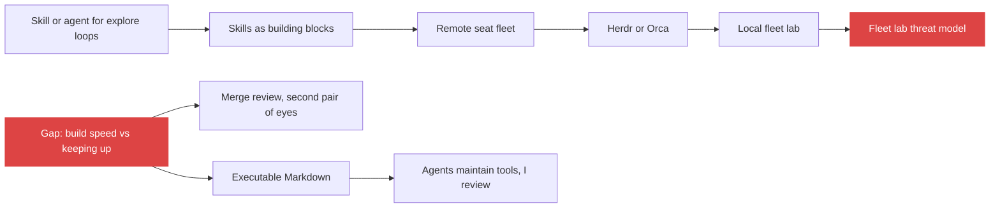

# Lecture 5: Workflows, not tool sets

> Skills and agents are workflows I design and review, not tool sets: I decide where a loop lives, add a second pair of eyes before the merge, run the fleet on a remote seat or a safe local lab, and keep up by checks and ways back.

Source: S01E05 transcript (audio), S01E05 article (text) and web research. Pictures are in `img/`. Related: [Lecture 4: Working with AI harnesses](../Lecture_4_Harness/README.md) · [Week 2, Lecture 1: Agent primitives](../Week2_Lecture_1_Agent_Primitives/README.md) · [root README](../README.md)

## What this lecture covered

## Notes

### Skills and agents as workflows

| File | Name | What it covers | Keywords |
|---|---|---|---|
| [01_Skill_Or_Agent_For_Explore_Loops.md](01_Skill_Or_Agent_For_Explore_Loops.md) | Skill or agent for explore loops | The loop, stop rule and answer shape go in a skill, and the agent file keeps separate context, tool limits and model | skill, agent, explore loop, isolation |
| [04_Executable_Markdown_Skills_As_Programs.md](04_Executable_Markdown_Skills_As_Programs.md) | Executable Markdown, skills as programs | Markdown for judgment, scripts for exact repeated steps, and tests with synthetic scenarios | executable markdown, scripts, synthetic scenarios |
| [05_Agents_Maintain_The_Tools_I_Review.md](05_Agents_Maintain_The_Tools_I_Review.md) | Agents maintain the tools, I review them | I build the system once, agents create and maintain tools and skills, and I review a standing report on each | knowledge base, primitives, standing report, review |
| [08_Skills_As_Building_Blocks.md](08_Skills_As_Building_Blocks.md) | Skills as building blocks | Small single-job skills compose into workflow skills, and where a skill lives depends on how it helps | workflow skills, full send, full stop, global, repository |

### Review and keeping up

| File | Name | What it covers | Keywords |
|---|---|---|---|
| [02_Merge_Review_Second_Pair_Of_Eyes.md](02_Merge_Review_Second_Pair_Of_Eyes.md) | Merge review, a second pair of eyes | A separate reviewer agent on a cheap model with clean context adds an independent check around the PR | reviewer agent, coderabbit, clean context, pr |
| [03_The_Gap_Build_Speed_Vs_Keeping_Up.md](03_The_Gap_Build_Speed_Vs_Keeping_Up.md) | The gap: build speed vs keeping up | Building gets faster but understanding and review do not, so keeping-up moves to checks and ways back | gap, build speed, review, checks, ways back |

### Fleet control planes and setup

| File | Name | What it covers | Keywords |
|---|---|---|---|
| [06_Run_The_Fleet_On_A_Remote_Seat.md](06_Run_The_Fleet_On_A_Remote_Seat.md) | Running the fleet on a remote seat | The lecturer's VPS seat on Tailscale runs Pi agents under Limen and Herdr and reaches GitHub only through PRs | remote seat, vps, tailscale, pi, limen, herdr |
| [07_Herdr_Or_Orca_For_My_Fleet.md](07_Herdr_Or_Orca_For_My_Fleet.md) | Herdr or Orca for my fleet | Two alternative control planes: terminals kept alive or a git worktree per task | herdr, orca, control plane, git worktree |

### Fleet lab safety

| File | Name | What it covers | Keywords |
|---|---|---|---|
| [09_Local_Fleet_Lab_Sandboxes_And_Worktrees.md](09_Local_Fleet_Lab_Sandboxes_And_Worktrees.md) | Local fleet lab, sandboxes and worktrees | Each Pi agent runs in a Docker Sandbox microVM in clone mode, each work item in its own worktree | sbx, docker sandbox, microvm, clone mode, worktree |
| [10_Fleet_Lab_Threat_Model.md](10_Fleet_Lab_Threat_Model.md) | Fleet lab threat model | Every action falls in three zones: alone in the sandbox, with my approval, or never because a mechanism blocks it | threat model, zones, assets, boundaries, data flows |
