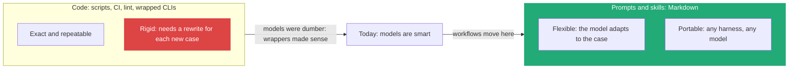
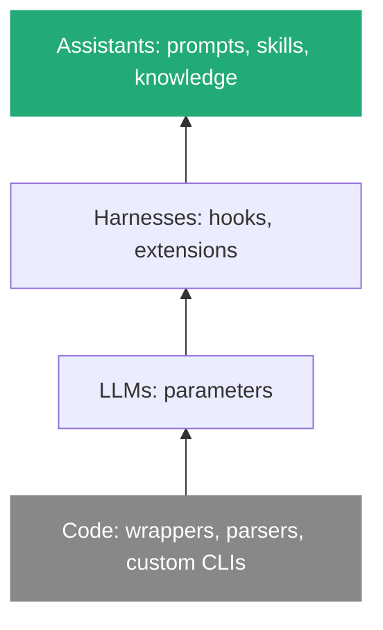

# 1. Workflows live in prompts and skills, not in code wrappers

> A workflow is the way I want work done. I write it in prompts and skills, because code wrappers around tools fight a model that is now smart enough to use the tool well.

Related: [02 Markdown is executable](draft_02_Markdown_Is_Executable.md) · [08 Compose skills](draft_08_Compose_Skills_Building_Blocks_To_Workflows.md) · [09 Where skills live](draft_09_Where_Skills_Live_Global_Harness_Repo.md) · [Lecture 4: 05 Don't overspecify](../Lecture_4_Harness/05_Dont_Overspecify_Work_At_Assistants_Level.md) · [Lecture 4: 01 Harness lock-in](../Lecture_4_Harness/01_Harness_Lock-in_Keep_Doors_Open.md) · [Lecture 2: 5 Skills](../Lecture_2_Context_Agents_md_Skills_Tools/5_skills.md)

Source: S01E05 transcript, opening section ("where to encode the way we work") and the closing section ("how little we talked about the code"). Vendor docs checked on 2026-11-09, see [Fact-check](#fact-check).

## 1. The problem

I can encode how my team works in several places: scripts, CI rules, lint rules, wrappers around the GitHub CLI, or plain prompts and skills. Which place gives me a workflow that keeps working when the model, the harness or the tool changes?

## 2. Words

| Term | Means here | Not to be confused with |
|---|---|---|
| **Workflow** | The steps and judgment rules for getting a kind of work done (fix a bug, file a PR) | A pipeline engine such as GitHub Actions. A workflow can use one, but it is not one |
| **Wrapper** | Code placed around a tool to limit what the model can do (a rewritten or restricted `gh`) | A tool the model calls on purpose |
| **Skill** | A Markdown file the agent loads when the task fits ([Lecture 2: 5](../Lecture_2_Context_Agents_md_Skills_Tools/5_skills.md)) | A script or a slash command typed by a human |
| **Guardrail in code** | A lint rule, CI check or test that fails when a rule is broken | A prompt that asks nicely |

## 3. Where a workflow can live

The lecturer lists the places in this order: code, then prompts and skills.

**The lecturer's argument:**
- "When models were dumber, that made a lot of sense, but they've gotten pretty smart now."
- "Putting your time into building custom wrapper functions around your tools to prevent them from doing the wrong thing, probably not the best use of your time."
- "Did you notice how little we talked about the code itself? ... The code just isn't flexible enough."

**His portability proof:** "All of the skills I just showed work great in every harness I use. They work great with every modern model that I touch." The workflow stays the same while tools and models change.

**Important:**
- Workflows "can be very dynamic and involve a lot of code". Code is still called by a skill. The point is where the *workflow* is written, not that code disappears.
- Three places make workflows concrete: **prompts, skills, and the composition of both** ([08](draft_08_Compose_Skills_Building_Blocks_To_Workflows.md)).

**Not important:**
- The exact list of tools he names. They are examples of what a skill can call.

## 4. When code still wins

The lecture does not argue against all code. A code rule is right when the check is exact and a mistake is expensive.

| Need | Place | Why |
|---|---|---|
| Steer how the agent works: order of steps, taste, style | Skill or prompt | Judgment, changes often |
| Exact, cheap, repeatable check (links, formats, lint) | Code, called from the skill | Code never forgets ([Lecture 3: 13](../Lecture_3_Simplify_Codebase_&_Knowledge_Base/13_Knowledge_Skill_Anatomy.md): "judgment in notes, mechanics in scripts") |
| A hard limit that must hold even if the model is wrong (secrets, production access, deploy) | Permissions, sandbox, CI | A prompt is a request, not a barrier ([Lecture 4: 14](../Lecture_4_Harness/14_What_Agent_Fleets_Need_Beyond_Spawning.md)) |
| Missing capability (upload a video without committing it) | A small tool, announced by a skill | The lecturer built a file-upload tool for exactly this ([08](draft_08_Compose_Skills_Building_Blocks_To_Workflows.md)) |

## 5. How it fits the four-layer stack

This is [Lecture 4: 05](../Lecture_4_Harness/05_Dont_Overspecify_Work_At_Assistants_Level.md) applied to team work. Skills and prompts sit at the Assistants layer. Wrapper code sits at the Code layer, the first one models outgrew.

## My take

The test from note 05 carries over: if I deleted my wrappers and kept my skills, would the agent still deliver most of the work? A wrapper that blocks a mistake is also a bet that the model will keep making that mistake. A skill that shows the mistake and the fix ([06](draft_06_Teach_With_Bad_And_Good_Examples.md)) loses little when the model improves.

The lecturer works where changes can be staged and reverted ([04](draft_04_The_Merge_Button_Before_And_After.md)). Where a wrong action cannot be undone, hard limits in code and permissions stay.

## Summary

Put the way of working into prompts and skills. Keep code for exact checks and hard limits. Skills move across harnesses and models, wrappers do not.

## Open questions

- Which of my current wrappers or hooks exist only because an older model made a mistake?
- Where is my hard-limit line: which actions must a permission block, whatever the skill says?

## Fact-check

| # | Claim | Verdict | Source | Checked |
|---|---|---|---|---|
| 1 | Wrapping tools to restrict a model is a weak use of time now | **Lecture-specific** | The lecturer's opinion. Consistent with [Anthropic's advice to prefer simple prompts](https://www.anthropic.com/research/claude-code-best-practices), which I did not re-read for this note | 2026-11-09 |
| 2 | Skills work across harnesses | **Differs: partly** | Skills follow the open Agent Skills format, but harness-specific frontmatter is not portable. A report says [OpenCode ignores `disable-model-invocation`](https://github.com/anomalyco/opencode/issues/11972) and another that [a Claude Desktop upload failed on it](https://github.com/anthropics/claude-code/issues/24826). Search summary of open issues, not retested | 2026-11-09 |
| 3 | Skills load from personal and project locations | **Agrees** | [Claude Code skills docs](https://code.claude.com/docs/en/skills): `~/.claude/skills/` (all projects), `.claude/skills/` (this project). Search summary, page not read in full | 2026-11-09 |
| 4 | Workflows work with "every modern model" | **Lecture-specific** | The lecturer's experience. Not tested here | 2026-11-09 |

## Sources

- S01E05 transcript (the lecturer's quotes above)
- [Claude Code skills docs](https://code.claude.com/docs/en/skills)
- Sections 4 and "My take" are my own reasoning
