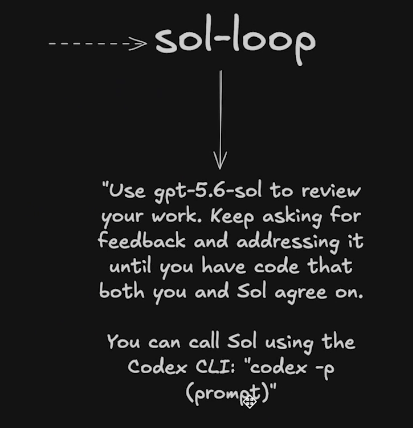
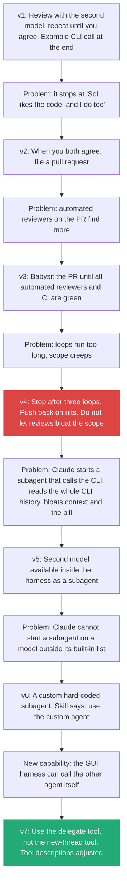
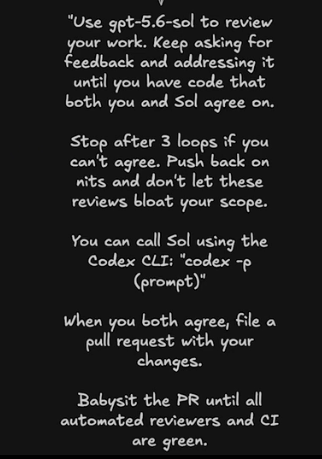
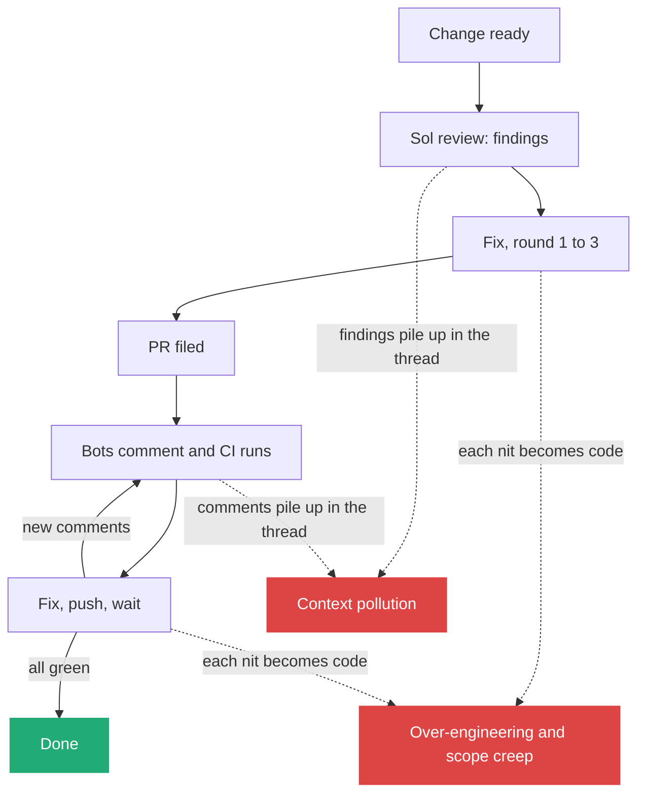

# 3. A skill is never finished: the sol-loop through seven edits

> The lecturer's review skill began as three sentences and changed seven times in a few months, each time because he watched the agent do something he did not want. A skill I have not edited in months is a skill I am not auditing.

Related: [02 Markdown is executable](draft_02_Markdown_Is_Executable.md) · [06 Teach with bad and good examples](draft_06_Teach_With_Bad_And_Good_Examples.md) · [08 Compose skills](draft_08_Compose_Skills_Building_Blocks_To_Workflows.md) · [09 Where skills live](draft_09_Where_Skills_Live_Global_Harness_Repo.md) · [Lecture 2: 7 Skill shaper](../Lecture_2_Context_Agents_md_Skills_Tools/7_skill_shaper_how_to_improve_skills.md) · [Lecture 2: 12 Subagents vs workers](../Lecture_2_Context_Agents_md_Skills_Tools/12_subagents_vs_workers.md) · [Lecture 4: 03 Skill and folder orchestration](../Lecture_4_Harness/03_Skill_And_Folder_Orchestration.md) · [01 Skill or agent for exploring](01_Skill_Or_Agent_For_Explore_Loops.md) · [02 Before the merge: a second pair of eyes](02_Merge_Review_Second_Pair_Of_Eyes.md)

Source: S01E05 transcript, the sol-loop story, and the lecturer's slides of the first and a later version (`img/sol-loop-first-version-slide.png`, `img/sol-loop-second-version-slide.png`). Claude Code subagent docs and the model name checked on 2026-11-09 as search summaries, see [Fact-check](#fact-check).

## 1. The problem

A skill that worked on day one stops fitting as models, tools and harnesses change, and as I notice new bad behavior. How do I keep a skill useful, and how do I know what to change?

## 2. Words

| Term | Means here | Not to be confused with |
|---|---|---|
| **sol-loop** | The lecturer's skill: ask a second model family to review my change, fix, repeat until both agree | A fixed pipeline. It is a few lines of Markdown |
| **Cross-model review** | Reviewer from a different model family than the author | Two runs of the same model |
| **Babysit** | Keep watching a PR until automated reviewers and CI are green | A one-time check |
| **Scope creep** | The loop keeps finding things and the change grows beyond its goal | A bug in the reviewed code |

## 3. Why the loop exists

The lecturer found that one model family "might not be my favorite for writing code, but they were incredibly thorough for reviewing it". So he writes with his preferred model and brings the other family in to review before the PR. This saves his other review agents and his team's time.

## 4. The first version, and the seven edits

**The story.** A dashed arrow points to the name **sol-loop**. A solid arrow leads down to the whole skill, quoted in full: "Use gpt-5.6-sol to review your work. Keep asking for feedback and addressing it until you have code that both you and Sol agree on. You can call Sol using the Codex CLI: `codex -p (prompt)`". That is all of version 1: one instruction, one stop condition ("both agree"), one example call.

**Important:**
- **Three sentences were enough to start.** The skill named a reviewer model, a loop, and how to call it.
- **The stop condition is "agree".** That is the weak spot the first edit fixes: agreement is not the finish line the lecturer wants.
- **The call is spelled out.** The agent did not have to discover how to reach the other model.

**Not important:**
- The small handle on the last line. It is the drawing tool's cursor.

The seven edits that followed:

| Edit | What he saw | The line he changed or added | Type of fix |
|---|---|---|---|
| v1 | Nothing yet | "Use gpt-5.6-sol to review your work. Keep asking for feedback and addressing it until you have code that both you and Sol agree on. You can call Sol using the Codex CLI: `codex -p (prompt)`" | Starting idea |
| v2 | Agent stops after agreement | "When you both agree, file a pull request with your changes" | **Goal moved to the real finish line** |
| v3 | PR reviewers catch what agents missed | "Babysit the PR until all automated reviewers and CI are green" | **Finish line moved again** |
| v4 | Long loops, scope creep | "Stop after three loops if you can't agree. Push back on nits" | **A limit and a stance** |
| v5 | Subagent reads the whole CLI history | Model made available as a subagent inside the harness | **Capability change** (see [Lecture 4: 06](../Lecture_4_Harness/06_Self_Management_Pi_Herdr.md)) |
| v6 | Agent cannot pick a model outside its list | A custom, hard-coded subagent, the "sol agent". The skill now says: call Sol with the custom agent through the subagent tool | **Work around a harness limit, by moving a capability from text into an agent** |
| v7 | A better tool appeared in the harness | "Use the delegate tool", with tool descriptions fixed in the open source project | **New tool, and fixing the tool** |

**Important:**
- **Every edit answers something he observed.** He audits what agents do and asks questions, then writes the fix as a sentence.
- **The finish line moved three times** (agree, then PR, then green PR). A skill's end condition is the first thing to check.
- **Limits go in the text:** "three loops" is a number the agent can follow.
- **Edit 6 is the move from skill to agent.** The skill could tell Claude to use Sol, but the harness only started models from its own list. An agent file fixes the model, so the lecturer wrote the "sol agent" and changed one line of the skill to call it. The skill stayed as the loop, and the agent became the reviewer. The reviewer is agent-level work: it carries a model, tools and its own thread.
- **Cost showed up as a hidden side effect** (a subagent reading a long history). Look at the bill, not only the result.
- Open source helped: "if you rely on open source tools, you can fix these things when they break."

**Not important:**
- Which two model families, and which GUI. The pattern fits any pair.

### The version after edits 2 to 4

**The story.** The first slide's three sentences are now the top of a longer text, in five paragraphs:
1. Review with `gpt-5.6-sol` until "both you and Sol agree on" the code.
2. "Stop after 3 loops if you can't agree. Push back on nits and don't let these reviews bloat your scope."
3. How to call Sol: `codex -p (prompt)`.
4. "When you both agree, file a pull request with your changes."
5. "Babysit the PR until all automated reviewers and CI are green."

**Important:**
- **Two loops now run one after the other.** The first is the agreement loop with Sol, capped at three rounds. The second starts after the PR is filed: the agent keeps going until the automated reviewers and CI are green. That is a consensus rule across several reviewers: my own review model first, then the PR bots, and CI as the exact check.
- **The slide caps only the first loop.** "Stop after 3 loops" sits in the paragraph about agreeing with Sol. The babysit line has no limit of its own.
- **The slide says "automated reviewers", not one product.** The lecturer names CodeRabbit, Greptile and Macroscope as examples when he tells the story. Reading the babysit step as "fetch each reviewer's findings, decide, fix, push, wait for the next round" is my reading of what babysitting means. The slide does not spell it out.
- **"Push back on nits" is the scope guard.** The agent may refuse a finding, which is what keeps the loop from growing the change.

**Not important:**
- The cursor mark on the picture.

## 5. Where the loop goes wrong: context pollution and over-engineering

Each round adds text to the thread: the diff, the reviewer's findings, the bot's comments, the fixes, the next findings. And each round can add code, because a reviewer that is asked for feedback finds something to say.

| Problem | How it shows up | Guard in the slide | Guard to add |
|---|---|---|---|
| **Context pollution** | The author's thread fills with findings and comments. Later decisions are made with the early plan buried under noise ([Lecture 2: 4](../Lecture_2_Context_Agents_md_Skills_Tools/4_context_window.md)) | None. His fix for the related subagent bloat was a different mechanism (edits 5 to 7 above) | Run each review round and each bot round as a fresh helper that gets the diff, the intent and the open findings, and returns a short list. Keep the author's thread for decisions ([01](01_Skill_Or_Agent_For_Explore_Loops.md)) |
| **Over-engineering** | Each finding is accepted. Small changes pile up: extra checks, abstractions, tests for cases that cannot occur | "Push back on nits and don't let these reviews bloat your scope" | Triage every finding as fix, push back (one line with a reason) or defer (to an issue). Only fix findings that tie to the stated intent or to a failing check |
| **Open-ended babysit** | No cap on rounds. Each new bot comment can start another round | CI and reviewers "green" is a stop condition, but nothing stops a loop that never gets there | A round limit and a severity threshold for the babysit loop too. At the limit, stop and hand the open items to me |
| **Bots disagree with the reviewer or with each other** | One asks for a change another undoes | Not covered | The author decides, using the intent as the tiebreaker. Record the reason in the PR |

**The lecturer's own evidence:** he saw loops run "way longer than they should", with "massive scope creep", and a subagent that "ended up massively bloating the context and increasing my bill". The three-loop cap and the push-back rule are his fixes for the first. The bot loop is where the same risks return.

## 6. A skill audit I can run

| Question | If the answer is "no" |
|---|---|
| Did I edit this skill in the last two months? | Read it. The lecturer says: "If you have a skill that you use regularly that you have not edited in months, I have concerns" |
| Does it end at the finish line I want today? | Move the end condition |
| Does it have a number or stop rule for loops? | Add one |
| Does it name the tool or agent to call, not a general category? | Name it |
| Does its output waste context or money? | Tell the agent what not to read |
| Do I still use it? | Delete it ([09](draft_09_Where_Skills_Live_Global_Harness_Repo.md)) |

## My take

The seven edits show the lecturer's skill as a small program with a changelog. A skill with a change history is something I can review like code: what failed, what line fixed it. For my platform, I would keep that history next to the skill (the "structure log" idea from [Lecture 3: 13](../Lecture_3_Simplify_Codebase_&_Knowledge_Base/13_Knowledge_Skill_Anatomy.md)) and the fleet metadata from [Lecture 4: 03](../Lecture_4_Harness/03_Skill_And_Folder_Orchestration.md).

Cross-model review also matches an ordinary rule: the author should not be the only reviewer.

## Cautions

- "One family reviews better" is the lecturer's observation, not a measured result.
- Cross-model review sends my code to a second vendor. For Aras code, check the [AI Solutions Catalog](http://aitools.aras.com/) before using it.
- The skill's fixes depend on one harness's tools. They age quickly.

## Summary

The sol-loop shows how a skill grows: start with three sentences, run it, watch the agent, add a line for each surprise. Check the end condition, loop limits, cost and the tool name. Edit often, and delete what I do not use.

## Open questions

- Which of my skills have a wrong or missing finish line?
- Do I want a short changelog inside each skill?

## Fact-check

| # | Claim | Verdict | Source | Checked |
|---|---|---|---|---|
| 1 | A second model family is a useful reviewer | **Lecture-specific** | The lecturer's experience. No measurement in the transcript | 2026-11-09 |
| 2 | A harness can run a custom subagent on a chosen model | **Agrees** | [Claude Code subagents](https://code.claude.com/docs/en/subagents): `.claude/agents/` files with a `model` field (`sonnet`, `opus`, `haiku`, full ID or `inherit`). Search summary | 2026-11-09 |
| 3 | A subagent calling a CLI can bloat context and cost | **Lecture-specific** | The lecturer saw it. Plausible, not measured here | 2026-11-09 |
| 4 | T3 Code has a delegate tool and a new-thread tool | **Unverified** | Not found in a search. [T3 Code README](https://github.com/pingdotgg/t3code) not read for tools. Verify before presenting | 2026-11-09 |
| 5 | The reviewer model is `gpt-5.6-sol` | **Agrees (search summary)** | Listed as the flagship of OpenAI's GPT-5.6 family (with Terra and Luna), released July 2026: [OpenRouter](https://openrouter.ai/models/openai/gpt-5.6-sol), [Box model card](https://developer.box.com/guides/box-ai/ai-models/openai-gpt-5-6-sol-model-card). OpenAI's own page not read. The transcript's "Soul" is "Sol" | 2026-11-09 |
| 6 | `codex -p (prompt)` calls the model with a prompt | **Unverified** | Third-party Codex CLI references describe `-p` as `--profile` (a config profile), and OpenAI's docs describe `codex exec` for non-interactive runs, summarized by [search](https://developers.openai.com/codex/noninteractive). The slide's form is not confirmed. Check `codex --help` before presenting | 2026-11-09 |
| 7 | The later version stops after 3 loops and pushes back on nits | **Agrees (slide)** | The lecturer's later slide, `img/sol-loop-second-version-slide.png` | 2026-11-09 |
| 8 | The cap applies only to the agreement loop. The babysit step has no limit on the slide | **My reading of the slide** | Same slide. The text may continue below the cut | 2026-11-09 |
| 9 | Babysit means fetching each bot's findings, fixing, pushing and rechecking | **My interpretation** | The slide says only "babysit the PR until all automated reviewers and CI are green" | 2026-11-09 |
| 10 | Review rounds pollute context and push toward over-engineering | **My interpretation, consistent with the lecturer** | His reports of context bloat and scope creep in the transcript. No measurement. See [Lecture 2: 4](../Lecture_2_Context_Agents_md_Skills_Tools/4_context_window.md) | 2026-11-09 |
| 11 | The writing model "Fable Five" and the PR reviewers "Macroscope", "Code Rabbit", "Greptile" | **Unverified** | Names as spoken in the transcript. Code Rabbit and Greptile are PR review products. Not checked individually | 2026-11-09 |

## Sources

- S01E05 transcript (the seven edits and quotes)
- [Claude Code subagents](https://code.claude.com/docs/en/subagents)
- The audit table and "My take" are my own reasoning
