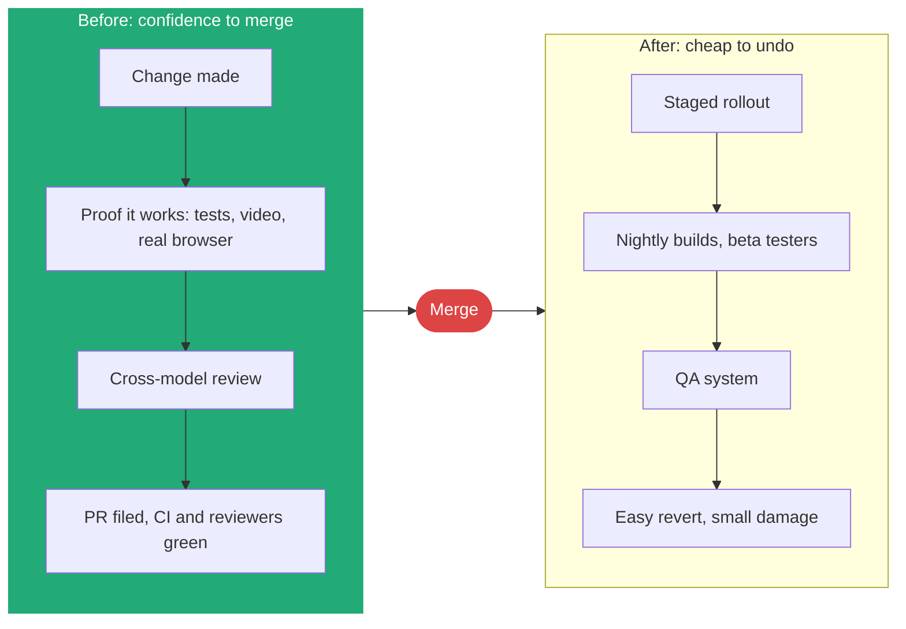
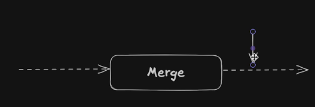
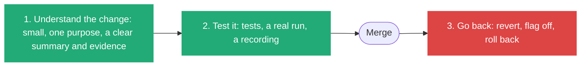
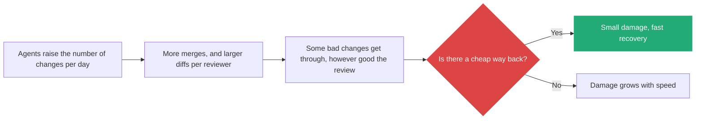

# 4. The merge button: what a workflow must protect, before and after

> A good workflow makes merging less scary from both sides: before the click, I have the evidence to trust the change, and after the click, a bad change is cheap to undo.

Related: [03 Skill evolution](draft_03_Skill_Evolution_Sol_Loop.md) · [07 Prompting wider](draft_07_Prompting_Wider.md) · [08 Compose skills](draft_08_Compose_Skills_Building_Blocks_To_Workflows.md) · [01 Workflows live in prompts and skills](draft_01_Workflows_Live_In_Prompts_And_Skills.md) · [Lecture 4: 10 Automation](../Lecture_4_Harness/10_Automation_Repository_Agents.md) · [01 Skill or agent for exploring](01_Skill_Or_Agent_For_Explore_Loops.md) · [Lecture 3: 1 Simplify first](../Lecture_3_Simplify_Codebase_&_Knowledge_Base/01_Simplify_First_Knowledge_Guardrails.md) · [02 Before the merge: a second pair of eyes](02_Merge_Review_Second_Pair_Of_Eyes.md)

Source: S01E05 transcript, the "merge button" passage and its sketch (`img/merge-step-before-and-after-sketch.png`). DORA metric definitions and the 2025 DORA report checked on 2026-11-09 as search summaries. The list of ways back is common practice, not read from a source. See [Fact-check](#fact-check).

## 1. The problem

When I design a workflow I need a goal to design for. What is the thing every step should serve? The lecturer's answer is the merge button, and it also tells me when his way of working does not fit.

## 2. Words

| Term | Means here | Not to be confused with |
|---|---|---|
| **Before the button** | Everything that lets me verify a change and trust it by the time I open the PR | Code review alone |
| **After the button** | How fast and safely a bad change is found and undone | Hotfixing |
| **Staged rollout** | A change reaches a few users first, then more | A feature flag that is never ramped |
| **Revertable change** | One I can undo with minimal damage | A change with data migrations that cannot go back |

## 3. The idea

"Merge button itself is just a button, but there's a lot that goes into the before and after of that button."

**The two frustrations he names:**
- **Before:** at a PR he cannot tell whether the changes are good, cannot check that it functions, or waits for someone to approve.
- **After:** "What if the changes were broken? ... How do I undo the damage?"

**Important:**
- Mistakes will break through: "even if you have the best engineers in the world obsessively reviewing things". So the *after* side matters as much as review.
- Every workflow in the lecture serves one side. Verify, cross-model review and babysitting serve *before*. Staged rollout and nightlies serve *after*.
- The goal for the agent: "I don't want the agent to bother me until it's done everything it can to verify the changes are good" ([07](draft_07_Prompting_Wider.md)).

**Not important:**
- His employers. The principle holds for any team that can stage changes.

### The lecturer's sketch

**The story.** One solid box labelled **Merge**. A dashed arrow runs into it from the left, and a dashed arrow runs out of it to the right. The box is the only fixed thing. The two dashed lines are everything that leads to it and follows it, and they are where the work of a workflow goes.

**Important:**
- **The merge is a point on a line, not an end.** The line continues to the right: the change still has to live in production.
- **The right-hand arrow is as long as the left one.** Whatever I build before the merge, I owe an equal amount after it.
- **Both lines are dashed:** they are not specified. Each team fills them with its own steps (tests, review, flags, rollout, revert).

**Not important:**
- The small handles at the top right. They are the drawing tool's selection marks.

## 4. Three abilities behind the button

Trust at the merge comes from three abilities, and the third one is the one I am least likely to have built.

| Ability | What it needs | How agents help | Gap to watch |
|---|---|---|---|
| **Understand** | Small changes with one purpose. A PR text that states problem and solution ([06](draft_06_Teach_With_Bad_And_Good_Examples.md)) | Concise PR text, proof attached | Agents produce large diffs faster than I can read them |
| **Test** | Tests that run on every change, plus a real run of the feature | Write and run tests, record a video of the bug and the fix ([07](draft_07_Prompting_Wider.md)) | Tests the agent wrote can share the agent's wrong assumption. A second model family reviews ([03](draft_03_Skill_Evolution_Sol_Loop.md)) |
| **Go back** | A unit I can undo alone. A rollout that limits damage. A fast way to restore | Little. This is mostly my system, not the agent's | Nobody asks for it until something breaks |

## 5. Speed raises the price of having no way back

When agents make changes faster, more changes reach the merge button per day. If my chance of a bad change per merge stays the same, the number of bad changes grows with the volume. Understanding and tests reduce the chance. The way back limits the cost of each one that gets through.

**What the industry measures here.** DORA, the research programme behind the most used delivery metrics, splits them into **throughput** (change lead time, deployment frequency, failed deployment recovery time) and **instability** (change fail rate, deployment rework rate). The last two are the cost of a bad change, and failed deployment recovery time is the way back measured in minutes. The 2025 DORA report on AI-assisted development says AI is an **amplifier** of what a team already does well or badly, and that AI adoption is now linked to higher throughput. Its open concern is making sure software works before it ships.

**Ways back, by what I can undo.** These are common practice, and I have not checked them against a source here.

| Way back | What it undoes | What it needs from me |
|---|---|---|
| Revert one commit | Code of one change | Small, single-purpose changes. A squash merge makes one change one commit |
| Switch a flag off | Behavior in production, without a deploy | The change shipped behind a flag |
| Stop a staged rollout | Reach of the change, while few users see it | A rollout in steps with a health check at each step |
| Roll back a release | Everything in one release | A previous release that still runs |
| Undo a data change | Data, only if planned | A migration that can go back, a backup, or expand-then-contract steps. Often the hardest, and the reason some changes are not revertable |
| Undo what an agent did outside the repo | Messages sent, tickets changed, files moved | A log of agent actions, and tools that can reverse them. Not covered by git |

**Rule for AI-heavy work:** before an agent may merge on its own, I can name the way back for that kind of change. If I cannot, the change stops at the human gate ([08](draft_08_Compose_Skills_Building_Blocks_To_Workflows.md): Full Stop, not Full Send).

## 6. When this does not fit

He says it himself: "You don't have to think the way I think ... if I was writing code for a pacemaker, I would probably be fired."

| Domain | Can I revert cheaply? | Where to put the effort |
|---|---|---|
| Web app with staged rollout | Yes | After side is strong. Agents can go far on their own |
| Internal tools | Yes | Light before, light after |
| On-premise product with customer-run upgrades | Hard | Heavy before, careful release gates |
| Safety-critical or regulated software | No | Human sign-off before. Agents prepare evidence, they do not merge |

His closing rule: "You should adjust your workflows based on how you work and what is and isn't working for you ... and be willing to adjust them as things change" ([03](draft_03_Skill_Evolution_Sol_Loop.md)).

## My take

I design for the merge button the way an architect designs for a failure budget: how much can go wrong, and how fast can I recover? A workflow that raises trust before the click lets a human review less and review better. The same question applies to my agentic platform: before an agent acts, what evidence does it produce, and after it acts, what is the undo?

Development speed is going up, so the way back has to be designed, not hoped for. Where AI is heavily involved, I treat "what is the way back for this change?" as a required field of the change, next to "what does it do?" and "how was it tested?".

The pacemaker example is the useful part. It shows that the *degree of autonomy* comes from how revertable the change is, not from how good the model is. Any Aras-facing agentic action needs that question answered first, and high-risk uses need approval under the AI governance rules.

## Summary

Design workflows around the merge button. Before it: proof and review so I trust the change. After it: staged rollout, nightlies and QA so a bad change is easy to undo. Trust comes from three abilities: understand the change, test it, and go back. Speed from agents makes the third one more important, because some bad changes will get through. Where a change cannot be undone, keep the human gate.

## Open questions

- For my platform, which actions are revertable, and which are not?
- What evidence does an agent hand me before I approve, and where is it stored?
- What is the way back for each kind of change my agents make (code, data, messages, tickets), and who owns it?
- Do I record the way back in the PR text, so a person on call finds it fast?

## Fact-check

| # | Claim | Verdict | Source | Checked |
|---|---|---|---|---|
| 1 | Staged rollouts, nightlies and QA make a bad merge cheaper | **Lecture-specific** | The lecturer's experience at his employers. Standard release-engineering practice, but no source was read for this note. Verify before presenting | 2026-11-09 |
| 2 | Autonomy should match how revertable a change is | **My interpretation** | Reasoning from the pacemaker remark. Not from a source | 2026-11-09 |
| 3 | Agents verify and review before a human sees the PR | **Lecture-specific** | Shown in [08](draft_08_Compose_Skills_Building_Blocks_To_Workflows.md) | 2026-11-09 |
| 4 | DORA splits delivery metrics into throughput and instability, and instability holds change fail rate and deployment rework rate | **Agrees** | [DORA metrics history](https://dora.dev/guides/dora-metrics/history/), via a search summary. Page not read in full | 2026-11-09 |
| 5 | "Failed deployment recovery time" replaced "mean time to recover" | **Agrees** | Same DORA page, via a search summary | 2026-11-09 |
| 6 | The 2025 DORA report calls AI an amplifier and links AI adoption to higher throughput | **Agrees** | [DORA 2025 report page](https://research.google/pubs/dora-2025-state-of-ai-assisted-software-development-report/) and [Google's summary](https://blog.google/technology/developers/dora-report-2025/), via search. Report not read | 2026-11-09 |
| 7 | AI adoption raises instability (more failed changes) | **Unverified** | The search results gave no change-fail-rate figure for AI. Read the DORA report before presenting this as fact | 2026-11-09 |
| 8 | Benchmarks for change fail rate (for example about 5% or 0 to 15% for elite teams) | **Unverified** | Secondary sources disagree. Not used in this note | 2026-11-09 |
| 9 | More changes per day means more bad changes reach production if the per-change rate stays the same | **My interpretation** | Arithmetic from volume. Not a measured result | 2026-11-09 |
| 10 | The table of ways back (revert, flag, staged rollout, release rollback, data undo, agent actions) | **My interpretation** | Common practice, no source read. Verify before presenting | 2026-11-09 |

## Sources

- S01E05 transcript (the merge button passage)
- [DORA metrics history](https://dora.dev/guides/dora-metrics/history/) and [DORA 2025 report](https://research.google/pubs/dora-2025-state-of-ai-assisted-software-development-report/)
- The sketch is the lecturer's slide, copied to `img/`
- The three abilities, the ways-back table, the domain table and "My take" are my own reasoning
