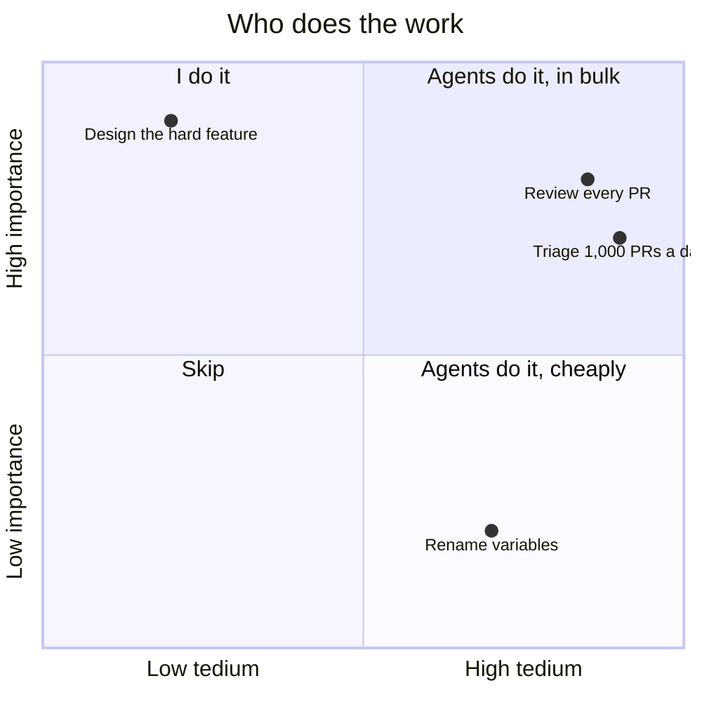

# 5. Seek tedium: give agents the work I used to avoid

> Great engineers hate tedium and either avoid it or automate it away. With agents, the tedious but important work is the best work to hand over, and I should do ten times more of it.

Related: [02 Markdown is executable](draft_02_Markdown_Is_Executable.md) · [04 The merge button](draft_04_The_Merge_Button_Before_And_After.md) · [07 Prompting wider](draft_07_Prompting_Wider.md) · [Lecture 4: 10 Automation](../Lecture_4_Harness/10_Automation_Repository_Agents.md) · [Lecture 3: 3 Agent asks dumb questions](../Lecture_3_Simplify_Codebase_&_Knowledge_Base/03_Agent_Asks_Dumb_Questions.md)

Source: S01E05 transcript, the "seek tedious stuff" passage. No outside source read, see [Fact-check](#fact-check).

## 1. The problem

My instinct says to avoid boring work, or to write code so I never touch it again. That instinct was right when the only worker was me. What is the right rule when I have agents?

## 2. Words

| Term | Means here | Not to be confused with |
|---|---|---|
| **Tedious** | Boring, repetitive, and your eyes glaze over doing it | Hard. Tedious work is often easy |
| **Important** | The work matters if done, and costs if skipped | Urgent |
| **Surface** | Agent brings the few items that need me to the top | Summary of everything |

## 3. The old instinct and the new one

"Historically, as engineers, we have always tried to avoid the tedious stuff, but if the tedious thing was important enough, we would write a bunch of code to make it go away."

| | Old instinct | New instinct |
|---|---|---|
| Boring and important | Write code to remove it, or skip it | **Give it to an agent** |
| Boring and unimportant | Skip | Skip, or agent does it cheaply |
| Interesting and important | I do it | I do it, with my freed attention |
| Cost of doing it by hand | My time | Agent tokens |

**His examples:**
- Reviewing every PR by hand. "I could never even come close to reviewing all the PRs that we are getting, but it doesn't matter because I've built systems and workflows with my agents to bring the important things up."
- A test: "If the task is so boring that you feel your eyes glazing over as you do it, that is incredible work for your agents to do."

**Important:**
- The result is **attention, not saved time**: "so that I can focus my attention on the things that aren't tedious, and in my case, are more fun, but also a bit more scary."
- The agent is a filter. It works through everything and surfaces a short list ([02](draft_02_Markdown_Is_Executable.md): at most eight PRs).

**Not important:**
- The "fun" and "scary" labels. They are his preferences.

## 4. Where this rule needs care

| Risk | Cover |
|---|---|
| Agents do tedious work wrongly and nobody notices | Output goes to a short list I read ([04](draft_04_The_Merge_Button_Before_And_After.md)) |
| Token and rate-limit cost grows | Cheap model filters, strong model confirms ([Lecture 4: 17](../Lecture_4_Harness/17_Cost_Per_Task.md)). He says he hits GitHub rate limits more than agent limits |
| I lose the feel for the system | Keep the interesting and risky work for myself |

## My take

For an architect this is a change of default. When I meet a boring recurring task, the first question used to be "how do I script it away?" Now it is "can an agent do this in bulk and bring me only the exceptions?" The test for a good candidate is the lecturer's: it makes my eyes glaze, and someone should do it. Compliance checks, document consistency, and reading long logs fit. Anything with business data needs the Aras data rules first.

## Summary

Do not avoid tedious, important work. Give it to agents in bulk, have them surface only what needs me, and spend my attention on the work that needs judgment.

## Fact-check

| # | Claim | Verdict | Source | Checked |
|---|---|---|---|---|
| 1 | Tedious work is the best work for agents | **Lecture-specific** | The lecturer's opinion and his own usage. No measurement | 2026-11-09 |
| 2 | He hits GitHub rate limits more than agent limits | **Lecture-specific** | His statement. Not checked | 2026-11-09 |
| 3 | 800 to 1,000 PRs a day at his project | **Unverified** | Spoken once in the transcript (also in [02](draft_02_Markdown_Is_Executable.md)). Verify before presenting | 2026-11-09 |

## Sources

- S01E05 transcript (the quotes)
- The quadrant, the risk table and "My take" are my own reasoning
