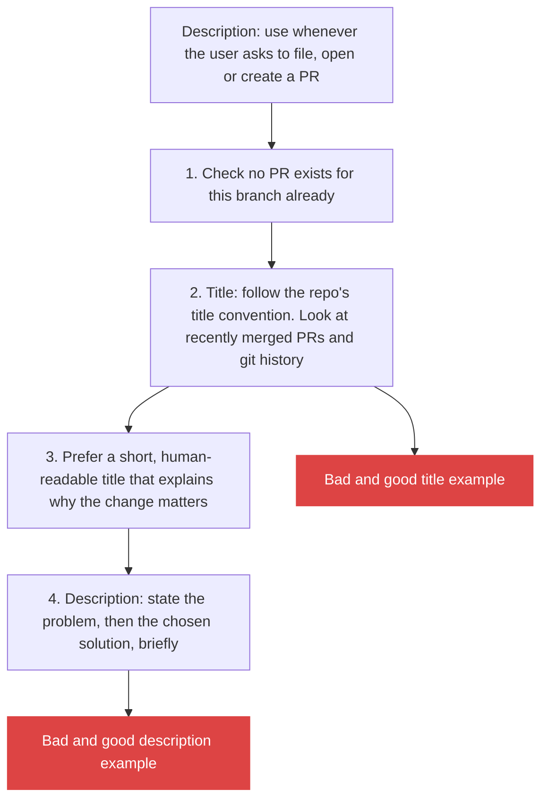

# 6. Teach with a bad and a good example: the file-PR skill

> When the agent does something I dislike, I write a short skill with the bad version it would have produced and the good version I want. The model copies the good one, and it works "unreasonably well".

Related: [02 Before the merge](02_Merge_Review_Second_Pair_Of_Eyes.md) · [08 Compose skills](draft_08_Compose_Skills_Building_Blocks_To_Workflows.md) · [09 Where skills live](draft_09_Where_Skills_Live_Global_Harness_Repo.md) · [Lecture 2: 5 Skills](../Lecture_2_Context_Agents_md_Skills_Tools/5_skills.md) · [Lecture 2: 7 Skill shaper](../Lecture_2_Context_Agents_md_Skills_Tools/7_skill_shaper_how_to_improve_skills.md) · [Lecture 3: 4 Ask why](../Lecture_3_Simplify_Codebase_&_Knowledge_Base/04_Ask_Why.md)

Source: S01E05 transcript, the file-PR skill passage. Claude Code skill invocation docs checked on 2026-11-09 as a search summary, see [Fact-check](#fact-check).

## 1. The problem

Agents write verbose, unclear commit messages, PR titles and descriptions. A general instruction ("be concise") does little. How do I steer style so the result matches what I want and holds across sessions?

## 2. Words

| Term | Means here | Not to be confused with |
|---|---|---|
| **Bad/good pair** | An example the agent would write, next to the version I want | A rule in words only |
| **Agent-invoked skill** | A skill the agent chooses to load when the description fits | A slash command only a human can run |
| **Description** | The skill's trigger text: when to use it and when not | The skill's body |

## 3. How the skill is built

The lecturer wrote it in about two minutes after an agent produced a commit message he could not read.



**His real examples** (title, from his own repo):

| | Text | Why |
|---|---|---|
| **Bad** | `Perf server: Negotiate per-message deflate on the WebSocket` | Describes the mechanism. "I have no idea what this means when I read it" |
| **Good** | `Perf server: Cut WebSocket frame size by 70%+ with gzipping` | States the effect, with a number |

**Description example:**

| | Text |
|---|---|
| **Bad** | `Removed implicit workspace carryover.` |
| **Good** | `My new work tree default was ignored when starting new threads on existing work trees. Super unintuitive. Now your preferences should always apply.` |

A skill skeleton in this style (my layout, his rules):

```markdown
---
name: file-pr
description: Use whenever the user asks to file, open or create a pull request.
---
1. Check that no PR exists for this branch.
2. Follow the repo's title convention (see recent merged PRs).
3. Title: short, human-readable, says why the change matters.
   Bad:  <the agent's usual title>
   Good: <the title I want>
4. Description: the problem first, then the solution.
   Bad:  <the agent's usual description>
   Good: <the description I want>
```

**Important:**
- **The skill pulls the model toward the good example at the moment it is about to write.** "It will see the bad example, which is what it would have done, and it'll see the good example, which is what you want, and it will work."
- **The first step is a guard against a past mistake** (an existing PR). Each line came from something that went wrong.
- **Two minutes of writing** changed "all of the branch names, PR titles, commit messages". The cost is low, so I write one for each repeated annoyance.
- **No user-only skills.** "I don't want user-invoked skills ... I want my skills to be clear when the agent should or shouldn't use them, and I let the agent choose when."

**Not important:**
- The exact numbers in his example title.

## 4. The pattern for my own skills

| Step | What I do |
|---|---|
| 1 | Notice something the agent keeps doing that I dislike |
| 2 | Copy the real bad output it produced |
| 3 | Write the version I want, same case |
| 4 | Write a description that says when to load the skill, and when not to |
| 5 | Add a guard for each past mistake |
| 6 | Test on a new task. If it still misses, ask the agent why ([Lecture 3: 4](../Lecture_3_Simplify_Codebase_&_Knowledge_Base/04_Ask_Why.md)) and edit |

## My take

Real bad examples work better than invented ones, because they are the exact failure the model produces. A repository of bad/good pairs is also a record of the team's taste, in a form the agent can follow and a new colleague can read. The lecturer's "no user-only skills" is a choice. Where a skill has side effects (deploy, send a message), the docs offer a way to block automatic use, and I would use it there.

## Cautions

- The effect on the model is the lecturer's experience. I have not measured it.
- A bad example can leak into output if the skill is vague about which is which. Label each plainly.
- Examples drawn from my own repository can contain business detail. Abstract them before they go into any note here.

## Summary

For each repeated annoyance, write a small agent-invoked skill: a clear trigger, a guard against past mistakes, and one real bad example beside one good example.

## Open questions

- Which two or three outputs from my agents do I fix by hand most often?
- Which of my skills should block automatic use because of side effects?

## Fact-check

| # | Claim | Verdict | Source | Checked |
|---|---|---|---|---|
| 1 | A skill is loaded by the agent when its description fits | **Agrees** | [Claude Code skills](https://code.claude.com/docs/en/skills). Search summary, page not read in full | 2026-11-09 |
| 2 | A skill can be limited to human use only | **Agrees** | `disable-model-invocation: true` blocks automatic use, per [docs](https://code.claude.com/docs/en/skills) as summarized by search. Open issues report [a refusal of the slash command](https://github.com/anthropics/claude-code/issues/26251) and [a field only controlling menu visibility](https://github.com/anthropics/claude-code/issues/56494). Not retested | 2026-11-09 |
| 3 | Bad/good examples steer the model well | **Lecture-specific** | The lecturer's experience. Consistent with common few-shot prompting practice, not verified here | 2026-11-09 |
| 4 | Agents write verbose PR text without guidance | **Lecture-specific** | The lecturer's observation | 2026-11-09 |

## Sources

- S01E05 transcript (the skill and both example pairs)
- [Claude Code skills docs](https://code.claude.com/docs/en/skills)
- The skill skeleton, the pattern table and "My take" are my own layout and reasoning
