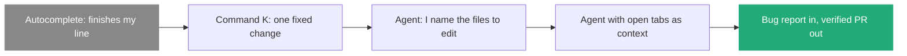

# 7. Prompting wider: bring the agent in earlier, let it go further

> A prompt can go deeper (harder problem) or wider (earlier start, later finish). Wider means I hand over the raw problem and the agent comes back with a verified, ready-to-merge result.

Related: [02 Before the merge](02_Merge_Review_Second_Pair_Of_Eyes.md) · [05 Seek tedium](draft_05_Seek_Tedium_Delegate_The_Boring.md) · [08 Compose skills](draft_08_Compose_Skills_Building_Blocks_To_Workflows.md) · [Lecture 2: 4 Context window](../Lecture_2_Context_Agents_md_Skills_Tools/4_context_window.md) · [Lecture 4: 10 Automation](../Lecture_4_Harness/10_Automation_Repository_Agents.md)

Source: S01E05 transcript, the "prompting wider" passage. No outside source read, see [Fact-check](#fact-check).

## 1. The problem

Most prompt advice makes the agent think harder about one task. The lecturer says the other direction matters more for workflows. What is "wide", and how do I tell whether I use it?

## 2. Words

| Term | Means here | Not to be confused with |
|---|---|---|
| **Depth** | The agent solves a harder problem (rewrite a function in another language) | Length of the prompt |
| **Width** | The span of work between the prompt's start point and end point | The number of files |
| **Start point** | Where I bring the agent in: after I wrote code, or as soon as I know a problem exists | The first line of the prompt |
| **End point** | Where the agent stops and needs me: a diff, or a verified PR | A "done" message |

## 3. The history of widening

Each step widens the work in two ways: "you have to do less before you bring in the agent, and more importantly, the agent can go further before it needs you again."

**His example of the widest case:** he sends the agent a screenshot of a DM from someone complaining about a bug. "By the time I check the thread again, there's a pull request up, ready to go, with a video showing exactly what was wrong and a video confirming the fix actually works."

| | Narrow | Wide |
|---|---|---|
| Start | I find the cause, pick the files | I send the raw report |
| Middle | Agent edits, I check each line | Agent finds, fixes, proves |
| End | A diff for me to verify | A PR with before/after evidence |
| My work | Most of it | A last look, thumbs up, merge |

**Important:**
- **The rule for the agent:** "I don't want the agent to bother me until it's done everything it can to verify the changes are good."
- **Evidence ends the work.** A video of the bug and a video of the fix replace reading each line.
- **A message for teams:** if a colleague still names the file and checks every line, "you need this part more than anyone". The lecturer says to send this part to them.
- **Many workflows are built to enable this** ([08](draft_08_Compose_Skills_Building_Blocks_To_Workflows.md)).

**Not important:**
- Which editor added open tabs first.

## 4. A width check for my own prompts

| Question | Narrow answer | Wide answer |
|---|---|---|
| What do I give the agent? | A file and a change | The symptom, a screenshot, a ticket |
| Who finds the cause? | Me | The agent |
| How do I know it works? | I read the diff | The agent shows proof |
| When does it stop? | When code is written | When a PR is ready and verified |

## My take

Width is about moving the human gate. The gate moves from "before the work" to "after the evidence". That only works when the *after* side is safe ([02, the way back](02_Merge_Review_Second_Pair_Of_Eyes.md#7-the-other-side-of-the-button-the-way-back)) and when the agent has the tools to prove its work: browser, recording, tests. For my platform the design question is which proof each task type must attach before the agent may call a job done.

## Cautions

- A wide prompt with no proof step is a risk. The agent can report success without evidence.
- Vague raw input (a screenshot with no context) can send the agent the wrong way. It should ask when unsure (see [Lecture 3: 3](../Lecture_3_Simplify_Codebase_&_Knowledge_Base/03_Agent_Asks_Dumb_Questions.md)).

## Summary

Go wide: bring the agent in at the first sign of a problem, and keep it going until it has proof. My effort moves from directing steps to reviewing evidence.

## Open questions

- Which of my tasks could start from a raw report instead of a diagnosis?
- What proof must my platform require before a job counts as finished?

## Fact-check

| # | Claim | Verdict | Source | Checked |
|---|---|---|---|---|
| 1 | Agents can go from a bug report to a PR with evidence | **Lecture-specific** | The lecturer's demonstration. No outside check | 2026-11-09 |
| 2 | The history autocomplete → Command K → agent | **Lecture-specific** | The lecturer's summary of tool history, told from the Cursor side. Not checked against vendor release notes | 2026-11-09 |
| 3 | "Depth" and "width" as the two directions of prompting | **Lecture-specific** | The lecturer's framing. No industry term found | 2026-11-09 |

## Sources

- S01E05 transcript (the quotes)
- The width check and "My take" are my own reasoning
