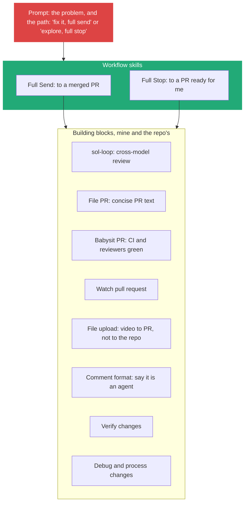
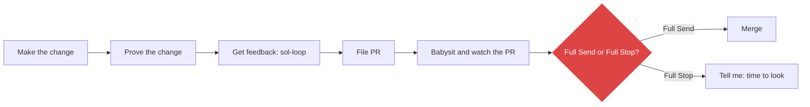

# 8. Compose skills: building blocks, then workflows, then a prompt

> Small skills do one job each. Workflow skills such as Full Send and Full Stop call them like programs call libraries, and my prompt only picks the path.

Related: [02 Before the merge](02_Merge_Review_Second_Pair_Of_Eyes.md) · [06 Teach with bad and good examples](draft_06_Teach_With_Bad_And_Good_Examples.md) · [09 Where skills live](draft_09_Where_Skills_Live_Global_Harness_Repo.md) · [Lecture 2: 6 Router skills](../Lecture_2_Context_Agents_md_Skills_Tools/6_router_skills.md) · [Lecture 3: 13 Knowledge skill anatomy](../Lecture_3_Simplify_Codebase_&_Knowledge_Base/13_Knowledge_Skill_Anatomy.md) · [Lecture 4: 03 Skill and folder orchestration](../Lecture_4_Harness/03_Skill_And_Folder_Orchestration.md) · [01 Skill or agent for exploring](01_Skill_Or_Agent_For_Explore_Loops.md)

Source: S01E05 transcript, the Full Send, Full Stop and building-block passages. Matt Pocock's skills repository checked on 2026-11-09 as a search summary, see [Fact-check](#fact-check).

## 1. The problem

One big skill that does everything is hard to change and hard to reuse. How do I build skills so I can combine them into flows and change one piece without breaking the rest?

## 2. Words

| Term | Means here | Not to be confused with |
|---|---|---|
| **Building block** | A small skill with one job (file a PR, babysit CI, upload a file) | A tool or a script |
| **Workflow skill** | A skill that calls blocks in order to finish a kind of work | A pipeline engine |
| **Full Send** | Agent does everything to a merged PR, with no human watching | Full Stop |
| **Full Stop** | Same flow, but stops before merge and calls me | Cancel |
| **Grilling skill** | The agent interviews me until it and I share a plan (Matt Pocock's) | A review skill |

## 3. The three layers

"I've created this hierarchy here, effectively, where I have the skills the repo provides, the skills that I provide, like the building block skills. Then I have a workflow set on top ... Then above that, I have the prompt I send."

**Important:**
- **"Markdown is kind of just a program at this point, you can have your program call another program the same way we would back in the Unix terminal days."** Skills form a graph and "agents are very good at calling things from other things".
- **Blocks are small and stable.** Workflows change more often ([02](02_Merge_Review_Second_Pair_Of_Eyes.md#how-the-sol-loop-got-here-seven-edits)).
- **The block set grows from pain.** The file-upload skill exists because GitHub did not let the CLI upload files, and agents committed a giant video to the repo to show it in a PR. The lecturer built a tool and a skill so he sees the video in the PR but does not commit it.

**Not important:**
- The exact list of blocks. Mine will differ.

## 4. Full Send and Full Stop

The Full Send description: "Only trigger if the user requests full send. If the user triggered this, it's 'cause they are not watching the thread, and they want you to complete the work end-to-end autonomously. Your updates and your final message will go unread long after you stop. You own the work from its current state to a merged PR."

| | Full Send | Full Stop |
|---|---|---|
| Ends at | Merged PR | PR ready to merge |
| Who merges | Agent | Me |
| He uses it for | Small, clear changes: "the CSS isn't aligned properly", screenshot plus "fix it, full send" | Hairy ones: data flow from UI to harness, database not persisting, a memory leak |
| Thread after | Archived on merge. "I'm mentally prepared to never see the thread again unless it asks me a question" | I read it |
| Why it exists | He was "addicted" to the first | The second goes as far as possible without bothering him |

For a design discussion he uses a different block: Matt Pocock's grilling skill, to go back and forth until he knows what he wants.

## 5. How composition fits my notes

| Idea | Where it appears |
|---|---|
| Small entry skill that routes to others | [Lecture 2: 6 Router skills](../Lecture_2_Context_Agents_md_Skills_Tools/6_router_skills.md) |
| One short skill, references opened when needed, scripts run | [Lecture 3: 13](../Lecture_3_Simplify_Codebase_&_Knowledge_Base/13_Knowledge_Skill_Anatomy.md) |
| Skills as dependencies with scope and origin | [Lecture 4: 03](../Lecture_4_Harness/03_Skill_And_Folder_Orchestration.md) |
| A skill that calls another by name | This note |

## My take

This is dependency design for text. The same rules apply as in code: small units, one job, a stable interface (the skill's description), and a clear owner. Two risks follow from the code analogy: a block change can break many workflows, and a call graph the agent chooses at run time is harder to trace than a pipeline. For my platform I would record, per job, which skills were loaded, so I can see the graph that actually ran.

The two endings, Send and Stop, are the merge-button question from [02, the way back](02_Merge_Review_Second_Pair_Of_Eyes.md#7-the-other-side-of-the-button-the-way-back) turned into a switch I set per task.

## Cautions

- Full Send needs a revertable change and strong verification. It is not for every repository ([02, the way back](02_Merge_Review_Second_Pair_Of_Eyes.md#7-the-other-side-of-the-button-the-way-back)).
- Chained skills multiply context and cost. A skill that loads five others needs a budget.
- The lecturer says he has "two times more skills than I probably should". Unused blocks add noise ([09](draft_09_Where_Skills_Live_Global_Harness_Repo.md)).

## Summary

Write small building-block skills, compose them into workflow skills, and let the prompt choose the path. Keep Send and Stop as two endings of one flow.

## Open questions

- Which 5 building blocks would cover most of my own work?
- How do I trace which skills ran on a job?

## Fact-check

| # | Claim | Verdict | Source | Checked |
|---|---|---|---|---|
| 1 | A skill can tell the agent to call another skill | **Lecture-specific** | The lecturer's practice. I did not find a documented skill-to-skill call mechanism. The agent loads skills by description ([skills docs](https://code.claude.com/docs/en/skills), search summary). Verify before presenting | 2026-11-09 |
| 2 | Matt Pocock publishes a grilling skill | **Agrees** | [github.com/mattpocock/skills](https://github.com/mattpocock/skills), MIT, `grill-me` skill. Search summary, repo not read | 2026-11-09 |
| 3 | GitHub CLI cannot upload files "until recently" | **Unverified** | The lecturer's statement. Not checked against `gh` docs. Verify before presenting | 2026-11-09 |
| 4 | T3 Code archives a thread on merge | **Unverified** | The lecturer's statement. [T3 Code](https://github.com/pingdotgg/t3code) README not read for this | 2026-11-09 |
| 5 | "P-Stack" skills | **Unverified** | Named in the transcript. Not identified. Verify before presenting | 2026-11-09 |

## Sources

- S01E05 transcript (the quotes and descriptions)
- [Matt Pocock's skills repository](https://github.com/mattpocock/skills)
- Sections 5 and "My take" are my own reasoning
