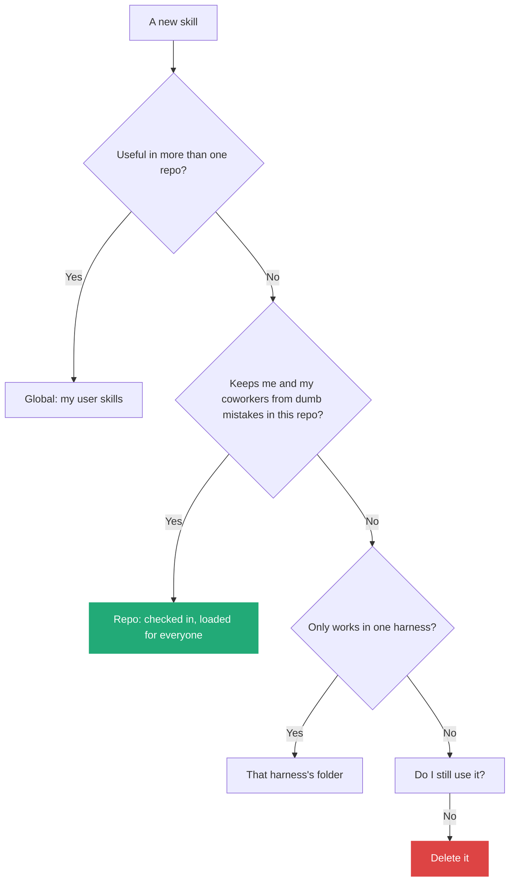
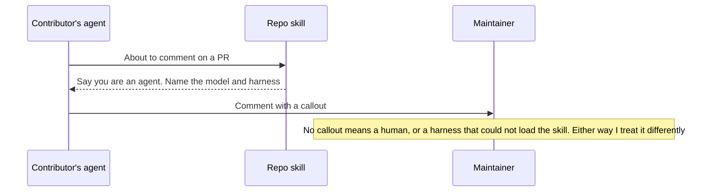

# 9. Where a skill lives: global, harness or repo

> A skill useful in more than one repo goes global. A skill that stops colleagues and their agents from making dumb mistakes goes in the repo. Any skill I do not use goes away.

Related: [02 Before the merge](02_Merge_Review_Second_Pair_Of_Eyes.md) · [06 Teach with bad and good examples](draft_06_Teach_With_Bad_And_Good_Examples.md) · [08 Compose skills](draft_08_Compose_Skills_Building_Blocks_To_Workflows.md) · [01 Workflows live in prompts and skills](draft_01_Workflows_Live_In_Prompts_And_Skills.md) · [Lecture 4: 03 Skill and folder orchestration](../Lecture_4_Harness/03_Skill_And_Folder_Orchestration.md) · [Lecture 4: 18 Sharing approved skills](../Lecture_4_Harness/18_Sharing_Approved_Skills_AI_Marketplace.md) · [Lecture 2: 5 Skills](../Lecture_2_Context_Agents_md_Skills_Tools/5_skills.md)

Source: S01E05 transcript, the "global, harness or repo" and "PR comment skill" passages. Claude Code skill locations checked on 2026-11-09 as a search summary, see [Fact-check](#fact-check).

## 1. The problem

Skills pile up. Some help only me, some help every contributor, some belong to one tool. Where does each one go, and how do I know which are worth keeping?

## 2. Words

| Term | Means here | Not to be confused with |
|---|---|---|
| **Global skill** | Lives in my user folder and follows me across repos | A skill shared with the team |
| **Harness skill** | Works with one harness only | A skill that merely sits in that harness's folder |
| **Repo skill** | Checked into the repository, loaded for everyone who works there | A personal convenience |
| **Workflow skill** | A skill that combines others ([08](draft_08_Compose_Skills_Building_Blocks_To_Workflows.md)) | A building block |

## 3. The decision

| Scope | Rule from the lecture | Example from the lecture |
|---|---|---|
| Global | "If the skill is useful in more than one repo, it should probably be in your globals" | File PR, babysit PR, sol-loop |
| Repo | "If the point of the skill is to keep you and your coworkers from making dumb mistakes, then it goes in the repo" | PR comment skill |
| Harness | Not stated as a rule. Harness limits come up as workarounds ([02](02_Merge_Review_Second_Pair_Of_Eyes.md#how-the-sol-loop-got-here-seven-edits)) | Custom subagent for one harness |
| Workflow skills | Keep them "slightly higher level to be useful outside of one specific repo". Useful in repos complex enough | Full Send, Full Stop |

## 4. Case: the PR comment skill

It started as a personal block: when an agent comments on a PR for him, it must say that an agent wrote it, and which model.

**Why it works:**
- He moved it into the repo after other contributors' comments did not say human or bot.
- Every contributor's agent now loads it, so he "knows what model they used, what harness they used, and if it was them or not".
- **Rule of thumb:** a repo skill prevents bad behavior that other contributors could hit: "a thing the model's confused by that you can't fix with code", or "a specific thing that people are doing that is making your life as a maintainer harder".

## 5. Keep the set small and measured

| Practice | How |
|---|---|
| Delete skills I do not use | "You should also not be that scared to delete skills when you're not using them that much or if they're doing things you don't want" |
| Measure | Ask the agent which skills were invoked where, how often, and how often the change was merged afterwards. This shows which skills help |
| Don't collect | He has "two times more skills than I probably should" from trying many shared sets |
| Read and edit | See the audit in [01](01_Skill_Or_Agent_For_Explore_Loops.md#7-a-skill-audit-i-can-run) |

## 6. Portability, the closing point

Because the workflows live in skills, they "work great in every harness I use ... every modern model that I touch". He can "switch between different tools and solutions without changing the way that I work". That is the argument of [01](draft_01_Workflows_Live_In_Prompts_And_Skills.md) and of [Lecture 4: 01](../Lecture_4_Harness/01_Harness_Lock-in_Keep_Doors_Open.md).

## My take

For an organization the repo skill is a way to put team norms where the agent reads them: contribution rules, disclosure, style. It resembles a pull request template, but the agent acts on it. The "which skills help" measurement needs usage logs per skill and a link to the outcome. That belongs in the fleet metadata and approval route from [Lecture 4: 03](../Lecture_4_Harness/03_Skill_And_Folder_Orchestration.md) and [18](../Lecture_4_Harness/18_Sharing_Approved_Skills_AI_Marketplace.md).

A repo skill is also an instruction that other people's agents will follow. Whoever merges a change to it controls those agents. It needs the same review as code.

## Cautions

- A repo skill changes the behavior of every contributor's agent, including their prompt-injection exposure ([Lecture 2: 9](../Lecture_2_Context_Agents_md_Skills_Tools/9_tools_prompt_injection.md)). Review it like code.
- A harness that cannot find the skill will not follow it. A missing disclosure line is a signal, not proof of a human.
- Do not put business secrets or customer data into a repo skill.

## Summary

Global if it helps in several repos. Repo if it protects the project from contributor mistakes. Harness folder if it is tied to one harness. Delete what I do not use, and check which skills actually lead to merged changes.

## Open questions

- Which of my skills would protect a shared repo if every contributor's agent loaded it?
- How do I log which skills ran on each job?

## Fact-check

| # | Claim | Verdict | Source | Checked |
|---|---|---|---|---|
| 1 | Personal skills load in all projects, project skills only in that project | **Agrees** | [Claude Code skills](https://code.claude.com/docs/en/skills): `~/.claude/skills/` and `.claude/skills/`. Search summary | 2026-11-09 |
| 2 | Name clashes resolve in a fixed order | **Agrees** | Enterprise over personal over project, per the docs as summarized by search. One blog says the opposite and looks unreliable. Verify on the page | 2026-11-09 |
| 3 | A repo skill reaches every contributor's agent | **Differs: partly** | Only harnesses that read that folder load it. Search results describe `.claude/skills/` for Claude Code. Other harnesses vary ([Lecture 4: 03](../Lecture_4_Harness/03_Skill_And_Folder_Orchestration.md)) | 2026-11-09 |
| 4 | Agents can report which skills ran and how often | **Unverified** | The lecturer's statement. Not tested | 2026-11-09 |
| 5 | Global for multi-repo, repo for mistake prevention | **Lecture-specific** | The lecturer's rule of thumb | 2026-11-09 |

## Sources

- S01E05 transcript (the rules and the PR comment story)
- [Claude Code skills docs](https://code.claude.com/docs/en/skills)
- The decision diagram and "My take" are my own reasoning
