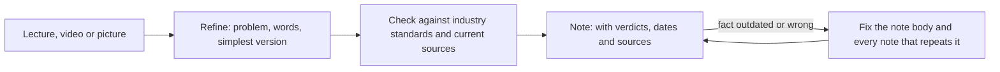
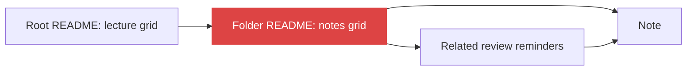

# megadev-course

A personal knowledge base. It follows the order of the **MEGA.dev course** on building with AI agents, but it is not only the course. It also holds my own knowledge and experience.

**How it is organized.**
- **By lecture,** the way the course goes: one folder per lecture.
- **By topic inside each lecture:** one file per topic. A file does not retell the lecture. It follows how I get the things the lecture touches. I dive into the problem, add my own understanding and clarifications, and check the result against industry standards.
- **What it holds:** lecture notes, refined insights, challenge work and my experiments.

It is **not a codebase**. The output is Markdown with Mermaid diagrams that I re-read and present. This file is the map: the lecture grid, how to navigate, the list of references I check against, the reference setup the lecturer uses, and the rules every note follows.

**Three voices, kept apart.** In each note, what the lecture says, what I add, and what industry sources say are marked separately, so you can always tell which is which.

## The principle: every claim is checked

A lecture is one author's view at one moment. It can be outdated, stale, or wrong. So nothing is copied into a note unchecked.

- **I check each key claim against industry standards and current sources.** Vendor docs, specifications, papers and official repositories come first. Blogs and social posts come last.
- **The checks are current for Q4 2026 to Q1 2027.** Most are dated November 2026. Models, harnesses, prices and vendor docs change within weeks, so a "fact" here is only valid inside that window. Re-check before you present.
- **Every note ends with a fact-check table.** Each claim gets a verdict, the source and the date:

| Verdict | Meaning |
|---|---|
| **Agrees** | A primary source supports it |
| **Differs** | A source says something different. The note says so plainly |
| **Outdated** | It was true once. I rewrite the sentence in the note body at once, in every note that repeats it |
| **Lecture-specific** | The lecturer's opinion or method. No outside source |
| **Unverified** | I could not check it. It stays marked "verify before presenting" |

- **I keep my own reasoning apart.** Each note's Sources section says which parts are mine and not from the lecture or the sources.
- **I check examples by running them or by reading their results,** and the note says which one I did. A search summary is not a primary source, and the note says when that is all we had.

**Coverage of the checks.** The Lecture 3 and Lecture 4 notes carry full fact-check tables. The Lecture 1 and 2 notes mark their sources and my own reasoning but have no fact-check tables, so their time-sensitive claims (models, tool behavior, limits, versions) have no check date.

## How a note is built

Every note has the same shape, so it is quick to scan:

1. `# N. Title` and a one-line summary starting with `>`.
2. A `Related:` line that links both ways. No broken relative links.
3. The sections (the exact order and minimums are in [.claude/rules/note-format.md](.claude/rules/note-format.md)): the problem, the words I pin down, the picture (its story, what is important, what is not), my view, the fact-check, cautions, summary, open questions, sources.
4. Diagrams are **Mermaid only**. No ASCII art.

## What to read first

- **Starting the course:** [how-to-start-mega-dev-challenge.md](how-to-start-mega-dev-challenge.md), then [mega-mcp-auth-issues.md](mega-mcp-auth-issues.md) if sign-in fails.
- **The core idea of Lecture 3:** [1 Simplify first](Lecture_3_Simplify_Codebase_&_Knowledge_Base/01_Simplify_First_Knowledge_Guardrails.md). Fix the codebase first, and keep knowledge as a last resort with a type and a way to review it.
- **The context model behind everything:** [Lecture 2: 4 Context window](Lecture_2_Context_Agents_md_Skills_Tools/4_context_window.md).

## How to navigate

I search in three steps, not by file names: this README for the structure, the README of the matching folder for a table of its notes (name, short description, keywords), then the note itself. Review reminders have their own index.

## Lecture grid

| Folder | Course day | What was discussed | Keywords | Notes | README |
|---|---|---|---|---|---|
| [Lecture_1_Mechanics_Behind_Generative_AI](Lecture_1_Mechanics_Behind_Generative_AI/) | Week 1, lecture 1 | How a model tokenizes and predicts text, ChatML, how a harness wraps the loop with tools, MCP and skills | tokens, next token, chatml, harness, tools, mcp, skills, code mode | 17 | [README](Lecture_1_Mechanics_Behind_Generative_AI/README.md) |
| [Lecture_2_Context_Agents_md_Skills_Tools](Lecture_2_Context_Agents_md_Skills_Tools/) | Week 1, lecture 2 | What the harness puts in front of the model: AGENTS.md, hooks, skills, router skills, tools, prompt injection, subagents | context window, agents.md, hooks, skills, tools, subagents | 13 | [README](Lecture_2_Context_Agents_md_Skills_Tools/README.md) |
| [Lecture_3_Simplify_Codebase_&_Knowledge_Base](Lecture_3_Simplify_Codebase_&_Knowledge_Base/) | Week 1, lecture 3 | Fix the codebase before writing knowledge, then build the knowledge base for agents and help them reach the right files | simplify, dumb questions, knowledge base, decision models, task board | 14 | [README](Lecture_3_Simplify_Codebase_&_Knowledge_Base/README.md) |
| [Lecture_4_Harness](Lecture_4_Harness/) | Week 1, lecture 4 (S01E04) | Harness lock-in and portability, fleets of agents, Pi and Herdr, model routing and cost per task | lock-in, plugins, fleet, herdr, orca, cost per task, sota | 18 | [README](Lecture_4_Harness/README.md) |
| [Lecture_5_Workflows_not_tool_sets](Lecture_5_Workflows_not_tool_sets/) | Week 1, lecture 5 (S01E05) | Skills and agents as workflows, review before the merge, fleet on a remote seat and a safe local lab | workflow skills, executable markdown, reviewer agent, fleet lab, threat model | 10 | [README](Lecture_5_Workflows_not_tool_sets/README.md) |
| [Week2_Lecture_1_Agent_Primitives](Week2_Lecture_1_Agent_Primitives/) | Week 2, lecture 1 (S02E01) | Agent primitives: prompts, the loop with limits, context and tool access, memory, evals, the harness | agent loop, tool search, memory, evals, harness, hooks, caching, code mode | 26 | [README](Week2_Lecture_1_Agent_Primitives/README.md) |
| [Week2_Lecture_2_Building_an_Agent](Week2_Lecture_2_Building_an_Agent/) | Week 2, lecture 2 (S02E02) | Building an agent: classifiers and decision models, workflows, cache and models, durable and always-on agents | classification, langgraph, model routing, cache, durability, wake and reflect | 24 | [README](Week2_Lecture_2_Building_an_Agent/README.md) |
| [Week2_Lecture_3_MCP_MCP+Resources_Skills](Week2_Lecture_3_MCP_MCP+Resources_Skills/) | Week 2, lecture 3 (S02E03) | MCP beyond tools: resources, skills, instructions, events, apps, confirmations, sandboxes | mcp skills, router skill, hateoas, server instructions, mcp events, sandbox, mcp apps | 20 | [README](Week2_Lecture_3_MCP_MCP+Resources_Skills/README.md) |
| [notes_for_later_use](notes_for_later_use/) | Week 2, all episodes | Short review reminders: what I want to check, decide or revisit later, by episode and lecture note | review, reminder, open question | 49 | [README](notes_for_later_use/README.md) |
| Course setup | Before lecture 1 | How to connect an agent to the course and start a Challenge, and known sign-in issues | challenge, mcp, sign-in | 2 | [how-to-start-mega-dev-challenge.md](how-to-start-mega-dev-challenge.md), [mega-mcp-auth-issues.md](mega-mcp-auth-issues.md) |

## Where to find what

For a topic that runs across lectures. Each link opens one note, and the folder README shows its neighbors.

| Topic | Notes |
|---|---|
| MCP resources, instructions, events, apps | [W2 L3 01](Week2_Lecture_3_MCP_MCP+Resources_Skills/01_MCP_Resources_Static_Context_And_Sampling.md), [W2 L3 08](Week2_Lecture_3_MCP_MCP+Resources_Skills/08_MCP_Server_Instructions_And_Harness_Support.md), [W2 L3 13](Week2_Lecture_3_MCP_MCP+Resources_Skills/13_MCP_Events_And_Lifecycle_Hooks.md), [W2 L3 15](Week2_Lecture_3_MCP_MCP+Resources_Skills/15_MCP_Apps_And_The_Lecturers_Preview_Tool.md) |
| Skills: design, routing, sharing, search | [Lecture 2 05](Lecture_2_Context_Agents_md_Skills_Tools/5_skills.md), [Lecture 2 06](Lecture_2_Context_Agents_md_Skills_Tools/6_router_skills.md), [W2 L1 02](Week2_Lecture_1_Agent_Primitives/02_Rethinking_The_Skills.md), [Lecture 5 08](Lecture_5_Workflows_not_tool_sets/08_Skills_As_Building_Blocks.md), [Lecture 4 18](Lecture_4_Harness/18_Sharing_Approved_Skills_AI_Marketplace.md), [W2 L3 03](Week2_Lecture_3_MCP_MCP+Resources_Skills/03_MCP_Skills_And_Tools.md), [W2 L3 04](Week2_Lecture_3_MCP_MCP+Resources_Skills/04_Router_Skill_Across_MCP_Server_Skills_And_Harness.md), [W2 L3 06](Week2_Lecture_3_MCP_MCP+Resources_Skills/06_Search_Over_Skills_Instead_Of_Listing_Them.md) |
| Tools: schemas, errors, loading, search, code mode | [Lecture 1 10](Lecture_1_Mechanics_Behind_Generative_AI/10_code_mode.md), [Lecture 2 08](Lecture_2_Context_Agents_md_Skills_Tools/8_tools_native_and_external.md), [Lecture 2 11](Lecture_2_Context_Agents_md_Skills_Tools/11_tool_upfront_vs_tool_discovery.md), [W2 L1 08](Week2_Lecture_1_Agent_Primitives/08_Tool_Search_Instead_Of_Many_Tools.md), [W2 L1 25](Week2_Lecture_1_Agent_Primitives/25_Tool_Execution_Instead_Of_Tool_Calls.md), [W2 L2 15](Week2_Lecture_2_Building_an_Agent/15_Tool_Navigation_And_Flexibility.md), [W2 L3 09](Week2_Lecture_3_MCP_MCP+Resources_Skills/09_MCP_Tools_Loading_And_Code_Mode_With_Many_Servers.md) |
| Tool results and hints | [Lecture 2 10](Lecture_2_Context_Agents_md_Skills_Tools/10_tool_results_context_to_file_and_back.md), [W2 L2 19](Week2_Lecture_2_Building_an_Agent/19_Evict_Tool_Results_To_Memory_By_Reference.md), [W2 L2 20](Week2_Lecture_2_Building_an_Agent/20_Repair_Tool_Calls_Before_A_Step_Is_Spent.md), [W2 L3 05](Week2_Lecture_3_MCP_MCP+Resources_Skills/05_HATEOAS_In_MCP_Tool_Results_Spotify_Example.md) |
| Context window, caching, compaction | [Lecture 2 04](Lecture_2_Context_Agents_md_Skills_Tools/4_context_window.md), [W2 L1 06](Week2_Lecture_1_Agent_Primitives/06_Context_Window_And_Compaction.md), [W2 L1 24](Week2_Lecture_1_Agent_Primitives/24_KV_Cache_And_Prompt_Caching.md), [W2 L2 09](Week2_Lecture_2_Building_an_Agent/09_Cache_Hit_Rate_And_P90_Latency.md), [W2 L2 10](Week2_Lecture_2_Building_an_Agent/10_Cache_And_Context_Window.md) |
| Memory | [W2 L1 10](Week2_Lecture_1_Agent_Primitives/10_Memory.md), [W2 L1 11](Week2_Lecture_1_Agent_Primitives/11_Memory_Known_Problems.md), [W2 L1 13](Week2_Lecture_1_Agent_Primitives/13_Memory_Operations.md), [W2 L2 16](Week2_Lecture_2_Building_an_Agent/16_Memory_Centric_Approach_With_Events.md) |
| System prompt and instructions | [W2 L1 01](Week2_Lecture_1_Agent_Primitives/01_Advanced_Prompt_Techniques.md), [W2 L1 05](Week2_Lecture_1_Agent_Primitives/05_Instructions_Five_Parts_And_Enforcement.md), [W2 L3 10](Week2_Lecture_3_MCP_MCP+Resources_Skills/10_Sys_Prompt_vs_Skills_Content_And_Threats.md), [W2 L3 11](Week2_Lecture_3_MCP_MCP+Resources_Skills/11_How_To_Adjust_System_Prompt_And_Make_It_Flexible.md) |
| Harness, loop, hooks | [Lecture 1 05](Lecture_1_Mechanics_Behind_Generative_AI/05_lesson_harnesses_providers_steering.md), [Lecture 2 01](Lecture_2_Context_Agents_md_Skills_Tools/1_Harness.md), [Lecture 2 03](Lecture_2_Context_Agents_md_Skills_Tools/3_lifecycle_hooks.md), [W2 L1 18](Week2_Lecture_1_Agent_Primitives/18_Harness_Around_The_Loop.md), [W2 L1 20](Week2_Lecture_1_Agent_Primitives/20_Loop_Hooks_Declared.md), [Lecture 4 01](Lecture_4_Harness/01_Harness_Lock-in_Keep_Doors_Open.md) |
| Sandboxes and security | [Lecture 2 09](Lecture_2_Context_Agents_md_Skills_Tools/9_tools_prompt_injection.md), [W2 L2 12](Week2_Lecture_2_Building_an_Agent/12_Sandbox_For_Agent_Code_Pi_And_Search_Execute.md), [W2 L2 17](Week2_Lecture_2_Building_an_Agent/17_Auto_Penetration_Testing_Of_My_Agent.md), [Lecture 5 10](Lecture_5_Workflows_not_tool_sets/10_Fleet_Lab_Threat_Model.md), [W2 L3 17](Week2_Lecture_3_MCP_MCP+Resources_Skills/17_Workspaces_And_Code_Sandboxes_In_Frameworks.md), [W2 L3 20](Week2_Lecture_3_MCP_MCP+Resources_Skills/20_Sandbox_Against_Jailbreak_And_Prompt_Injection_Per_Tenant.md) |
| Human approval and confirmation | [W2 L1 14](Week2_Lecture_1_Agent_Primitives/14_Tool_Approval_Durable_Waits.md), [W2 L3 15](Week2_Lecture_3_MCP_MCP+Resources_Skills/15_MCP_Apps_And_The_Lecturers_Preview_Tool.md), [W2 L3 16](Week2_Lecture_3_MCP_MCP+Resources_Skills/16_Human_Confirmation_Across_AG-UI_A2A_And_MCP_Channels.md) |
| Workflows and durable runs | [W2 L2 06](Week2_Lecture_2_Building_an_Agent/06_Workflow_vs_LangGraph.md), [W2 L2 22](Week2_Lecture_2_Building_an_Agent/22_Long_Horizon_Runs_Concurrency_Durability_Watchers.md), [W2 L2 24](Week2_Lecture_2_Building_an_Agent/24_Pi_Durable_How_It_Recovers_Long_Running_Tasks.md), [W2 L1 03](Week2_Lecture_1_Agent_Primitives/03_Agent_Loop_Stop_Limits_Recovery.md), [Lecture 5 01](Lecture_5_Workflows_not_tool_sets/01_Skill_Or_Agent_For_Explore_Loops.md) |
| Fleets and orchestration | [Lecture 4 07](Lecture_4_Harness/07_Multi_Agent_Coordination.md), [Lecture 4 13](Lecture_4_Harness/13_Herdr_vs_Orca_Agent_Orchestration.md), [Lecture 4 14](Lecture_4_Harness/14_What_Agent_Fleets_Need_Beyond_Spawning.md), [Lecture 5 06](Lecture_5_Workflows_not_tool_sets/06_Run_The_Fleet_On_A_Remote_Seat.md), [Lecture 5 09](Lecture_5_Workflows_not_tool_sets/09_Local_Fleet_Lab_Sandboxes_And_Worktrees.md) |
| Models, routing and cost | [Lecture 4 08](Lecture_4_Harness/08_Settings_Model_Routing_Cost.md), [Lecture 4 17](Lecture_4_Harness/17_Cost_Per_Task.md), [W2 L2 01](Week2_Lecture_2_Building_an_Agent/01_LLM_vs_Classification.md), [W2 L2 11](Week2_Lecture_2_Building_an_Agent/11_Model_Routing_In_LangGraph.md), [W2 L2 13](Week2_Lecture_2_Building_an_Agent/13_LLM_Adapters_And_Gateway.md) |
| Evals and review | [W2 L1 15](Week2_Lecture_1_Agent_Primitives/15_Trace_A_Run_And_Size_Its_Step_Limit.md), [W2 L1 16](Week2_Lecture_1_Agent_Primitives/16_Evals_For_Agent_Changes.md), [Lecture 5 02](Lecture_5_Workflows_not_tool_sets/02_Merge_Review_Second_Pair_Of_Eyes.md), [W2 L3 12](Week2_Lecture_3_MCP_MCP+Resources_Skills/12_Self_Evolution_Of_Harness_On_Event.md) |
| Knowledge base | [Lecture 3 01](Lecture_3_Simplify_Codebase_&_Knowledge_Base/01_Simplify_First_Knowledge_Guardrails.md), [Lecture 3 05](Lecture_3_Simplify_Codebase_&_Knowledge_Base/05_Knowledge_As_Files_For_Agents.md), [Lecture 3 13](Lecture_3_Simplify_Codebase_&_Knowledge_Base/13_Knowledge_Skill_Anatomy.md), [Lecture 5 05](Lecture_5_Workflows_not_tool_sets/05_Agents_Maintain_The_Tools_I_Review.md) |

## Example skills

### Example skills I keep (not enabled)

These are pinned, verbatim copies of other people's skills, kept as examples of good structure. Claude Code loads project skills from `.claude/skills/`, so these folders are **not loaded**. Each has a `SOURCE.md` with the repository, commit, version and license. Read the code before you enable or run anything.

| Folder | What it is |
|---|---|
| [.claude/explainer/](.claude/explainer/SOURCE.md) | The `explainer` skill: Markdown with data blocks to an interactive HTML page |
| [.claude/knowledge/](.claude/knowledge/SOURCE.md) | The `knowledge` skill: designs a knowledge base and leaves it a skill of its own |

### Example skills I wrote (not enabled)

| Folder | What it is |
|---|---|
| [.claude/review-loop/](.claude/review-loop/README.md) | A `review-loop` skill and a read-only `review-second-eyes` agent (`model: claude-sonnet-5-5` in its header): independent review before the PR, then the PR until CI and bots are green, `MAX = 3` rounds per loop, no merge. Built from [Lecture 5: 02](Lecture_5_Workflows_not_tool_sets/02_Merge_Review_Second_Pair_Of_Eyes.md). Not run yet |
| [.agents/fleet-lab/](.agents/fleet-lab/README.md) | `fleet-plan`, `fleet-run` and `fleet-worker` skills for Pi and Claude Code, a Pi runner script (a worktree per item, `xargs -P` cap), a Claude worker agent with `isolation: worktree`, and an installer that puts the skills in `.agents/skills/` with `.claude/skills/` symlinks. Built from [Lecture 5: 09](Lecture_5_Workflows_not_tool_sets/09_Local_Fleet_Lab_Sandboxes_And_Worktrees.md). Windows versions (`install.ps1`, `run-pi-workers.ps1`). Shell logic tested with a stub `pi`. No model run yet. Read [Lecture 5: 10](Lecture_5_Workflows_not_tool_sets/10_Fleet_Lab_Threat_Model.md) before any run |

## The lecturer's reference setup

The tools and workflows the lecturer names across the lectures. They show what the course aims at. They are the lecturer's choices, not my recommendations, and I have not checked each tool's fit. Each section names the lecture it comes from.

### Tool stack the MEGA team uses (S01E04)

| Category | Tools |
|---|---|
| Observability and product telemetry | [PostHog](https://posthog.com/), [Axiom](https://axiom.co/docs) |
| Build, storage and remote reach | [Vercel](https://vercel.com/), [Minio](https://www.min.io/), [Depot](https://depot.dev/), [Cloudflare](https://www.cloudflare.com/) with [Alchemy](https://alchemy.run/), [Tailscale](https://tailscale.com/), [UploadThing](https://uploadthing.com/) |
| Agent surfaces and harnesses | [Pi](https://pi.dev/), [Herdr](https://herdr.dev/), [Moshi](https://getmoshi.app/), [OpenRouter](https://openrouter.com/) |
| Typed app substrate | [XState](https://stately.ai/docs/xstate), [Effect](https://effect.website/), [oxlint](https://oxc.rs/), [mdsvex](https://svelte.dev/docs/cli/mdsvex) |
| Auth and backend | [Clerk](https://clerk.com/), [Convex](https://www.convex.dev/) |
| Work the agent can write | [Linear](https://linear.app/), [Stripe](https://stripe.com/), [Resend](https://resend.com/), [Attio](https://attio.com/) |
| Design | [Paper](https://paper.design/), [Figma](https://figma.com/) |

The lecturer says not everything on the list will be useful for everyone. It is also a source of inspiration for finding new tools and refreshing a stack. My reading of why each category matters for agents is in [Lecture 4: 09 Teamwork](Lecture_4_Harness/09_Teamwork_Knowledge_Base_Tool_Stack.md).

### Automated workflows that run in the background (S01E04)

Agents that integrate with GitHub: [Claude Code](https://code.claude.com/docs/en/github-actions), [Cursor](https://cursor.com/docs/cli/github-actions), [Devin](https://devin.ai/) and [CodeRabbit](https://www.coderabbit.ai/). They can be called in GitHub comments and pull requests, and events in the repository can trigger them. The lecturer lists these uses:

1. Keep documentation, a knowledge base, or even the entire website up to date
2. Convert an issue into a pull request enriched with the necessary context
3. Review pull requests as soon as they are created and leave a brief comment ([pr-review-rules example](https://github.com/MEGA-DOT-DEV/examples/tree/main/examples/pr-review-rules))
4. Autonomously fix small bugs and publish the changes
5. Detect issues in code and dependencies
6. Assign pull requests to the person responsible for a given feature
7. Gather data from external systems or even from people
8. Handle routine tasks such as cleaning up dead code

My notes on these uses, with triggers and the human review step, are in [Lecture 4: 10 Automation](Lecture_4_Harness/10_Automation_Repository_Agents.md).

### Repository the lecturer asks to study (S01E04)

[overment/limen](https://github.com/overment/limen) is a working coordinator, workers and supervisor setup built from plain text files, git worktrees, Pi extensions and Herdr, with a small CLI. The lecturer says that if one thing is taken from S01E04, it should be this: play with the repository, chat about it with an AI agent, and extract ideas or modify it to fit your needs. His steps to apply it:

1. Run `limen init`
2. Shape `vision.md` and `styleguide.md` together with an agent
3. Install Pi and Herdr
4. Open Pi and ask it to implement something

limen runs on macOS and Linux. My notes read the commit `01fc400`: [Lecture 4: 07 Multi-agent coordination](Lecture_4_Harness/07_Multi_Agent_Coordination.md) describes the design, and [15 Pi and limen behind the scenes](Lecture_4_Harness/15_Pi_Limen_Behind_The_Scenes.md) covers how to try it and the ideas I take from it.

### Skills and workflows the lecturer names (S01E05)

| Name | What it does | Notes |
|---|---|---|
| sol-loop | Asks a second model family to review a change, fixes, repeats up to three loops, then files a PR | [02](Lecture_5_Workflows_not_tool_sets/02_Merge_Review_Second_Pair_Of_Eyes.md#how-the-sol-loop-got-here-seven-edits) |
| File PR | Files a concise PR with a good title and description, using bad and good examples | [08](Lecture_5_Workflows_not_tool_sets/08_Skills_As_Building_Blocks.md) |
| Babysit PR, watch pull request | Keeps watching a PR until reviewers and CI are green | [08](Lecture_5_Workflows_not_tool_sets/08_Skills_As_Building_Blocks.md) |
| File upload | Shows a video in a PR without committing it to the repo | [08](Lecture_5_Workflows_not_tool_sets/08_Skills_As_Building_Blocks.md) |
| PR comment skill | Makes an agent say that it, and which model, wrote a comment | [08](Lecture_5_Workflows_not_tool_sets/08_Skills_As_Building_Blocks.md) |
| Full Send, Full Stop | Workflow skills: to a merged PR, or to a PR ready for me | [08](Lecture_5_Workflows_not_tool_sets/08_Skills_As_Building_Blocks.md) |
| Nightly PR triage | A scheduled prompt: cheap delegates audit PRs, strong delegates verify, a list of eight or fewer | [04](Lecture_5_Workflows_not_tool_sets/04_Executable_Markdown_Skills_As_Programs.md) |
| [T3 Code](https://github.com/pingdotgg/t3code) | The lecturer's GUI harness for Codex, Claude and others | [02](Lecture_5_Workflows_not_tool_sets/02_Merge_Review_Second_Pair_Of_Eyes.md#how-the-sol-loop-got-here-seven-edits) |
| [Matt Pocock's skills](https://github.com/mattpocock/skills) | Includes the grilling skill used to settle a plan with the agent | [08](Lecture_5_Workflows_not_tool_sets/08_Skills_As_Building_Blocks.md) |

### Tools the lecturer names (S02E01)

| Name | What it does | Notes |
|---|---|---|
| [AI SDK](https://vercel.com/ai-sdk) | Vercel's TypeScript toolkit for multi-provider model calls, tools and agent loops. The lecturer prefers official SDKs over it | [21](Week2_Lecture_1_Agent_Primitives/21_AI_SDK_Or_Official_SDKs.md) |
| [Pi](https://github.com/earendil-works/pi) | Minimal terminal agent harness, loop in `packages/agent` | [19](Week2_Lecture_1_Agent_Primitives/19_Pi_LangGraph_DeepSeek_Harnesses.md), [20](Week2_Lecture_1_Agent_Primitives/20_Loop_Hooks_Declared.md) |
| [Goose](https://github.com/aaif-goose/goose) | Open-source agent harness named as a loop implementation | [03](Week2_Lecture_1_Agent_Primitives/03_Agent_Loop_Stop_Limits_Recovery.md) (loop source not read) |
| DeepSeek Harness paper ([arXiv 2608.25512](https://arxiv.org/abs/2608.25512)) | A composability paper, not an agent harness | [19](Week2_Lecture_1_Agent_Primitives/19_Pi_LangGraph_DeepSeek_Harnesses.md) |
| [mem0](https://mem0.ai/), [supermemory](https://supermemory.ai/), [Hindsight](https://hindsight.vectorize.io/), [lamarck](https://github.com/johnlindquist/lamarck) | Agent memory projects | [10](Week2_Lecture_1_Agent_Primitives/10_Memory.md) |
| [Treg](https://github.com/superdesigndev/treg) | Hosted proxy and registry for external tools | [09](Week2_Lecture_1_Agent_Primitives/09_Tool_Search_And_Proxy_Gateway.md) |
| [Mastra](https://mastra.ai/) | Agent framework used in the transcript demo, worked example only | [15](Week2_Lecture_1_Agent_Primitives/15_Trace_A_Run_And_Size_Its_Step_Limit.md), [16](Week2_Lecture_1_Agent_Primitives/16_Evals_For_Agent_Changes.md) |

### Tools the lecturer names (S02E02)

| Name | What it does | Notes |
|---|---|---|
| Jev ([LLM Gateway docs](https://docs.llmgateway.io/features/system-one)) | TypeSafe's hosted decision model: typed answers with per-option probabilities | [01](Week2_Lecture_2_Building_an_Agent/01_LLM_vs_Classification.md), [04](Week2_Lecture_2_Building_an_Agent/04_Jev_And_Microsoft_Decision_1.md) |
| [Microsoft-Decision-1](https://ai.azure.com/catalog/models/Microsoft-Decision-1) | Microsoft's decision model on Foundry, Qwen3.5-9B post-trained, preview. Not named by the lecturer, added as the Azure counterpart | [04](Week2_Lecture_2_Building_an_Agent/04_Jev_And_Microsoft_Decision_1.md) |
| [Mastra](https://mastra.ai/) | Framework with `createStep`, suspend and resume, named in the S02E02 article and the transcript demo | [06](Week2_Lecture_2_Building_an_Agent/06_Workflow_vs_LangGraph.md) |
| [OpenRouter](https://openrouter.com/), [Amazon Bedrock](https://aws.amazon.com/bedrock/model-choice/), [Azure AI Foundry](https://azure.microsoft.com/en-us/products/ai-foundry/models) | Provider gateways named in the S02E02 article | Not yet covered |
| [pi-durable](https://github.com/earendil-works/pi/tree/main/packages/durable), [pi-until](https://github.com/joelhooks/pi-until) | Durable execution and watchers for Pi, named in the S02E02 article | Not yet covered |

### Tools the lecturer names (S02E03)

| Name | What it does | Notes |
|---|---|---|
| [Streamable MCP server template](https://github.com/iceener/streamable-mcp-server-template) | The lecturer's TypeScript template for MCP servers | [01](Week2_Lecture_3_MCP_MCP+Resources_Skills/01_MCP_Resources_Static_Context_And_Sampling.md) (not read) |
| [Spotify MCP server](https://github.com/iceener/spotify-streamable-mcp-server) | The lecturer's personal MCP server, used as the example of shaping tools | [05](Week2_Lecture_3_MCP_MCP+Resources_Skills/05_HATEOAS_In_MCP_Tool_Results_Spotify_Example.md) |
| [Goose](https://github.com/aaif-goose/goose) | Client in the transcript that shows an MCP elicitation form | [15](Week2_Lecture_3_MCP_MCP+Resources_Skills/15_MCP_Apps_And_The_Lecturers_Preview_Tool.md) (elicitation compared with MCP Apps) |
| [Mastra](https://mastra.ai/) | Framework in the transcript for MCP resources, code mode and skills | [01](Week2_Lecture_3_MCP_MCP+Resources_Skills/01_MCP_Resources_Static_Context_And_Sampling.md) (resources), [17](Week2_Lecture_3_MCP_MCP+Resources_Skills/17_Workspaces_And_Code_Sandboxes_In_Frameworks.md) (workspace) |

## Repository rules

The rules for working in this repo are in [AGENTS.md](AGENTS.md). [CLAUDE.md](CLAUDE.md) only imports it. The main ones:

- Check what already exists before writing. Extend or link, do not duplicate.
- Fact-check the lecturer. Fix outdated facts in the body and everywhere they repeat.
- Diagrams are Mermaid only.
- **Content scope:** the notes hold how I think, analyze and struggle. They never hold Aras business secrets, customer data, PII, credentials or other Restricted Data. Examples are abstracted. Internal tools go through the [AI Solutions Catalog](http://aitools.aras.com/).
- Never read or print `.env`, `github.pat` or `configuration.txt`.
- Do not commit unless asked. One branch per lecture.
- These notes are drafted with AI assistance (Claude Code). When you share one outside this repository, add: "Prepared with AI assistance; reviewed and validated by [Name]."

## References I check against

Each note lists its own sources. These are the main ones I rely on, grouped by kind. I prefer the ones at the top.

### Vendor and project documentation

- Claude Code docs: [best practices](https://code.claude.com/docs/en/best-practices), [memory](https://code.claude.com/docs/en/memory), [subagents](https://code.claude.com/docs/en/sub-agents), [scheduled tasks](https://code.claude.com/docs/en/routines)
- Anthropic engineering: [Effective harnesses for long-running agents](https://www.anthropic.com/engineering/effective-harnesses-for-long-running-agents), [Claude Code best practices](https://www.anthropic.com/research/claude-code-best-practices)
- GitHub: [webhook events and payloads](https://docs.github.com/en/webhooks/webhook-events-and-payloads)
- Letta (MemGPT): [memory tiers](https://docs.letta.com/letta_memgpt)
- Cline: [Memory Bank](https://docs.cline.bot/best-practices/memory-bank) (a community pattern)

### Specifications and formats

- [Agent Skills specification](https://agentskills.io/specification)
- [AGENTS.md](https://agents.md/)
- [Open Knowledge Format (OKF) v0.2](https://github.com/GoogleCloudPlatform/knowledge-catalog/blob/main/okf/SPEC.md)
- [MDX](https://mdxjs.com/docs/what-is-mdx/) and [mdsvex](https://mdsvex.pngwn.io/docs)
- [MADR](https://adr.github.io/madr/) (Markdown architectural decision records)

### Papers

- [Evaluating AGENTS.md: are repository-level context files helpful for coding agents? (arXiv 2602.11988)](https://arxiv.org/abs/2602.11988)
- [Language models don't always say what they think (arXiv 2305.04388)](https://arxiv.org/abs/2305.04388)
- [Towards understanding sycophancy in language models (arXiv 2310.13548)](https://arxiv.org/abs/2310.13548)
- [Reasoning models don't always say what they think (Anthropic)](https://www.anthropic.com/research/reasoning-models-dont-say-think)
- [Psychological safety and learning behavior in work teams (Edmondson, 1999)](https://web.mit.edu/curhan/www/docs/Articles/15341_Readings/Group_Performance/Edmondson%20Psychological%20safety.pdf)

### Course material and examples

- [MEGA-DOT-DEV/examples](https://github.com/MEGA-DOT-DEV/examples): the course examples I read (`file-picker`, `unreached-notes`, `cleanup-routine-drift`, `knowledge-health-check`) and my fork [Glareone/mega-dev-examples](https://github.com/Glareone/mega-dev-examples)
- [overment/skills](https://github.com/overment/skills): the author's skills (`explainer`, `knowledge`, `skill-shaper`)
- [dzhng/jevgrep](https://github.com/dzhng/jevgrep) and [Karpathy's llm-wiki gist](https://gist.github.com/karpathy/442a6bf555914893e9891c11519de94f)

### Methods and practice (lower trust, often secondary)

- [Diátaxis](https://diataxis.fr/), [Evergreen notes](https://notes.andymatuschak.org/z5E5QawiXCMbtNtupvxeoEX), [KCS v6 Practices Guide](https://library.serviceinnovation.org/KCS/KCS_v6/KCS_v6_Practices_Guide)
- [Cognition: SWE-grep](https://cognition.com/blog/swe-grep)
- Blogs and write-ups are used only to find a topic. The note that uses them marks them as lower trust.

### Lectures 1 and 2

Their sources are listed at the bottom of each note. They lean on the Model Context Protocol site, the Claude and OpenAI developer docs, the OWASP GenAI project, Simon Willison on prompt injection, and the Claude Code docs.
