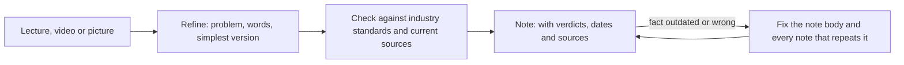

# megadev-course

A personal knowledge base. It follows the order of the **MEGA.dev course** on building with AI agents, but it is not only the course. It also holds my own knowledge and experience.

**How it is organized.**
- **By lecture,** the way the course goes: one folder per lecture.
- **By topic inside each lecture:** one file per topic. A file does not retell the lecture. It follows how I get the things the lecture touches. I dive into the problem, add my own understanding and clarifications, and check the result against industry standards.
- **What it holds:** lecture notes, refined insights, challenge work and my experiments.

It is **not a codebase**. The output is Markdown with Mermaid diagrams that I re-read and present. This file is the table of contents, the list of references I check against, the reference setup the lecturer uses, and the rules every note follows.

**Three voices, kept apart.** In each note, what the lecture says, what I add, and what industry sources say are marked separately, so you can always tell which is which.

## The principle: every claim is checked

A lecture is one author's view at one moment. It can be outdated, stale, or wrong. So nothing is copied into a note unchecked.

- **I check each key claim against industry standards and current sources.** Vendor docs, specifications, papers and official repositories come first. Blogs and social posts come last.
- **The checks are current for Q4 2026 to Q1 2027.** Most are dated November 2026. Models, harnesses, prices and vendor docs change within weeks, so a "fact" here is only valid inside that window. Re-check before you present.
- **Every note ends with a fact-check table.** Each claim gets a verdict, the source and the date:

| Verdict | Meaning |
|---|---|
| **Agrees** | A primary source supports it |
| **Differs** | A source says something different. The note says so plainly |
| **Outdated** | It was true once. I rewrite the sentence in the note body at once, in every note that repeats it |
| **Lecture-specific** | The lecturer's opinion or method. No outside source |
| **Unverified** | I could not check it. It stays marked "verify before presenting" |

- **I keep my own reasoning apart.** Each note's Sources section says which parts are mine and not from the lecture or the sources.
- **I check examples by running them or by reading their results,** and the note says which one I did. A search summary is not a primary source, and the note says when that is all we had.

**Coverage of the checks.** The Lecture 3 and Lecture 4 notes carry full fact-check tables. The Lecture 1 and 2 notes mark their sources and my own reasoning but have no fact-check tables, so their time-sensitive claims (models, tool behavior, limits, versions) have no check date.

## How a note is built

Every note has the same shape, so it is quick to scan:

1. `# N. Title` and a one-line summary starting with `>`.
2. A `Related:` line that links both ways. No broken relative links.
3. The sections (the exact order and minimums are in [.claude/rules/note-format.md](.claude/rules/note-format.md)): the problem, the words I pin down, the picture (its story, what is important, what is not), my view, the fact-check, cautions, summary, open questions, sources.
4. Diagrams are **Mermaid only**. No ASCII art.

## What to read first

- **Starting the course:** [how-to-start-mega-dev-challenge.md](how-to-start-mega-dev-challenge.md), then [mega-mcp-auth-issues.md](mega-mcp-auth-issues.md) if sign-in fails.
- **The core idea of Lecture 3:** [1 Simplify first](Lecture_3_Simplify_Codebase_&_Knowledge_Base/01_Simplify_First_Knowledge_Guardrails.md). Fix the codebase first, and keep knowledge as a last resort with a type and a way to review it.
- **The context model behind everything:** [Lecture 2: 4 Context window](Lecture_2_Context_Agents_md_Skills_Tools/4_context_window.md).

## Table of contents

### Course setup

| File | What it is |
|---|---|
| [how-to-start-mega-dev-challenge.md](how-to-start-mega-dev-challenge.md) | How to connect your agent to the course and start a Challenge |
| [mega-mcp-auth-issues.md](mega-mcp-auth-issues.md) | Known sign-in issues with the course MCP server |

### Lecture 1: Mechanics behind generative AI

Folder: [Lecture_1_Mechanics_Behind_Generative_AI](Lecture_1_Mechanics_Behind_Generative_AI/)

| Note | Topic |
|---|---|
| [01](Lecture_1_Mechanics_Behind_Generative_AI/01_tokenizer_encoder_decoder.md) | Tokenizer: encoder and decoder |
| [02](Lecture_1_Mechanics_Behind_Generative_AI/02_next_token_prediction.md) | Predicting the next token |
| [03](Lecture_1_Mechanics_Behind_Generative_AI/03_video_chatml_tools_agent_loop.md) | The video: ChatML, tools and the agent loop |
| [04](Lecture_1_Mechanics_Behind_Generative_AI/04_lesson_model_mechanics_and_tools.md) | Lesson page: model mechanics and tools |
| [05](Lecture_1_Mechanics_Behind_Generative_AI/05_lesson_harnesses_providers_steering.md) | Lesson page: harnesses, providers and steering |
| [06](Lecture_1_Mechanics_Behind_Generative_AI/06_reasoning_visible_and_silent.md) | Reasoning: visible and silent |
| [07](Lecture_1_Mechanics_Behind_Generative_AI/07_responses_api_request_example.md) | Example: Responses API request |
| [08](Lecture_1_Mechanics_Behind_Generative_AI/08_chatml.md) | ChatML |
| [09](Lecture_1_Mechanics_Behind_Generative_AI/09_multimodality.md) | Multimodality |
| [10](Lecture_1_Mechanics_Behind_Generative_AI/10_code_mode.md) | Code mode |
| [11](Lecture_1_Mechanics_Behind_Generative_AI/11_cli_and_mcp.md) | CLI and MCP tools |
| [12](Lecture_1_Mechanics_Behind_Generative_AI/12_mcp_resources_and_skills.md) | MCP: resources and skills |
| [13](Lecture_1_Mechanics_Behind_Generative_AI/13_skills_and_context.md) | Skills: loading, context and unloading |
| [14](Lecture_1_Mechanics_Behind_Generative_AI/14_attachments_and_what_the_model_sees.md) | Attachments: what the model actually sees |
| [15](Lecture_1_Mechanics_Behind_Generative_AI/15_self_querying.md) | Self-querying |
| [16](Lecture_1_Mechanics_Behind_Generative_AI/16_self_management.md) | Self-management |
| [17](Lecture_1_Mechanics_Behind_Generative_AI/17_ambient_durable_agents.md) | Ambient, durable agents |

### Lecture 2: Context, AGENTS.md, skills and tools

Folder: [Lecture_2_Context_Agents_md_Skills_Tools](Lecture_2_Context_Agents_md_Skills_Tools/)

| Note | Topic |
|---|---|
| [Insight 1](Lecture_2_Context_Agents_md_Skills_Tools/Insight_1_Context_Agents.md) | Context: AGENTS.md and CLAUDE.md. The main source of token waste |
| [1](Lecture_2_Context_Agents_md_Skills_Tools/1_Harness.md) | Harness: everything around the model |
| [2](Lecture_2_Context_Agents_md_Skills_Tools/2_agent_context_self_report.md) | Agent context self-report |
| [3](Lecture_2_Context_Agents_md_Skills_Tools/3_lifecycle_hooks.md) | Lifecycle hooks: deterministic logic around the loop |
| [4](Lecture_2_Context_Agents_md_Skills_Tools/4_context_window.md) | Context window |
| [5](Lecture_2_Context_Agents_md_Skills_Tools/5_skills.md) | Skills: design, generation and security |
| [6](Lecture_2_Context_Agents_md_Skills_Tools/6_router_skills.md) | Router skills |
| [7](Lecture_2_Context_Agents_md_Skills_Tools/7_skill_shaper_how_to_improve_skills.md) | Skill shaper: how to improve skills |
| [8](Lecture_2_Context_Agents_md_Skills_Tools/8_tools_native_and_external.md) | Tools: native and external |
| [9](Lecture_2_Context_Agents_md_Skills_Tools/9_tools_prompt_injection.md) | Tools and prompt injection |
| [10](Lecture_2_Context_Agents_md_Skills_Tools/10_tool_results_context_to_file_and_back.md) | Tool results: context to file and back |
| [11](Lecture_2_Context_Agents_md_Skills_Tools/11_tool_upfront_vs_tool_discovery.md) | Tools: upfront schemas versus discovery |
| [12](Lecture_2_Context_Agents_md_Skills_Tools/12_subagents_vs_workers.md) | Subagents versus workers, and which model and effort each helper gets (A2A peers are opaque) |

### Lecture 3: Simplify the codebase and the knowledge base

Folder: [Lecture_3_Simplify_Codebase_&_Knowledge_Base](Lecture_3_Simplify_Codebase_&_Knowledge_Base/). Pictures are in its `img/` folder.

| Note | Topic |
|---|---|
| [1](Lecture_3_Simplify_Codebase_&_Knowledge_Base/01_Simplify_First_Knowledge_Guardrails.md) | Simplify first: fix the codebase before adding knowledge. Knowledge needs a type and a way to review it |
| [2](Lecture_3_Simplify_Codebase_&_Knowledge_Base/02_Dumb_Questions_Rule.md) | Dumb questions rule: a human onboarding trick that makes confusion visible |
| [3](Lecture_3_Simplify_Codebase_&_Knowledge_Base/03_Agent_Asks_Dumb_Questions.md) | Agent asks dumb questions: a fresh agent as a test reader |
| [4](Lecture_3_Simplify_Codebase_&_Knowledge_Base/04_Ask_Why.md) | Ask why: treat the answer as a hypothesis and verify it |
| [5](Lecture_3_Simplify_Codebase_&_Knowledge_Base/05_Knowledge_As_Files_For_Agents.md) | Knowledge as files, built for agents: raw sources, an agent-written wiki, thinking rounds |
| [6](Lecture_3_Simplify_Codebase_&_Knowledge_Base/06_Beyond_Markdown_mdx_svx.md) | Beyond Markdown: mdx and svx |
| [7](Lecture_3_Simplify_Codebase_&_Knowledge_Base/07_Explainer_Skill.md) | The explainer skill: a skill as an example, and an idea for ADRs |
| [8](Lecture_3_Simplify_Codebase_&_Knowledge_Base/08_Decision_Models_Search_And_Memory.md) | Decision models: pointing the agent where to look, and near and far memory |
| [9](Lecture_3_Simplify_Codebase_&_Knowledge_Base/09_Jevgrep.md) | Jevgrep: the numbers read closely, and a test plan |
| [10](Lecture_3_Simplify_Codebase_&_Knowledge_Base/10_Demos_Reaching_The_Right_Files.md) | Demos: reaching the right files and notes (a map, links and a picker) |
| [11](Lecture_3_Simplify_Codebase_&_Knowledge_Base/11_Knowledge_Base_Problems_And_Known_Techniques.md) | Knowledge base problems and known techniques, filtered for agents |
| [12](Lecture_3_Simplify_Codebase_&_Knowledge_Base/12_Knowledge_Event_&_Triggers.md) | Update triggers: schedules and events, and how to keep them safe |
| [13](Lecture_3_Simplify_Codebase_&_Knowledge_Base/13_Knowledge_Skill_Anatomy.md) | How the knowledge skill is built, and what to copy |
| [14](Lecture_3_Simplify_Codebase_&_Knowledge_Base/14_Broader_Context_Task_Board.md) | Broader context: a task board next to `AGENTS.md` |

### Lecture 4: Working with AI harnesses

Folder: [Lecture_4_Harness](Lecture_4_Harness/)

| Note | Topic |
|---|---|
| [1](Lecture_4_Harness/01_Harness_Lock-in_Keep_Doors_Open.md) | Harness lock-in: treat the harness as a replaceable middle layer, keep substance in the repo |
| [2](Lecture_4_Harness/02_Agent_Runner_Portability.md) | Agent runner portability: plugin architecture, adapter boundaries, runner contracts, six evaluation questions |
| [3](Lecture_4_Harness/03_Skill_And_Folder_Orchestration.md) | Skill and folder orchestration: organizing skills by harness, scope and origin (fleet + limen patterns) |
| [4](Lecture_4_Harness/04_Computers_md_Fleet_Infrastructure.md) | COMPUTERS.md: machine registry, provisioning runbook, fleet infrastructure as data. Path to A2A service discovery |
| [5](Lecture_4_Harness/05_Dont_Overspecify_Work_At_Assistants_Level.md) | Don't overspecify: the stack is Code → LLMs → Harnesses → Assistants. Work at the top, keep lower layers thin |
| [6](Lecture_4_Harness/06_Self_Management_Pi_Herdr.md) | Self-management: Pi and Herdr, self-configuring agents, spawning workers that survive a closed terminal |
| [7](Lecture_4_Harness/07_Multi_Agent_Coordination.md) | Multi-agent coordination: coordinator, workers, supervisor, files as messages, worktrees, vision and styleguide, the job lifecycle as a state machine, where the lifecycle hooks attach |
| [8](Lecture_4_Harness/08_Settings_Model_Routing_Cost.md) | Settings: model routing, reasoning effort, cost per task, deterministic privacy boundary |
| [9](Lecture_4_Harness/09_Teamwork_Knowledge_Base_Tool_Stack.md) | Teamwork: internal knowledge base, AI-friendly tool stack, sharing skills |
| [10](Lecture_4_Harness/10_Automation_Repository_Agents.md) | Automation: repository agents, PR review, issue to PR, doc updates, trigger → agent → human loop |
| [11](Lecture_4_Harness/11_Cloud_Coding_Agents.md) | Cloud coding agents vs agent hosting platforms: comparison table, vendor docs, self-hosted options, Aras caveat, open questions |
| [12](Lecture_4_Harness/12_Context_Language_Models.md) | Context language models: the model edits its own context file. What the paper shows, wins and non-wins, what it does not test, how it differs from Mixture-of-Experts and other model types, weights, license and serving (checked against the PDF) |
| [13](Lecture_4_Harness/13_Herdr_vs_Orca_Agent_Orchestration.md) | Herdr vs Orca: terminal multiplexer vs worktree orchestrator, real Herdr commands checked, comparison table, where each fits |
| [14](Lecture_4_Harness/14_What_Agent_Fleets_Need_Beyond_Spawning.md) | What an agent fleet needs beyond spawning workers: the lecture's 11 requirements as a checklist, coverage in my notes, gaps, test questions for my platform |
| [15](Lecture_4_Harness/15_Pi_Limen_Behind_The_Scenes.md) | Behind the scenes of the limen setup: what Pi's hooks do, what limen's files, supervisor and Herdr do, the real job-record layout, a sequence diagram, where the code differs from the lecture, how to try limen, and ideas worth taking from it |
| [16](Lecture_4_Harness/16_SOTA_And_Reasoning_Effort.md) | SOTA and reasoning effort as two separate dials: the 2×2 grid, what each dial changes, what Anthropic and OpenAI docs say about effort, the course effort-routing example, effort in a portable runner |
| [17](Lecture_4_Harness/17_Cost_Per_Task.md) | Cost per task instead of token price: the lecture's worked example, tasks per dollar, cost per solved task, why tokens per task differ, who publishes it, what to measure in my own runner |
| [18](Lecture_4_Harness/18_Sharing_Approved_Skills_AI_Marketplace.md) | Sharing approved skills across teams: Git, `npx skills` and Skills over MCP checked against their docs, and an AI marketplace as an approval step on top of them |

### Lecture 5: Workflows, not tool sets

| # | Topic |
|---|---|
| [01](Lecture_5_Workflows_not_tool_sets/01_Skill_Or_Agent_For_Explore_Loops.md) | Skill or agent for exploring: thread and settings are the real difference, a loop for `explore-*` agents, skill plus agent |
| [02](Lecture_5_Workflows_not_tool_sets/02_Merge_Review_Second_Pair_Of_Eyes.md) | Before the merge: a read-only reviewer agent on a fast, cheap model next to tests, PR bots and a human, a three-round revision loop, what the evidence says |
| [03](Lecture_5_Workflows_not_tool_sets/03_The_Gap_Build_Speed_Vs_Keeping_Up.md) | The gap: building speed outruns what I can keep up with. The lecture article's first figure, what does not speed up (review, testing, docs, people, agents that need me), three moves to shrink the gap |
| [04](Lecture_5_Workflows_not_tool_sets/04_Executable_Markdown_Skills_As_Programs.md) | Executable Markdown: a skill as a program. The article's five problems and four strengths, the nightly PR triage, and a design for a nightly agent that prepares tech-debt fixes with Playwright screenshots as proof |
| [05](Lecture_5_Workflows_not_tool_sets/05_Agents_Maintain_The_Tools_I_Review.md) | Agents build and maintain my tools, I review them: the system built once, a standing review checklist (still needed, simplify, merge, archive), why old rules go stale as models improve, guards for agents editing agent instructions |
| [06](Lecture_5_Workflows_not_tool_sets/06_Run_The_Fleet_On_A_Remote_Seat.md) | Running the fleet on a remote seat: the lecturer's Pi, Herdr and Limen setup on a VPS and tailnet, where Orca fits, setup split between me and the agent, a nightly timer the docs do not provide, security and Aras governance gates |
| [07](Lecture_5_Workflows_not_tool_sets/07_Herdr_Or_Orca_For_My_Fleet.md) | Herdr or Orca for my fleet: what the Orca docs add to the Lecture 4 comparison, a decision flow, a fair trial of both, the security posture of each. Links to [Lecture 4: 13](Lecture_4_Harness/13_Herdr_vs_Orca_Agent_Orchestration.md) |
| [08](Lecture_5_Workflows_not_tool_sets/08_Skills_As_Building_Blocks.md) | Skills as building blocks: skills or code, blocks then workflow skills then a prompt, Full Send and Full Stop, a skill from a real bad example, global or repo or harness, the PR comment skill, keeping the set small |
| [09](Lecture_5_Workflows_not_tool_sets/09_Local_Fleet_Lab_Sandboxes_And_Worktrees.md) | A local fleet lab: `sbx` microVM in clone mode for execution, a worktree per item for changes, four levels from Claude-only to a sandbox per worker, portable skills for Pi and Claude Code, DeepSeek workers through OpenRouter, my architecture repository as the pilot |
| [10](Lecture_5_Workflows_not_tool_sets/10_Fleet_Lab_Threat_Model.md) | Fleet lab threat model: three zones (alone, with me, never by mechanism), R1 to R9 with OWASP agentic mapping, SSH forwarding and the Balanced preset as unsafe defaults, the poisoned return path, a ten-step run gate |

### Week 2, Lecture 1: Agentic primitives

Folder: [Week2_Lecture_1_Agent_Primitives](Week2_Lecture_1_Agent_Primitives/). Where to look for what: its [README](Week2_Lecture_1_Agent_Primitives/README.md). Pictures are in its `img/` folder.

| # | Topic |
|---|---|
| [01](Week2_Lecture_1_Agent_Primitives/01_Advanced_Prompt_Techniques.md) | Advanced prompt techniques: The lecture's direct-work-versus-unattended table, Anthropic's published prompt sections, what the extracted Codex and Opus prompts show (provenance unverified), what Anthropic and OpenAI recommend, how it maps to the five parts |
| [02](Week2_Lecture_1_Agent_Primitives/02_Rethinking_The_Skills.md) | Rethinking the skills: OpenAI's ten recommendations for skills and AGENTS.md on newer models, the limits behind them in the Agent Skills spec, Claude Code and Codex, bad and good examples, a skill review list |
| [03](Week2_Lecture_1_Agent_Primitives/03_Agent_Loop_Stop_Limits_Recovery.md) | Agent loop: The routing function behind the stop condition, step limits across runtimes, budget and deadline, three recovery layers, retry only what is idempotent |
| [04](Week2_Lecture_1_Agent_Primitives/04_HITL_And_Execution_Isolation.md) | HITL and execution isolation: Where threads are stored, what else a harness persists, who may read, write or grant each kind, access checks inside tools, per-user workspaces and sandbox coverage |
| [05](Week2_Lecture_1_Agent_Primitives/05_Instructions_Five_Parts_And_Enforcement.md) | Instructions: The five prompt parts, my tagged-chapter layout, boundaries as requests versus rules in code, start simple and iterate with evals |
| [06](Week2_Lecture_1_Agent_Primitives/06_Context_Window_And_Compaction.md) | Context window and compaction: Window and compaction, tools and results kept out of the thread, what survives compaction in Claude Code, skill re-injection, why a long AGENTS.md hurts |
| [08](Week2_Lecture_1_Agent_Primitives/08_Tool_Search_Instead_Of_Many_Tools.md) | Tool search instead of many tools: The lecturer's tool-search example (keyword scoring, names only, no native tools, mock numbers), Anthropic, OpenAI and Claude Code tool search, when it pays, how to pick the native tools |
| [09](Week2_Lecture_1_Agent_Primitives/09_Tool_Search_And_Proxy_Gateway.md) | Tool search and proxy gateway: The lecture's gateway figure, Uber's control plane and data plane (registry with tools off, approval of description changes, proxy that authorizes, redacts and trims) against Treg, what I take for managing many tools |
| [10](Week2_Lecture_1_Agent_Primitives/10_Memory.md) | Memory: The lecture's memory figures, a comparison of Mem0 OSS, supermemory and Hindsight, five principles (relations, placement, search, readable pieces, immutable and append-only) against Zep, Hindsight, Mem0, Claude Code, the Anthropic memory tool, LangMem and Redis BM25, extraction choices, review questions for my flat RediSearch store |
| [11](Week2_Lecture_1_Agent_Primitives/11_Memory_Known_Problems.md) | Memory known problems: Contradiction, duplication and ambiguity, the lecturer's memory-extraction example (three modes over six dated chats and its counters), how I beat each with replace-by-key, identity from the session and a hold state, what the example leaves open |
| [12](Week2_Lecture_1_Agent_Primitives/12_Memory_Audit_Ledger_In_Memory_Or_State.md) | Audit ledger: state or memory: My Ledger idea checked against the LangGraph docs: state against Store, what a state channel does not guarantee, write-ahead entries, ten review questions for the implementation, an external append-only sink |
| [13](Week2_Lecture_1_Agent_Primitives/13_Memory_Operations.md) | Memory operations: Search, update and insert against Hindsight's retain, recall and reflect with its worker, Mem0, supermemory, the Anthropic memory tool and lamarck's maintenance (gates, lifecycle, decay, budget), what reflect and mental models add, what Joel Hooks' retired pipeline shows |
| [14](Week2_Lecture_1_Agent_Primitives/14_Tool_Approval_Durable_Waits.md) | Tool approval and durable waits: Approval as a harness duty, persisted run state, resume after days, LangGraph `interrupt`, permission grants |
| [15](Week2_Lecture_1_Agent_Primitives/15_Trace_A_Run_And_Size_Its_Step_Limit.md) | Trace a run and size its step limit: Traces, the debugging rule, step-limit tuning against LangGraph supersteps, tracing tools |
| [16](Week2_Lecture_1_Agent_Primitives/16_Evals_For_Agent_Changes.md) | Evals for agent changes: Behaviour eval cases, self-revision cases, rerun after every change, prompt-eval loop and smallest model, eval tools |
| [17](Week2_Lecture_1_Agent_Primitives/17_Extend_Adjust_Or_Leave_The_Framework.md) | Extend, adjust or leave the framework: Three moves from cheapest to costliest, a decision flow, what I must understand before choosing |
| [18](Week2_Lecture_1_Agent_Primitives/18_Harness_Around_The_Loop.md) | The harness around the loop: The lecture's harness figure: four caller forms, six hook points, the limits frame, history, memory, observability |
| [19](Week2_Lecture_1_Agent_Primitives/19_Pi_LangGraph_DeepSeek_Harnesses.md) | Pi, LangGraph and the DeepSeek paper: Who owns the loop in each, extension points, state and resume, and why the DeepSeek paper is a composability paper |
| [20](Week2_Lecture_1_Agent_Primitives/20_Loop_Hooks_Declared.md) | Loop hooks declared: The lecture's three illustrative hooks against Pi's real callbacks, the same points in Claude Code and LangChain middleware, fail-open versus fail-closed |
| [21](Week2_Lecture_1_Agent_Primitives/21_AI_SDK_Or_Official_SDKs.md) | AI SDK or official SDKs: What the Vercel AI SDK gives (providers, loop, middleware, telemetry), what leaks through the abstraction, language and framework fit (no Python SDK, LangGraph only at the UI edge, no CrewAI fit), whether a layer really goes, a parity check before migrating |
| [22](Week2_Lecture_1_Agent_Primitives/22_Threads_Vs_A2A_Subagents.md) | Threads, subagents and A2A: The lecture's thread figure, in-process subagents against A2A peers, `contextId` and tasks, what the A2A spec, LangGraph, Microsoft, Claude Code, Anthropic and Cognition say, my process-per-agent choice |
| [23](Week2_Lecture_1_Agent_Primitives/23_Self_Configuring_Harness.md) | Self-configuring harness: The lecture's "Configuration" part: what Claude Code, OpenCode and Pi let the agent change at runtime, what the documented guards cover, what the DeepSeek paper adds, and a change-class design with undo |
| [24](Week2_Lecture_1_Agent_Primitives/24_KV_Cache_And_Prompt_Caching.md) | KV cache and prompt caching: The KV cache and prefix caching in three layers, Anthropic's `cache_control` against OpenAI's `prompt_cache_key`, options and breakpoints, what to cache and in what order, what breaks a hit, cost arithmetic, isolation |
| [25](Week2_Lecture_1_Agent_Primitives/25_Tool_Execution_Instead_Of_Tool_Calls.md) | Tool execution instead of tool calls: The lecture's code mode figure, function calling against scripts, what Anthropic, OpenAI, Cloudflare, Pi and DeepSeek do, parallel calls versus scripts, large results stored and read by chunk (memory bound to context), what I would review |
| [26](Week2_Lecture_1_Agent_Primitives/26_Packages.md) | Packages: The lecture's package figure, Anthropic's code-execution pattern, Voyager's skill library, Agent Skills docs, and the guards a saved package needs |

### Week 2, Lecture 2: Building an agent

Folder: [Week2_Lecture_2_Building_an_Agent](Week2_Lecture_2_Building_an_Agent/).

| # | Topic |
|---|---|
| [01](Week2_Lecture_2_Building_an_Agent/01_LLM_vs_Classification.md) | LLM vs classification: Trained classifiers against LLM-based steps, how each is used and supported, a side-by-side table, scenarios (volume, latency, hosted, tenant-defined categories), a cascade, Anthropic's routing pattern |
| [02](Week2_Lecture_2_Building_an_Agent/02_ClassificationModel_vs_DecisionModel.md) | Classification model vs decision model: Where labels are bound (rules, trained, zero-shot NLI, LLM enum, decision model), the typed-answer contract, and what sits under Decision-1, Kev, Laya and Jev |
| [03](Week2_Lecture_2_Building_an_Agent/03_Classification_Options_Market.md) | Classification options on the market: Classical ML, trained and zero-shot encoders, SetFit, AWS Comprehend, Azure AI Language, Azure ML AutoML, deprecated Vertex AutoML Text, LLM enums, what each returns per class |
| [04](Week2_Lecture_2_Building_an_Agent/04_Jev_And_Microsoft_Decision_1.md) | Jev and Microsoft-Decision-1: Who makes them, price, access, a call shape, what vendors and TypedBench say about calibration, how I would try them |
| [05](Week2_Lecture_2_Building_an_Agent/05_Support_Chat_In_Production.md) | Support chat in production: How Amazon Lex, Rasa, Dialogflow CX, Azure CLU and Zendesk route a message (first pass, confidence gate, handoff), where I start for a support chat, Azure's 2029 retirements |
| [06](Week2_Lecture_2_Building_an_Agent/06_Workflow_vs_LangGraph.md) | Workflow vs LangGraph: Guardrail, workflow and durable told apart, composing calls against enforcing a process, who is the outer layer, LangGraph, Mastra, CrewAI, ADK, Microsoft Agent Framework, Semantic Kernel and others compared |
| [07](Week2_Lecture_2_Building_an_Agent/07_Workflows_On_The_Fly_And_Todo_Lists.md) | Workflows on the fly and todo lists: What the Deep Agents todo list is, three levels of runtime change, the resume cost, a fixed executor over a model-written plan |
| [08](Week2_Lecture_2_Building_an_Agent/08_Mastra_Workflow_Mapped_To_LangGraph.md) | Mastra workflow mapped to LangGraph: The lecture's exchange flow in both engines, step to node, suspend to interrupt, runId to thread_id, snapshot to checkpoint, what reruns on resume, where they differ |
| [09](Week2_Lecture_2_Building_an_Agent/09_Cache_Hit_Rate_And_P90_Latency.md) | Cache hit rate and P90 latency: What 95-99% cached input buys (arithmetic), what a hit does not touch (reasoning, decode, tools, steps), where a 75-89% rate may leak, the per-step fields to measure first |
| [10](Week2_Lecture_2_Building_an_Agent/10_Memory_Centric_Approach_With_Events.md) | Memory-centric approach with events: Memory changes emit events that wake the agent, the six primitives, what to register (messages, journal, schedule), self-scheduling in Cloudflare Agents, Claude Code and Letta, guards, wake-ups against the cache TTL |
| [11](Week2_Lecture_2_Building_an_Agent/11_Model_Routing_In_LangGraph.md) | Model routing in LangGraph: What is fixed after compile and what is not, six ways to choose a model per call, what Claude Code, Aider and Foundry's router do, the cold-cache cost of a switch |
| [12](Week2_Lecture_2_Building_an_Agent/12_Sandbox_For_Agent_Code_Pi_And_Search_Execute.md) | Sandbox for agent code: Script, tool and harness walls told apart, what Pi (codemode in QuickJS, Gondolin micro-VM, `tool_search`), Cloudflare, Anthropic, the DeepSeek API and the community DeepSeek TUI provide, which wall for which situation |
| [13](Week2_Lecture_2_Building_an_Agent/13_LLM_Adapters_And_Gateway.md) | LLM adapters and gateway: Dialect and host as two axes (Claude on Foundry and direct), what each host lacks, three designs, what a gateway does to the cache, what the interface must carry |
| [15](Week2_Lecture_2_Building_an_Agent/15_Execution_Flows_Skill_Tool_Or_Workflow.md) | Execution flows: Where a required flow lives (skill, consolidated tool, gate, enforcement), the Stripe price flow checked, what to do when a skill grows, what unloading a skill costs the cache |

### Example skills I keep (not enabled)

These are pinned, verbatim copies of other people's skills, kept as examples of good structure. Claude Code loads project skills from `.claude/skills/`, so these folders are **not loaded**. Each has a `SOURCE.md` with the repository, commit, version and license. Read the code before you enable or run anything.

| Folder | What it is |
|---|---|
| [.claude/explainer/](.claude/explainer/SOURCE.md) | The `explainer` skill: Markdown with data blocks to an interactive HTML page |
| [.claude/knowledge/](.claude/knowledge/SOURCE.md) | The `knowledge` skill: designs a knowledge base and leaves it a skill of its own |

### Example skills I wrote (not enabled)

| Folder | What it is |
|---|---|
| [.claude/review-loop/](.claude/review-loop/README.md) | A `review-loop` skill and a read-only `review-second-eyes` agent (`model: claude-sonnet-5-5` in its header): independent review before the PR, then the PR until CI and bots are green, `MAX = 3` rounds per loop, no merge. Built from [Lecture 5: 02](Lecture_5_Workflows_not_tool_sets/02_Merge_Review_Second_Pair_Of_Eyes.md). Not run yet |
| [.agents/fleet-lab/](.agents/fleet-lab/README.md) | `fleet-plan`, `fleet-run` and `fleet-worker` skills for Pi and Claude Code, a Pi runner script (a worktree per item, `xargs -P` cap), a Claude worker agent with `isolation: worktree`, and an installer that puts the skills in `.agents/skills/` with `.claude/skills/` symlinks. Built from [Lecture 5: 09](Lecture_5_Workflows_not_tool_sets/09_Local_Fleet_Lab_Sandboxes_And_Worktrees.md). Windows versions (`install.ps1`, `run-pi-workers.ps1`). Shell logic tested with a stub `pi`. No model run yet. Read [Lecture 5: 10](Lecture_5_Workflows_not_tool_sets/10_Fleet_Lab_Threat_Model.md) before any run |

## The lecturer's reference setup

The tools and workflows the lecturer names across the lectures. They show what the course aims at. They are the lecturer's choices, not my recommendations, and I have not checked each tool's fit. Each section names the lecture it comes from.

### Tool stack the MEGA team uses (S01E04)

| Category | Tools |
|---|---|
| Observability and product telemetry | [PostHog](https://posthog.com/), [Axiom](https://axiom.co/docs) |
| Build, storage and remote reach | [Vercel](https://vercel.com/), [Minio](https://www.min.io/), [Depot](https://depot.dev/), [Cloudflare](https://www.cloudflare.com/) with [Alchemy](https://alchemy.run/), [Tailscale](https://tailscale.com/), [UploadThing](https://uploadthing.com/) |
| Agent surfaces and harnesses | [Pi](https://pi.dev/), [Herdr](https://herdr.dev/), [Moshi](https://getmoshi.app/), [OpenRouter](https://openrouter.com/) |
| Typed app substrate | [XState](https://stately.ai/docs/xstate), [Effect](https://effect.website/), [oxlint](https://oxc.rs/), [mdsvex](https://svelte.dev/docs/cli/mdsvex) |
| Auth and backend | [Clerk](https://clerk.com/), [Convex](https://www.convex.dev/) |
| Work the agent can write | [Linear](https://linear.app/), [Stripe](https://stripe.com/), [Resend](https://resend.com/), [Attio](https://attio.com/) |
| Design | [Paper](https://paper.design/), [Figma](https://figma.com/) |

The lecturer says not everything on the list will be useful for everyone. It is also a source of inspiration for finding new tools and refreshing a stack. My reading of why each category matters for agents is in [Lecture 4: 09 Teamwork](Lecture_4_Harness/09_Teamwork_Knowledge_Base_Tool_Stack.md).

### Automated workflows that run in the background (S01E04)

Agents that integrate with GitHub: [Claude Code](https://code.claude.com/docs/en/github-actions), [Cursor](https://cursor.com/docs/cli/github-actions), [Devin](https://devin.ai/) and [CodeRabbit](https://www.coderabbit.ai/). They can be called in GitHub comments and pull requests, and events in the repository can trigger them. The lecturer lists these uses:

1. Keep documentation, a knowledge base, or even the entire website up to date
2. Convert an issue into a pull request enriched with the necessary context
3. Review pull requests as soon as they are created and leave a brief comment ([pr-review-rules example](https://github.com/MEGA-DOT-DEV/examples/tree/main/examples/pr-review-rules))
4. Autonomously fix small bugs and publish the changes
5. Detect issues in code and dependencies
6. Assign pull requests to the person responsible for a given feature
7. Gather data from external systems or even from people
8. Handle routine tasks such as cleaning up dead code

My notes on these uses, with triggers and the human review step, are in [Lecture 4: 10 Automation](Lecture_4_Harness/10_Automation_Repository_Agents.md).

### Repository the lecturer asks to study (S01E04)

[overment/limen](https://github.com/overment/limen) is a working coordinator, workers and supervisor setup built from plain text files, git worktrees, Pi extensions and Herdr, with a small CLI. The lecturer says that if one thing is taken from S01E04, it should be this: play with the repository, chat about it with an AI agent, and extract ideas or modify it to fit your needs. His steps to apply it:

1. Run `limen init`
2. Shape `vision.md` and `styleguide.md` together with an agent
3. Install Pi and Herdr
4. Open Pi and ask it to implement something

limen runs on macOS and Linux. My notes read the commit `01fc400`: [Lecture 4: 07 Multi-agent coordination](Lecture_4_Harness/07_Multi_Agent_Coordination.md) describes the design, and [15 Pi and limen behind the scenes](Lecture_4_Harness/15_Pi_Limen_Behind_The_Scenes.md) covers how to try it and the ideas I take from it.

### Skills and workflows the lecturer names (S01E05)

| Name | What it does | Notes |
|---|---|---|
| sol-loop | Asks a second model family to review a change, fixes, repeats up to three loops, then files a PR | [02](Lecture_5_Workflows_not_tool_sets/02_Merge_Review_Second_Pair_Of_Eyes.md#how-the-sol-loop-got-here-seven-edits) |
| File PR | Files a concise PR with a good title and description, using bad and good examples | [08](Lecture_5_Workflows_not_tool_sets/08_Skills_As_Building_Blocks.md) |
| Babysit PR, watch pull request | Keeps watching a PR until reviewers and CI are green | [08](Lecture_5_Workflows_not_tool_sets/08_Skills_As_Building_Blocks.md) |
| File upload | Shows a video in a PR without committing it to the repo | [08](Lecture_5_Workflows_not_tool_sets/08_Skills_As_Building_Blocks.md) |
| PR comment skill | Makes an agent say that it, and which model, wrote a comment | [08](Lecture_5_Workflows_not_tool_sets/08_Skills_As_Building_Blocks.md) |
| Full Send, Full Stop | Workflow skills: to a merged PR, or to a PR ready for me | [08](Lecture_5_Workflows_not_tool_sets/08_Skills_As_Building_Blocks.md) |
| Nightly PR triage | A scheduled prompt: cheap delegates audit PRs, strong delegates verify, a list of eight or fewer | [04](Lecture_5_Workflows_not_tool_sets/04_Executable_Markdown_Skills_As_Programs.md) |
| [T3 Code](https://github.com/pingdotgg/t3code) | The lecturer's GUI harness for Codex, Claude and others | [02](Lecture_5_Workflows_not_tool_sets/02_Merge_Review_Second_Pair_Of_Eyes.md#how-the-sol-loop-got-here-seven-edits) |
| [Matt Pocock's skills](https://github.com/mattpocock/skills) | Includes the grilling skill used to settle a plan with the agent | [08](Lecture_5_Workflows_not_tool_sets/08_Skills_As_Building_Blocks.md) |

### Tools the lecturer names (S02E01)

| Name | What it does | Notes |
|---|---|---|
| [AI SDK](https://vercel.com/ai-sdk) | Vercel's TypeScript toolkit for multi-provider model calls, tools and agent loops. The lecturer prefers official SDKs over it | [21](Week2_Lecture_1_Agent_Primitives/21_AI_SDK_Or_Official_SDKs.md) |
| [Pi](https://github.com/earendil-works/pi) | Minimal terminal agent harness, loop in `packages/agent` | [19](Week2_Lecture_1_Agent_Primitives/19_Pi_LangGraph_DeepSeek_Harnesses.md), [20](Week2_Lecture_1_Agent_Primitives/20_Loop_Hooks_Declared.md) |
| [Goose](https://github.com/aaif-goose/goose) | Open-source agent harness named as a loop implementation | [03](Week2_Lecture_1_Agent_Primitives/03_Agent_Loop_Stop_Limits_Recovery.md) (loop source not read) |
| DeepSeek Harness paper ([arXiv 2608.25512](https://arxiv.org/abs/2608.25512)) | A composability paper, not an agent harness | [19](Week2_Lecture_1_Agent_Primitives/19_Pi_LangGraph_DeepSeek_Harnesses.md) |
| [mem0](https://mem0.ai/), [supermemory](https://supermemory.ai/), [Hindsight](https://hindsight.vectorize.io/), [lamarck](https://github.com/johnlindquist/lamarck) | Agent memory projects | [10](Week2_Lecture_1_Agent_Primitives/10_Memory.md) |
| [Treg](https://github.com/superdesigndev/treg) | Hosted proxy and registry for external tools | [09](Week2_Lecture_1_Agent_Primitives/09_Tool_Search_And_Proxy_Gateway.md) |
| [Mastra](https://mastra.ai/) | Agent framework used in the transcript demo, worked example only | [15](Week2_Lecture_1_Agent_Primitives/15_Trace_A_Run_And_Size_Its_Step_Limit.md), [16](Week2_Lecture_1_Agent_Primitives/16_Evals_For_Agent_Changes.md) |

### Tools the lecturer names (S02E02)

| Name | What it does | Notes |
|---|---|---|
| Jev ([LLM Gateway docs](https://docs.llmgateway.io/features/system-one)) | TypeSafe's hosted decision model: typed answers with per-option probabilities | [01](Week2_Lecture_2_Building_an_Agent/01_LLM_vs_Classification.md), [04](Week2_Lecture_2_Building_an_Agent/04_Jev_And_Microsoft_Decision_1.md) |
| [Microsoft-Decision-1](https://ai.azure.com/catalog/models/Microsoft-Decision-1) | Microsoft's decision model on Foundry, Qwen3.5-9B post-trained, preview. Not named by the lecturer, added as the Azure counterpart | [04](Week2_Lecture_2_Building_an_Agent/04_Jev_And_Microsoft_Decision_1.md) |
| [Mastra](https://mastra.ai/) | Framework with `createStep`, suspend and resume, named in the S02E02 article and the transcript demo | [06](Week2_Lecture_2_Building_an_Agent/06_Workflow_vs_LangGraph.md) |
| [OpenRouter](https://openrouter.com/), [Amazon Bedrock](https://aws.amazon.com/bedrock/model-choice/), [Azure AI Foundry](https://azure.microsoft.com/en-us/products/ai-foundry/models) | Provider gateways named in the S02E02 article | Not yet covered |
| [pi-durable](https://github.com/earendil-works/pi/tree/main/packages/durable), [pi-until](https://github.com/joelhooks/pi-until) | Durable execution and watchers for Pi, named in the S02E02 article | Not yet covered |

## Repository rules

The rules for working in this repo are in [AGENTS.md](AGENTS.md). [CLAUDE.md](CLAUDE.md) only imports it. The main ones:

- Check what already exists before writing. Extend or link, do not duplicate.
- Fact-check the lecturer. Fix outdated facts in the body and everywhere they repeat.
- Diagrams are Mermaid only.
- **Content scope:** the notes hold how I think, analyze and struggle. They never hold Aras business secrets, customer data, PII, credentials or other Restricted Data. Examples are abstracted. Internal tools go through the [AI Solutions Catalog](http://aitools.aras.com/).
- Never read or print `.env`, `github.pat` or `configuration.txt`.
- Do not commit unless asked. One branch per lecture.
- These notes are drafted with AI assistance (Claude Code). When you share one outside this repository, add: "Prepared with AI assistance; reviewed and validated by [Name]."

## References I check against

Each note lists its own sources. These are the main ones I rely on, grouped by kind. I prefer the ones at the top.

### Vendor and project documentation

- Claude Code docs: [best practices](https://code.claude.com/docs/en/best-practices), [memory](https://code.claude.com/docs/en/memory), [subagents](https://code.claude.com/docs/en/sub-agents), [scheduled tasks](https://code.claude.com/docs/en/routines)
- Anthropic engineering: [Effective harnesses for long-running agents](https://www.anthropic.com/engineering/effective-harnesses-for-long-running-agents), [Claude Code best practices](https://www.anthropic.com/research/claude-code-best-practices)
- GitHub: [webhook events and payloads](https://docs.github.com/en/webhooks/webhook-events-and-payloads)
- Letta (MemGPT): [memory tiers](https://docs.letta.com/letta_memgpt)
- Cline: [Memory Bank](https://docs.cline.bot/best-practices/memory-bank) (a community pattern)

### Specifications and formats

- [Agent Skills specification](https://agentskills.io/specification)
- [AGENTS.md](https://agents.md/)
- [Open Knowledge Format (OKF) v0.2](https://github.com/GoogleCloudPlatform/knowledge-catalog/blob/main/okf/SPEC.md)
- [MDX](https://mdxjs.com/docs/what-is-mdx/) and [mdsvex](https://mdsvex.pngwn.io/docs)
- [MADR](https://adr.github.io/madr/) (Markdown architectural decision records)

### Papers

- [Evaluating AGENTS.md: are repository-level context files helpful for coding agents? (arXiv 2602.11988)](https://arxiv.org/abs/2602.11988)
- [Language models don't always say what they think (arXiv 2305.04388)](https://arxiv.org/abs/2305.04388)
- [Towards understanding sycophancy in language models (arXiv 2310.13548)](https://arxiv.org/abs/2310.13548)
- [Reasoning models don't always say what they think (Anthropic)](https://www.anthropic.com/research/reasoning-models-dont-say-think)
- [Psychological safety and learning behavior in work teams (Edmondson, 1999)](https://web.mit.edu/curhan/www/docs/Articles/15341_Readings/Group_Performance/Edmondson%20Psychological%20safety.pdf)

### Course material and examples

- [MEGA-DOT-DEV/examples](https://github.com/MEGA-DOT-DEV/examples): the course examples I read (`file-picker`, `unreached-notes`, `cleanup-routine-drift`, `knowledge-health-check`) and my fork [Glareone/mega-dev-examples](https://github.com/Glareone/mega-dev-examples)
- [overment/skills](https://github.com/overment/skills): the author's skills (`explainer`, `knowledge`, `skill-shaper`)
- [dzhng/jevgrep](https://github.com/dzhng/jevgrep) and [Karpathy's llm-wiki gist](https://gist.github.com/karpathy/442a6bf555914893e9891c11519de94f)

### Methods and practice (lower trust, often secondary)

- [Diátaxis](https://diataxis.fr/), [Evergreen notes](https://notes.andymatuschak.org/z5E5QawiXCMbtNtupvxeoEX), [KCS v6 Practices Guide](https://library.serviceinnovation.org/KCS/KCS_v6/KCS_v6_Practices_Guide)
- [Cognition: SWE-grep](https://cognition.com/blog/swe-grep)
- Blogs and write-ups are used only to find a topic. The note that uses them marks them as lower trust.

### Lectures 1 and 2

Their sources are listed at the bottom of each note. They lean on the Model Context Protocol site, the Claude and OpenAI developer docs, the OWASP GenAI project, Simon Willison on prompt injection, and the Claude Code docs.
