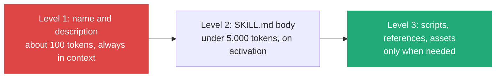

# 2. Rethinking skills for newer models: short descriptions, a router, no recipes, and a re-test on every model change

> OpenAI's guidance for GPT-6 generation models is to write skill descriptions as short as possible but clear about when to use the skill, keep the root file a router, drop recipes, ask-first language and test-running reminders, define completion up front, and revisit every instruction when the model changes; the skill specifications and Claude Code's limits explain why, and the advice is qualitative with no measurements.

Related: [01 Advanced prompt techniques](01_Advanced_Prompt_Techniques.md) · [05 Instructions: five parts and enforcement](05_Instructions_Five_Parts_And_Enforcement.md) · [06 Context window and compaction](06_Context_Window_And_Compaction.md) · [10 Evals and traces](draft_10_Evals_And_Traces_For_Agent_Changes.md) · [Lecture 2: 5 Skills](../Lecture_2_Context_Agents_md_Skills_Tools/5_skills.md) · [Lecture 3: 13 Knowledge skill anatomy](../Lecture_3_Simplify_Codebase_&_Knowledge_Base/13_Knowledge_Skill_Anatomy.md) · [Lecture 5: 05 Agents maintain the tools I review](../Lecture_5_Workflows_not_tool_sets/05_Agents_Maintain_The_Tools_I_Review.md) · [Lecture 5: 08 Skills as building blocks](../Lecture_5_Workflows_not_tool_sets/08_Skills_As_Building_Blocks.md)

Source: OpenAI's blog "Rethinking skills and prompts for GPT-6" (linked in S02E01, "Personality and Environmental Awareness"), read in full on 2026-11-15, no byline or date on the page. The Agent Skills specification, Claude Code skills docs, Anthropic's skill best practices and OpenAI's Codex skills page, read through fetch agents. See [Fact-check](#fact-check).

## Glossary

| Term | What it means here | Same thing elsewhere | Not to be confused with |
|---|---|---|---|
| Skill | A directory with a `SKILL.md` and optional scripts, references and assets | Agent Skills spec, Claude Code skill, Codex skill | A tool the model calls |
| Description | The frontmatter text that tells the model when to use the skill | Spec `description` (1 to 1,024 characters) | The skill body |
| Router skill | A short root `SKILL.md` that points to supporting files | OpenAI: "a minimal router" | A recipe that holds every step |
| Progressive disclosure | Metadata at startup, the body on activation, resources only when needed | Spec: three levels | Loading all at once |
| Skill listing | The names and descriptions the harness puts in context | Claude Code listing, Codex initial list | The loaded skill body |
| Overconstraining | Guidance so specific that a newer model does worse | OpenAI: "overly specific guidance can now hinder results" | A safety boundary |

## 1. The problem

My skills and AGENTS.md grew for older models. OpenAI says some of that now hurts. **What does the guidance say, what in the skill formats and harnesses makes it matter, and what do I change in my own skills?**

## 2. What OpenAI recommends

| # | Recommendation | Rationale given |
|---|---|---|
| 1 | Descriptions "as short as possible while making it clear when the model should use them" | Many installed skills get descriptions shortened. Broad ones trigger when they do not help |
| 2 | Descriptions that do not contradict or over-emphasize each other | The model loads instructions that do not help |
| 3 | Root document a "minimal router" to supporting docs and scripts | Reading a skill uses context and brings compaction closer |
| 4 | No elaborate itineraries or recipes | "overly specific guidance can now hinder results where it previously helped" |
| 5 | Write for other models too | Guidance for one model "may overconstrain" another |
| 6 | Revisit each AGENTS.md instruction | It applies to every task in the repo, so stale rules cost context |
| 7 | Point to docs by context, not before every edit | A pre-read stack is "excessive for a typo fix" |
| 8 | Drop reminders to run tests | The model does it, the reminders cause unnecessary testing |
| 9 | Allow named safe workflows without asking | The model can be tentative about how far to go |
| 10 | Define completion before starting, and where exploration stops | The model may return after a first implementation |

It also removes strong "ask first" language and a mandatory stop for review after the first implementation. The blog gives no benchmark, percentage or measurement, and says to audit instructions when changing models, even by asking the model itself.

## 3. The mechanics behind it



| Source | What it states |
|---|---|
| [Agent Skills spec](https://agentskills.io/specification) | `name` 1 to 64 characters, `description` 1 to 1,024. Metadata about 100 tokens, body under 5,000 tokens recommended, `SKILL.md` under 500 lines, references one level deep |
| [Claude Code](https://code.claude.com/docs/en/skills) | The listing cuts `description` plus `when_to_use` at 1,536 characters. A listing budget scales with the context window (1%, summary only) and drops the least-used descriptions first. An invoked skill stays in the conversation and after compaction the first 5,000 tokens of each are re-attached, 25,000 tokens in total. Put the key use case first |
| [Codex](https://learn.chatgpt.com/docs/build-skills) (summary only) | Names, descriptions and paths load first. The initial list is capped (2% of the window or 8,000 characters), and descriptions are shortened first |
| [Anthropic best practices](https://platform.claude.com/docs/en/agents-and-tools/agent-skills/best-practices) | "Claude is already very smart", so add only what it lacks. Third person, specific key terms, evals before documentation, test on every model you use |

So a long or broad description costs context on every run and can be truncated, and a long body costs again after every compaction.

## 4. Bad and good

```text
skill description
bad:  Use when working with databases, queries, models, or persistence.
good: short, names the trigger, e.g. "Use when changing the database schema or writing a migration."
AGENTS.md
bad:  Read all docs and the repo map before every edit.
good: Use architecture.md for service boundaries, database.md for schema changes,
      deployment.md when preparing a deployment.
```

The blog's own examples (good wording for the second one is quoted from it). My first line of the good description is my own wording.

## 5. What I take

- **Review each skill like code** ([Lecture 5: 05](../Lecture_5_Workflows_not_tool_sets/05_Agents_Maintain_The_Tools_I_Review.md)): description short and specific, root a router, no recipe, no ask-first line, no test reminder, completion defined.
- **Re-test on a model change**, with and without the instruction, on my golden set ([10](draft_10_Evals_And_Traces_For_Agent_Changes.md)). Anthropic says the same: test with every model I plan to use.
- **Remember the exceptions.** The same sources add explicit lines for unattended runs and keep important constraints, see [01](01_Advanced_Prompt_Techniques.md).
- **Cap the numbers I control:** descriptions under the smallest limit I deploy to (1,024 in the spec, 1,536 in the Claude Code listing), the body under 500 lines.

## Summary

For newer models skills get shorter: a precise description, a router body, details in files, no recipes and no reminders the model no longer needs. The formats' limits show why, and the evidence is qualitative, so I re-test each instruction when the model changes.

## Open questions

- Which of my skills have broad descriptions or recipe bodies that fail a with-and-without test?
- Which models read the same skills, and does each pass the golden set?

## Fact-check

| # | Claim | Verdict | Source | Checked |
|---|---|---|---|---|
| 1 | OpenAI recommends short descriptions, a router root, no recipes, defined completion, revisiting AGENTS.md | **Agrees** | [OpenAI blog](https://developers.openai.com/blog/rethinking-skills-and-prompts-for-gpt-6-astra), read in full. No byline, date or numbers | 2026-11-15 |
| 2 | Skill `name` max 64 and `description` max 1,024 characters | **Agrees** | [Spec](https://agentskills.io/specification), verbatim. Anthropic's docs state the same limits | 2026-11-15 |
| 3 | Body under 500 lines, about 100 tokens of metadata, body under 5,000 tokens | **Agrees** | Spec, verbatim | 2026-11-15 |
| 4 | Claude Code listing cuts description plus `when_to_use` at 1,536 characters | **Agrees** | [Claude Code skills](https://code.claude.com/docs/en/skills), verbatim. The 1% budget is summary only | 2026-11-15 |
| 5 | After compaction the first 5,000 tokens per skill come back, 25,000 in total | **Agrees** | Same page, verbatim | 2026-11-15 |
| 6 | Codex caps the initial skill list at 2% of the window or 8,000 characters | **Unverified** | [Codex page](https://learn.chatgpt.com/docs/build-skills): summary only, the old URL redirected to another host | 2026-11-15 |
| 7 | Guidance for one model can overconstrain another | **Agrees**, qualitative | OpenAI blog. [Anthropic](https://platform.claude.com/docs/en/agents-and-tools/agent-skills/best-practices): test on every model | 2026-11-15 |
| 8 | `anthropic` and `claude` are reserved in skill names | **Agrees** for Anthropic's docs | Not in the open spec | 2026-11-15 |

## Sources

- S02E01 article, "Personality and Environmental Awareness".
- [OpenAI: Rethinking skills and prompts for GPT-6](https://developers.openai.com/blog/rethinking-skills-and-prompts-for-gpt-6-astra) · [Agent Skills specification](https://agentskills.io/specification) · [Claude Code skills](https://code.claude.com/docs/en/skills)
- [Anthropic skill best practices](https://platform.claude.com/docs/en/agents-and-tools/agent-skills/best-practices) · [Codex build skills](https://learn.chatgpt.com/docs/build-skills)
- My own reasoning: the review list in section 5.
