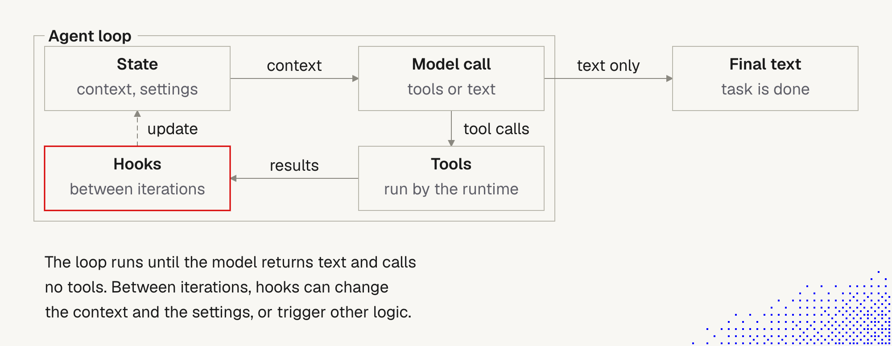
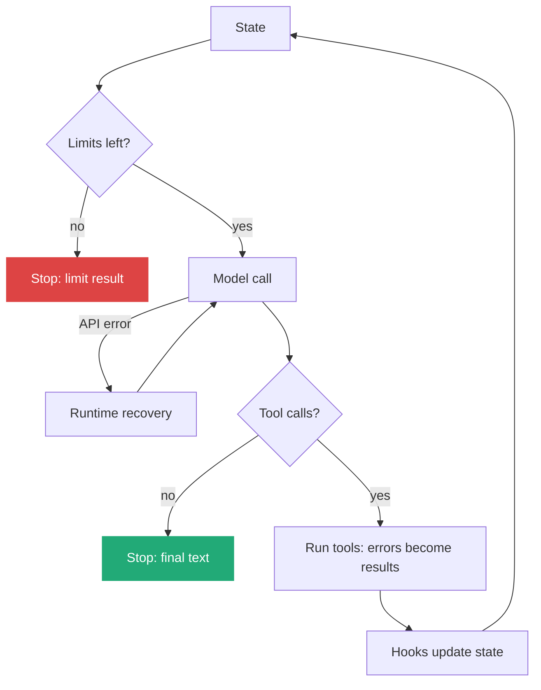

# 3. The agent loop is the easy part: exits, limits and recovery make it safe

> A loop that ends when the model returns no tool calls is correct but not production-safe: I add a routing function with more than one exit, a hard step cap, a budget, error recovery and a named result for every way a run ends, all as runtime code outside the model.

Related: [18 The harness around the loop](18_Harness_Around_The_Loop.md) · [19 Pi, LangGraph and the DeepSeek paper](19_Pi_LangGraph_DeepSeek_Harnesses.md) · [20 Loop hooks declared](20_Loop_Hooks_Declared.md) · [21 AI SDK or official SDKs](21_AI_SDK_Or_Official_SDKs.md) · [17 Extend, adjust or leave the framework](17_Extend_Adjust_Or_Leave_The_Framework.md) · [04 HITL and execution isolation](04_HITL_And_Execution_Isolation.md) · [14 Tool approval, durable waits](14_Tool_Approval_Durable_Waits.md) · [15 Evals and traces](16_Evals_For_Agent_Changes.md) · [Lecture 2: 12 Subagents vs workers](../Lecture_2_Context_Agents_md_Skills_Tools/12_subagents_vs_workers.md)

Source: S02E01 article "Agentic Loop" (figures 2, 3, 5, 6) and the transcript demo (step limit, trace; worked example only). Primary docs read 2026-11-15, see [Fact-check](#fact-check).

## Glossary

| Term | What it means here | Same thing elsewhere | Not to be confused with |
|---|---|---|---|
| Step / turn | One model call, which may request several tools | - | One tool call |
| Super-step | One LangGraph tick: every ready node runs once. `recursion_limit` counts these | - | A model call. A ReAct round is about two |
| Stop condition | The rule that ends a run normally | - | A limit, which ends it abnormally |
| Result type | The named outcome: success, max turns, max budget, error | SDK `ResultMessage` subtype | The final text |
| Routing function | `should_continue`: picks the next node or `END` after the model node | LangGraph conditional edge, Pi `finishTurn` | - |
| Idempotent retry | Repeat only work with no side effect | Claude Code: no retry after a completed tool call | - |
| Checkpoint | Graph state saved at a super-step boundary | LangGraph checkpointer | - |
| Retryable fault | An error class the runtime may retry: 429, 503, timeout, incomplete reply | Claude Code retries transient failures only | A non-retryable fault such as 401 |

## 1. The problem

The lecture says an agent runs until the model "decides not to use any tools and instead returns text". That is the happy path. **Which mechanisms turn it into a run I can leave unattended, and which belong to the runtime and not the prompt?**

## 2. The loop and its exits

Source: S02E01 article, figure 2. Lecturer: the loop "runs until the model returns text and calls no tools. Between iterations, hooks can change the context and the settings, or trigger other logic."

The figure shows the one exit the model controls. A runtime adds exits it does not:

**`should_continue`.** LangGraph does not ask a yes-or-no question. It attaches a routing function to the model node as a conditional edge. The documented quickstart body returns the tool node if the last message has tool calls and `END` otherwise ([quickstart](https://docs.langchain.com/oss/python/langgraph/quickstart)). The function may return a node name, `END`, a list of names (run in parallel in the next super-step) or `Send` objects, and `Command` combines a state update with the route ([graph API](https://docs.langchain.com/oss/python/langgraph/graph-api)). So the exit is n-way:

| Return | Routes to |
|---|---|
| Tool node / `END` | Tool calls pending / final text |
| Compaction node | Context near the limit |
| Human review node | Next tool call needs approval |
| Retry node / limit exit | Last call failed / a cap was hit |

Pi has the same idea without a graph: a `finishTurn` hook can force `"end"` or `"continue"` ([agent-loop.ts](https://github.com/earendil-works/pi/blob/main/packages/agent/src/agent-loop.ts)). The article does not say why it omits the routing function. Simplification and avoiding LangGraph vocabulary are both guesses.

## 3. Step limit: a cap the model cannot argue with

The runtime enforces it and ends the run with a named result.

| Runtime | Limit | Default | When it hits |
|---|---|---|---|
| Mastra (demo) | `maxSteps` | 5 in the demo | Run ends after five model steps |
| Claude Agent SDK | `max_turns`, `max_budget_usd` | None | `error_max_turns` or `error_max_budget_usd`, no final text |
| LangGraph | `recursion_limit` | Python 10,007 super-steps (1.1.4+). The JS docs say 25 | `GraphRecursionError` |
| Semantic Kernel | Max auto-invoke attempts, filter `Terminate` | Per connector, unverified | Auto-invocation stops |
| Goose | `GOOSE_MAX_TURNS`, `GOOSE_SUBAGENT_MAX_TURNS` | 1000, 25 (unverified) | Stops and asks the user |
| Pi | None in `agent-loop.ts` | None | Caller or hook |

- **Units differ.** Model turns, super-steps, turns per user input: a "limit of 25" is not portable.
- **Defaults are not safety limits.** 10,007 and "no limit" need my own cap. Mine: an explicit `recursion_limit` of 200 and a confirmation from the user before the run continues (my practice, not a default). LangGraph can route before the limit with `RemainingSteps`, or catch `GraphRecursionError` after it.
- **A limit needs a result type**, or I cannot tell a finished run from a stopped one.

## 4. Budget, deadline and who owns the cap

- **Budget.** The Agent SDK cap includes subagent spend, is checked after a response (spend can pass it by one) and blocks new subagents once reached.
- **No wall-clock.** The hosting guide lists no top-level session timeout and no per-subagent deadline. I add a deadline in the host.
- **Custom caps** (cost, repeated call, deadline) belong in a Semantic Kernel filter, a LangGraph routing function or a Pi hook. `recursion_limit` is the backstop.

## 5. Error recovery: three layers, three owners

Article figure 5: model call 2 gets an API error, "no path for the error", the task stops mid-turn.

| Layer | Failure | Safe handling | Owner |
|---|---|---|---|
| Transport | 5xx, 529, timeout, temporary 429 | Retry with backoff and jitter | Runtime |
| Run | Process dies, wait of days | Resume from persisted state, see [04](04_HITL_And_Execution_Isolation.md) | Runtime and storage |
| Tool | Throws, bad arguments, denied | Return an error result to the model | Loop |

- **Claude Code:** up to 10 retries with backoff, none after a completed text block or tool call; `CLAUDE_CODE_RETRY_WATCHDOG=1` retries 429 and 529 indefinitely ([errors](https://code.claude.com/docs/en/errors)).
- **Pi:** tool failure becomes a result with `isError: true`; an `error` stop ends the run, retry lives below.
- **LangGraph:** `RetryPolicy` per node (3 attempts, 0.5 s, factor 2.0, max 128 s, jitter) plus a checkpointer ([fault tolerance](https://docs.langchain.com/oss/python/langgraph/fault-tolerance)).
- **Semantic Kernel:** no loop retry; use connector resilience and a filter.

My rule: **retry only what is idempotent.** A failed model call is safe to repeat, a completed tool call with a side effect is not.

**Worked example: the lecturer's `loop-error-recovery`.** A night-audit agent records inventory (step 1) and billing (step 2) through one tool and then answers (step 3). One seeded fault hits step 2, once. Three modes compare ([example](https://github.com/MEGA-DOT-DEV/examples/tree/main/examples/loop-error-recovery), all files read by a fetch agent):

| Mode | What it does | Effect of the fault |
|---|---|---|
| unhandled | No handler | The run stops at step 2 |
| retry | Resend the same input, at most 2 retries (`MAX_ATTEMPTS = 3`), backoff 25 ms then 50 ms (cap 200), no jitter | Step 1 runs again, so its input tokens are sent again |
| resume | Retry plus the conversation saved after each tool result (in memory in the demo) | Step 1 is skipped |

Retryable: 429, 503, timeout, incomplete reply (`max_output_tokens`), invalid tool arguments. Not retryable: other HTTP statuses such as 401, a wrong check order, unknown errors. The attempt counter resets after each successful step. 429, 503 and timeout are thrown before the request and cost no tokens. An incomplete or malformed reply costs a real request.

Against my notes: the example covers the transport and run layers only. The error is not fed back to the model as a tool result. It has no idempotency guard, which is safe only because `record_check` has no external side effect. A tool with a side effect needs my rule above. The file-based resume is the lecturer's `resumable-run` example (not read), see [14](14_Tool_Approval_Durable_Waits.md).

## Summary

The stop condition ends a correct run. A routing function with several exits, a step cap and budget I set myself, a deadline in the host, three recovery layers and a named result per exit make it safe.

## Fact-check

| # | Claim | Verdict | Source | Checked |
|---|---|---|---|---|
| 1 | Pi's loop runs while tool calls exist | **Agrees**, with nuance | [agent-loop.ts](https://github.com/earendil-works/pi/blob/main/packages/agent/src/agent-loop.ts), full file read via fetch agent: `while (hasMoreToolCalls \|\| pendingMessages.length > 0)`; also `finishTurn`, `terminate`, error and abort exits | 2026-11-15 |
| 2 | Goose uses the same loop | **Unverified** | Loop source not read. [Goose repo](https://github.com/aaif-goose/goose) | 2026-11-15 |
| 3 | The loop ends when the model returns no tool calls | **Agrees** | [Agent SDK loop](https://code.claude.com/docs/en/agent-sdk/agent-loop) | 2026-11-15 |
| 4 | Claude Code recovers from API errors | **Agrees** | [errors](https://code.claude.com/docs/en/errors), first 100,000 characters read | 2026-11-15 |
| 5 | Codex recovers the same way | **Unverified** | No Codex retry docs found | 2026-11-15 |
| 6 | A step is one model call that may request several tools | **Agrees** (SDK), **Differs** (LangGraph) | Agent SDK loop page; LangGraph counts super-steps | 2026-11-15 |
| 7 | `recursion_limit` default 10,007 since 1.1.4, `GraphRecursionError` | **Agrees** for Python, **Differs** in the JS docs | Source code `libs/langgraph/langgraph/_internal/_config.py`: `getenv("LANGGRAPH_DEFAULT_RECURSION_LIMIT", "10007")`, read in full. [Python graph API](https://docs.langchain.com/oss/python/langgraph/graph-api): 10,007 from 1.1.4, 10,000 for 1.0.6 to 1.1.3. [JS graph API](https://docs.langchain.com/oss/javascript/langgraph/graph-api): "The default is 25 super-steps", no version given. A default of 200 was not found in any source I read | 2026-11-15 |
| 8 | Agent SDK has no default turn or budget cap | **Agrees** | Agent SDK loop page, table "Turns and budget" | 2026-11-15 |
| 9 | Semantic Kernel default auto-invoke attempts is 128 | **Unverified** | Issue mirror only; [filters page](https://learn.microsoft.com/en-us/semantic-kernel/concepts/enterprise-readiness/filters) confirms counters and `Terminate` | 2026-11-15 |
| 10 | Goose `GOOSE_MAX_TURNS` 1000, subagent 25 | **Unverified** | [Goose env vars](https://block.github.io/goose/docs/guides/environment-variables), search summary | 2026-11-15 |
| 11 | Retry only before a tool call completed | **Agrees** | Claude Code errors page | 2026-11-15 |
| 12 | A parent cap bounds a multi-agent run | **Differs** | Budget includes subagents; no per-subagent wall-clock ([hosting](https://code.claude.com/docs/en/agent-sdk/hosting)) | 2026-11-15 |
| 13 | The loop is a yes-or-no check | **Differs**, simplification | [quickstart](https://docs.langchain.com/oss/python/langgraph/quickstart), [graph API](https://docs.langchain.com/oss/python/langgraph/graph-api): routing returns a node, `END`, a list or `Send` | 2026-11-15 |
| 14 | Retry with backoff and a saved conversation lets a run finish after a fault | **Agrees** | [loop-error-recovery](https://github.com/MEGA-DOT-DEV/examples/tree/main/examples/loop-error-recovery): `MAX_ATTEMPTS = 3`, 25 ms then 50 ms, no jitter, resume skips step 1. Seeded faults, not real outages. No idempotency guard | 2026-11-15 |

## Sources

- S02E01 article figures 2, 3, 5, 6; transcript step-limit and trace segments.
- [Pi agent-loop.ts](https://github.com/earendil-works/pi/blob/main/packages/agent/src/agent-loop.ts) · [Agent SDK loop](https://code.claude.com/docs/en/agent-sdk/agent-loop) · [errors](https://code.claude.com/docs/en/errors) · [hosting](https://code.claude.com/docs/en/agent-sdk/hosting)
- [LangGraph graph API](https://docs.langchain.com/oss/python/langgraph/graph-api) · [fault tolerance](https://docs.langchain.com/oss/python/langgraph/fault-tolerance)
- [Semantic Kernel filters](https://learn.microsoft.com/en-us/semantic-kernel/concepts/enterprise-readiness/filters) · [Goose env vars](https://block.github.io/goose/docs/guides/environment-variables)
- [loop-error-recovery example](https://github.com/MEGA-DOT-DEV/examples/tree/main/examples/loop-error-recovery) (`recovery.ts`, `index.ts`, README)
- My own reasoning: the three recovery layers, the idempotency rule, the units warning.
