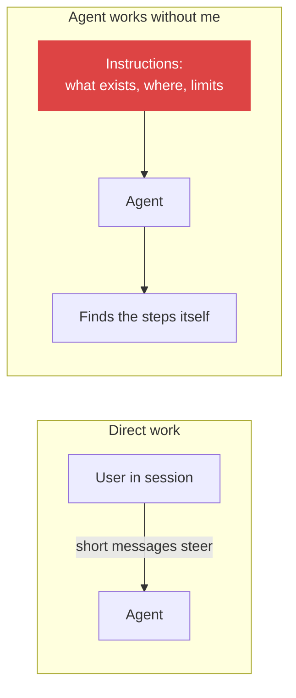
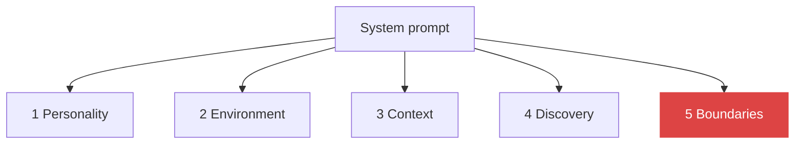
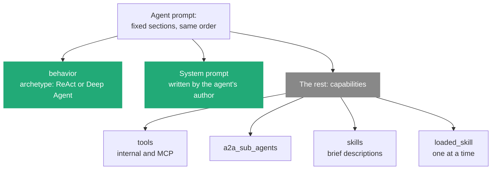
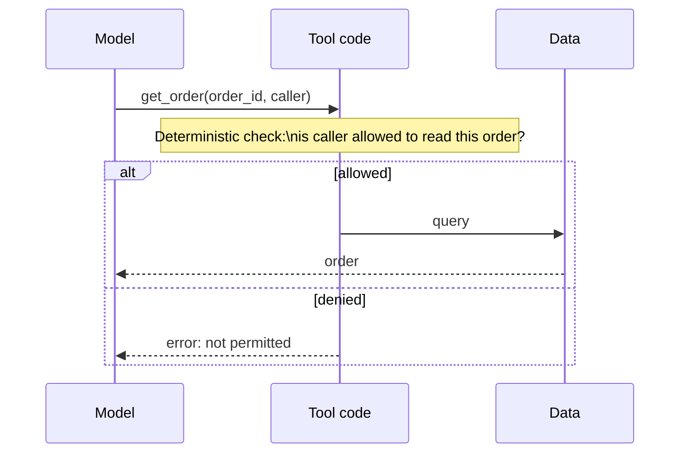
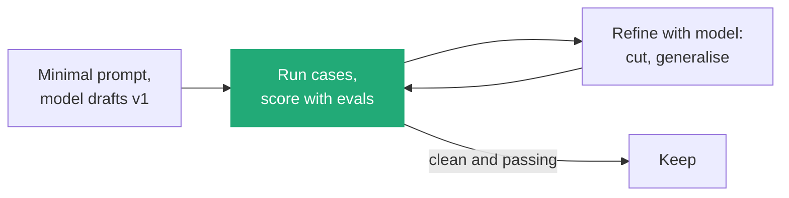

# 3. Instructions: five parts, and what code must enforce

> The system prompt tells the agent who it is, where it works, what exists, how to look and what is off limits, but only the first four are guidance I can rely on; every boundary that matters must also be enforced in code, because the model may ignore a prompt.

Related: [00 Modern system prompts](draft_00_Modern_System_Prompts.md) · [04 Context window and compaction](draft_04_Context_Window_And_Compaction.md) · [06 Tools: awareness, discovery, gateway](draft_06_Tools_Awareness_Discovery_Gateway.md) · [07 Tool approval, durable waits](draft_07_Tool_Approval_Durable_Waits.md) · [08 Evals and traces for agent changes](draft_08_Evals_And_Traces_For_Agent_Changes.md) · [01 Agent loop, stop, limits, recovery](01_Agent_Loop_Stop_Limits_Recovery.md) · [Lecture 4: 05 Don't overspecify](../Lecture_4_Harness/05_Dont_Overspecify_Work_At_Assistants_Level.md) · [Lecture 2: 5 Skills](../Lecture_2_Context_Agents_md_Skills_Tools/5_skills.md) · [Lecture 2: 4 Context window](../Lecture_2_Context_Agents_md_Skills_Tools/4_context_window.md)

Source: S02E01 article "Personality and Environmental Awareness" and "Agentic Loop" (Context), takeaways; S02E01 transcript (retail-agent demo, used only as a worked example); the layout in section 4 is my own platform design. Vendor docs read on 2026-11-15, see [Fact-check](#fact-check).

## Glossary

| Term | What it means here | Same thing elsewhere | Not to be confused with |
|---|---|---|---|
| Instructions | Text sent to the model on every call (system or developer message) | - | A skill or AGENTS.md body, which the model loads or reads later |
| Boundary | A thing the agent must not do | - | An enforced permission. A boundary written in a prompt is a request |
| Enforcement | A check in code, a hook or a sandbox that runs whether or not the model agrees | - | A guardrail model, which is still a probabilistic check |
| Unattended agent | An agent with no human in the session (automation, background job, app logic) | - | An interactive coding session |
| Archetype | The loop pattern an agent follows: ReAct or Deep Agent | `langchain.agents.create_agent`, `create_react_agent` (older), `create_deep_agent` | - |
| ReAct | A loop where the model reasons, calls a tool, reads the result and repeats | Paper: [ReAct, arXiv 2210.03629](https://arxiv.org/abs/2210.03629) | - |
| Deep Agent | A ReAct-style loop with planning, sub-agents and a filesystem added | LangChain Deep Agents (search summary: verify before presenting) | - |
| Tagged chapter | One prompt concern wrapped in an XML-like tag | Anthropic: XML tags per content type | - |
| Layering | A base prompt plus the author's domain prompt, concatenated | Deep Agents: `system_prompt` appended to the base prompt | - |
| Loaded skill | The body of the single skill currently in context | A skill after invocation, as against the skill list with descriptions | - |
| Static prefix | The part of the prompt identical between calls | Cache prefix, see [17](17_KV_Cache_And_Prompt_Caching.md) | - |

## 1. The problem

Models follow short messages well, and a harness vendor just cut most of its own system prompt. So what still belongs in the instructions of an agent I build, and what must not live there at all? The line I need: **guidance goes in the prompt, guarantees go in code.**

## 2. Why instructions matter most when no human is present

An interactive user corrects the agent with a short message. An automation has nobody to do that, so the instructions carry everything the human would have said.

The lecturer: harnesses "set a solid system prompt so users can speak with agents more naturally", and once I build my own automations "we become the ones who need to craft that prompt". Anthropic's own guide for unattended agents agrees on the mechanism: a text-only end of turn can stop an unattended loop, so the guide adds a system prompt paragraph for unattended runs and keeps a separate confirmation step for risky actions ([Prompting Opus 5.5](https://platform.claude.com/docs/en/build-with-claude/prompt-engineering/prompting-claude-opus-5-5#unattended-agentic-runs)). Both a prompt and a harness check appear in the same recommendation.

## 3. The five parts

The lecture splits a system prompt into five blocks. This split is the lecturer's, not a vendor standard.

| Part | What it answers | Worked example (abstract) | Failure when missing |
|---|---|---|---|
| Personality | Who am I, whom do I serve | "You are an internal operations agent for the support team" | Wrong tone, wrong assumptions about the reader |
| Environment | Why do I exist, is a human reachable | "No human is available. Do not ask questions, make the safest choice and report it" | Stops to ask, or stops after a progress note |
| Context | What resources exist, or where to find them | "Order data: `orders` tool. Policies: `/policies/` folder" | Claims it cannot do things it can |
| Discovery | How to explore the harness capabilities | "Search tools before saying a capability is missing. Open the process doc fully" | Skips steps of a process because the doc was badly organised |
| Boundaries | What I must not do | "Never read another customer's order" | Only a recommendation, see section 5 |

Compared with vendor guides: Anthropic's and OpenAI's current guides give task-specific patterns (effort, unattended runs, exploring context in multiapp workflows) and not a five-block template. Two of them match the lecture directly:

- Context and Discovery: Anthropic gives a one-sentence system prompt line, "Before taking any action, explore broadly with tool calls ...", and reports more correct runs on multiapp automation tasks ([Prompting Opus 5.5](https://platform.claude.com/docs/en/build-with-claude/prompt-engineering/prompting-claude-opus-5-5#explore-context-in-multi-app-workflows)).
- Boundaries: OpenAI warns that strong "ask first" language written for older models can make a newer model stop where I would be happy for it to continue ([Rethinking skills and prompts](https://developers.openai.com/blog/rethinking-skills-and-prompts-for-gpt-6-astra)). A boundary written in prompt text has a cost in both directions.

## 4. My layout: tagged chapters in a fixed order

The five parts say what a prompt must cover. My layout says where each part lives: one tagged chapter per concern, the same sections in every agent, so a problem has one location.

| Chapter (XML-like tag) | Holds | What changes it per agent |
|---|---|---|
| `<behavior>` | How the loop behaves for the archetype | The archetype: ReAct or Deep Agent |
| System prompt | Personality, environment, boundaries | The sections the agent's author writes |
| `<tools>` | Internal tools and MCP tools, each with a brief description of what it does and when to call it | Which tools are enabled |
| `<a2a_sub_agents>` | Sub-agents reachable over A2A, brief descriptions | Which sub-agents are enabled |
| `<skills>` | The skill list, a brief description each | Which skills are enabled |
| `<loaded_skill>` | The body of the one skill in use, up to 5,000 characters (my platform's limit) | The task |

My mapping of the five parts: personality, environment and boundaries sit in the system prompt chapter, context and discovery sit in the capability chapters as short descriptions, and the loop's behaviour sits in `<behavior>`. The agents differ in three ways only: the author's sections, the archetype, and the enabled capabilities. Everything else is fixed.

What industry sources say:

- **Tags.** Anthropic recommends XML tags for prompts that mix instructions, context, examples and inputs, with a separate tag per content type and consistent, descriptive names ([Prompting best practices](https://platform.claude.com/docs/en/build-with-claude/prompt-engineering/claude-prompting-best-practices)). It gives no comparison against Markdown. OpenAI's guide uses Markdown headers for sections and XML to mark where reference content starts and stops ([Prompt engineering](https://developers.openai.com/api/docs/guides/prompt-engineering)). A format study finds large effects that vary by task and model, with no universal winner, on 2024 OpenAI models only ([arXiv 2411.10541](https://arxiv.org/abs/2411.10541)). So tags are well supported, and "tags beat Markdown" is not a vendor-neutral rule.
- **My own observation.** On a smaller model (GPT-5.4-mini) switching from Markdown headers to tags improved results. On GPT-6 Luna the difference is minor. I recorded no numbers, and the model names are as I use them. This is a practitioner observation, not a published result.
- **Layering.** The Deep Agents library appends the author's `system_prompt` to its built-in base prompt, so the author writes only the domain part ([create_deep_agent](https://reference.langchain.com/python/deepagents/graph/create_deep_agent)). `create_react_agent` takes the author's prompt as the whole system message. My `<behavior>` chapter plays the role of that base layer.
- **Skills.** One loaded skill at a time and 5,000 characters are my platform's choices. Claude Code differs: it can hold several skills and re-attaches them after compaction with a cap of 5,000 tokens per skill and 25,000 in total (see [04](draft_04_Context_Window_And_Compaction.md)).

## 5. Boundaries: recommendation in the prompt, rule in code

The prompt reaches the model. The tool code reaches the data. Only the second one can refuse.

The transcript demo does exactly this: the access check sits in the tool, not in the prompt, because the rules are already known, the check needs no extra model call, and a wrong answer has one place to debug. The presenter also says plainly: "Instructions don't guarantee that the model will" follow them. Claude Code docs say the same about its own files: CLAUDE.md is "context, not enforced configuration", and to block an action regardless of what Claude decides I use a PreToolUse hook ([Memory](https://code.claude.com/docs/en/memory.md)).

| Control | Strength | Where it lives |
|---|---|---|
| Boundary sentence in the prompt | Recommendation | Instructions |
| Tool argument validation, authorization in tool code | Guarantee | Tool implementation |
| Pre-tool hook, permission rules | Guarantee | Harness |
| Sandbox, per-user workspace, scoped credentials | Guarantee | Infrastructure |
| Approval before an irreversible action | Guarantee, with a wait | [07](draft_07_Tool_Approval_Durable_Waits.md) |

Architect mapping: in LangGraph this is a node or tool wrapper that checks `state` and the caller identity before it runs, plus `interrupt` for approval. In Semantic Kernel it is a function invocation filter (`IFunctionInvocationFilter`) that can cancel or replace the result. I keep the prompt sentence as well, because it lowers how often the model hits the wall, but the wall is the control.

## 6. Start simple, then iterate with evals

The lecturer: start with minimal instructions or let a model draft the first version, then the goal is to make it "right": clean, well generalised, only what is needed, using an iterative loop with verification or evals.

This agrees with vendor advice: Anthropic says to test effort levels "against your own evals rather than carrying over the setting" from the previous model, and OpenAI says to revisit AGENTS.md entries as the model improves. Details of the eval loop are in [08](draft_08_Evals_And_Traces_For_Agent_Changes.md).

## 7. The 80% claim, read at the source

The lecture says Claude Code "had 80% of its system prompt removed for the latest models" and implies clear instructions may even degrade the model. The source ([Thariq Shihipar, Anthropic, 2026-07-24](https://claude.dev/blog/the-new-rules-of-context-engineering-for-claude-5-generation-models/)) says something narrower: "We removed over 80% of Claude Code's system prompt" for models like Claude Opus 5 and Claude Fable 5, "with no measurable loss on our coding evaluations". It names no evaluation, number or score. What went out: strict rules (a no-comments rule became "match the surrounding code"), tool-usage examples and repeated tool references, while step-by-step procedures moved into skills. Its thesis is that the team was overconstraining the model, and it keeps constraints "in highly important areas". It does not say instructions are irrelevant or hurt performance. The [Opus 5.5 prompting guide](https://platform.claude.com/docs/en/build-with-claude/prompt-engineering/prompting-claude-opus-5-5) points the other way for unattended agents: it recommends explicit system-prompt lines for unattended runs. The result covers one coding harness, so I check my own prompt with my own evals. The article's context rules are in [04](draft_04_Context_Window_And_Compaction.md).

## Summary

The five parts (personality, environment, context, discovery, boundaries) are a useful checklist, not a standard. Instructions matter most for unattended agents because no human fills the gaps. Boundaries in text are requests: authorization, limits and approvals go into tool code, hooks and infrastructure. I start with a short prompt and shorten it further only when my evals show no loss. In my own agents the prompt is a fixed set of tagged chapters, so each concern has one place.

## Open questions

- Do the static chapters come before the per-run chapters so the cache prefix stays stable?
- Does an experiment of tags against Markdown on my golden set reproduce the gain I saw on the small model?
- Which boundaries in my agents are only prompt text today, and what would the code check for each one look like?

## Fact-check

| # | Claim | Verdict | Source | Checked |
|---|---|---|---|---|
| 1 | Claude Code had 80% of its system prompt removed for the latest models | **Agrees, narrower than implied.** Over 80% removed for Opus 5 and Fable 5, no measurable loss on coding evals, no eval named, no numbers. The article does not say instructions are irrelevant or harmful | [claude.dev blog](https://claude.dev/blog/the-new-rules-of-context-engineering-for-claude-5-generation-models/), 2026-07-24, read in full via fetch (14,129 characters) | 2026-11-15 |
| 2 | A five-part prompt (personality, environment, context, discovery, boundaries) | **Lecture-specific** | Not a vendor template. Vendor guides give task patterns, see [Anthropic](https://platform.claude.com/docs/en/build-with-claude/prompt-engineering/prompting-claude-opus-5-5) and [OpenAI](https://developers.openai.com/blog/rethinking-skills-and-prompts-for-gpt-6-astra) | 2026-11-15 |
| 3 | Unattended agents need explicit instructions about their environment | **Agrees** | Anthropic guide section "Unattended agentic runs" and "Explore context in multiapp workflows" | 2026-11-15 |
| 4 | A boundary in the prompt is only a recommendation | **Agrees** | Claude Code memory docs: "context, not enforced configuration", use a PreToolUse hook to block. Transcript: "Instructions don't guarantee" | 2026-11-15 |
| 5 | Start simple, iterate with evals | **Agrees** | Anthropic guide (test against own evals), OpenAI article (revisit entries as models improve) | 2026-11-15 |
| 6 | Latent Space Activation: prompting is getting the model to recall relevant knowledge before it answers | **Unverified** | The [repo](https://github.com/daveshap/latent_space_activation) exists. Its README (read via fetch summary) shows the idea as an example dialog ("What do I know about Rome that is relevant?") and gives no definition of prompting. The one-line summary is the lecturer's. Verify before presenting | 2026-11-15 |
| 7 | Anthropic recommends XML tags to structure prompts | **Agrees** | [Prompting best practices](https://platform.claude.com/docs/en/build-with-claude/prompt-engineering/claude-prompting-best-practices), search summary of the page | 2026-11-15 |
| 8 | XML tags are slightly better than Markdown headers | **Unverified** as a general claim | No vendor comparison found. My own observation on a small model, no recorded numbers | 2026-11-15 |
| 9 | The tag advice holds for every vendor | **Differs** | OpenAI uses Markdown for sections and XML for reference content ([guide](https://developers.openai.com/api/docs/guides/prompt-engineering), search summary). [arXiv 2411.10541](https://arxiv.org/abs/2411.10541): no universal best format, 2024 OpenAI models only, preprint, search summary | 2026-11-15 |
| 10 | A base prompt plus the author's prompt is an established layering | **Agrees** | [create_deep_agent](https://reference.langchain.com/python/deepagents/graph/create_deep_agent), search summary. Parameter names for `create_react_agent` are changing: verify before presenting | 2026-11-15 |
| 11 | One loaded skill at a time, up to 5,000 characters | **Lecture-specific**: my platform's design | Not a vendor rule. Claude Code allows several skills, with a re-attach cap in tokens | 2026-11-15 |

## Sources

- S02E01 article and transcript (local files). The mapping to LangGraph and Semantic Kernel filters is my own reasoning.
- [Prompting Claude Opus 5.5](https://platform.claude.com/docs/en/build-with-claude/prompt-engineering/prompting-claude-opus-5-5)
- [Rethinking skills and prompts for GPT-6](https://developers.openai.com/blog/rethinking-skills-and-prompts-for-gpt-6-astra)
- [The new rules of context engineering](https://claude.dev/blog/the-new-rules-of-context-engineering-for-claude-5-generation-models/)
- [Claude Code: How Claude remembers your project](https://code.claude.com/docs/en/memory.md)
- [Anthropic: Prompting best practices](https://platform.claude.com/docs/en/build-with-claude/prompt-engineering/claude-prompting-best-practices), [OpenAI: Prompt engineering](https://developers.openai.com/api/docs/guides/prompt-engineering), [arXiv 2411.10541](https://arxiv.org/abs/2411.10541), [LangChain create_deep_agent](https://reference.langchain.com/python/deepagents/graph/create_deep_agent). Section 4 is my own layout and observations.
- [Latent Space Activation](https://github.com/daveshap/latent_space_activation)
