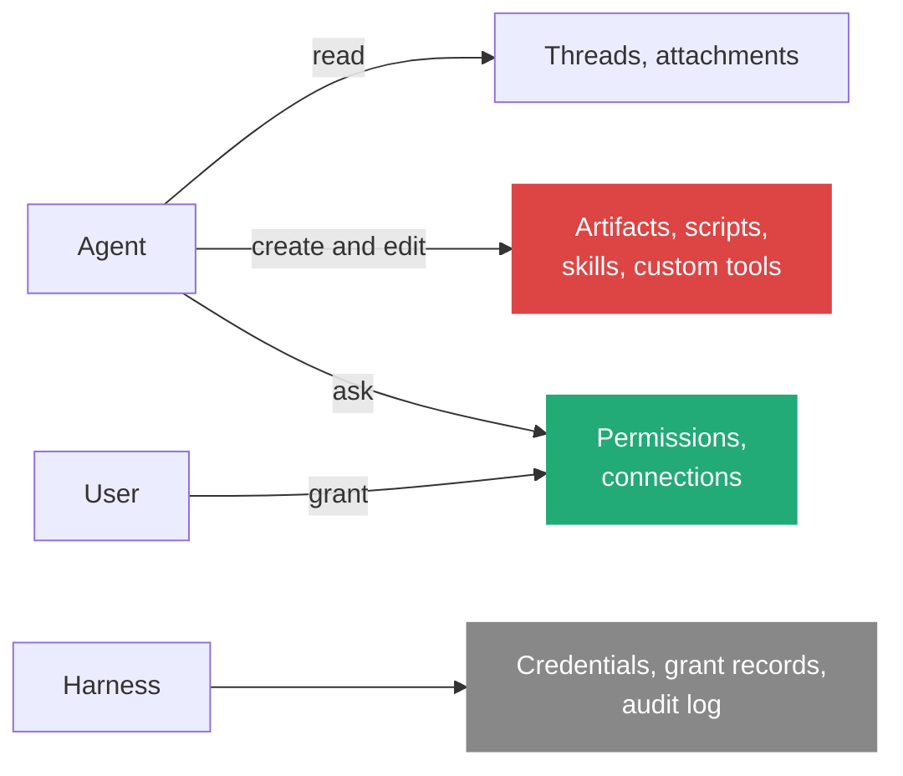
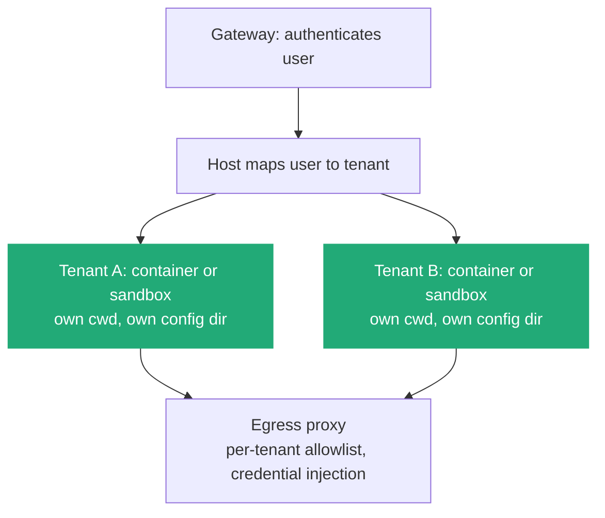

# 4. What a harness stores, who may touch it, and how users are kept apart

> A harness persists threads, artifacts, permissions and more, and each kind needs its own access rule (agent reads, agent writes, user grants); once more than one user shares the runtime, the filesystem is not a boundary, so isolation has to be enforced by the sandbox and the host, not by the agent.

Related: [22 Threads, subagents and A2A](22_Threads_Vs_A2A_Subagents.md) · [03 Agent loop, limits and recovery](03_Agent_Loop_Stop_Limits_Recovery.md) · [05 Instructions: five parts and enforcement](05_Instructions_Five_Parts_And_Enforcement.md) · [10 Memory: extraction and retrieval](10_Memory.md) · [14 Tool approval and durable waits](14_Tool_Approval_Durable_Waits.md) · [Lecture 4: 04 Computers.md fleet infrastructure](../Lecture_4_Harness/04_Computers_md_Fleet_Infrastructure.md) · [Lecture 4: 07 Multi-agent coordination](../Lecture_4_Harness/07_Multi_Agent_Coordination.md) · [W2L3 04 Workspaces and code sandboxes in frameworks](../Week2_Lecture_3_MCP_MCP+Resources_Skills/04_Workspaces_And_Code_Sandboxes_In_Frameworks.md)

Source: S02E01 article, sections "Threads and sessions" and "Persistence" (figures 8, 10; figure 7 is in [22](22_Threads_Vs_A2A_Subagents.md)). S02E01 transcript only for the worked example of a deterministic access check inside a tool. Claude Agent SDK hosting and sandboxing docs, Pi session docs, LangGraph persistence docs checked on 2026-11-15, see [Fact-check](#fact-check).

## Glossary

| Term | What it means here | Same thing elsewhere | Not to be confused with |
|---|---|---|---|
| Thread | The record of one interaction line: messages, tool calls, results. Can span several sessions | - | A process or an OS thread |
| Session | One continuous run of the harness on a thread, from start to exit | - | A thread. One thread has many sessions |
| Checkpoint (LangGraph) | A snapshot of graph state at a super-step, keyed by `thread_id` | - | A saved file the agent can read |
| Store (LangGraph) | Cross-thread key-value memory with namespaces | - | A checkpointer. The checkpointer is per thread |
| Harness-only state | Stored state the agent can neither read nor write: credentials, grant records, audit log (a ledger in graph state: [12](12_Memory_Audit_Ledger_In_Memory_Or_State.md)) | Secrets injected by an egress proxy; service session IDs kept in trusted storage (Microsoft) | Agent-readable state |
| Sandbox | An OS-enforced boundary around code the agent runs | - | A permission rule. Rules decide, the sandbox enforces |
| Workspace | The directory (or volume) one user or task works in | - | The sandbox. A workspace is data, a sandbox is a wall |

## 1. The problem

On my laptop an agent reads and writes my files freely, and that is fine. In a team or production product the same agent serves many users from one runtime. **What does the harness have to persist, who is allowed to read, write or grant each kind of state, and what keeps user A's data away from user B's agent?**

## 2. Where threads are stored

The article: history "is often stored in text files agents can easily read using **bash**". What a thread is, and how subagent threads differ from A2A peers, is in [22](22_Threads_Vs_A2A_Subagents.md).

How the real systems store it:

| System | Thread unit | Where it lives | Subagent thread |
|---|---|---|---|
| Claude Code / Agent SDK | Session, resumable by ID, forkable | JSONL transcripts under `~/.claude/projects/` (or `CLAUDE_CONFIG_DIR`), one process per session | Separate transcript file per subagent. Community docs describe `subagents/agent-<id>.jsonl`, verify before presenting |
| Pi | Session file, tree of entries linked by `id` and `parentId` | JSONL under `~/.pi/agent/sessions/`, grouped by working directory ([session format](https://docs.pi.dev/latest/session-format)) | Not described in the docs I read |
| LangGraph | `thread_id` in `config["configurable"]`, primary key for checkpoints | Checkpointer backend (SQLite, Postgres, Redis) | Subgraph checkpointer mode: per-invocation (default), per-thread or stateless |
| Semantic Kernel | `ChatHistory` object or an agent thread abstraction | In memory unless I persist it | My own design |

Two architect points:

- **Files are a design choice, not a law.** The lecture says history is "often stored in text files agents can easily read using **bash**". That is true for Claude Code and Pi and it gives the agent cheap self-inspection and search. LangGraph and SK keep state in a database or in objects, which is better for multi-host runs but needs a tool to expose history to the agent. The lecture adds "**not every harness** supports subagents and easy access to threads", which is a fair warning.
- **Local disk is ephemeral in production.** The Agent SDK hosting guide says transcripts, `CLAUDE.md` memory and working-directory artifacts live on the container filesystem and "none of them survive a container restart, a scale-down, or a move to a different node". Transcripts need a `SessionStore` adapter. The store mirrors transcripts only, not memory files or artifacts.

## 3. What else is persisted, and who may touch it

The article names more than threads: "attachments, generated artifacts, scripts, skills, permissions, connections, integrations, custom tools". Figure 10 shows the shape: the agent manages items in harness storage, finds an earlier image among the artifacts (red), checks access against the permissions, and the permissions lead to settings only the user can grant. Figure 8 groups the items by access level. The grouping is the lecturer's example, and I keep it because it makes the rule explicit.

Source: S02E01 article, figure 10. Caption: "A harness stores more than threads. The agent needs a way to manage what the harness stores, so it can use earlier work and ask for missing permissions."

| Level | Items | Agent may | Danger if wrong |
|---|---|---|---|
| Agent reads | Threads, attachments | Read only | History or uploads edited by the agent hide what happened |
| Agent creates and edits | Artifacts, scripts, skills, custom tools | Read and write | Highlighted red in the figure: the agent changes the behavior of future runs. A generated script or skill is executable influence |
| Agent asks, user grants | Permissions, connections, integrations | Request only | Self-granted permission removes the human from the loop |
| Harness only (my addition) | Credentials and tokens, grant records, audit log | Nothing: out of its reach | A secret the agent can read can leak. An audit log it can edit hides what it did |

Persistence is not only what the agent can reach. The harness also keeps state the agent must not see or edit: credentials (kept outside the agent environment behind a proxy that injects them, see section 4), the record of who granted what, and the audit trail. The lecture's figure 8 stops at three levels. The fourth is my addition.

Evidence in the lecture: generated images should be available to the agent "so it can handle follow up tasks", and if an integration needs a permission "the agent should be able to show us the settings where we can grant it permission". That means the agent needs a tool to find its own artifacts and a tool to point the user to a grant screen, not a tool to grant.

Mapping to LangGraph: the checkpointer holds thread state, the **store** holds cross-thread data such as user preferences and facts, with namespaces I can scope per user. Permissions and grants are not part of either, so I keep them in my own service. Mapping to Semantic Kernel: function invocation filters are the place where a grant check runs before every call.

## 4. Where the access rule lives: inside the tool

The transcript demo gives the cleanest example. The retail agent looks up an order, and the check that the order belongs to the caller sits **in the tool code**, not in the prompt. The lecturer's point, as I read it: the model decides to call `getOrder`, the function decides whether the data may leave the database.

| Check placed in | What it relies on | Fails when |
|---|---|---|
| Prompt ("only show the user's own orders") | The model obeying | Prompt injection, long context, a different model |
| Tool code (user ID from the session, not from the model's arguments) | Deterministic code | The tool takes the user ID as a model-supplied argument |
| Sandbox / network layer | OS or proxy enforcement | Misconfiguration, escape hatches |

My rule: identity comes from the authenticated session, never from a tool argument the model fills in. The Agent SDK hosting guide gives the same direction for secrets: put authentication at a gateway in front of the agent, and keep tool credentials out of the agent environment behind a proxy that injects them. Detail on enforcement is in [05](05_Instructions_Five_Parts_And_Enforcement.md).

## 5. Separating users: sandbox, workspace, config

The article: "once we go beyond [a single user's machine] ... things get much harder without sandboxes and proper permission management." It does not say how. These are the mechanisms I can verify.

| Layer | Mechanism | Source behavior |
|---|---|---|
| Process / filesystem | One subprocess and one working directory per session. Distinct `cwd` per tenant | Agent SDK default: all sessions inherit the app's directory, so I must pass `cwd` on every call |
| Shared container | `settingSources: []`, `CLAUDE_CODE_DISABLE_AUTO_MEMORY=1`, per-tenant `CLAUDE_CONFIG_DIR` | Default settings and memory files can leak one tenant's context into another's session |
| Hard isolation | Container per task, gVisor or Firecracker for stronger walls | Hosting guide: ephemeral, long-running, hybrid and multi-agent patterns |
| Shell sandbox | Seatbelt on macOS, bubblewrap on Linux and WSL2, network via proxy with domain allowlist | Off by default. Native Windows runs unsandboxed. Built-in Read, Edit, Write, WebFetch, hooks and local MCP servers are not covered |
| Network | Egress proxy per tenant, credentials injected outside the container | A compromised tenant cannot use another tenant's policy |
| LangGraph | `thread_id` plus store namespaces per user | These are data scoping, not a security boundary. The graph process still sees everything |
| Semantic Kernel | One `Kernel` per request with that user's plugins and filters | Same: scoping in the process, walls need the host |

The point of the last two rows: **LangGraph threads and SK kernels separate data logically, containers separate it physically.** I need both when the tools can run code.

Agents get around boundaries. The Claude Code sandbox docs describe an "escape hatch": when a command fails inside the sandbox, Claude may retry it with `dangerouslyDisableSandbox`, which runs outside it. Whether that needs approval depends on the permission mode (`bypassPermissions` runs it without a prompt, `dontAsk` denies it). Controls: `allowUnsandboxedCommands: false`, an ask rule on `Bash(dangerouslyDisableSandbox:true)`, `failIfUnavailable: true`, and managed settings that developers cannot loosen. An `excludedCommands` entry runs with full access, so a broad pattern such as `docker *` widens the hole. This is vendor documentation, so it supports the lecture's warning with a concrete case.

## Summary

A harness persists threads (often as text files), artifacts and scripts the agent may write, and permissions only the user may grant. I give each kind its own access rule, put identity checks in tool code, and isolate users with per-tenant workspaces, containers or sandboxes and an egress proxy. Logical scoping such as `thread_id` or a store namespace is not a security boundary.

## Fact-check

| # | Claim | Verdict | Source | Checked |
|---|---|---|---|---|
| 1 | History is stored as text files agents can read with bash (Claude Code) | **Agrees** | [Hosting the Agent SDK](https://code.claude.com/docs/en/agent-sdk/hosting): "JSONL session transcripts on local disk", `~/.claude/projects/` | 2026-11-15 |
| 2 | Subagent transcripts are separate files named `agent-<id>.jsonl` in a `subagents/` folder | **Unverified** | Community docs only (search summary, for example [claude-dev.tools](https://claude-dev.tools/docs/transcripts)). Not in the official pages I read. Verify before presenting | 2026-11-15 |
| 3 | Pi stores sessions as JSONL trees under `~/.pi/agent/sessions/` | **Agrees** | [Session format](https://docs.pi.dev/latest/session-format), read: JSONL, entries form a tree via `id` and `parentId`, grouped by working directory. Crash resume is not described | 2026-11-15 |
| 4 | Not every harness supports subagents and easy thread access | **Lecture-specific** | Lecture states it without naming harnesses. Consistent with LangGraph and SK, which store state in backends and need a tool to expose it | 2026-11-15 |
| 5 | Local state does not survive restarts, so transcripts need external storage | **Agrees** | [Hosting the Agent SDK](https://code.claude.com/docs/en/agent-sdk/hosting), `SessionStore`, "transcripts only" | 2026-11-15 |
| 6 | LangGraph checkpointer is per thread, store is cross-thread | **Agrees** | [Persistence](https://docs.langchain.com/oss/python/langgraph/persistence), comparison table, via Context7 | 2026-11-15 |
| 7 | Access grouping (agent reads / creates and edits / asks, user grants) | **Lecture-specific** | Figure 8 labels it an example. No standard found. It matches the permission model of Claude Code (allow, ask, deny rules), which I did not map in full | 2026-11-15 |
| 8 | Multi-user agents need sandboxes and permission management | **Agrees** | [Hosting: multi-tenant isolation](https://code.claude.com/docs/en/agent-sdk/hosting) and [Sandboxing](https://code.claude.com/docs/en/sandboxing). Sandboxing page read up to 100,000 of about 110,890 characters | 2026-11-15 |
| 9 | Agents get around boundaries | **Agrees** | [Sandboxing](https://code.claude.com/docs/en/sandboxing): `dangerouslyDisableSandbox` retry and `excludedCommands` described as escape hatches | 2026-11-15 |
| 10 | Sandbox covers the agent's file tools | **Differs** | Sandbox covers Bash, PowerShell and Monitor processes. Built-in Read, Edit, Write and WebFetch are not covered, see [Sandboxing](https://code.claude.com/docs/en/sandboxing). The lecture says only "sandboxes" | 2026-11-15 |
| 11 | Default Agent SDK sessions are isolated per user | **Differs** | [Hosting](https://code.claude.com/docs/en/agent-sdk/hosting): sessions inherit the app's working directory and read shared settings and memory unless configured | 2026-11-15 |
| 12 | Some persisted state must stay out of the agent's reach (credentials, grant records) | **Agrees**, the fourth level is my addition | [Hosting the Agent SDK](https://code.claude.com/docs/en/agent-sdk/hosting): tool credentials outside the agent environment behind a proxy. [Microsoft Agent Framework sessions](https://learn.microsoft.com/en-us/agent-framework/concepts/agents/conversations/session): store service session IDs in trusted storage, not as an authorization boundary. Figure 8 shows three levels only | 2026-11-15 |

## Sources

- Lecture: S02E01 article, "Threads and sessions", "Persistence", figures 7, 8, 10. S02E01 transcript, order lookup with the access check in the tool (worked example only).
- [Hosting the Agent SDK](https://code.claude.com/docs/en/agent-sdk/hosting)
- [Claude Code sandboxing](https://code.claude.com/docs/en/sandboxing) · [Microsoft Agent Framework sessions](https://learn.microsoft.com/en-us/agent-framework/concepts/agents/conversations/session)
- [Claude Agent SDK: how the agent loop works](https://code.claude.com/docs/en/agent-sdk/agent-loop)
- [LangGraph persistence](https://docs.langchain.com/oss/python/langgraph/persistence) and [subgraphs](https://docs.langchain.com/oss/python/langgraph/use-subgraphs), read through Context7
- [Pi session format](https://docs.pi.dev/latest/session-format)
- My own reasoning: the identity-from-session rule, the logical versus physical isolation split, the Semantic Kernel mappings.
