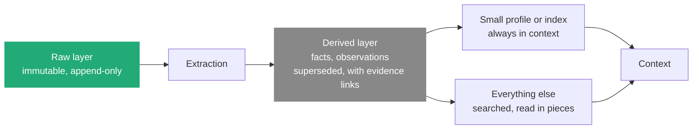

# 7. Memory: relations, placement, search, readable pieces, and what stays immutable or append-only

> Modern agent memory keeps an immutable raw layer, derives facts that link back to it and are superseded rather than overwritten, loads a small profile always and everything else on demand, searches by several methods, and lets the agent read small addressable pieces; my flat store with RediSearch BM25 covers search and placement, and the open questions are relations, a raw layer and supersede links.

Related: [06 Context window and compaction](06_Context_Window_And_Compaction.md) · [04 HITL and execution isolation](04_HITL_And_Execution_Isolation.md) · [09 Audit ledger](09_Memory_Audit_Ledger_In_Memory_Or_State.md) · [21 Tool execution instead of tool calls](21_Tool_Execution_Instead_Of_Tool_Calls.md) · [10 Tools: awareness, discovery, gateway](draft_10_Tools_Awareness_Discovery_Gateway.md) · [12 Evals and traces](draft_12_Evals_And_Traces_For_Agent_Changes.md) · [Lecture 1: 15 Self-querying](../Lecture_1_Mechanics_Behind_Generative_AI/15_self_querying.md)

Source: S02E01 article, "Context and Memory" (figures 19 to 23) and the Mastra demo in the transcript (worked example only). Memory docs and papers of Anthropic, Claude Code, Letta, Mem0, Zep, LangMem and Hindsight, Redis search docs and the LongMemEval paper, read through fetch agents on 2026-11-15. My own memory (flat, RediSearch BM25) is the case I review against. See [Fact-check](#fact-check).

## Glossary

| Term | What it means here | Same thing elsewhere | Not to be confused with |
|---|---|---|---|
| Memory | Stored information that outlives a thread and is read back into context | LangMem long-term memory | The thread, or a retention window |
| Raw layer | What was said or ingested, kept as it came | Zep episodes ("non-lossy"), Hindsight raw facts ("always preserved") | A derived fact |
| Derived layer | Facts, observations, profiles and pages built from the raw layer | Hindsight observations and pages, Mem0 memories | The raw layer |
| Relation | A link between pieces: evidence, entity, supersedes | Zep edges, Hindsight evidence links, `@` imports | A namespace, which only groups |
| Placement | Whether a piece is always in context or loaded on demand | Claude Code `CLAUDE.md` against topic files | Retrieval ranking |
| Immutable / append-only | Never edited / only added to | Zep episodes, Hindsight raw facts | A mutable profile field |
| Supersede / invalidate | Mark an old value as replaced and keep it | Zep `t_invalid` | Delete or overwrite |
| BM25 | Lexical ranking by term frequency and length | Redis `BM25STD`, the default scorer | Embedding similarity |

## 1. The problem

A model sees only its context, so memory is what makes last week change today's answer. **Which principles keep memory correct and findable as it grows, and how does my flat store with BM25 hold up against them?**

## 2. The lecture's model

Source: S02E01 article, figure 19. Caption: "Agentic memory has four parts. Extraction saves information into a structure, retrieval finds it, and context presents it to the agent with the tools to change it."

Source: S02E01 article, figure 20. Caption: "Preferences live as structured profile fields. A newer preference updates the stored value instead of creating a separate document." Extraction runs as a background request or as explicit `memory.update` tool calls. The hard part is one current, owned value: contradiction, duplication and ambiguity (figure 21).

## 3. Five principles, and what the systems do

| Principle | What modern systems do | For my flat store |
|---|---|---|
| Relations | Zep: bidirectional episode and edge indices. Hindsight: facts link to entities and facts, observations to their evidence. Mem0 graph variant: labelled edges. Claude Code: an index file and `@` imports up to 4 hops. LangMem: namespaces only | Fields can carry the links: `source`, `entity`, `supersedes` |
| Placement | Claude Code: `CLAUDE.md` always, the first 200 lines or 25 KB of `MEMORY.md`, topic files on demand. Anthropic memory tool: not preloaded, the model is told to view the directory first. Hindsight: a token budget, not top-k | A small always-on profile, the rest searched |
| Search | Zep: cosine, BM25 and breadth-first, then rerank. Hindsight: four searches fused and reranked. Anthropic: grep and glob just-in-time, with `CLAUDE.md` up front. LongMemEval: fact-augmented index keys +9.4% recall, time-aware query expansion +6.8% to +11.3% | BM25 is the default Redis scorer. Extra keys and time fields help BM25 too |
| Readable pieces | Anthropic tool: list 2 levels, then view a file with a line range, long views truncate at 16,000 characters. Claude Code: topic files read on demand | Small pieces with ids, read by id and range ([21](21_Tool_Execution_Instead_Of_Tool_Calls.md)) |
| Immutable and append-only | Zep: episodes non-lossy, contradicted edges get `t_invalid`, bi-temporal. Hindsight: raw facts preserved, observations "refined, not overwritten". Mem0 base: deletes contradicted memories. Anthropic tool and Claude Code: all mutable, no versioning documented | Raw layer append-only, derived layer superseded |

## 4. Review of my memory (flat, RediSearch BM25)

I have not seen its schema in this session, so these are questions.

| Question | Why |
|---|---|
| Is there a raw layer, or only extracted records? | A wrong extraction is unrecoverable without it |
| Do records carry `source`, `entity`, `supersedes` fields? | Cheap relations in a flat index |
| Is a changed fact overwritten or superseded? | Contradiction without history |
| What is always in context and what is searched? | Placement |
| Which `LANGUAGE` and weights are set per field, and do I add fact keys and timestamps? | Stemming is per index or field. Key expansion helped in LongMemEval |
| Can the agent read one record by id and a range? | Large results by reference |
| Where do deletes go, and who may delete? | Immutability policy, [09](09_Memory_Audit_Ledger_In_Memory_Or_State.md) |
| Do I measure recall on my golden set before adding vectors? | A dense retriever beat BM25 in LongMemEval (summary-only numbers) |

## 5. Contradiction, duplication, ambiguity

| Problem | Principle that answers it |
|---|---|
| Contradiction | Supersede or invalidate, keep the old value. Zep gives new facts priority |
| Duplication | One owner per fact. Hindsight merges near-duplicate observations at 0.97 by default |
| Ambiguity | Resolve the entity before the write. Confidence scores and temporary notes are the lecture's practice, no vendor source |

A retention window is not memory: it forgets by position, memory by decision. The Mastra demo shows both in one config, with explicit read and save tools scoped per customer. Its option meanings come from the transcript only:

| Demo option | Mechanism | Layer here | My stack |
|---|---|---|---|
| `lastMessages: 20` | Last N messages of the thread | Retention window | Cache store plus message trimming |
| `semanticRecall` | Retrieve past messages by meaning | Search by embedding | AI Search |
| `workingMemory` | Facts kept across conversations | Derived layer, profile | Near-field knowledge store |

Recall needs the thread plus a profile, not the last message alone (figure 23, lecture opinion): in the lecture's example the last message names no client, proposal or meeting.

## 6. Extraction choices, and what other projects teach

| Choice | Strength | Cost | Where I see it |
|---|---|---|---|
| Background LLM call | No latency on the turn | Extra model cost, I decide when it fires | LangMem background formation, Mem0 provider |
| Explicit tool call | Available at once, visible to the user | Latency, more load on the agent | LangMem hot path, the Mastra save tool |
| Profile (one document) | One place to look | Each update rewrites it, more error-prone as it grows | LangMem profile |
| Collection (documents) | Narrow, better recall | Hard to update or delete, the model over-inserts | LangMem collection |

| Project | What it teaches |
|---|---|
| Semantic Kernel `WhiteboardProvider` (experimental) | Keep requirements, decisions and actions beyond history truncation |
| Semantic Kernel `Mem0Provider` | A query built from the request alone is the naive case |
| lamarck | Offline extraction into `MEMORY.md` and topic files with maturity and dedup, no runtime recall |
| supermemory | Memory and ingested documents are different things (vendor sources only) |
| Joel Hooks' observation pipeline | A small curated memory kept apart from raw logs (article unreachable) |

## Summary

Keep the raw layer immutable, derive facts with links back and supersede instead of overwrite, load a small profile always and search the rest with more than one method, and let the agent read small pieces. My flat BM25 store has search and placement. I check relations, a raw layer and supersede links, and measure recall before adding vectors.

## Open questions

- Does my store separate raw and derived records, and can I add `supersedes` without a schema break?
- Is BM25 enough on my golden set, or does a hybrid pay?

## Fact-check

| # | Claim | Verdict | Source | Checked |
|---|---|---|---|---|
| 1 | There are no established patterns for agent memory | **Differs** | [LangMem](https://langchain-ai.github.io/langmem/concepts/conceptual_guide/), [Anthropic memory tool](https://platform.claude.com/docs/en/agents-and-tools/tool-use/memory-tool), [Claude Code memory](https://code.claude.com/docs/en/memory.md). No cross-vendor standard found | 2026-11-15 |
| 2 | Zep keeps episodes non-lossy and invalidates contradicted edges | **Agrees** | [Zep paper](https://arxiv.org/abs/2501.13956), first 40k characters verbatim. "Immutable" and an explicit "not deleted" are not stated | 2026-11-15 |
| 3 | Hindsight keeps raw facts and refines observations with history | **Agrees**, vendor | [Hindsight](https://hindsight.vectorize.io/developer/observations). History mechanism not stated. Vendor benchmark numbers unverified | 2026-11-15 |
| 4 | Mem0 base deletes contradicted memories, the graph variant invalidates | **Agrees** | [Mem0 paper](https://arxiv.org/abs/2504.19413). Result tables are summary only | 2026-11-15 |
| 5 | Claude Code loads the first 200 lines or 25 KB of `MEMORY.md`, topic files on demand | **Agrees** | [Claude Code memory](https://code.claude.com/docs/en/memory.md), verbatim | 2026-11-15 |
| 6 | Anthropic's memory tool is client-side with six commands and no versioning documented | **Agrees** | [Memory tool](https://platform.claude.com/docs/en/agents-and-tools/tool-use/memory-tool), verbatim | 2026-11-15 |
| 7 | Redis default scorer is BM25 | **Agrees** | [Scoring](https://redis.io/docs/latest/develop/ai/search-and-query/advanced-concepts/scoring/): `BM25STD` default, renamed from `BM25` in Redis Open Source 8.4. Hybrid search not found in the pages read | 2026-11-15 |
| 8 | Fact-augmented keys and time-aware expansion improve recall | **Agrees** | [LongMemEval](https://arxiv.org/abs/2410.10813): +9.4% recall, +6.8% to +11.3% temporal. BM25 against dense numbers are from a summary: verify before presenting | 2026-11-15 |
| 9 | Recall needs the thread and a profile | **Lecture-specific** | Figure 23 | 2026-11-15 |
| 10 | Confidence scores handle ambiguity | **Lecture-specific** | No vendor source read | 2026-11-15 |
| 11 | mem0, supermemory, lamarck and Joel Hooks' pipeline | **Agrees** in part | Mem0 and lamarck read. supermemory vendor sources only. The Hooks article did not resolve: unverified | 2026-11-15 |

## Sources

- S02E01 article, figures 19 to 23; transcript demo.
- [Anthropic memory tool](https://platform.claude.com/docs/en/agents-and-tools/tool-use/memory-tool) · [Claude Code memory](https://code.claude.com/docs/en/memory.md) · [LangMem concepts](https://langchain-ai.github.io/langmem/concepts/conceptual_guide/)
- [Mem0 paper](https://arxiv.org/abs/2504.19413) · [Zep paper](https://arxiv.org/abs/2501.13956) · [Hindsight](https://hindsight.vectorize.io/) · [Letta](https://docs.letta.com/configuration/memory) · [lamarck](https://github.com/johnlindquist/lamarck)
- [Redis scoring](https://redis.io/docs/latest/develop/ai/search-and-query/advanced-concepts/scoring/) · [LongMemEval](https://arxiv.org/abs/2410.10813) · [Anthropic: effective context engineering](https://www.anthropic.com/engineering/effective-context-engineering-for-ai-agents)
- My own reasoning: the five-principle table, the review questions and the layer diagram.
