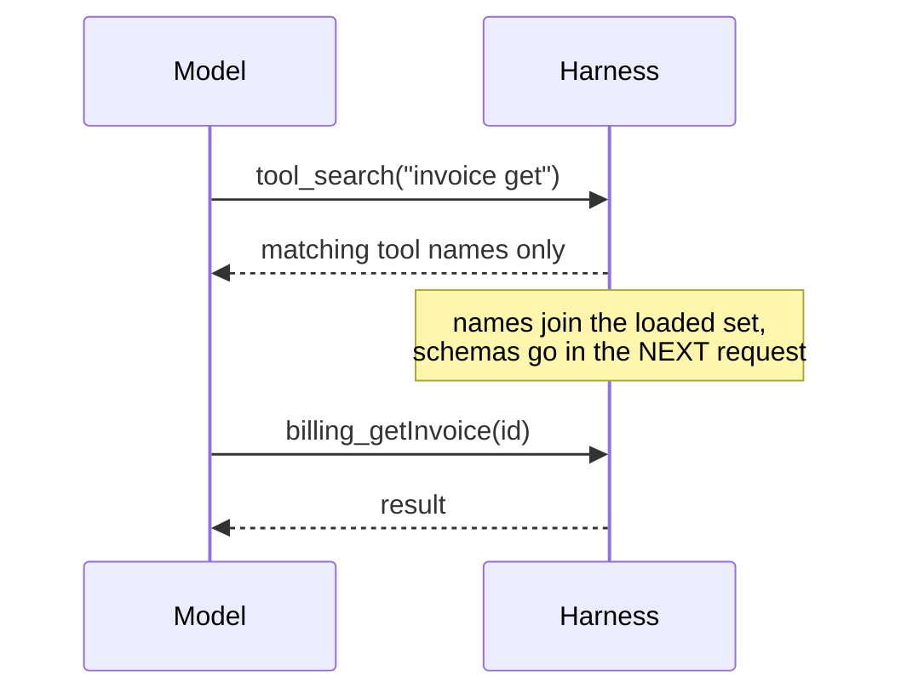

# 8. Tool search instead of many tools: the model sees names, searches, and loads only the schemas it needs

> A catalog of dozens of tools costs context and hurts tool selection, so the harness sends names (or a category line) plus one search tool, loads the schemas of the matches into the next request, and keeps a few tools always loaded; Anthropic, OpenAI and Claude Code ship this, the lecturer's example builds it client-side with keyword scoring, and it saves tokens only when the discovery requests cost less than the schemas they avoid.

Related: [09 Tool search and proxy gateway](09_Tool_Search_And_Proxy_Gateway.md) · [07 Context: tool awareness avoids compression](07_Context_Tool_Awareness_Avoids_Compression.md) · [25 Tool execution instead of tool calls](25_Tool_Execution_Instead_Of_Tool_Calls.md) · [24 KV cache and prompt caching](24_KV_Cache_And_Prompt_Caching.md) · [06 Context window and compaction](06_Context_Window_And_Compaction.md) · [05 Instructions](05_Instructions_Five_Parts_And_Enforcement.md) · [Lecture 2: 11 Tool upfront vs discovery](../Lecture_2_Context_Agents_md_Skills_Tools/11_tool_upfront_vs_tool_discovery.md)

Source: S02E01 article, "Tools" (awareness, figure 24). The lecturer's [tool-search example](https://github.com/MEGA-DOT-DEV/examples/tree/main/examples/tool-search): README, `search.ts`, `index.ts`, `api.ts` and `search.test.ts` read; the `ui/` folder and `../code-mode/catalog.ts` not read. Anthropic's tool search docs (read in full), OpenAI's tool search guide, Claude Code's MCP docs (partly summary), on 2026-11-15. See [Fact-check](#fact-check).

## Glossary

| Term | What it means here | Same thing elsewhere | Not to be confused with |
|---|---|---|---|
| Tool search | A tool the model calls to find other tools by words | Anthropic `tool_search_tool_regex` and `_bm25`, OpenAI `tool_search` | A web search |
| Deferred tool | A tool whose schema stays out of the context until found | `defer_loading: true` | A disabled tool |
| Native tool | A tool always loaded | Non-deferred tool | A built-in tool of the vendor |
| Capability list | Names and a line each, always in the prompt | The example's "Available tool names" line | The schemas |
| Discovery step | One extra model request that loads schemas | The example's second request | Calling the tool |
| `tool_reference` | Anthropic's block that returns found tools | Client-side search result | A schema |

## 1. The problem

The lecture: the agent must be aware of its capabilities without loading them all, yet some must be available at once, and I decide which. **How does tool search work, what do the vendors and the lecturer's example show, and how do I pick the native tools?**

## 2. The lecturer's example

A fictional workspace with 41 tools by the README (about 40 in the code I could count). The model must find the right tool and call it with valid arguments, in three tasks (an invoice, a docs page, a new task). It compares three ways to give schemas.

| Mode | What the model gets | Cost |
|---|---|---|
| `all-schemas` | Every schema up front | One request, large input |
| `tool-search` (default) | One line with all tool names plus `tool_search` | One discovery request, then the call |
| `files` | `list_dir`, `read_file`, `invoke_tool`, and a schema file must be read before the tool runs | More requests |

The search is plain client-side keyword scoring: lowercase, split on non-alphanumerics, drop words of two letters or fewer, plus 4 per word found in a tool name and plus 1 per word found in its description, best 6 returned, names only. No tool is native except the search tool itself, and the code gives no reason. A search with no match loads nothing and raises no error. The loop stops after 6 rounds.

The README says "Deferred loading does not always use fewer tokens: each discovery step is one more request". The example has no live measurement. Its only numbers come from a mock model with scripted outputs (tool-search 2 requests and 290 input tokens, files 3 requests and 260), so they show the harness, not model behavior.

## 3. What the vendors do

| Who | How | Notes |
|---|---|---|
| [Anthropic](https://platform.claude.com/docs/en/agents-and-tools/tool-use/tool-search-tool) | Two search variants: regex (patterns up to 200 characters) and BM25 (a query up to 500). Mark tools `defer_loading: true`. At least one tool stays non-deferred. Up to 5 results by default, up to 10,000 deferred tools | Selection "degrades once you exceed 30–50 available tools". A five-server setup "can consume ~55k tokens", reduced "by over 85 percent" (vendor). A deferred tool cannot carry `cache_control` |
| [OpenAI](https://developers.openai.com/api/docs/guides/tools-tool-search) | `tool_search` tool, `defer_loading: true`, hosted or client-executed. GPT-5.4 and later | Keep each namespace under 10 functions. Tools load at the end of the context |
| [Claude Code MCP](https://code.claude.com/docs/en/mcp) | On by default. Only tool names and server instructions load at start (summary) | `ENABLE_TOOL_SEARCH=auto` loads upfront below 10% of the window, and `alwaysLoad` exempts a server (both summary) |
| Pi | A built-in `tool_search` for deferred tools (summary only, unverified) | Pi's docs read in [19](19_Pi_LangGraph_DeepSeek_Harnesses.md) |

Anthropic's advice on when: use it with 10 or more tools, definitions over 10k tokens, or 200 or more MCP tools. Standard calling is better under 10 tools, when every tool is used on every request, or when definitions total under 100 tokens. Prefix names by service.

## 4. Which tools stay native

| Rule | Source |
|---|---|
| Keep the 3 to 5 most used tools non-deferred | Anthropic |
| Name the categories in the prompt ("you can search for tools to interact with Slack, GitHub, and Jira") | Anthropic |
| A tool needed on nearly every turn, or a safety-critical one, is native | My reasoning |
| Everything rare is deferred, behind a prefix | My reasoning |
| Decide from measured use: count tool calls per task in my traces and keep the top few | My reasoning, [15](draft_15_Evals_And_Traces_For_Agent_Changes.md) |

Cost to weigh: every discovery step is an extra request and latency, and a changed tool list can break the cache prefix ([24](24_KV_Cache_And_Prompt_Caching.md)). A short capability list in the prompt, as the example does, is my tagged `<tools>` chapter with one line per tool ([05](05_Instructions_Five_Parts_And_Enforcement.md)).

## 5. Many, many tools

The lecture's gateway figure shows both halves of this note and the next: in the data plane, agents reach a tool search block (search server, list tools, get schema) over MCP, which then calls a proxy. The tool search block is the mechanism of sections 2 to 4, and the proxy, registry and crawler around it are in [09](09_Tool_Search_And_Proxy_Gateway.md).

Source: S02E01 article, figure 26. Caption: "The MCP Gateway is one door to the APIs that Uber already has. The proxy translates MCP to the protocol of each backend, so the services do not change."

## Summary

Send names and a search tool, load schemas on demand, keep three to five tools native, and measure. The lecturer's example shows the mechanics with simple keyword scoring and warns that discovery steps cost requests. Whether it pays depends on catalog size and how often each tool is used. At thousands of tools a gateway adds a registry, approval of description changes and one policy point, see [09](09_Tool_Search_And_Proxy_Gateway.md).

## Open questions

- Which of my tools are used in most tasks, and which are rare enough to defer?
- Is keyword scoring enough for my names and descriptions, or do I need BM25 or embeddings?

## Fact-check

| # | Claim | Verdict | Source | Checked |
|---|---|---|---|---|
| 1 | An agent can be aware of tools without loading all of them | **Agrees** | [Anthropic](https://platform.claude.com/docs/en/agents-and-tools/tool-use/tool-search-tool), full page. [OpenAI](https://developers.openai.com/api/docs/guides/tools-tool-search) | 2026-11-15 |
| 2 | The lecturer's example searches by keyword scoring and returns at most 6 names | **Agrees** | `search.ts`, read. The README says 41 tools, the code shows about 40, unresolved | 2026-11-15 |
| 3 | The example measures token savings | **Differs**: it does not | README and tests: scripted mock numbers only, `ui/` not read | 2026-11-15 |
| 4 | Selection degrades past 30 to 50 tools, and tool search cuts definitions by over 85% | **Agrees**, vendor | Anthropic docs, no benchmark table on the page | 2026-11-15 |
| 5 | Keep 3 to 5 tools non-deferred | **Agrees** | Anthropic docs | 2026-11-15 |
| 6 | OpenAI `tool_search` needs GPT-5.4 or later, keep namespaces under 10 functions | **Agrees** | OpenAI guide, read in full by a fetch agent | 2026-11-15 |
| 7 | Claude Code turns tool search on by default and loads upfront below 10% of the window | **Agrees** in part | [MCP docs](https://code.claude.com/docs/en/mcp): "on by default" verbatim, the threshold from a summary | 2026-11-15 |
| 8 | Pi has a built-in `tool_search` | **Unverified** | Summary only | 2026-11-15 |

## Sources

- S02E01 article, "Tools" (figure 24).
- [tool-search example](https://github.com/MEGA-DOT-DEV/examples/tree/main/examples/tool-search) · [Anthropic tool search](https://platform.claude.com/docs/en/agents-and-tools/tool-use/tool-search-tool) · [OpenAI tool search](https://developers.openai.com/api/docs/guides/tools-tool-search) · [Claude Code MCP](https://code.claude.com/docs/en/mcp)
- My own reasoning: the native-tool rules marked as mine.
