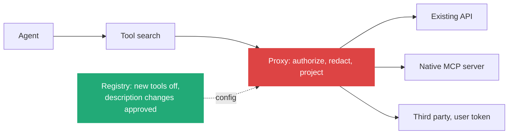

# 9. A proxy gateway puts tool search, authorization and one door in front of thousands of tools

> When tools number in the thousands the problem moves from context to ownership, authorization and rollout, and Uber's MCP gateway answers with a control plane (a crawler and a registry that starts every tool disabled) and a data plane (tool search, then a proxy that authorizes, redacts, trims the reply and translates MCP to each backend's protocol); Treg is a hosted catalog with the same shape of one door, so the idea I take is a registry that starts everything off, approval of description changes, and one policy point for every call.

Related: [08 Tool search instead of many tools](08_Tool_Search_Instead_Of_Many_Tools.md) · [07 Context: tool awareness avoids compression](07_Context_Tool_Awareness_Avoids_Compression.md) · [04 HITL and execution isolation](04_HITL_And_Execution_Isolation.md) · [25 Tool execution instead of tool calls](25_Tool_Execution_Instead_Of_Tool_Calls.md) · [14 Tool approval, durable waits](14_Tool_Approval_Durable_Waits.md) · [23 Self-configuring harness](23_Self_Configuring_Harness.md) · [W2L3 13 MCP tools loading and code mode with many servers](../Week2_Lecture_3_MCP_MCP+Resources_Skills/13_MCP_Tools_Loading_And_Code_Mode_With_Many_Servers.md)

Source: S02E01 article, "Tools" (Uber's MCP gateway figure). [Uber's post](https://www.uber.com/en-PL/blog/designing-mcp-gateway/), dated 2026-10-01, read in full, and the [Treg README](https://github.com/superdesigndev/treg), first 40k of 48.6k characters verbatim, through a fetch agent on 2026-11-15. See [Fact-check](#fact-check).

## Glossary

| Term | What it means here | Same thing elsewhere | Not to be confused with |
|---|---|---|---|
| Control plane | Where tools are found, described and enabled | Uber's registry and crawler | The data plane |
| Data plane | Where calls run: search, authorize, redact, translate | Uber's proxy gateway | The model's context |
| Registry | The single source of truth for discovery, ownership and enablement | Uber MCP Registry, Treg catalog | A tool list in a prompt |
| Proxy | A service every call passes through, a policy point | Uber Proxy Gateway, Treg `/call/` | A model |
| Response projection | Keep only chosen fields of a reply | Uber Response Projection | Truncating text |
| Default off | A new tool is disabled until its owner enables it | Uber: every server and tool starts disabled | Hidden |
| Token relay | The caller's token is passed to a third-party service | Uber for Jira and Google | A shared service key |

## 1. The problem

The lecture: to manage tools at scale I need a gateway, with their authorization and permissions, as Uber built for 8000+ tools or as the open-sourced Treg. **What does such a gateway consist of, what do the two examples show, and what do I take for my own tools?**

## 2. The lecture's figure

Source: S02E01 article, figure 26. Caption: "The MCP Gateway is one door to the APIs that Uber already has. The proxy translates MCP to the protocol of each backend, so the services do not change."

Important: the red arrow. The backends stay unchanged and the gateway adapts to them. Also important: the registry sits in the control plane and configures the proxy, so enabling a tool is a separate act from finding it. Not important: box positions and the corner pattern.

## 3. Uber and Treg

| | Uber MCP gateway | Treg |
|---|---|---|
| What | Internal control plane and data plane. Over 800 MCP servers and over 5000 tools | "OpenRouter for agent tools": a hosted catalog, self-hostable, 8.1k stars |
| Registration | A crawler reads Protobuf and Thrift definitions and native MCP servers. An LLM writes agent-friendly descriptions at crawl time. Every server and tool starts disabled. A description change is a diff its owner must approve | A tool is an endpoint (base URL plus credential bindings) or a CLI. A skill bundles `SKILL.md`, secrets and tools |
| Discovery | Omni MCP: `discover_server`, `discover_tools`, `get_tool_schema`, `invoke_tool`. Search method not stated | `treg catalog search "backlinks for a domain"`. Method not stated |
| Calling | The proxy translates MCP to HTTP, gRPC or TChannel. Third-party servers get the caller's user token | REST proxy under `https://treg.to/call/`, `treg run`, an MCP endpoint at `/mcp/v2/` |
| Security | Attribute-based access per server with tool-level overrides. PII redaction in responses. Rate limiting and observability named, details not stated | One token, provider keys injected server side, roles, per-member tool access, audit via `treg calls`, secrets encrypted at rest, rate limits |
| Context fixes | Omni MCP, Response Projection, and Code Mode as the default for coding agents: a CLI to list, search and call, output written to files | Search by task |

## 4. What I take (my reading)

- **A tool description is prompt text.** Uber's approval of every description change guards what the model reads. It matches the change classes in [23](23_Self_Configuring_Harness.md): a capability change needs review before it loads.
- **Descriptions can be generated once, at crawl time,** and searched at query time. That improves search without a model call per query.
- **One policy point.** Authorization, redaction and response trimming live in the proxy, so no backend repeats them. Treg's key injection is the same pattern as the egress proxy in [04](04_HITL_And_Execution_Isolation.md).
- **Response projection and file output** are results by reference ([25](25_Tool_Execution_Instead_Of_Tool_Calls.md)).
- **Tool search serves the model, a gateway serves the organization.** I need the second only when many teams own tools.

Corrections: Uber's post says over 800 servers and over 5000 tools, not "8000+". Treg speaks MCP and is large. Its license is not in the README text I read: a summary says Apache 2.0 with extra terms, so I read the LICENSE file before relying on it.

## Summary

A gateway is a registry that starts everything disabled, approval of description changes, tool search as the front door, and one proxy that authorizes, redacts, trims and translates. Uber built it over existing APIs, Treg offers a hosted version. I take the registry with default off, the approval of description changes and the single policy point.

## Open questions

- Which of my tools would go behind a proxy first, and who approves a description change?
- Does my platform have one point where authorization and redaction run for every tool call?

## Fact-check

| # | Claim | Verdict | Source | Checked |
|---|---|---|---|---|
| 1 | Uber's MCP gateway manages 8000+ tools | **Wrong** | [Uber blog](https://www.uber.com/en-PL/blog/designing-mcp-gateway/), read in full: over 800 MCP servers and over 5000 tools. Counts may have changed since the post | 2026-11-15 |
| 2 | Registry and crawler on the control plane, proxy and tool search on the data plane, tools disabled by default | **Agrees** | Same page, verbatim. Search method, result limits, token savings and latency are not stated | 2026-11-15 |
| 3 | The proxy authorizes, redacts and trims the reply | **Agrees** in part | Same page: tool-level authorization and PII redaction stated, projection stated, rate limiting and observability only named | 2026-11-15 |
| 4 | Treg is an open-sourced gateway for tools | **Agrees**, with scope | [Treg README](https://github.com/superdesigndev/treg): hosted and self-hostable, MCP endpoint named. License from a summary only | 2026-11-15 |
| 5 | A description change needs owner approval | **Agrees** | Uber post: a description change creates a config diff the owner approves | 2026-11-15 |

## Sources

- S02E01 article, figure 26.
- [Uber: designing the MCP gateway](https://www.uber.com/en-PL/blog/designing-mcp-gateway/) · [Treg](https://github.com/superdesigndev/treg)
- My own reasoning: section 4.
