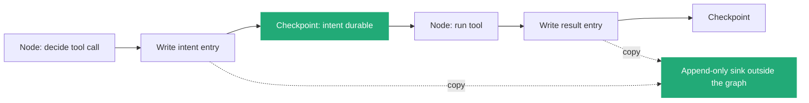

# 10. An audit ledger fits LangGraph state better than Store memory, but state alone is not a harness-only, tamper-evident log

> A per-run, append-only ledger belongs in graph state (ordered with the run, restored with it, kept apart from memory the agent reads), but a state channel is writable by any node, streamed by default, copied in full into every checkpoint and deleted or pruned by hand, so the durable audit record needs an append-only sink outside the graph.

Related: [04 HITL and execution isolation](04_HITL_And_Execution_Isolation.md) · [08 Memory](08_Memory.md) · [11 Tool approval, durable waits](draft_11_Tool_Approval_Durable_Waits.md) · [18 Threads, subagents and A2A](18_Threads_Vs_A2A_Subagents.md) · [14 The harness around the loop](14_Harness_Around_The_Loop.md) · [03 Agent loop](03_Agent_Loop_Stop_Limits_Recovery.md)

Source: my own Ledger idea (audit log kept in state, not in memory), reviewed against the LangGraph docs read through a fetch agent on 2026-11-15. I have not seen the implementation, so section 4 lists questions, not findings. See [Fact-check](#fact-check).

## Glossary

| Term | What it means here | Same thing elsewhere | Not to be confused with |
|---|---|---|---|
| Ledger | My name for the append-only record of a run's intents and results | Audit log, event log | Memory, which the agent reads to answer |
| State channel | One key of the graph state, with an optional reducer | LangGraph `Annotated[list, operator.add]` | A Store item |
| Reducer | Merges a node's update into a channel. No reducer means overwrite | `operator.add`, `add_messages` | A checkpointer |
| Private channel | A channel outside the graph's input and output schemas | LangGraph multiple schemas | A hidden channel: nodes and streaming can still see it |
| Checkpoint | The full value of every channel at a super-step boundary | LangGraph checkpointer | A log entry |
| Store | Cross-thread key-value data with namespaces | LangGraph Store, my memory layer | The thread's state |
| Write-ahead entry | An intent recorded durably before its effect runs | Figure 1: history "records each intent before its effect" | A result entry |
| Outbox | Entries copied to an external append-only sink | Event outbox pattern | The checkpointer |

## 1. The problem

My agents keep an audit log. I put it in graph state, not in memory. **Is that the right place, and what must I check in my implementation so the log is complete, ordered and out of the agent's reach?**

## 2. State or Store

| Property | State (checkpointer) | Store | Ledger consequence |
|---|---|---|---|
| Purpose | "Graph state snapshots" per thread | "Application-defined key-value data" across threads | A run's ledger is run data |
| Write semantics | Reducer merges. `operator.add` appends | A put overwrites an item | Append needs state, or my own key per entry |
| Order | Super-step order, versioned with the run | "Do not rely on a specific order" | State keeps the order |
| Read path | Node input, streaming, `get_state` | Nodes, search (default 10, silently truncated) | A ledger in the Store sits beside what memory tools read |
| Scope | One thread | Namespace I choose, no access control in the docs | A cross-thread question needs another index |

State is the better home for the in-run record. Putting it in the Store mixes audit data into the layer the agent reads when it builds context ([08](08_Memory.md)).

## 3. What a state channel does not give

| Fact from the docs | Why it matters |
|---|---|
| "A node can write to any channel in the graph state" | A tool node can write the ledger unless my code prevents it |
| `Overwrite` bypasses a merging reducer, "including clearing it" | One node can wipe the ledger |
| Schemas "do not hide channels from streaming by default"; values streaming emits private channels too | The ledger can reach clients |
| Checkpoints "write the full value of every state channel at each super-step" | The ledger is copied at every step. Growth. `DeltaChannel` stores deltas, beta, langgraph 1.2 and later |
| `update_state` creates a new checkpoint that branches, the original stays | No mutation, but a fork is an alternate history |
| Retention is manual ("a cron job to delete checkpoints"). Thread deletion API not confirmed | Ledger lifetime equals checkpoint lifetime |
| Checkpointers can optionally encrypt persisted state | The ledger is plain text otherwise |
| Audit, immutability, tamper-evidence: not found on any page read | Guarantees are mine to build |

Why two nodes: checkpoints sit at super-step boundaries, and a node that is replayed "runs again from the start of its function", with "side effects before the pause" running again. An intent written in the same node as its effect is not durable before the effect and can be recorded twice. The docs advise idempotency keys, upserts or read-before-write checks.

## 4. Review questions for my implementation

| Question | Why |
|---|---|
| Which reducer, and is `Overwrite` or an empty return ever used? | Append-only is the point |
| Who may write the channel: harness nodes only, or tool nodes the model drives? | The ledger is harness-only state, [04](04_HITL_And_Execution_Isolation.md) |
| Is the ledger outside the model's messages, outside input and output schemas and excluded from streamed values? | Private channels are still visible to nodes and streams |
| Is each intent in its own super-step before the effect, with an idempotency key per entry? | Durability before effect, and no duplicate on replay |
| What does an entry hold: ids and hashes, or payloads? Are secrets and personal data kept out? | Checkpoints store everything in full |
| How is growth bounded, and is `DeltaChannel` an option? | Cost per step |
| How do I answer "what did these agents do for user X"? | State is per thread. Deleted threads lose their ledger |
| Who records what a disposed A2A peer did? | The orchestrator, [18](18_Threads_Vs_A2A_Subagents.md) |
| What happens to entries on a fork or time-travel replay? | Alternate histories |
| Is there a hash chain or an external append-only copy? | Tamper evidence |

## 5. My position

State for the working ledger, an append-only sink outside the graph for the audit record (an outbox written as entries are made), and the Store only for memory. This is my reasoning from the docs, not a source's recommendation.

## Summary

State suits an ordered, per-run ledger that must not sit in memory. It is not harness-only or tamper-evident by itself, so I restrict who writes it, keep it out of messages and streams, write intents before effects and copy entries to an external append-only sink.

## Open questions

- Does my implementation pass the ten review questions, and which fail?
- Which store holds the outbox, and who may read it?

## Fact-check

| # | Claim | Verdict | Source | Checked |
|---|---|---|---|---|
| 1 | A reducer such as `operator.add` makes a channel append-only. No reducer overwrites | **Agrees** | [State](https://docs.langchain.com/oss/python/langgraph/graph-api-state.md), read | 2026-11-15 |
| 2 | A node can write any channel. Schemas do not hide channels from streaming | **Agrees** | [Graph API](https://docs.langchain.com/oss/python/langgraph/graph-api), read | 2026-11-15 |
| 3 | Checkpoints store the full value of every channel per super-step | **Agrees** | [Checkpointers](https://docs.langchain.com/oss/python/langgraph/checkpointers.md), first 40k of 50.6k characters read | 2026-11-15 |
| 4 | `update_state` branches and leaves the original | **Agrees** | [Time travel](https://docs.langchain.com/oss/python/langgraph/use-time-travel), read | 2026-11-15 |
| 5 | Private channels are stored in checkpoints | **Unverified** | Inferred: they are channels. Not stated | 2026-11-15 |
| 6 | Store is cross-thread key-value memory, no TTL or access control documented | **Agrees** | [Stores](https://docs.langchain.com/oss/python/langgraph/stores.md), read in full | 2026-11-15 |
| 7 | A replayed node restarts from the start and repeats side effects | **Agrees** | Checkpointers page. The durable-execution page failed to load: the URL returned the persistence page | 2026-11-15 |
| 8 | Thread deletion API exists | **Unverified** | Two summaries conflict | 2026-11-15 |
| 9 | LangGraph documents audit or immutability features | **Not found** | None on the pages read | 2026-11-15 |
| 10 | The ledger belongs in state, with an external sink | **Lecture-specific**, my position | No source | 2026-11-15 |

## Sources

- [LangGraph graph API](https://docs.langchain.com/oss/python/langgraph/graph-api) · [state](https://docs.langchain.com/oss/python/langgraph/graph-api-state.md) · [checkpointers](https://docs.langchain.com/oss/python/langgraph/checkpointers.md) · [time travel](https://docs.langchain.com/oss/python/langgraph/use-time-travel) · [stores](https://docs.langchain.com/oss/python/langgraph/stores.md)
- My own reasoning: the write-ahead split, the review questions, the position.
