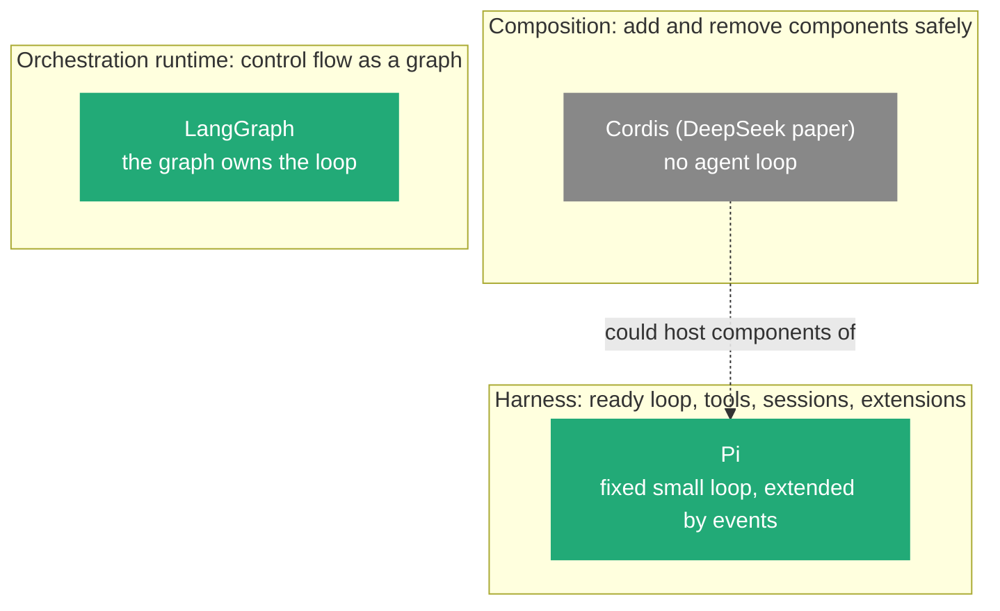

# 11. Pi, LangGraph and the DeepSeek paper answer "who owns the loop?" three ways

> LangGraph lets a graph own the loop, Pi runs one small fixed loop that I extend through events, and the DeepSeek paper defines no loop at all: it is a composition layer for adding and removing components safely.

Related: [01 Agent loop](01_Agent_Loop_Stop_Limits_Recovery.md) · [10 The harness around the loop](10_Harness_Around_The_Loop.md) · [12 Loop hooks declared](12_Loop_Hooks_Declared.md) · [16 Self-configuring harness](16_Self_Configuring_Harness.md) · [09 Extend, adjust or leave the framework](draft_09_Extend_Adjust_Or_Leave_The_Framework.md) · [02 HITL and execution isolation](02_HITL_And_Execution_Isolation.md) · [07 Tool approval, durable waits](draft_07_Tool_Approval_Durable_Waits.md) · [Lecture 4: 15 Pi and limen](../Lecture_4_Harness/15_Pi_Limen_Behind_The_Scenes.md) · [Lecture 2: 12 Subagents vs workers](../Lecture_2_Context_Agents_md_Skills_Tools/12_subagents_vs_workers.md)

Source: S02E01 article ("Agentic Loop", "Configuration"). Pi docs and repo, LangChain docs and the arXiv paper read 2026-11-15 through fetch agents and local PDF text. See [Fact-check](#fact-check).

## Glossary

| Term | What it means here | Same thing elsewhere | Not to be confused with |
|---|---|---|---|
| Orchestration runtime | Control flow expressed as a graph, with persistence | - | A harness with a ready loop |
| Harness | A ready loop plus tools, sessions and extensions | - | A framework |
| Composition layer | Adds and removes components and reverts their effects | - | An agent loop |
| Cordis | The paper's meta-framework: components declare effects and coeffects | None in LangGraph or Pi | - |
| Temporal composability | Revert a removed component's side effects completely | Process restart is the coarse substitute | - |
| Spatial composability | Reactivate only dependents whose dependency changed | Container orchestration, at service level | - |
| Steering / follow-up | Pi queues: after the current turn / after the run finishes | LangGraph `Command`, `interrupt` | - |

## 1. The problem

The article names Pi as an elegant loop, and cites a "DeepSeek Harness" paper for self-configuring harnesses. I run LangGraph. **How do the three differ, and what does each teach me?**

## 2. Side by side

| Axis | LangGraph | Pi | DeepSeek paper (Cordis) |
|---|---|---|---|
| What it is | Runs graphs by message passing "in the style of Google's Pregel" | "A minimal, extensible agent harness" | A programming paradigm for dynamic composition of software |
| Loop owner | The graph: nodes, edges, `should_continue` | `agent-loop.ts`: runs while tool calls or queued messages exist | None |
| Exits | `END`, any node, `recursion_limit` | No tool calls, `finishTurn` end, `terminate` on every result of a batch, error, abort. No step counter | n/a |
| State, resume | Checkpoints at super-step boundaries with a checkpointer | Sessions as a JSONL tree under `~/.pi/agent/sessions/`, persisted per turn. Crash resume not documented, `--continue` and `--resume` reopen sessions | State lost on reload unless held in a longer-lived dependency |
| Extension points | Middleware (`before_agent`, `before_model`, `wrap_model_call`, `after_model`, `wrap_tool_call`, `after_agent`), `Command`, `interrupt` | TypeScript extensions: lifecycle events, `registerTool`, steering and follow-up queues | Components with revertible effects, reactive dependencies, hot module replacement |
| Runtime change | Not a design goal | `/reload` hot-reloads auto-discovered extensions, project ones only after trust | The goal: remove a component and revert its tracked effects |
| Permissions | Mine to add | No built-in permission system, extensions run with full OS permissions | Confinement and sandboxing in the paper (sections not read) |

## 3. What the DeepSeek source really is

The lecture's "DeepSeek Harness" is arXiv 2608.25512, "A Programming Paradigm for Spatiotemporal Composability" (Peking University and DeepSeek-AI, 92 pages, 2026-08-26). Two properties: temporal composability (revert a removed component's side effects) and spatial composability (declared, reactive dependencies). Agent harnesses are a motivating example. The paper calls validating Cordis on a harness that rewrites its own components future work. Its evidence is one observational case study, Koishi, a chatbot framework with over 4000 plugins. It supports "safe runtime removal needs a revert mechanism", not "self-evolving harnesses work". The community DeepSeek TUI in Lecture 2 note 12 is a different project.

## 4. What I take

- **Different layers, not rivals.** A graph fits when control flow is the product. Pi fits when the loop is standard and value is in tools. A composition layer matters when components change while the agent runs.
- **Rollback for agent-written tools.** Removing a saved integration must undo what it changed ([06](draft_06_Tools_Awareness_Discovery_Gateway.md)). A restart discards state.
- **Checkpoint granularity.** LangGraph resumes at a super-step boundary. Pi persists per turn but documents no crash resume. Compare [02](02_HITL_And_Execution_Isolation.md) and [07](draft_07_Tool_Approval_Durable_Waits.md).

## Summary

Who owns the loop is the axis: a graph, a fixed extensible loop, or nothing (a composition layer). The DeepSeek paper is a composability paper, not an agent harness.

## Fact-check

| # | Claim | Verdict | Source | Checked |
|---|---|---|---|---|
| 1 | LangGraph runs graphs by message passing in the style of Pregel, in discrete super-steps, checkpoints at super-step boundaries | **Agrees** | [graph API](https://docs.langchain.com/oss/python/langgraph/graph-api), read: "in the style of Google's Pregel system". The word "every" is not in the docs. "Low-level orchestration framework" is not in the docs body | 2026-11-15 |
| 2 | Middleware hooks as listed | **Agrees** | [custom middleware](https://docs.langchain.com/oss/python/langchain/middleware/custom), read. `wrap_tool_call` position in the loop not documented there | 2026-11-15 |
| 3 | Pi is a minimal extensible harness; package split | **Agrees** | [Pi README](https://github.com/earendil-works/pi): `pi-ai`, `pi-agent-core`, `pi-coding-agent`, `pi-tui` (the TUI is its own package) | 2026-11-15 |
| 4 | Pi default tools read, write, edit, bash; prompt under 1,000 tokens | **Qualified** | [Zechner article](https://mariozechner.at/posts/2025-11-30-pi-coding-agent/) (2025-11-30, older repo): "system prompt and tool definitions together" below 1000 tokens. Not in current docs | 2026-11-15 |
| 5 | Pi loop exits and no step counter | **Agrees** | [agent-loop.ts](https://github.com/earendil-works/pi/blob/main/packages/agent/src/agent-loop.ts), full file read. `turnIndex` in extension events is informational | 2026-11-15 |
| 6 | Pi saves each step and can resume after a crash | **Differs** | [session format](https://docs.pi.dev/latest/session-format): JSONL tree, persisted per turn. No crash-resume described | 2026-11-15 |
| 7 | Pi extensions: TypeScript, discovery paths, trust, full permissions, `/reload` | **Agrees** | [extensions docs](https://docs.pi.dev/latest/extensions), middle section only summarized | 2026-11-15 |
| 8 | The "DeepSeek Harness" paper is an agent harness paper | **Differs** | [arXiv 2608.25512](https://arxiv.org/abs/2608.25512), PDF text read locally. Lecture's Substack link returned 403, not read | 2026-11-15 |

## Sources

- S02E01 article. [arXiv 2608.25512](https://arxiv.org/abs/2608.25512)
- [Pi docs](https://docs.pi.dev/latest) · [Pi repo](https://github.com/earendil-works/pi) · [Zechner, 2025-11-30](https://mariozechner.at/posts/2025-11-30-pi-coding-agent/)
- [LangGraph graph API](https://docs.langchain.com/oss/python/langgraph/graph-api) · [LangChain middleware](https://docs.langchain.com/oss/python/langchain/middleware/custom)
- My own reasoning: the layer diagram and section 4.
