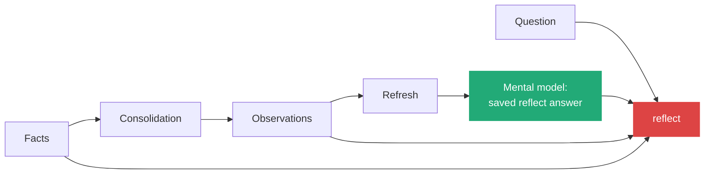

# 13. Memory operations: search, update and insert are not the whole set, reflect, consolidate and maintain are the others

> I use three memory calls (search, update, insert); Hindsight's three are retain, recall and reflect plus a background worker that consolidates facts into observations and refreshes knowledge pages, and lamarck adds maintenance (gates, lifecycle, decay, a size budget), so my set lacks a synthesize operation (reflect) and a maintenance loop, and the question is whether my store needs them.

Related: [10 Memory](10_Memory.md) · [11 Memory known problems](11_Memory_Known_Problems.md) · [12 Memory audit ledger](12_Memory_Audit_Ledger_In_Memory_Or_State.md) · [06 Context window and compaction](06_Context_Window_And_Compaction.md) · [25 Tool execution instead of tool calls](25_Tool_Execution_Instead_Of_Tool_Calls.md)

Source: S02E01 article, figure 22 (the Hindsight flow). Hindsight's retain, recall, reflect and mental-model docs, the lamarck README, Mem0, supermemory and the Anthropic memory tool (see [10](10_Memory.md)), and the joelclaw memory skill, read through fetch agents on 2026-11-15. Joel Hooks' article itself was unreachable. See [Fact-check](#fact-check).

## Glossary

| Term | What it means here | Same thing elsewhere | Not to be confused with |
|---|---|---|---|
| Operation | One call on the memory API | Retain, recall, reflect; add, search | A tool in the agent's tool list |
| Retain / insert | Store new information | Hindsight `retain`, Mem0 `add` | An upsert, which replaces by `document_id` |
| Recall / search | Find stored pieces | Hindsight `recall`, Mem0 `search` | Reflect, which returns an answer |
| Reflect | An agentic loop over memory that returns a synthesized answer | Hindsight `reflect` | A summary stored for later |
| Consolidation | A background job that turns facts into observations | Hindsight worker | Extraction at write time |
| Mental model | A saved reflect response that is refreshed | Hindsight mental models, knowledge pages | An observation |
| Quality gate | A cheap rule before a write | lamarck dedup, path and hash filters | An LLM judgement |
| Lifecycle / decay | Items move candidate, established, proven, deprecated and fade | lamarck, 90-day half-life | Deletion |

## 1. The problem

My memory has three calls: search, update, insert. I never use reflect. **Which operations do the memory systems expose, what do reflect and the background jobs add, and which do I need for my flat BM25 store?**

## 2. The lecture's figure

![The lecture's Hindsight flow. Your AI agent calls retain, recall and reflect on the Hindsight API. Retain stores what happened into sources (documents and chunks), from which facts are extracted. Recall searches memories (facts and observations) by meaning, keywords, entities and time. Reflect reasons over memories to produce an answer from synthesized mental models and knowledge pages. A Hindsight worker, in red, runs consolidation, which turns facts into observations, and refresh, which rewrites knowledge pages from observations.](img/hindsight-three-calls-and-worker.png)

Source: S02E01 article, figure 22. Caption: "Your agent uses three calls: retain(), recall() and reflect(). The Hindsight Worker turns facts into observations, and then rewrites knowledge pages from them."

## 3. Operations by system

| Kind | My store | Hindsight | Mem0 OSS | supermemory | Anthropic memory tool | lamarck |
|---|---|---|---|---|---|---|
| Write | insert, update | `retain` (upserts by `document_id`, `replace` or `append`) | `add`, `delete_all` | `add` | `create`, `str_replace`, `insert`, `delete`, `rename` | Offline learn from history |
| Read | search | `recall` | `search`, `get_all` | `search`, `profile` | `view` (directory, then file range) | None at runtime: writes `MEMORY.md` |
| Derive | none | `reflect`, background consolidation and refresh | Extraction at `add` | Graph of facts | None | LLM reflection, curation |
| Maintain | none | Observations refined, mental-model refresh | `expiration_date`, hash dedup | Updates win, history can remain | Delete old files by hand | Gates, lifecycle, decay, 200-line budget |

Mem0 `update`, `delete` and `history` reference pages were not read.

## 4. Reflect in detail

Hindsight `retain` stores extracted facts, not the raw text. `recall` runs semantic, BM25, graph and temporal searches and returns pieces. `reflect` is different: an agentic loop that uses the tools `lookup`, `recall`, `learn` and `expand`, checks mental models first, then observations, then raw facts, and returns markdown text with `based_on`, an optional structured output and a trace. A retrieval failure returns HTTP 500, not a partial answer. The round count is not documented.

A mental model is "a saved reflect response". Its trigger can refresh it after each consolidation or on a cron (the two are mutually exclusive), in `full` or `delta` mode, and a scheduled tick runs only if memories in scope changed.

For my store, a reflect-like operation would be: search, let a model synthesize, and optionally save the answer as a derived page that links to its source records. That is my reasoning, not a vendor design. It costs a model call per question, and a saved page adds a staleness problem the refresh trigger exists to solve.

## 5. Maintenance: what lamarck shows

lamarck (MIT, 21 stars, two commits) turns Claude Code history into `MEMORY.md` files. It is a design reference, not a dependency.

| Mechanism | What it does |
|---|---|
| Cursor | Reads only new lines of `history.jsonl` with a byte offset and inode tracking |
| Ledger | `processed.jsonl` prevents re-extraction. A crash resets "processing" to "queued" |
| Redaction | Secrets removed before any LLM call |
| Gates | Jaccard dedup at 0.85, drop absolute paths and commit hashes, category quotas, minimum scores |
| Lifecycle | candidate, established, proven, deprecated, with conflict detection |
| Decay | 90-day half-life on feedback. A harmful signal weighs 4 times a helpful one |
| Budget | `MEMORY.md` under 200 lines, overflow into topic files |
| Schedule | Cron, or a hook after a conversation |

## 6. Joel Hooks' pipeline

The article was unreachable (DNS failure from the fetch tool), so I did not read it. His repository's memory skill says the earlier design, observations with write gates and reflect or promote into `MEMORY.md`, was retired on 2026-07-17. The current shape derives scoped observations and reflections, and recall returns "flowing reflections, flowing observations, and curated Brain pages as separate lanes". `MEMORY.md` is only a pointer index, dedupe is permanent, and session-start briefing injection is off. The lesson I take: even the author dropped automatic promotion into the always-loaded file, and kept lanes separate.

## 7. What I would review

| Question | Why |
|---|---|
| Do I want a synthesize operation, and for which repeated questions? | Reflect pays when the same question recurs |
| Do I have a write gate before an insert? | Cheap rules keep the store small |
| Is there a decay or lifecycle for stale items? | Otherwise old items stay forever |
| Is there a cursor and a ledger for ingest? | Idempotent reruns |

## Summary

Search, update and insert cover read and write. Systems add a synthesize call (reflect), background consolidation and refresh, and maintenance with gates, lifecycle and decay. I decide per need: a reflect-like call for repeated questions, a gate before insert, and decay for stale items.

## Open questions

- Which repeated questions would a saved reflect answer serve, and how would I refresh it?
- Which of lamarck's gates fit a flat BM25 store?

## Fact-check

| # | Claim | Verdict | Source | Checked |
|---|---|---|---|---|
| 1 | Hindsight has retain, recall and reflect, and a worker that consolidates and refreshes | **Agrees**, vendor | [retain](https://hindsight.vectorize.io/developer/api/retain), [recall](https://hindsight.vectorize.io/developer/api/recall), [reflect](https://hindsight.vectorize.io/developer/api/reflect). Recall's tail is summary only | 2026-11-15 |
| 2 | Reflect checks mental models, then observations, then raw facts | **Agrees** | Reflect docs, read to the end. Round count not documented | 2026-11-15 |
| 3 | A mental model is a saved reflect response refreshed on a trigger | **Agrees** | [Mental models](https://hindsight.vectorize.io/developer/api/mental-models), first 40k of 74k characters verbatim | 2026-11-15 |
| 4 | lamarck gates, lifecycle, 90-day decay, 200-line budget | **Agrees** | [lamarck README](https://github.com/johnlindquist/lamarck). Source files not read. Only one date in it (2026-02-10) | 2026-11-15 |
| 5 | Joel Hooks' pipeline is observe, reflect, promote into `MEMORY.md` | **Outdated** | The [skill](https://raw.githubusercontent.com/joelhooks/joelclaw/main/skills/memory-system/SKILL.md) says that stack was retired 2026-07-17. The article was not read | 2026-11-15 |
| 6 | Reflect is worth adding to my store | **Unverified**, my reasoning | No test | 2026-11-15 |

## Sources

- S02E01 article, figure 22.
- [Hindsight retain](https://hindsight.vectorize.io/developer/api/retain) · [recall](https://hindsight.vectorize.io/developer/api/recall) · [reflect](https://hindsight.vectorize.io/developer/api/reflect) · [mental models](https://hindsight.vectorize.io/developer/api/mental-models)
- [lamarck](https://github.com/johnlindquist/lamarck) · [joelclaw memory skill](https://raw.githubusercontent.com/joelhooks/joelclaw/main/skills/memory-system/SKILL.md) · [Joel Hooks' article](https://joelclaw.com/observation-pipeline-persistent-ai-memory) (unreachable)
- My own reasoning: the operations table's "my store" column, the reflect-like operation and section 7.
