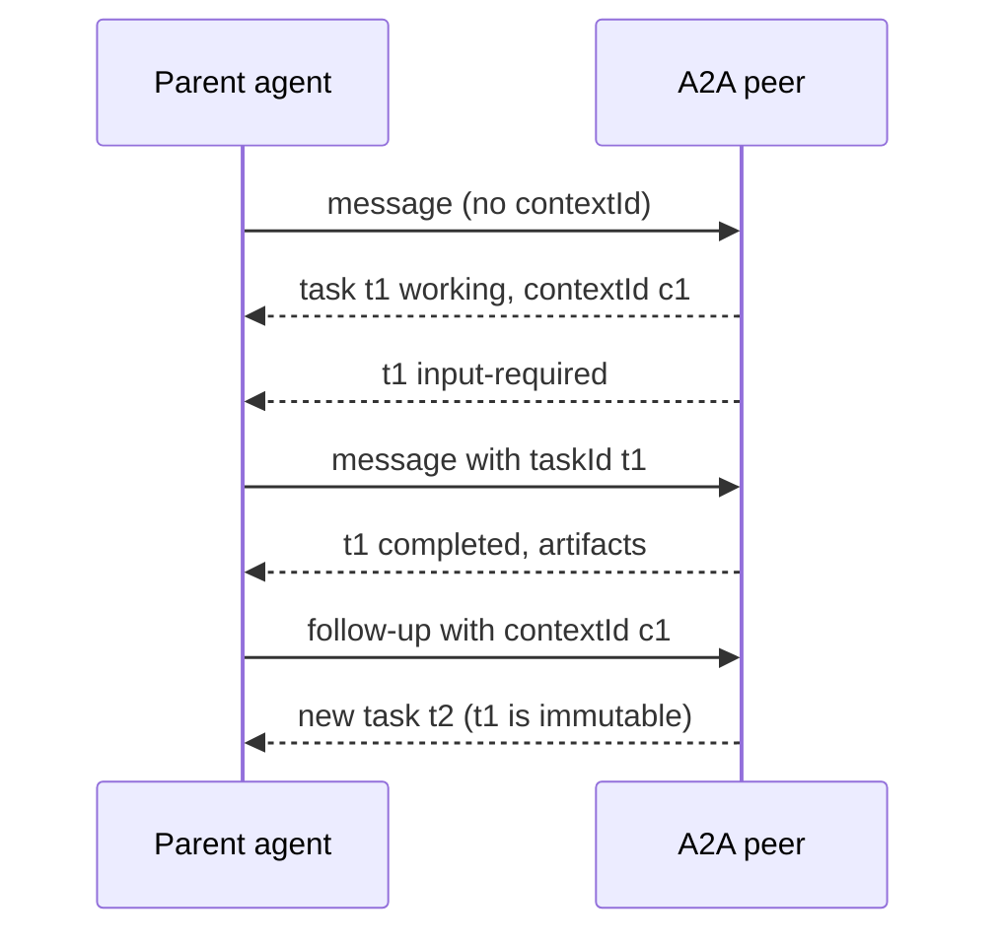

# 14. A subagent is a sub-thread in my process or a peer behind A2A: the difference is whose context and whose lifetime

> An in-process subagent shares my process, store and deadline but starts with a fresh context and returns one final message; an A2A peer is opaque, owns its own store and execution and is addressed by a task under a `contextId`, which is easier to run and limit in the cloud, at the price of a shared trace and tight control.

Related: [02 Persistence, access, isolation](draft_02_Persistence_Access_Isolation.md) · [01 Agent loop](01_Agent_Loop_Stop_Limits_Recovery.md) · [07 Tool approval, durable waits](draft_07_Tool_Approval_Durable_Waits.md) · [09 Extend, adjust or leave the framework](draft_09_Extend_Adjust_Or_Leave_The_Framework.md) · [Lecture 2: 12 Subagents vs workers](../Lecture_2_Context_Agents_md_Skills_Tools/12_subagents_vs_workers.md) · [Lecture 4: 07 Multi-agent coordination](../Lecture_4_Harness/07_Multi_Agent_Coordination.md)

Source: S02E01 article, "Threads and sessions" (figure 7). A2A specification, LangGraph, Microsoft Agent Framework, OpenAI, Claude Code and Anthropic and Cognition articles read through fetch agents on 2026-11-15. My own design is marked. See [Fact-check](#fact-check).

## Glossary

| Term | What it means here | Same thing elsewhere | Not to be confused with |
|---|---|---|---|
| Thread | The record of one interaction line. Can span sessions | LangGraph `thread_id`, OpenAI Conversation, A2A `contextId` | A process or OS thread |
| Session | One continuous run of the harness on a thread | Claude Code session | A thread |
| Sub-thread | An in-process subagent: fresh context, own transcript, final message returns | Claude Code subagent, LangGraph subgraph | An A2A peer |
| A2A peer | A remote agent reached over A2A | `A2AAgent` (Microsoft), LangGraph `RemoteGraph` | An MCP tool |
| Task | A2A unit of work with an `id` and a state. Immutable once terminal | A LangGraph run | A thread |
| `contextId` | Server-generated id grouping tasks and messages of one conversation | LangGraph `thread_id` (Agent Server mapping) | `taskId` |
| Orchestrator | The agent that owns the thread, the shared context, deadlines and the audit trail, and delegates tasks | Claude Code main agent, Anthropic's lead agent | A peer |
| Disposable peer | A subagent that does one task, returns its response and keeps no history | Claude Code subagent (fresh context, final message) | A long-lived worker |
| Opaque | The caller cannot see the peer's internal state, memory or tools | - | Private data |

## 1. The problem

The lecture draws a subagent as its own thread inside a main thread. In the cloud I run each agent as a separate process behind A2A. **How do the two models differ, and what does the industry say about the trade-off?**

## 2. The lecture's figure

Source: S02E01 article, figure 7. Caption: "The user comes back, and the main thread goes on in a new session. In session 2, the main thread connects with a subagent thread."

## 3. Two ways to run a subagent

| Axis | In-process (Claude Code) | In-process (LangGraph subgraph) | A2A peer |
|---|---|---|---|
| Context in | Fresh window. Only the Agent tool's prompt string comes from the parent | Own state schema, data passed by a wrapper node | The message, plus a `contextId` the peer maps to its own history |
| Result out | Only the final message | Subgraph output | Task status, messages, artifacts |
| State | Separate transcript file, persists independently | Through the parent's checkpointer: per-invocation (default), per-thread or stateless | The peer's own store, opaque to me |
| Limits | Cost counts toward the parent query. Nesting depth 3 by default | The parent's `recursion_limit` | The peer's own limits and my per-task deadline |
| Failure | Shares my process | Shares my process | Own process, own failure and restart |
| Internals visible | The transcript on disk | Yes, except behind a tool call | No, by design |

## 4. What industry says

| Source | Statement | Date |
|---|---|---|
| [A2A spec](https://a2a-protocol.org/latest/specification/) (v1.0.0, Agentic AI Foundation) | Agents work "without needing access to each other's internal state, memory, or tools". `contextId` groups tasks. A follow-up in the same context is a new task. Which messages the peer keeps in task history is its decision | read 2026-11-15 |
| [A2A and MCP](https://a2a-protocol.org/latest/topics/a2a-and-mcp/) | "MCP is vertical" (an agent and its tools), "A2A is horizontal" (agents to agents) | same |
| [LangGraph Agent Server](https://docs.langchain.com/langsmith/agent-server-api/a2a/a2a-json-rpc.md) | `message.contextId` maps to `thread_id`. Text and data parts only. `tasks/cancel` is not supported | same |
| [Microsoft Agent Framework](https://learn.microsoft.com/en-us/agent-framework/integrations/by-component/agent-services/a2a) | `A2AAgent` keeps `context_id`, `task_id` and task state in the session. Remote tools are invisible. A service session id is not an authorization boundary | page updated 2026-11-02 |
| [Claude Code subagents](https://code.claude.com/docs/en/agent-sdk/subagents.md) | "only its final message returns to the parent". Use one when a side task would flood the main context | no date shown |
| [Anthropic multi-agent research](https://www.anthropic.com/engineering/multi-agent-research-system) | Subagents compress through their own context windows. About 15× the tokens of a chat. Fits breadth-first work, not tasks that need shared context | 2025-06-13 |
| [Cognition: Don't Build Multi-Agents](https://cognition.com/blog/dont-build-multi-agents) | Share full agent traces. Actions carry implicit decisions that conflict. Default to a single-threaded agent | 2025-06-12 |
| [OpenAI](https://developers.openai.com/api/docs/assistants/migration.md) | Assistants threads sunset 2026-08-26, replaced by Conversations. This is conversation state, not delegation | 2026-08-26 |

None of these compares an in-process sub-thread with a remote peer head to head. The comparison in the next section is my own reasoning.

## 5. My principle: simple, disposable peers, and an orchestrator that owns state

- **The peer:** gets a task, does the job, sends the response and is disposed. It keeps no history and shares none outside the task (my principle).
- **The orchestrator:** owns the thread, the shared context, the audit trail, deadlines and cancellation. That is why it carries so much weight in my design.
- **Fit with A2A:** a task in a terminal state cannot restart and a follow-up is a new task ([life of a task](https://a2a-protocol.org/latest/topics/life-of-a-task/)). Disposal after completion matches that. The peer needs no retention period, because nothing is kept.
- **Gap:** my A2A server does not support task cancel. A runaway peer is stopped at process level (timeout or kill), not through the protocol. LangGraph's server has the same gap.
- **Gains:** each agent has its own lifetime, deadline, scaling, sandbox and failure. The Agent SDK has no per-subagent wall-clock deadline ([01](01_Agent_Loop_Stop_Limits_Recovery.md)), a process I can time out.
- **Costs:** no shared trace, so Cognition's conflict risk is mine to manage. Model routing stops at the A2A boundary ([Lecture 2: 12](../Lecture_2_Context_Agents_md_Skills_Tools/12_subagents_vs_workers.md)). Token cost rises as Anthropic reports. The orchestrator is a single point of failure for context.

## 6. What the orchestrator passes: a summary or the trace

I have not settled this. The options, with what the sources say:

| Option | What the peer gets | Source or reasoning | Risk |
|---|---|---|---|
| Task prompt only | One prompt string | Claude Code: "The only content you pass from parent to subagent is the Agent tool's prompt string" | The peer misses implicit decisions (Cognition) |
| Decision summary | Goal, constraints, decisions with reasons, options ruled out, artifact references, expected output | No standard found. My candidate | A summary can drop a detail, as in [04](draft_04_Context_Window_Cache_Compaction.md) |
| Full trace | The parent's history | Cognition: share full traces | Tokens, and parent context leaks across the boundary |
| References | Links to artifacts, not contents | Anthropic has subagents pass lightweight references back to the coordinator. The same idea in the other direction is my reasoning | The peer needs access to the store |

My criterion: with disposable peers a wrong guess costs a rerun, so I compare the cost of a rerun with the tokens and exposure of a fuller context. The summary is the middle path, and its fields are the open question.

## Summary

In-process subagents give a fresh context and one returned message inside my process. A2A peers give an opaque, separately run agent addressed by task and `contextId`. Sources describe each but do not compare them. I run simple, disposable A2A peers in the cloud, and the orchestrator owns the state and the shared context. What it passes to a peer is open.

## Open questions

- Which fields does the decision summary need, and who writes it: the orchestrator model or code?
- How do I stop a peer that ignores its deadline while the server cannot cancel a task?
- Does the audit trail I keep in the harness cover what a disposed peer did?

## Fact-check

| # | Claim | Verdict | Source | Checked |
|---|---|---|---|---|
| 1 | A thread can span sessions and involve subagents with their own thread | **Agrees** | [Claude Code subagents](https://code.claude.com/docs/en/agent-sdk/subagents.md): "stored in separate files and persist independently". [LangGraph subgraphs](https://docs.langchain.com/oss/python/langgraph/use-subgraphs) | 2026-11-15 |
| 2 | A2A `contextId` groups tasks and messages, opaque to clients, new task per follow-up | **Agrees** | [A2A spec](https://a2a-protocol.org/latest/specification/): parts read verbatim, parts via summary. Names differ between v0.3 and v1.0 | 2026-11-15 |
| 3 | A2A hides the peer's internal state | **Agrees** | Spec section 1 and [key concepts](https://a2a-protocol.org/latest/topics/key-concepts/), verbatim | 2026-11-15 |
| 4 | LangGraph Agent Server maps `contextId` to `thread_id` | **Agrees** | [A2A endpoint docs](https://docs.langchain.com/langsmith/agent-server-api/a2a/a2a-json-rpc.md), no date shown | 2026-11-15 |
| 5 | Claude Code subagents return only the final message and can nest to depth 3 | **Agrees** | [Agent SDK subagents](https://code.claude.com/docs/en/agent-sdk/subagents.md), read in full | 2026-11-15 |
| 6 | Multi-agent costs about 15× the tokens of chat | **Agrees** for Anthropic's system | [Anthropic](https://www.anthropic.com/engineering/multi-agent-research-system), vendor figure for its research system, not general | 2026-11-15 |
| 7 | Not every harness supports subagents and easy thread access | **Lecture-specific** | Article states it without naming harnesses | 2026-11-15 |
| 8 | A subagent is a sub-thread in the parent's process | **Differs** in my design | The lecture draws a subagent thread. I run A2A processes | 2026-11-15 |
| 9 | Process per agent is easier to manage in the cloud | **Unverified**, my reasoning | No source compares the two directly | 2026-11-15 |
| 10 | A task in a terminal state cannot restart, so disposal after completion fits A2A | **Agrees** | [Life of a task](https://a2a-protocol.org/latest/topics/life-of-a-task/): "Once a task reaches a terminal state ... it cannot restart" | 2026-11-15 |
| 11 | My A2A server supports task cancel | **No**, my setup | LangGraph Agent Server also lists `tasks/cancel` as not supported ([docs](https://docs.langchain.com/langsmith/agent-server-api/a2a/a2a-json-rpc.md)). The spec defines a cancel operation, section not read in full | 2026-11-15 |
| 12 | Disposable peers with an owning orchestrator is the right design | **Lecture-specific**, my principle | Consistent with Claude Code's fresh-context subagents and Cognition's single-owner argument. No source tests it | 2026-11-15 |

## Sources

- S02E01 article, figure 7.
- [A2A specification](https://a2a-protocol.org/latest/specification/) · [A2A and MCP](https://a2a-protocol.org/latest/topics/a2a-and-mcp/) · [key concepts](https://a2a-protocol.org/latest/topics/key-concepts/)
- [LangGraph A2A endpoint](https://docs.langchain.com/langsmith/agent-server-api/a2a/a2a-json-rpc.md) · [LangGraph subgraphs](https://docs.langchain.com/oss/python/langgraph/use-subgraphs) · [Microsoft Agent Framework A2A](https://learn.microsoft.com/en-us/agent-framework/integrations/by-component/agent-services/a2a)
- [Claude Code subagents](https://code.claude.com/docs/en/agent-sdk/subagents.md) · [Anthropic multi-agent research](https://www.anthropic.com/engineering/multi-agent-research-system) · [Cognition](https://cognition.com/blog/dont-build-multi-agents) · [OpenAI Assistants migration](https://developers.openai.com/api/docs/assistants/migration.md)
- [A2A life of a task](https://a2a-protocol.org/latest/topics/life-of-a-task/)
- My own reasoning: the comparison table's last column, sections 5 and 6.
