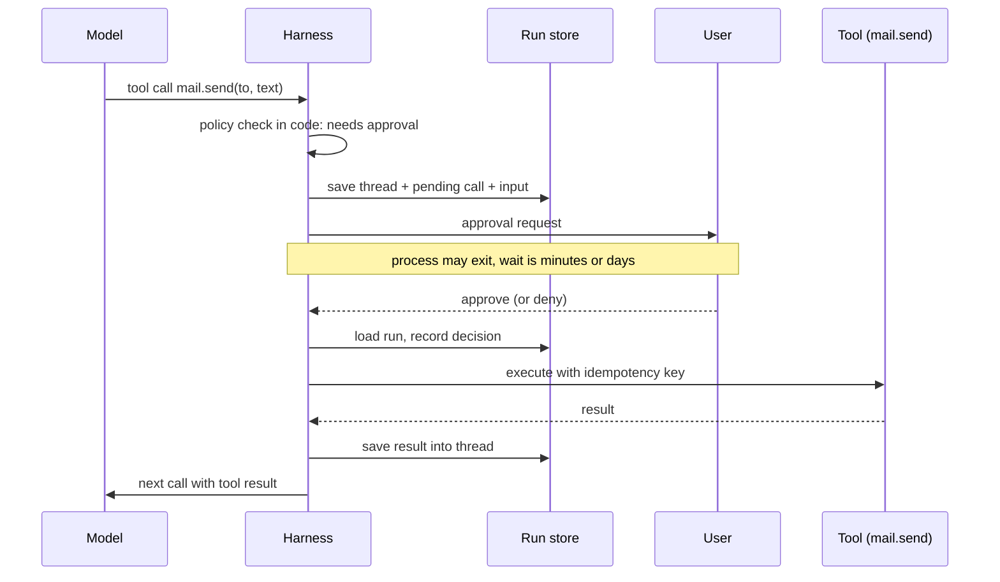
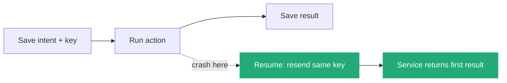
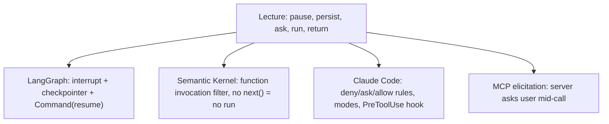

# 14. Tool approval is the harness's job, and the wait must survive a restart

> The model only asks for an irreversible tool call. The harness stops, saves the run, asks a human, and executes the tool in code after the answer, even days later. That only works if the run state lives on disk and the action is idempotent.

Related: [03 Agent loop, stop limits, recovery](03_Agent_Loop_Stop_Limits_Recovery.md) · [04 HITL and execution isolation](04_HITL_And_Execution_Isolation.md) · [05 Instructions, five parts and enforcement](05_Instructions_Five_Parts_And_Enforcement.md) · [07 Tools: awareness, discovery, gateway](07_Context_Tool_Awareness_Avoids_Compression.md) · [15 Evals and traces for agent changes](draft_15_Evals_And_Traces_For_Agent_Changes.md) · [Lecture 1: 17 Ambient, durable agents](../Lecture_1_Mechanics_Behind_Generative_AI/17_ambient_durable_agents.md) · [Lecture 5: 05 Agents maintain the tools I review](../Lecture_5_Workflows_not_tool_sets/05_Agents_Maintain_The_Tools_I_Review.md)

Source: S02E01 article (the approvals paragraph and its sequence figure, with an email tool as the example; the permission and persistence parts), the lecture's `resumable-run` example read on 2026-11-15 as a fetched page summary (not the code), LangGraph, Semantic Kernel, Claude Code and MCP docs checked on 2026-11-15. See [Fact-check](#fact-check).

## Glossary

| Term | What it means here | Same thing elsewhere | Not to be confused with |
|---|---|---|---|
| Approval | A human decision on one concrete tool call (name plus arguments) | - | A prompt line "ask before sending", which is only a recommendation |
| Permission grant | A standing rule the user gives ("this agent may call X") | - | Approval of a single call |
| Run state | Everything needed to continue: thread, pending tool call with its full input, decision, intent record | - | The model's context window, which is rebuilt from the thread on each call |
| Idempotency key | A caller-chosen ID that lets the target service recognise a repeated request and return the first result | - | A retry counter in my harness |

## 1. The problem

An agent loop can call a tool that cannot be undone: send a mail, refund a payment, delete a record. A human must say yes first, and that human may answer in a minute or in three days. **Where does the approval live, who enforces it, and what keeps the run alive while it waits?**

## 2. The approval sequence

The model never executes anything. It emits a tool request. The harness decides whether to run it.

Lecture figure, as described in its alt text: "The model asks for mail.send. The harness does not run it, but asks the user for approval. The user may answer days later. After approval, the harness runs the tool and sends the result back to the model." The tool name, address and text are example values.

Important:
- The harness does not run the tool at the first request.
- The wait sits between "save" and "load". Nothing holds a process open.
- A denial is also a result. It goes back to the model as the tool result so the loop can end cleanly.

Not important: the email example. Any irreversible tool fits.

## 3. Why a naive in-memory loop cannot wait

A `while` loop that awaits a prompt keeps the pending call in process memory. A deploy, crash, scale-to-zero or an HTTP timeout loses it. The user then approves something the system no longer knows about. A loop that waits for days also pins a worker.

| Design | State lives in | Survives restart | Wait cost |
|---|---|---|---|
| In-memory loop, blocking on input | Process memory | No | One held worker per pending approval |
| Persisted run, process exits at approval | Thread file or DB | Yes | Zero compute while waiting |
| Workflow engine (durable execution) | Engine history | Yes | Engine-managed timer or signal |

The lecture's `resumable-run` example makes this literal. Each session is a new OS process, so only files on disk carry state. Session 1 asks the model, saves the tool call with its full input and exits. Session 2 loads the thread, records the approval and runs the action. Source: GitHub page summary read on 2026-11-15, I did not read the code.

## 4. Idempotency: the second half of resuming

Persisting the pending call is not enough. A crash can happen after the action ran and before its result was saved. The example crashes session 2 at exactly that point and compares three recoveries in session 3.

| Recovery mode | What session 3 does | Outcome |
|---|---|---|
| `restart` | Ignores the saved thread, model picks the action again | Action runs twice |
| `thread` | Reruns the pending call from the thread | Action runs twice, the thread never recorded that it ran |
| `intent` | Resends the saved idempotency key | Service returns the first result, action runs once |

The saved intent only helps if the outside service honours the key. The example states this. That is the architect point: **exactly-once is a property of the target API plus my intent record, not of my loop.** For a service without idempotency keys I need a check-then-act on my own ledger, and a residual risk remains.

## 5. Where approval is enforced: code, not prompt

A line in the system prompt such as "never send mail without asking" is a recommendation. The lecture says the same about Boundaries in the prompt. Enforcement is a gate in the harness, outside the model's reach.

| Layer | Mechanism | Binding |
|---|---|---|
| Prompt | "Ask before sending" | No, the model may ignore it |
| Tool registry (config-gated) | A flag decides whether the tool is registered at all | Yes, the model never sees a tool that is off |
| Policy gate in the harness | Rule table: tool X needs approval, tool Y is denied | Yes |
| Tool implementation | Ownership and scope checks inside `execute` | Yes, runs on every call |

Config-gated tools are the strongest and cheapest control. In the transcript demo a setting turns the `getOrder` tool on or off. With it off, the model is only sent the tool list without it, so it cannot call it. That demo is also where the lecturer enforces access in code: the query needs both order ID and customer ID, so another customer's order returns "not found". I cover that case in [15](draft_15_Evals_And_Traces_For_Agent_Changes.md).

Permission grants are the standing counterpart. The agent asks for a capability, the user grants it, and the grant is stored as a rule the gate reads. The lecture mentions permissions in the persistence part but gives no mechanism, so the storage and expiry of grants is my design question, not a lecture fact.

## 6. How the same shape appears in other stacks

| Stack | Pause mechanism | Durable wait | Gotcha |
|---|---|---|---|
| LangGraph | `interrupt()` inside a node or tool, resume with `Command(resume=...)` | Needs a checkpointer and a `thread_id`. The graph "waits indefinitely until you resume" | On resume the whole node restarts from the top, so side effects before `interrupt()` must be idempotent. `InMemorySaver` is lost on restart |
| Semantic Kernel (C#) | `IFunctionInvocationFilter`: not calling `next` means the function does not run | None built in. I must add the persistence and the human step | A filter can block or override a result, but it does not suspend a run by itself |
| Claude Code | Rules evaluate deny, then ask, then allow. Modes such as `acceptEdits`, `dontAsk`, `bypassPermissions`. `PreToolUse` hooks run before the prompt | Interactive session, not a days-long wait. `dontAsk` and `denyInsteadOfPrompting` deny rather than wait when unattended | Docs: rules are "enforced by Claude Code, not by the model". A hook returning allow does not override a deny or ask rule |
| MCP elicitation | A server sends `elicitation/create` during a request. User can accept, decline or cancel | Defined as an in-flight request, not a persisted wait | New feature of the spec, may evolve. Not a substitute for a harness approval gate |

The LangGraph row is the closest match to the lecture. Its re-run-from-the-top rule is the same hazard as the `thread` recovery mode above. Semantic Kernel is the most relevant for my C# work: the filter is the right place for the policy gate, but the durable wait stays my code.

## Summary

- Approval is a harness state transition: model asks, harness saves and stops, human decides, harness executes and returns the result.
- Waiting for days means the pending call and its full input sit in storage and the process may exit.
- Idempotency makes resume safe: persist an intent with a key, and rely on the target service to dedupe.
- Enforce in code (tool registry, policy gate, checks inside the tool). The prompt only shapes what the model tries.

## Open questions

- How do I store and expire permission grants so that "agent asks, user grants" cannot widen silently?
- What is the approval timeout policy: auto-deny after N days, or wait without limit?
- Which of my tools have no idempotency key on the target side, and what ledger do I need for them?

## Fact-check

| # | Claim | Verdict | Source | Checked |
|---|---|---|---|---|
| 1 | The harness is responsible for approvals before irreversible actions, and the wait can take days | **Agrees** | LangGraph interrupts docs: graph "waits indefinitely until you resume" ([docs](https://docs.langchain.com/oss/python/langgraph/interrupts), fetched page). Lecture claim itself is [S02E01](https://github.com/MEGA-DOT-DEV/examples/tree/main/examples/resumable-run) | 2026-11-15 |
| 2 | After approval the harness, not the model, runs the tool and returns the result | **Agrees** | LangGraph docs: `Command(resume=...)` value returns from `interrupt()` and the tool code then runs in the graph. Claude Code docs: rules are enforced by Claude Code, not the model ([permissions](https://code.claude.com/docs/en/permissions)) | 2026-11-15 |
| 3 | A durable wait needs persisted state | **Agrees** | LangGraph requires a checkpointer and `thread_id` for `interrupt`. `InMemorySaver` loses state on restart ([persistence](https://docs.langchain.com/oss/python/langgraph/persistence), search-tool summary of the page) | 2026-11-15 |
| 4 | Resuming reruns code, so the action must be idempotent | **Agrees** | LangGraph: "the runtime restarts the entire node from the beginning"; side effects before `interrupt` "should (ideally) be idempotent" ([interrupts](https://docs.langchain.com/oss/python/langgraph/interrupts)). Lecture example: three recovery modes ([resumable-run](https://github.com/MEGA-DOT-DEV/examples/tree/main/examples/resumable-run), page summary only) | 2026-11-15 |
| 5 | Semantic Kernel filter can block a call | **Agrees** | "Without calling `next`, the operation will not be executed" ([filters](https://learn.microsoft.com/en-us/semantic-kernel/concepts/enterprise-readiness/filters)). It offers no durable suspension | 2026-11-15 |
| 6 | Claude Code evaluates deny, ask, allow in order and a PreToolUse hook cannot override deny or ask | **Agrees** | [permissions](https://code.claude.com/docs/en/permissions), read from the saved page | 2026-11-15 |
| 7 | MCP elicitation lets a server request user input mid-call | **Agrees**, with maturity caveat | [MCP spec 2025-11-25, elicitation](https://modelcontextprotocol.io/specification/2025-11-25/client/elicitation.md) via search summary. Draft spec changes the flow, verify before presenting | 2026-11-15 |
| 8 | Exactly-once effect needs the target service to honour the key | **Agrees** | resumable-run page summary. Lecture does not state it as a rule, this is my reading of the example | 2026-11-15 |
| 9 | Permission grants (agent asks, user grants) are part of the harness | **Unverified** | Article mentions permissions only in passing. No mechanism cited. Verify before presenting | 2026-11-15 |

## Sources

- Lecture: [S02E01 article](https://hq.mega.dev/figures/s02e01/artifacts/lesson/figure-14/frame.html), figure 14; example [resumable-run](https://github.com/MEGA-DOT-DEV/examples/tree/main/examples/resumable-run).
- [LangGraph interrupts](https://docs.langchain.com/oss/python/langgraph/interrupts) and [persistence](https://docs.langchain.com/oss/python/langgraph/persistence).
- [Semantic Kernel filters](https://learn.microsoft.com/en-us/semantic-kernel/concepts/enterprise-readiness/filters).
- [Claude Code permissions](https://code.claude.com/docs/en/permissions).
- [MCP elicitation](https://modelcontextprotocol.io/specification/2025-11-25/client/elicitation.md).
- My own reasoning: the comparison table, the idempotency framing, the open questions.
