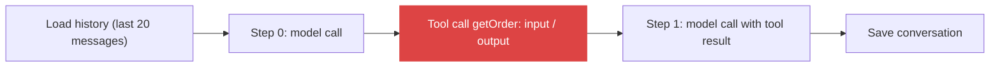
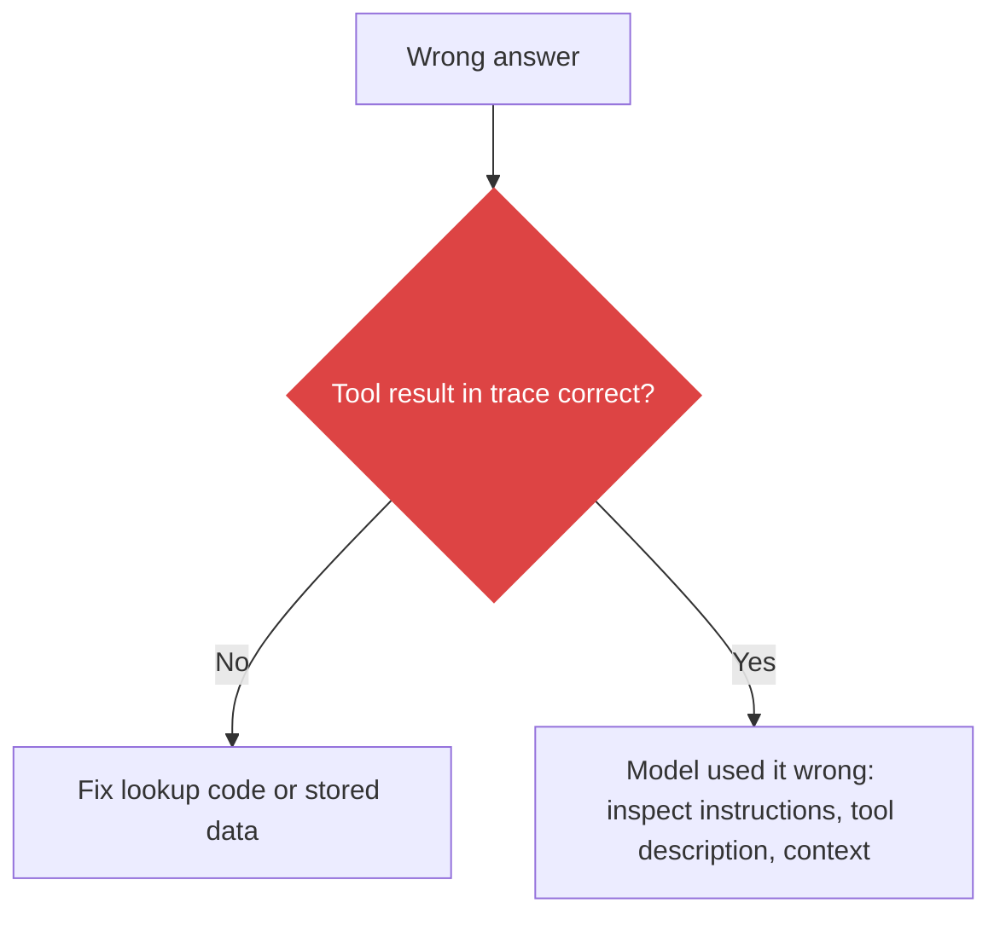

# 15. A trace shows where a wrong answer came from, and measured steps size the limit

> A trace of one run tells me whether the tool returned the wrong thing or the model used the right thing wrong, and the same trace gives the number of steps a task really needs, so I set the step limit from measurement and not from a default; a step is a model call in the lecture and a super-step in LangGraph, so the two limits are not the same number.

Related: [16 Evals for agent changes](16_Evals_For_Agent_Changes.md) · [03 Agent loop, exits, limits, recovery](03_Agent_Loop_Stop_Limits_Recovery.md) · [04 HITL and execution isolation](04_HITL_And_Execution_Isolation.md) · [05 Instructions, five parts and enforcement](05_Instructions_Five_Parts_And_Enforcement.md) · [10 Memory](10_Memory.md) · [14 Tool approval and durable waits](14_Tool_Approval_Durable_Waits.md) · [Lecture 5: 05 Agents maintain the tools I review](../Lecture_5_Workflows_not_tool_sets/05_Agents_Maintain_The_Tools_I_Review.md)

Source: S02E01 transcript (a retail-agent demo in Mastra, used only as a worked example: the trace view and `maxSteps`), the lecture's `loop-error-recovery` example (page summary, not the code), LangSmith, LangGraph, OpenTelemetry and Semantic Kernel docs, checked on 2026-11-15. See [Fact-check](#fact-check).

## Glossary

| Term | What it means here | Same thing elsewhere | Not to be confused with |
|---|---|---|---|
| Trace | The record of one run: every step, model call and tool call with inputs and outputs | LangSmith "tree of runs", OpenTelemetry spans | A log line, or the chat transcript |
| Step | One model call in the loop. That call may request several tools | Claude Agent SDK turn | One tool call; a LangGraph superstep |
| Superstep | One round of node execution in a LangGraph graph. A model node and a tools node are usually two | `recursion_limit` counts these | A model call |
| Step limit | The maximum number of steps in a run, not a target | Mastra `maxSteps`, LangGraph `recursion_limit` | A timeout |

## 1. The problem

Many people treat agents as black boxes. **When an answer is wrong, where did it come from? And how many steps should a run be allowed?** Both questions are answered by reading the trace.

## 2. A trace is one run, read step by step

In the lecture demo the trace of one customer turn has this order: history loaded from memory, model steps (numbered from 0), tool calls as nested entries, conversation saved for the next message.

Each step input carries the instructions again plus recent history, so the instructions matter on every call. The tool entry shows what the function received and what it returned. Important: the tool entry separates "tool wrong" from "model wrong", and the ownership check lives in code, so a failed check appears as a tool output and not as model behaviour. Not important: the studio UI, because any trace viewer shows the same tree.

## 3. The debugging rule

The lecturer's version: if the shoe size was wrong in the tool result, check the lookup code or the stored order. If it was right in the tool result and wrong in the answer, investigate how the agent used it. In the demo the odd behaviour (asking for exchange details the agent could not process) was traced to the instructions, which told it to collect replacement details. The fix was an instruction change, with model, order and tools unchanged.

## 4. Step limits are measured, not guessed

The lecture's definition: "A step is a call to the model and that call can request more than one tool. So five steps doesn't mean five tool calls." The limit is a maximum, not a target. To choose it, run scenarios and measure steps to success. In the demo the agent needed two steps, and a limit of five gave buffer.

| Framework | What the limit counts | Default | On exceed |
|---|---|---|---|
| Lecture demo (Mastra `maxSteps`) | Model calls per run | 5 (set in the demo) | Run stops |
| LangGraph `recursion_limit` | Supersteps, a round of node execution | Python: 10,007 since 1.1.4 (10,000 for 1.0.6 to 1.1.3). The JS docs say 25 | `GraphRecursionError` |

These differ. A ReAct loop in LangGraph usually takes one superstep for the model node and one for the tools node, so one model call plus its tools is about two supersteps, and several parallel tool calls inside one tools node still count once. That mapping is my inference from the superstep definition, not a documented rule, so a LangGraph limit of 10 is not "10 model calls". Measure in the framework I use.

Tuning rule, mine: take the p95 of steps over the success cases and add headroom. The lecture's `loop-error-recovery` example uses a fixed three-step task and states no general limit (page summary), so it gives no number to copy. My own explicit cap and confirmation at the limit are in [03](03_Agent_Loop_Stop_Limits_Recovery.md).

## 5. Tracing tools compared

| Need | LangSmith | OpenTelemetry GenAI | Semantic Kernel |
|---|---|---|---|
| One run as steps | Trace is a tree of runs, each with full inputs and outputs | Spans for model calls, tools, agents | Spans for each auto function invocation loop, function and model call |
| Standard format | Vendor, OTel-compatible mapping | Open spec, status Development | Emits OTel-compatible traces |

OpenTelemetry's GenAI conventions are not stable: the spec pages list Development status, and they moved to a separate `semantic-conventions-genai` repository. Names may change, so I pin the instrumentation version and treat attribute names as a moving target.

## Summary

A trace separates a wrong tool result from a wrong use of it, and it gives the steps a task needs. A step is a model call in the lecture and a super-step in LangGraph, so I measure in my own framework, take the p95 plus headroom, and pin the tracing library version.

## Open questions

- Do I record prompt and tool content in traces, given what customer data may reach them?
- What is the p95 of steps over my success cases?

## Fact-check

| # | Claim | Verdict | Source | Checked |
|---|---|---|---|---|
| 1 | A trace records one run as steps: model calls and tool calls with inputs and outputs | **Agrees** | LangSmith: a trace is a "tree of runs" with "every run, with full inputs and outputs" ([observability concepts](https://docs.langchain.com/langsmith/observability-concepts), fetched page) | 2026-11-15 |
| 2 | If the tool result is right and the answer wrong, investigate model use of the result | **Lecture-specific** | Sound engineering practice, not a vendor rule. Transcript is the source | 2026-11-15 |
| 3 | A step is a model call that can request several tools | **Differs** from LangGraph | `recursion_limit` counts supersteps, default 10,007 in Python since 1.1.4 ([graph API](https://docs.langchain.com/oss/python/langgraph/graph-api), and the source default in `_config.py`; the JS docs say 25). Mastra `maxSteps` semantics come from the transcript only: verify before presenting | 2026-11-15 |
| 4 | Set the step limit by measuring steps on scenarios | **Lecture-specific** | Transcript. Anthropic docs say to base choices on evals ([choosing a model](https://platform.claude.com/docs/en/about-claude/models/choosing-a-model)) but give no step method | 2026-11-15 |
| 5 | OpenTelemetry GenAI conventions are an established standard | **Differs** | Still Development status per spec pages (search summary). Spec moved to [semantic-conventions-genai](https://github.com/open-telemetry/semantic-conventions-genai). Verify status in that repo before presenting | 2026-11-15 |
| 6 | Semantic Kernel emits OpenTelemetry traces for function loops and model calls | **Agrees**, search summary only | [Learn: SK observability](https://learn.microsoft.com/en-us/semantic-kernel/concepts/enterprise-readiness/observability), not fetched. Content-recording defaults unverified | 2026-11-15 |
| 7 | LangGraph Studio shows traces of runs | **Unverified** | Not checked. LangSmith tracing is the part I verified | 2026-11-15 |

## Sources

- Lecture: S02E01 transcript demo; example [loop-error-recovery](https://github.com/MEGA-DOT-DEV/examples/tree/main/examples/loop-error-recovery).
- [LangSmith observability concepts](https://docs.langchain.com/langsmith/observability-concepts) · [LangGraph graph API](https://docs.langchain.com/oss/python/langgraph/graph-api)
- [OpenTelemetry GenAI conventions](https://opentelemetry.io/docs/specs/semconv/gen-ai/) · [moved repository](https://github.com/open-telemetry/semantic-conventions-genai) · [Semantic Kernel observability](https://learn.microsoft.com/en-us/semantic-kernel/concepts/enterprise-readiness/observability)
- [Anthropic: choosing a model](https://platform.claude.com/docs/en/about-claude/models/choosing-a-model)
- My own reasoning: the superstep mapping and the p95 tuning rule.
