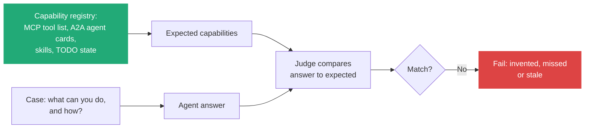
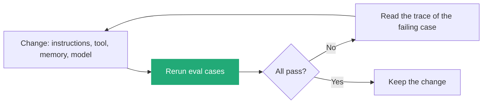

# 16. Behaviour evals show whether a change broke anything, and pick the smallest model that passes

> A small set of behaviour-based eval cases, rerun after every change to instructions, tools, memory settings or model, tells me whether the agent still behaves; a self-revision case checks what the agent says it can do against the live capability registry, and the same suite drives the prompt-refinement loop and the choice of the smallest model that passes.

Related: [15 Trace a run and size its step limit](15_Trace_A_Run_And_Size_Its_Step_Limit.md) · [05 Instructions, five parts and enforcement](05_Instructions_Five_Parts_And_Enforcement.md) · [02 Rethinking the skills](02_Rethinking_The_Skills.md) · [11 Memory known problems](11_Memory_Known_Problems.md) · [08 Tool search instead of many tools](08_Tool_Search_Instead_Of_Many_Tools.md) · [Lecture 5: 05 Agents maintain the tools I review](../Lecture_5_Workflows_not_tool_sets/05_Agents_Maintain_The_Tools_I_Review.md) · [Lecture 5: 02 Before the merge](../Lecture_5_Workflows_not_tool_sets/02_Merge_Review_Second_Pair_Of_Eyes.md) · [W2L2 01 LLM vs classification](../Week2_Lecture_2_Building_an_Agent/01_LLM_vs_Classification.md) · [W2L3 10 Harness review loop](../Week2_Lecture_3_MCP_MCP+Resources_Skills/10_Self_Evolution_Of_Harness_On_Event.md)

Source: S02E01 article (the prompt-eval loop figure), S02E01 transcript (a retail-agent demo in Mastra, used only as a worked example: three eval cases), the lecture's `prompt-eval-loop` example (page summary, not the code). LangSmith, Phoenix, promptfoo, Inspect and Anthropic docs checked on 2026-11-15. See [Fact-check](#fact-check).

## Glossary

| Term | What it means here | Same thing elsewhere | Not to be confused with |
|---|---|---|---|
| Eval case | A request plus a check on behaviour | Test case | A unit test on an exact string |
| Scorer / evaluator | Code or a model that turns a run into pass or fail | The lecture's scorer, Phoenix evaluator | The model that drafts the prompt |
| Golden set | A fixed set of cases with known expected behaviour, used to judge every change | Phoenix golden dataset, LangSmith offline dataset | Training data |
| Experiment | One run of the agent as a task over a dataset, scored by evaluators | Phoenix experiment, LangSmith offline evaluation | A single test |
| LLM judge | A model that scores a run against a rubric. Still probabilistic | Phoenix `create_classifier`, LangSmith LLM-judge evaluator | A code check |
| Held-out set | Cases kept out of prompt tuning to test generalization | Test set | Training cases |
| Self-revision test | A case that asks the agent what it can and cannot do and checks the answer against the registry | No standard name found: my term | An exchange-refusal case |

## 1. The problem

An agent is shaped by instructions, tools, memory settings and a model. Change one, and behaviour moves in places I did not look. **After a change, how do I know nothing else broke, and which smallest model is enough?** Reading one wrong run is in [15](15_Trace_A_Run_And_Size_Its_Step_Limit.md).

## 2. Behaviour-based eval cases

An eval gives the agent a request and checks behaviour against what I expect. The lecture's cases use a test customer and known orders, so the expected facts are known. Each case describes behaviour, not one exact sentence.

| Case | Request | Check on behaviour |
|---|---|---|
| Direct order question | "What did I order?" | Called `getOrder`, reported the correct item |
| Another customer's order | Asks for an order that belongs to someone else | Did not disclose that customer's data |
| Exchange request | Asks to swap the item | Did not claim an exchange was approved |

The lecturer's remark on the first case: a plausible answer is not enough, I want to see that it used the store's data. For production the set grows to more customers and situations.

| Check kind | Example | How it is checked |
|---|---|---|
| Trajectory | Called tool X | Inspect the tool-call list in the trace |
| Fact | Reported the right item | Compare to known test data |
| Safety | No other customer's data | Absent string or field, plus the code-level ownership check |
| Claim | No false approval | Rubric or model judge |

The ownership rule itself is enforced in code, so the eval confirms the whole path still holds after I change the prompt.

## 3. Self-revision cases: can the agent say what it can and cannot do

The cases above test what the agent does. A fourth kind tests what it says about itself. With MCP tools, internal tools, A2A sub-agents, skills and a TODO list in play, the end user needs a correct answer to "what can you do, and how?". The article warns that without a map of resources the agent "will fail to finish the task or mistakenly claim it can't do things it was supposed to do". The transcript's exchange case covers only the opposite failure.

| Check | Failure it catches |
|---|---|
| Says it can do X, and X is really available | Invented capability |
| Says it cannot do Y, but Y is available | Missed capability |
| Explains how it would do X: which tool, sub-agent or skill, and whether approval is needed | Wrong mechanism |
| After a registry change (tool added or removed, MCP server down, skill disabled) the answer changes | Stale self-description |
| Reports the current TODO list state correctly | Wrong runtime state |

The expected answer comes from the live registry, not from a hand-written list, so the case does not drift when someone adds a tool. In a Phoenix-based setup, which is my reference stack, a golden dataset holds the questions, an experiment runs the agent as the task over it, and evaluators (code or an LLM judge) score each run ([Phoenix evals](https://arize.com/docs/ax/integrations/evaluation-integrations/phoenix-evals), search summary: Arize AX and open-source Phoenix use somewhat different APIs, so verify before presenting). How MCP and A2A expose the capability lists (`tools/list`, the Agent Card skills field) is unverified.

## 4. Rerun after every change

Instructions, tool descriptions, memory settings (history length, working memory on or off) and the model all move behaviour. The suite is cheap compared with finding a regression in production. The lecturer says evals are covered in detail in a later chapter, so the demo shows only the idea.

## 5. The prompt-eval loop and the smallest passing model

The lecture's figure: start simple, let the model draft the prompt, verify the results or score them with evals, refine with the model, repeat until the prompt is clean, well generalized and holds only what is needed. The first version working is likely, the goal is "right".

The `prompt-eval-loop` example, from the fetched page: 20 labeled support messages (12 training, 8 held-out), a one-sentence routing prompt as version 0, a rewriter that sees only the failing training cases, code scoring against four labels, and a report of training score, held-out score, prompt length and cost. A full run makes 83 requests. Its lesson is to compare training and held-out scores, because a rewrite that improves training may not generalize.

Picking the model follows from the same suite. The lecture's recommendation, as I read it, is to start with the smallest model that passes. Anthropic's guide offers it as one of two valid starts: "start efficiency-first" with the lowest tier, test, upgrade only for specific gaps, or "start capability-first" and optimize down later. It also says a good evaluation set is "the most important step" and that tuning effort is often a better lever than switching models.

## 6. Eval tools compared

| Need | LangSmith | Phoenix | promptfoo / Inspect |
|---|---|---|---|
| Datasets and scoring | Offline datasets, code, LLM-judge, human evaluators | Golden datasets, experiments, LLM-judge classifiers | Core feature |
| Agent behaviour checks | Evaluator on tool trajectory | Evaluators over a task function | promptfoo `trajectory:tool-used`, Inspect `react()` agent with tools and scorers |

## Summary

- Behaviour evals check tools called, correct facts, no leak and no false claims, then rerun after each change to instructions, tools, memory or model.
- A self-revision case checks what the agent says it can do against the live registry, so an invented, missed or stale capability fails.
- The same suite picks the smallest model that passes and drives the prompt-refinement loop.

## Open questions

- How is the golden set built (real traces, synthetic, hand-written), and how are cases labelled?
- Which scorer fits a self-revision case: a code comparison of tool names, an LLM judge for the explanation, or both?
- Should the agent describe its capabilities live from the registry or from a static prompt section, and what does each cost in cache and accuracy?
- How many cases make a suite trustworthy, and how do I keep held-out cases apart from the ones I tune on?
- Which scorer do I trust for "did not claim an exchange was approved": a rubric model or a code pattern?

## Fact-check

| # | Claim | Verdict | Source | Checked |
|---|---|---|---|---|
| 1 | Eval cases check behaviour, not exact text | **Agrees** | LangSmith lists code, LLM-judge and human evaluators beyond exact match ([evaluation concepts](https://docs.langchain.com/langsmith/evaluation-concepts)). promptfoo has `llm-rubric`, `trajectory:tool-used` ([docs](https://www.promptfoo.dev/docs/configuration/expected-outputs/)). Both fetched pages | 2026-11-15 |
| 2 | Rerun evals after every change to instructions, tools, memory or model | **Agrees** | LangSmith: offline evals support regression testing ([evaluation concepts](https://docs.langchain.com/langsmith/evaluation-concepts)) | 2026-11-15 |
| 3 | Prompt-eval loop: start simple, model drafts, score, refine, repeat | **Agrees** | Lecture example read as a page summary: 12 training, 8 held-out, rewriter sees training failures only ([prompt-eval-loop](https://github.com/MEGA-DOT-DEV/examples/tree/main/examples/prompt-eval-loop)). Code not read | 2026-11-15 |
| 4 | Start with the smallest model that passes | **Lecture-specific** | Anthropic offers it as one of two valid starts ([choosing a model](https://platform.claude.com/docs/en/about-claude/models/choosing-a-model), fetched page). Not a universal rule | 2026-11-15 |
| 5 | An agent without a map of its resources may claim it cannot do things it can | **Agrees** with the article | S02E01 article, "Context" part of the prompt. The transcript's exchange case covers only the false-approval side | 2026-11-15 |
| 6 | Phoenix supports datasets, experiments and LLM-judge evaluators | **Agrees**, search summary only | [Phoenix evals](https://arize.com/docs/ax/integrations/evaluation-integrations/phoenix-evals) and the [LLM-judge experiment tutorial](https://arize.com/docs/ax/develop/tutorial/run-experiments-with-llm-judge.md). Not read in full. Phoenix and Arize AX APIs differ | 2026-11-15 |
| 7 | A self-revision test is an established practice | **Unverified**. My own design | No vendor or paper found. Verify before presenting | 2026-11-15 |

## Sources

- Lecture: S02E01 article figure 17 (prompt-eval loop) and the transcript demo; example [prompt-eval-loop](https://github.com/MEGA-DOT-DEV/examples/tree/main/examples/prompt-eval-loop).
- [LangSmith evaluation concepts](https://docs.langchain.com/langsmith/evaluation-concepts) · [Phoenix evals](https://arize.com/docs/ax/integrations/evaluation-integrations/phoenix-evals) · [promptfoo assertions](https://www.promptfoo.dev/docs/configuration/expected-outputs/) · [Inspect](https://inspect.aisi.org.uk/)
- [Anthropic: choosing a model](https://platform.claude.com/docs/en/about-claude/models/choosing-a-model)
- My own reasoning: the check-kind table and section 3 (self-revision cases).
