# 20. A hook is a callback at a fixed point of the loop: the lecture's three are an illustration, Pi's real ones differ

> The lecture's naive loop declares three hooks (`beforeModel`, `beforeTool`, `afterTool`) as an example; Pi's loop declares others with defined return values, and Claude Code and LangChain add their own, so I read a harness's declaration before I copy a hook name or assume what a hook may change.

Related: [03 Agent loop](03_Agent_Loop_Stop_Limits_Recovery.md) · [18 The harness around the loop](18_Harness_Around_The_Loop.md) · [19 Pi, LangGraph and the DeepSeek paper](19_Pi_LangGraph_DeepSeek_Harnesses.md) · [17 Extend, adjust or leave the framework](17_Extend_Adjust_Or_Leave_The_Framework.md) · [05 Instructions](05_Instructions_Five_Parts_And_Enforcement.md) · [14 Tool approval, durable waits](14_Tool_Approval_Durable_Waits.md) · [Lecture 2: 3 Lifecycle hooks](../Lecture_2_Context_Agents_md_Skills_Tools/3_lifecycle_hooks.md) · [Lecture 4: 15 Pi and limen](../Lecture_4_Harness/15_Pi_Limen_Behind_The_Scenes.md) · [W2L2 06 Workflow vs LangGraph](../Week2_Lecture_2_Building_an_Agent/06_Workflow_vs_LangGraph.md) · [W2L3 13 MCP events and lifecycle hooks](../Week2_Lecture_3_MCP_MCP+Resources_Skills/13_MCP_Events_And_Lifecycle_Hooks.md)

Source: S02E01 article, figure 3 (the naive loop with hooks, which the article says Pi "fully implements"). Pi source (`types.ts`, `agent-loop.ts`, README, extension docs), Claude Code hooks reference and LangChain middleware page read through fetch agents on 2026-11-15. See [Fact-check](#fact-check).

## Glossary

| Term | What it means here | Same thing elsewhere | Not to be confused with |
|---|---|---|---|
| Hook | A callback the loop calls at a fixed point | Pi loop callback, LangChain middleware, Claude Code hook, Semantic Kernel filter | A tool the model calls |
| Observe / change / block / queue | The four powers a hook may have: read only, edit data, stop an action, add more work | The figure: "watch, change, block or queue more work" | - |
| `prepareRequest` | Pi: runs before every provider request, may replace context, model and thinking level | The lecture's `beforeModel` | `transformContext`, which changes messages only |
| `beforeToolCall` / `afterToolCall` | Pi: before execute may block, after execute may override the result fields | The lecture's `beforeTool` / `afterTool` | An extension `tool_call` event |
| `finishTurn` | Pi: after a turn, returns `end` or `continue` | LangGraph `should_continue`, Claude Code `Stop` | `turn_end`, a notification |
| Node-style / wrap-style | LangChain: runs at a point and returns a state update / wraps the call and may skip or retry it | - | - |
| Fail-open / fail-closed | A failing hook lets the action proceed / blocks it | - | - |

## 1. The problem

The article says hooks run between iterations so my code "can change the context and settings, and trigger its own logic". **Which hooks does a real loop declare, what may each one return, and which should my own harness copy?**

## 2. The lecture's declaration

Source: S02E01 article, figure 3. Its own description says the tool and hook names are examples. The hooks are `beforeModel` ("change the context and settings"), `beforeTool` ("inspect or change the call"), `afterTool` ("trigger your own logic"). The code does not say what a hook returns, so the sample is not Pi's declaration.

## 3. Pi's real declaration

Pi's loop takes callbacks in `AgentLoopConfig` (`types.ts`). Order inside one turn:

```mermaid
flowchart LR
    A["prepareNextTurn"] --> B["getSteeringMessages"] --> C["prepareRequest"] --> D["transformContext"] --> E["convertToLlm"] --> F["model call"]
    F --> G["beforeToolCall"] --> H["execute"] --> I["afterToolCall"] --> J["finishTurn"]
    style C fill:#2a7,stroke:#2a7,color:#fff
    style G fill:#d44,stroke:#d44,color:#fff
```

| Callback | Runs | May do |
|---|---|---|
| `prepareRequest` | Before every provider request | Replace context, model, thinking level. Cannot append messages |
| `transformContext` | Per request, before `convertToLlm` | Prune or inject messages for that call only |
| `beforeToolCall` | After validation, before `execute` | Return `{ block, reason, terminate }`. Cannot rewrite args |
| `afterToolCall` | After `execute` | Override result fields one by one. Not called for blocked, unknown or aborted calls |
| `finishTurn` | After the turn's tool results | `end` or `continue`. Ignored on error or abort |
| `prepareNextTurn` | Top of the next turn | Replace context, model, thinking level, append messages |
| `getSteeringMessages` / `getFollowUpMessages` | After a turn / when no tool calls remain | Inject user messages |

Pi has no loop-level `afterModel` or error hook. A thrown `beforeToolCall` or `afterToolCall` becomes an error tool result. Extensions are a separate event layer: `tool_call` can block and mutate `input` with no re-validation, `tool_result` patches fields, `context` and `before_provider_request` change messages and payload. The docs do not state the order between extension events and loop callbacks.

## 4. Lecture sample against Pi

| Lecture | Pi |
|---|---|
| `beforeModel(state)` | `prepareRequest({ context, model, thinkingLevel }, signal)` returns a partial update |
| `beforeTool(state, call)` | `beforeToolCall({ assistantMessage, toolCall, args, context }, signal)` returns a block decision |
| `afterTool(state, result)` | `afterToolCall({ ..., result, isError, context }, signal)` returns field overrides |
| One `state` argument | Destructured object plus an abort signal |
| No return semantics | Defined returns, async, per hook |
| Three hooks | Also `finishTurn`, `prepareNextTurn`, steering, follow-up, `getApiKey` |

## 5. The same points elsewhere

| Point | Pi | Claude Code | LangChain middleware |
|---|---|---|---|
| Before each model call | `prepareRequest` | None found per call. `PostToolBatch` can stop the loop before the next call | `before_model` (state update, `jump_to`); `wrap_model_call` (`request.override` of model, tools, system message) |
| Before a tool | `beforeToolCall` blocks | `PreToolUse` blocks, `updatedInput` | `wrap_tool_call` returns a `ToolMessage` or `Command`. Request change not documented |
| After a tool | `afterToolCall` overrides | `PostToolUse` (`updatedToolOutput`); `PostToolUseFailure` observes | `wrap_tool_call` |
| End of turn | `finishTurn` | `Stop` can block | `after_model` with `jump_to` |
| On error | No loop hook | `PostToolUseFailure`, `StopFailure` | Wrap-style retry |

Claude Code lists 33 hook events. A hook there that fails or times out does not block unless `onFailure: "block"` is set, so it fails open. In Pi an extension `tool_call` error blocks the tool, so it fails closed ([hooks](https://code.claude.com/docs/en/hooks), [Pi extensions](https://docs.pi.dev/latest/extensions)).

## 6. What I take for my own hooks

- **Choose the points first**: before model, before tool, after tool, end of turn, error.
- **Give each a power**: observe, change, block or queue. The power sets the risk.
- **Decide fail-open or fail-closed per hook.** A guard hook fails closed, a logging hook fails open.
- **Say the order** between layers (loop callbacks, extension events). Pi's docs do not.
- **A hook is a guarantee only if the model cannot skip it**, see [05](05_Instructions_Five_Parts_And_Enforcement.md) section 5.

## Summary

The lecture's three hooks are an illustration. Real loops differ in names, arguments, return values and error behaviour, so I copy the declaration of the harness I use, not the figure. Hooks are my route to guarantees: block at the tool call, change context and settings at the model call, decide the exit at the end of the turn.

## Fact-check

| # | Claim | Verdict | Source | Checked |
|---|---|---|---|---|
| 1 | Figure 3's hooks are Pi's hooks | **Differs** | Names, arguments and returns differ, see section 4. The figure marks names as examples. [types.ts](https://github.com/earendil-works/pi/blob/main/packages/agent/src/types.ts) | 2026-11-15 |
| 2 | Pi has `prepareRequest`, `transformContext`, `beforeToolCall`, `afterToolCall`, `finishTurn` as described | **Agrees** | [types.ts](https://github.com/earendil-works/pi/blob/main/packages/agent/src/types.ts), [agent-loop.ts](https://github.com/earendil-works/pi/blob/main/packages/agent/src/agent-loop.ts), [README](https://github.com/earendil-works/pi/blob/main/packages/agent/README.md), read by a fetch agent | 2026-11-15 |
| 3 | `beforeToolCall` cannot rewrite args | **Agrees**, from the return type | Source above. In-place mutation is undocumented | 2026-11-15 |
| 4 | Pi has no loop-level model-after or error hook | **Agrees**, by absence | Not found in the files read. `convertToLlm` throwing interrupts the loop | 2026-11-15 |
| 5 | Order of extension events against loop callbacks | **Unverified** | [Extensions docs](https://docs.pi.dev/latest/extensions) do not say | 2026-11-15 |
| 6 | Claude Code has 33 hook events and fails open by default | **Agrees**, partly summarized | [Hooks reference](https://code.claude.com/docs/en/hooks): first 40k characters verbatim, decision details from a summary | 2026-11-15 |
| 7 | LangChain `before_model` and `wrap_model_call` powers | **Agrees** | [Custom middleware](https://docs.langchain.com/oss/python/langchain/middleware/custom). Settings other than model, tools and system message not found | 2026-11-15 |

## Sources

- S02E01 article, figure 3.
- [Pi types.ts](https://github.com/earendil-works/pi/blob/main/packages/agent/src/types.ts) · [agent-loop.ts](https://github.com/earendil-works/pi/blob/main/packages/agent/src/agent-loop.ts) · [Pi README](https://github.com/earendil-works/pi/blob/main/packages/agent/README.md) · [Pi extensions](https://docs.pi.dev/latest/extensions)
- [Claude Code hooks](https://code.claude.com/docs/en/hooks) · [LangChain custom middleware](https://docs.langchain.com/oss/python/langchain/middleware/custom)
- My own reasoning: the four powers, fail-open and fail-closed per hook, and the section 6 list.
