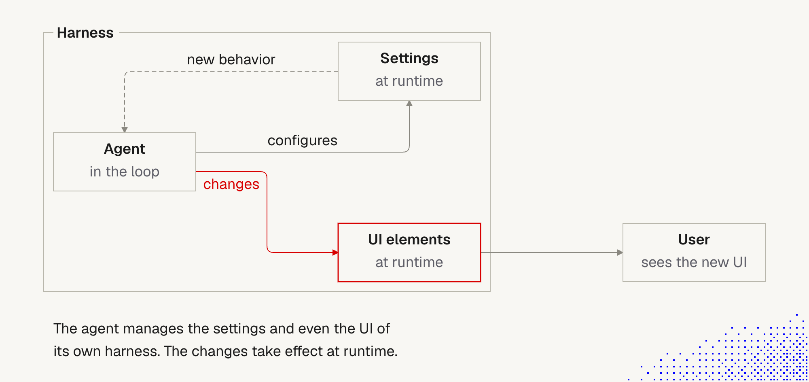
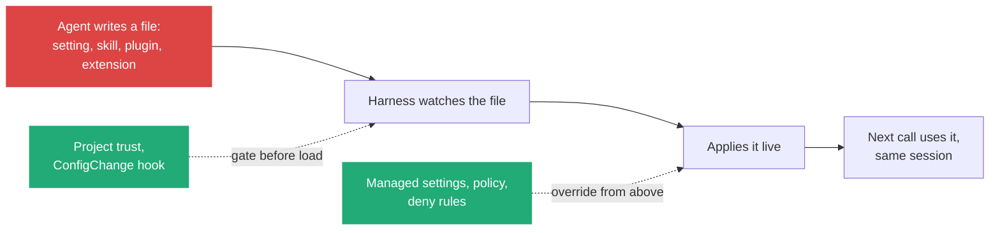

# 23. A self-configuring harness lets the agent change its own settings, tools and UI, so the guard must sit outside what the agent can edit

> Claude Code, OpenCode and Pi load settings, skills, plugins or extensions from files they watch, so an agent can change itself within a session; the documented guards decide who may override and what loads, not whether the agent may edit and reload itself, so for my platform the guard is a design I own.

Related: [17 Extend, adjust or leave the framework](17_Extend_Adjust_Or_Leave_The_Framework.md) · [19 Pi, LangGraph and the DeepSeek paper](19_Pi_LangGraph_DeepSeek_Harnesses.md) · [20 Loop hooks declared](20_Loop_Hooks_Declared.md) · [04 HITL and execution isolation](04_HITL_And_Execution_Isolation.md) · [07 Tools: awareness, discovery, gateway](07_Context_Tool_Awareness_Avoids_Compression.md) · [12 Audit ledger](12_Memory_Audit_Ledger_In_Memory_Or_State.md) · [05 Instructions](05_Instructions_Five_Parts_And_Enforcement.md) · [Lecture 1: 16 Self-management](../Lecture_1_Mechanics_Behind_Generative_AI/16_self_management.md) · [26 Agent-made packages](26_Packages.md) · [W2L2 07 Workflows on the fly](../Week2_Lecture_2_Building_an_Agent/07_Workflows_On_The_Fly_And_Todo_Lists.md) · [W2L3 12 Harness review loop](../Week2_Lecture_3_MCP_MCP+Resources_Skills/12_Self_Evolution_Of_Harness_On_Event.md)

Source: S02E01 article, "Configuration" (figure 9). [OpenCode Reloaded](https://anoma.ly/notes/opencode-reloaded/) (read in part: the page was cut after its "Reloading" section), OpenCode, Claude Code and Pi docs, and the arXiv paper 2608.25512 (sections 5.2.2 and 6.3, PDF text read locally), all on 2026-11-15. See [Fact-check](#fact-check).

## Glossary

| Term | What it means here | Same thing elsewhere | Not to be confused with |
|---|---|---|---|
| Self-configuration | The agent changes its own settings, tools, skills or UI during a session | Lecture: "configure themselves" | The user editing a config file |
| Hot reload | A changed file takes effect without restarting the session | Claude Code settings watcher, OpenCode watched dirs, Pi `/reload` | A restart |
| Managed settings | Settings from an administrator that users and projects cannot override | Claude Code managed settings, OpenCode managed config and policies | Project settings |
| Project trust | A gate on loading project-local code and config | Pi `project_trust` | A sandbox |
| Capability | A dependency a component declares and may use | Paper: `inject` declaration | Ambient authority |
| Revertible effect | An action paired with its inverse, so removal undoes it | Paper: temporal composability | A backup |

## 1. The problem

The lecture says harnesses such as Claude Code can configure themselves, and that AI-native apps push it further: settings and even UI elements managed at runtime (OpenCode, the DeepSeek paper, "everything is a plugin"). **What can each harness really change, what stops the agent changing the wrong thing, and what do I need for my platform?**

## 2. What the lecture's examples say

Source: S02E01 article, figure 9. Caption: "The agent manages the settings and even the UI of its own harness. The changes take effect at runtime."

Important: two paths. Settings loop back to the agent as new behavior. The UI path, in red, ends at the user: no arrow returns to the agent, so in this picture the agent does not see what the user sees (my reading). Not important: box positions and the corner pattern.

- **OpenCode Reloaded** (author's note): OpenCode "can edit its config, connect an MCP server, or write a plugin", with changes taking effect "across every session", and the agent can make a tool and use it in the same turn. Its demo changes tools and skills. I found no readable example of the agent changing its own UI.
- **The DeepSeek paper** is not an agent harness paper, see [19](19_Pi_LangGraph_DeepSeek_Harnesses.md). Its relevance is the mechanism: components can be removed with their effects reverted.

## 3. What each harness lets the agent change

| Item | Claude Code | OpenCode | Pi |
|---|---|---|---|
| Settings | Files are watched and "most edits" apply without restart. Some keys are read only at start. `/config` saves options | `opencode.json(c)`, "You can also ask OpenCode to update this file for you". `PATCH /config` on the server | `/reload` enables newly added default tools. Agent editing settings: not found |
| Tools and code | Skill files picked up live, a new top-level skills directory needs `/reload-skills`. Subagent files detected within seconds. Hooks live in settings | Plugins in `.opencode/plugins/`, tools in `.opencode/tools/`, MCP added with `POST /mcp`, watched dirs reload automatically | "Pi can create extensions. Ask it to build one", `/reload` hot-reloads auto-discovered ones |
| UI | Not documented as agent-changeable | The TUI is a client of a server and `/tui` endpoints drive it. Desktop plugins can add panels and commands | Extensions can add TUI components |

## 4. What the documented guards cover

| Source | Guard | What it limits |
|---|---|---|
| Claude Code | Managed settings have top precedence and "nothing in your own settings files overrides a managed key". "Permission rules are enforced by Claude Code, not by the model". Deny rules block in every mode | Overrides and tool calls |
| Claude Code | `ConfigChange` fires on direct edits to settings files. It can block a change except for policy settings (summary only) | A change at the point of load |
| OpenCode | Managed settings highest. Policies can block an MCP server, skill or plugin. Two built-in plugins ignore removals so a repository cannot switch enforcement off | What a project can add or remove |
| Pi | Project-local extensions load only after trust. Extensions run with full OS permissions. "Project trust ... does not sandbox tool calls" | What loads, not what runs |
| Paper | A component can use only declared dependencies, so an orchestrator can review them at load time. Untrusted code needs an external sandbox | Capabilities per component |

No page I read says the agent's own edit-and-reload of its configuration needs approval. OpenCode's permission and policy guides returned 404, and Claude Code's protected-path table came from a summary. The absence is therefore "not found", not "does not exist".

## 5. What I would design (my reasoning)

| Change class | Examples | Approval | Undo | Stored in |
|---|---|---|---|---|
| Content | Prompt sections, skill text | Diff review, or none for my own agent | Version history | Versioned files |
| Capability | Tools, MCP servers, plugins | Declared capabilities reviewed before load, run in a sandbox | Remove the component and revert its effects | Registry I control |
| Policy | Permissions, limits, credentials, deadlines | Never agent-editable | Harness only | Harness-only state, [04](04_HITL_And_Execution_Isolation.md) |

Every self-change is an entry in the ledger ([12](12_Memory_Audit_Ledger_In_Memory_Or_State.md)), scoped to one tenant. The unit of rollback is the open design choice.

## Summary

The three harnesses make self-change cheap: write a file, it reloads. Their documented guards limit overrides and loading, not the agent's own edits. I classify changes by blast radius, review capabilities before load, keep policy out of the agent's reach and record every change with a way back.

## Open questions

- What does self-configuration mean on my platform: agent prompt, enabled tools, skills, or all three?
- What is the unit of rollback: a file version, a component, or a ledger entry?
- Who approves a capability change when no human is in the session?

## Fact-check

| # | Claim | Verdict | Source | Checked |
|---|---|---|---|---|
| 1 | Claude Code can configure itself | **Agrees** in part | [Settings](https://code.claude.com/docs/en/settings): watched files, live reload, `/config` saves. No page says Claude edits its own settings or that such edits need approval: not found | 2026-11-15 |
| 2 | OpenCode can edit its config, add MCP and write plugins, effective at once | **Agrees**, mostly author | [OpenCode Reloaded](https://anoma.ly/notes/opencode-reloaded/) partly read. Vendor: [config](https://opencode.ai/docs/config/), [plugins](https://opencode.ai/docs/plugins/), [server](https://opencode.ai/docs/server/). Several pages carry a V1 banner. The note's demo is labelled OpenCode 2 | 2026-11-15 |
| 3 | OpenCode's TUI can be driven through an API | **Agrees** | [Server docs](https://opencode.ai/docs/server/): `/tui` endpoints | 2026-11-15 |
| 4 | "Everything is a plugin" for OpenCode | **Agrees** in part | The author says its environment is "assembled by plugins". The phrase is not in the vendor docs | 2026-11-15 |
| 5 | The DeepSeek paper follows self-evolving software and "everything is a plugin" | **Differs** | A composability paper. Self-evolving harnesses are future work ([arXiv](https://arxiv.org/abs/2608.25512), sections 1.2.2, 6.3) | 2026-11-15 |
| 6 | Pi can write its own extensions and reload them | **Agrees** | [Extensions](https://docs.pi.dev/latest/extensions.md): "Pi can create extensions", `/reload`. Reload rules while the agent runs: summary only | 2026-11-15 |
| 7 | Permission rules are enforced by the harness, not the model | **Agrees** | [Permissions](https://code.claude.com/docs/en/permissions), verbatim | 2026-11-15 |
| 8 | Documented guards cover overrides and loading, not the agent's own edits | **Unverified**, by absence | Pages partly read, OpenCode permission guides 404. Verify before presenting | 2026-11-15 |
| 9 | Capability declarations let an orchestrator review access before load | **Agrees** | Paper section 6.3, verbatim | 2026-11-15 |

## Sources

- S02E01 article, "Configuration". [OpenCode Reloaded](https://anoma.ly/notes/opencode-reloaded/) · [OpenCode docs](https://opencode.ai/docs/)
- [Claude Code settings](https://code.claude.com/docs/en/settings) · [permissions](https://code.claude.com/docs/en/permissions) · [hooks](https://code.claude.com/docs/en/hooks) · [skills](https://code.claude.com/docs/en/skills)
- [Pi docs](https://docs.pi.dev/latest) · [arXiv 2608.25512](https://arxiv.org/abs/2608.25512)
- My own reasoning: the change classes and the ledger link in section 5.
