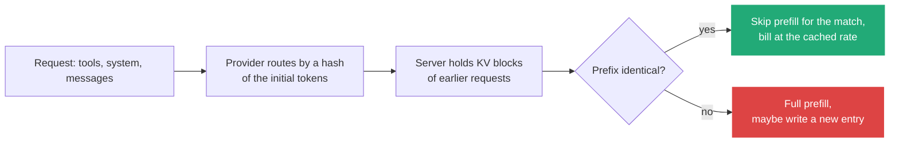

# 24. Prompt caching reuses the KV state of an identical prefix: I put static content first and mark where the cache may end

> The model stores key-value tensors for tokens it has already processed, and providers reuse them for a request that starts with the same prefix, so I put tools and instructions first, volatile data last, mark a cache point with Anthropic's `cache_control` or OpenAI's `prompt_cache_key` and breakpoints, never edit what comes before it, and check the usage fields.

Related: [06 Context window and compaction](06_Context_Window_And_Compaction.md) · [05 Instructions](05_Instructions_Five_Parts_And_Enforcement.md) · [07 Tools: awareness, discovery, gateway](07_Context_Tool_Awareness_Avoids_Compression.md) · [21 AI SDK or official SDKs](21_AI_SDK_Or_Official_SDKs.md) · [04 HITL and execution isolation](04_HITL_And_Execution_Isolation.md) · [Lecture 2: 4 Context window](../Lecture_2_Context_Agents_md_Skills_Tools/4_context_window.md)

Source: S02E01 article, "Agentic Loop" (Context): the prefix-based cache "only if the existing context stays the same". OpenAI's prompt caching guide and pricing page, Anthropic's prompt caching documentation (read in full) and vLLM's prefix caching pages, read through fetch agents on 2026-11-15. Numbers change often: see [Fact-check](#fact-check).

## Glossary

| Term | What it means here | Same thing elsewhere | Not to be confused with |
|---|---|---|---|
| KV cache | The attention key and value tensors of tokens a model already processed, kept so they are not recomputed | OpenAI: "stores key-value (KV) tensors, not the tokens" | A response cache |
| Prefill | The phase that processes the input prompt before the first output token | vLLM: caching reduces prefilling only | Decoding |
| Prefix caching | Reusing the KV state of a request that starts with the same tokens | vLLM automatic prefix caching, OpenAI and Anthropic prompt caching | Caching the answer |
| Cache breakpoint | A marked place where the cached prefix may end | Anthropic `cache_control`, OpenAI `prompt_cache_breakpoint` | A message boundary |
| TTL | How long an entry lives after its last use | Anthropic 5 min or 1 h, OpenAI 30 min or 12 h | A retention policy |
| Cache write / read | The request that stores the prefix / a later request that reuses it | Usage fields below | Output tokens |
| Cache key | A routing hint that groups requests with a shared prefix | OpenAI `prompt_cache_key` | A security boundary |

## 1. The problem

Every call resends the whole context. The provider can skip recomputing the front of it, if the bytes match. **What is cached, which attribute turns it on, and what do I put where so it keeps hitting?** The context-size side is in [06](06_Context_Window_And_Compaction.md).

## 2. Three layers



- **Model level:** the KV tensors. vLLM's automatic prefix caching reuses them for a new query that shares a prefix, and "only reduces the time of processing the queries (the prefilling phase)". It hashes per full KV block, and a per-request `cache_salt` keeps tenants apart.
- **Provider level:** OpenAI "Prompt caching is enabled by default", matches the "entire rendered prefix" and routes by "a hash of the initial tokens". Anthropic adds an explicit attribute.
- **My level:** the order and stability of what I send.

## 3. The controls

| | Anthropic | OpenAI |
|---|---|---|
| Turn on | Top-level `cache_control: {type: "ephemeral"}` (automatic) or `cache_control` on a block (explicit) | Automatic. GPT-5.6 and later: `prompt_cache_options` with `mode` implicit or explicit |
| Breakpoints | Up to 4. Prefix order tools, system, messages. Lookback 20 blocks | `prompt_cache_breakpoint` on a content block, up to 4 cache writes |
| Lifetime | 5 min default, `ttl: "1h"`. Reads refresh it | `ttl` 30m default or 12h (GPT-5.6+). Earlier: `prompt_cache_retention` in_memory or 24h |
| Routing | None | `prompt_cache_key`, about 15 requests per minute per key. `prewarm: true` writes without output |
| Minimum prefix | 512 to 4,096 tokens by model | 1,024 visible input tokens (GPT-5.6+) |
| Prices | Write 1.25x (5 min) or 2x (1 h), read 0.1x, some models 0.05x or 0.025x | Write 1.25x (30m) or 2.5x (12h), read 0.1x, some 0.05x |
| Check a hit | `cache_read_input_tokens`, `cache_creation_input_tokens`, per-TTL `cache_creation` | `usage.input_tokens_details.cached_tokens`, `cache_write_tokens` |

```json
{ "model": "...", "cache_control": { "type": "ephemeral" }, "system": "static instructions", "messages": [ ... ] }
```

```json
{ "model": "...", "prompt_cache_key": "tenant-42", "prompt_cache_options": { "mode": "implicit", "ttl": "30m" }, "input": [ ... ] }
```

## 4. What I cache and how

1. **Order:** tools, then instructions, then shared reference material, then conversation, then volatile data last. Both vendors say stable content first.
2. **Multi-turn:** start with Anthropic's automatic caching, the breakpoint moves to the last block each turn. With explicit breakpoints put one on the last block that stays identical.
3. **Append, never rewrite:** OpenAI says compaction or summarization "can change the prefix and reset cache reuse". A change at position N invalidates everything after N ([06](06_Context_Window_And_Compaction.md)).
4. **Tools stay fixed:** edit a tool definition and the whole Anthropic cache is lost. OpenAI offers `allowed_tools`, `tool_choice: "none"` and `defer_loading` to change what is callable without changing the list.
5. **Settings stay fixed:** `reasoning.effort`, `text.verbosity`, `text.format` and `parallel_tool_calls` change the OpenAI prefix. On GPT-6 and later a `configuration_update` input item changes effort. On Anthropic effort and thinking changes are model-specific.
6. **Parallel first call:** an Anthropic entry exists only after the first response starts, so wait before fanning out.
7. **Volatile last:** a timestamp in the system prompt gives zero hits.

```text
bad:  system = "You are X. Current time: 2026-11-15T10:42:07Z. ..."   -> new bytes each call
good: system = "You are X. ..."   user = "[time: 2026-11-15T10:42:07Z] ..."
```

## 5. What breaks it

| Change | Anthropic | OpenAI |
|---|---|---|
| Edit a tool definition | Everything lost | Prefix changes |
| Change `tool_choice` | System and messages lost | Not listed as a breaker |
| Add or remove images | System and messages lost | Prefix changes |
| Toggle web search or citations | Tools cache lost | n/a |
| Thinking, effort | Model-specific | `reasoning.effort` changes it |
| Compaction or summarization | Rewrites messages | `context_management` and compaction reset reuse |
| Below the minimum length | Silently not cached | Not cached |
| Non-deterministic JSON key order in tool inputs | Breaks it (Swift, Go named) | n/a |

## 6. Cost and privacy

- **Arithmetic:** a 5-minute write at 1.25x plus one read at 0.1x costs 1.35x for two requests against 2x uncached. The OpenAI page gives the same 1.35x example for 30m. Longer TTL writes cost 2x or 2.5x, so they need more reuse.
- **Isolation:** caches are isolated between organizations. Anthropic isolates by workspace on its own API. OpenAI stores "encrypted key/value tensors in GPU-local storage" and does not share across organizations or regions. Both are zero-data-retention eligible. Neither has manual clearing.
- **Multi-tenant:** use a `prompt_cache_key` per tenant on OpenAI. The key is routing, not security.
- **Through the AI SDK:** `cacheControl` goes in `providerOptions` ([21](21_AI_SDK_Or_Official_SDKs.md)).

## Summary

The cache saves prefill for an identical prefix. I order content static first, mark the cache point with the provider's attribute, keep tools and settings fixed, append instead of rewriting, and read the usage fields to confirm hits.

## Open questions

- Which of my settings changes mid-session invalidate which layer on my provider?
- At my thread length, does compaction cost more in lost discount than it saves in tokens?

## Fact-check

| # | Claim | Verdict | Source | Checked |
|---|---|---|---|---|
| 1 | The cache saves cost and latency only if the prefix stays the same | **Agrees** | [OpenAI](https://developers.openai.com/api/docs/guides/prompt-caching): "Cache reuse requires the entire rendered prefix to match" (about 70% verbatim). [Anthropic](https://platform.claude.com/docs/en/build-with-claude/prompt-caching), read in full | 2026-11-15 |
| 2 | The KV cache stores tensors, not tokens | **Agrees** | OpenAI guide. vLLM pages do not define "KV cache" in one sentence: not found | 2026-11-15 |
| 3 | Anthropic: up to 4 breakpoints, order tools, system, messages, lookback 20 | **Agrees** | Anthropic page, verbatim | 2026-11-15 |
| 4 | OpenAI `prompt_cache_options`, `prompt_cache_breakpoint`, `ttl` 30m or 12h | **Agrees**, partly summary | OpenAI guide, the last 30% came as a summary. Default of `mode` not found | 2026-11-15 |
| 5 | Prices and minimum lengths as in section 3 | **Unverified for durability** | Vendor pages and [OpenAI pricing](https://developers.openai.com/api/docs/pricing) on the check date. They change often | 2026-11-15 |
| 6 | Caches are isolated and ZDR eligible | **Agrees** | Anthropic isolation and ZDR text, verbatim. OpenAI ZDR statement: summary only | 2026-11-15 |
| 7 | vLLM APC reduces only the prefill phase | **Agrees** | [vLLM APC](https://docs.vllm.ai/en/latest/features/automatic_prefix_caching/), dated 2026-11-12 | 2026-11-15 |

## Sources

- S02E01 article, "Agentic Loop" (Context).
- [OpenAI prompt caching](https://developers.openai.com/api/docs/guides/prompt-caching) · [OpenAI pricing](https://developers.openai.com/api/docs/pricing) · [Anthropic prompt caching](https://platform.claude.com/docs/en/build-with-claude/prompt-caching)
- [vLLM automatic prefix caching](https://docs.vllm.ai/en/latest/features/automatic_prefix_caching/) · [vLLM design](https://docs.vllm.ai/en/latest/design/prefix_caching/)
- My own reasoning: the numbered recipe and the 1.35x arithmetic.
